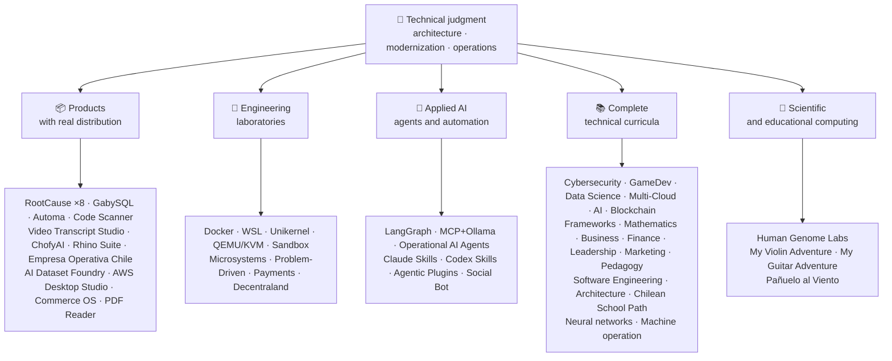

<!-- Synced from the public GitHub profile on 2026-10-16. -->

<div align="center">

# 👋Wladimir Acuña

## **Lösungsarchitekt·Senior Full-Stack·Digitale Transformation·Management & Operations**

**Professionell ausgebildet in Informatik und Computing Engineering und Business Administration, mit 16+ Jahren Bau und Betrieb von Software in realen Umgebungen. Ich verbinde Unternehmen, Mitarbeiter, Prozesse und Technologien, um Lösungen mit technischem Urteilsvermögen und einer operativen Sichtweise zu entwerfen, zu bewerten, zu liefern und zu erhalten - unterstützt durch überprüfbare Beweise in diesem GitHub-Konto.**

[](https://vladimiracunadev-create.github.io/)
[](https://www.linkedin.com/in/vladimir-acu%C3%B1a-valdebenito-11924a29/)
[](mailto:vladimir.acuna.dev@gmail.com)

[](#berufsumfang)
[](#produkte-mit-realer-distribution)
[](#komplette-technische-lehrpläne)

<!-- STATS:START -->
[](https://github.com/vladimiracunadev-create?tab=repositories)
[](https://github.com/vladimiracunadev-create?tab=repositories)
[](#ökosystem-auf-einen-blick)
[](#komplette-technische-lehrpläne)
[](https://github.com/vladimiracunadev-create?tab=repositories)
<!-- STATS:END -->

[](https://github.com/vladimiracunadev-create?tab=repositories)
[](https://github.com/vladimiracunadev-create?tab=followers)

[🌐 Portfolio (22 languages)](https://vladimiracunadev-create.github.io/) ·
[🧩 Ecosystem](#ökosystem-auf-einen-blick) ·
[⚡ Evaluate me in 10 minutes](#wenn-sie-10-minuten-zeit-haben-mich-zu-bewerten) ·
[✅ Professional scope](#berufsumfang) ·
[🧭 Non-coding management](#management-administration-und-non-coding-karrieremöglichkeiten) ·
[📋 Role matrix](PROFESIONAL_ROLES.md) ·
[📬 Contact](#kontakt)

**🌐 Vollständige Versionen:** [Español](README.md) · [English](README.en.md) · [Português](README.pt.md) · [Italiano](README.it.md) · [Français](README.fr.md) · [简体中文](README.zh.md) · [繁體中文](README.zh-TW.md) · [日本語](README.ja.md) · [한국어](README.ko.md) · [Türkçe](README.tr.md) · [Русский](README.ru.md) · [Tiếng Việt](README.vi.md) · [ไทย](README.th.md) · [Deutsch](README.de.md) · [Українська](README.uk.md) · [Polski](README.pl.md) · [العربية](README.ar.md) · [فارسی](README.fa.md) · [Bahasa Indonesia](README.id.md) · [Nederlands](README.nl.md) · [हिन्दी](README.hi.md) · [Ελληνικά](README.el.md)

**Technischer Kern:**
PHP 8 · Python · Rust · Go · Node/TS · Java 21 · .NET 8 · Dart/Flutter · WASM
· AWS · Terraform · Kubernetes · Docker · n8n · LangGraph/MCP · CI/CD · FinOps · Observability

**Unternehmens-Technologie-Brücke:**
Prozess- und Anforderungsanalyse·Lösungsbewertung·Lieferkoordinierung·Betrieb und Kontinuität·Risikomanagement·Produkt und Dienstleistung·technische Ausbildung

</div>

---

> [!NOTE]
> Dieses Profil macht aus Chancen keine Erfahrung. Bewährte technische Erfahrungen, übertragbare Fähigkeiten, tragfähige Anwendungen und zukünftige Entwicklungsziele werden explizit voneinander getrennt. Verknüpfte GitHub-Beweise sind ausführbar oder dokumentarisch; wo etwas ist**nicht**fertig, wird es als solches angegeben.

## 🎯Was Sie hier finden werden

Dies ist kein „One Repo: Es ist ein Ökosystem mit gemeinsamen Standards.

- 🔁 **Reproduzierbare Demos**Klonen, Laufen, Validieren.
- 🧰 **Standardisierte Werkzeuge**— Makefiles, Hub CLI,`doctor`, und`smoke`pro Repository.
- 🛡️ **Verteidigung in der Tiefe**- geheimes Scannen, Richtlinien und ausdrücklich verbotene Praktiken.
- 📈 **Beobachtung** — `/health`, `/ready`, `/metrics`Dashboards und Rückverfolgbarkeit.
- 📚 **Audienzbewusste Dokumentation**- Recruiter, Anfänger, DevOps oder Sicherheit, abhängig vom Repository.
- 📦 **Verteilung der Erzeugnisse**- herunterladbare Releases, Checksummen und Build-Beweise; kommerzielle / Store-Signaturen, die als anhängig erklärt wurden, wenn anwendbar.
- 🌍 **Internationalisierung**— Portfolio in 22 Sprachen (ES)·EN·PT·IT·F·ZH.
- 🧭 **Technische Ehrlichkeit**Jeder Fall gekennzeichnet`OPERATIONAL`, `DOCUMENTED/SCAFFOLD`, oder`PLANNED`.

## ✅Nachprüfbarer Status

| Oberfläche | Konkrete Beweise |
|---|---|
| 🧪 **Testabdeckung** | GabySQL**828 Prüfungen**+ Fuzzing over**503,8 Mio. Abfragen**(0 Paniken)·Empresa Operativa Chile**158 Prüfungen** ·Automa**150 pytest** ·Mehrfach-OS-KI |
| 🤖 **Mittel zur Herstellung** | LangGraph RealWorld**25/25 operative Backends**(Fälle 01-25, 100% Abdeckung)·Operationelle KI-Agenten**13 Agenten**mit**39 deterministische Evals** |
| 🔗 **Polyglotte** | **20 Fälle**Sender → n8n → Empfänger —**19 Einsatzkräfte**, einzeln mit Docker auditiert -· **18+ DB-Motoren** · **20+ Container** ·11 Muster |
| 📦 **Verteilung** | **151 Releases**In einem Ökosystem von**64 im Eigentum stehende öffentliche Datenspeicher** ·Installateure und Artefakte`.exe` · `.msi` · `.dmg` · `.apk`mit Prüfsummen und Baunachweisen; ggf. laufende Signaturen von Geschäfts-/Ladengeschäften |
| 🛡️ **Lieferkette** | CodeQL·Semgrep·Bandit·Triviolett·Grype·Gitleaks·TrüffelHog·CycloneDX SBOM·Scorecard |
| 📚 **Curricula** | **14.530 Klassen**über 21 Programme nachprüfbar, gezählt nach[a workflow](.github/workflows/stats.yml)aus einer realen Repository-Struktur oder einer überprüfbaren Quelle, die im Repository deklariert ist – nicht von Hand geschrieben –·Jedes Programm erklärt seinen redaktionellen Status und seine Einschränkungen |
| 🌐 **Portfolio** | Installierbare PWA· **22 Sprachen** · **154 PDFs**erzeugt durch Pipeline·CV Daten-API·Kondensator Android·Lighthouse 100 |
| 🔒 **Telemetrie** | Null Telemetrie in forensischen Produkten und Empresa Operativa Chile - in jedem Build verifiziert (kein Android)`INTERNET`Erlaubnis |
| 🌐 **Veröffentlichte Websites** | **56 GitHub Seiten**55 Landungen, eine pro Produkt, Programm oder Ökosystem-Navigator, plus das Portfolio - jede aus ihrem eigenen Repository bereitgestellt·alle 56 verifiziert mit HTTP`200` |

## 🗺️Ökosystem auf einen Blick



## 📦Produkte mit realer Distribution

Software, die heruntergeladen, installiert und verwendet wird – nicht nur geklont.

| Produkt | Was es ist | Stapel | Lieferung |
|---|---|---|---|
| [🔍 **RootCause Windows**](https://github.com/vladimiracunadev-create/rootcause-windows-inspector) | Cybersecurity Forensik: Jede anomale Ressourcenverzerrung kann das erste Anzeichen einer Bedrohung sein. Erst diagnostizieren, später eingreifen | Rust🦀 ·ETW/WPR | **v0.19.0** · **16 Releases** · **5 Ausgaben**: GUI·Tragbar·CLI·PowerShell·VS-Code· [landing](https://vladimiracunadev-create.github.io/rootcause-windows-inspector/) |
| [📱 **RootCause Mobile**](https://github.com/vladimiracunadev-create/rootcause-mobile-inspector) | Das mobile Geschwister: ein forensischer Sensor, der jede App mit sich selbst vergleicht, Stalkerware kennzeichnet und erteilte Berechtigungen von nur angeforderten trennt | Flutter·Kotlin·Schnell | **v0.8.0** ·Nachprüfbare Android APK·5 Sprachen· **Nulltelemetrie** · [landing](https://vladimiracunadev-create.github.io/rootcause-mobile-inspector/) |
| [🍎 **RootCause macOS**](https://github.com/vladimiracunadev-create/rootcause-macos-inspector) | macOS Edition:`launchd`Persistenz, Gatekeeper, SIP, FileVault, XProtect, TCC-Berechtigungen, signierte Prozesse und Netzwerknachbarn - jede Oberfläche wird mit einem bekannten Gutzustand verglichen | Rust🦀 ·macOS 13+ | **v0.1.0** ·Erstes veröffentlichtes Release·Apache-2.0· [landing](https://vladimiracunadev-create.github.io/rootcause-macos-inspector/) |
| [🖥️ **RootCause Server**](https://github.com/vladimiracunadev-create/rootcause-server) | Die Server-Geschwister: korreliert, was kein einzelnes Protokoll zusammen sieht - exponierte Oberfläche, Zugriffsversuchs-Bursts, eine Sitzung, die derselben Adresse gewährt wird, kritische Dateiintegrität und Sensorstille - und verwandelt sie in einen umsetzbaren Satz | Rust🦀 ·Windows·Linux·macOS | **v0.2.0** · **18 Regeln**Mit Beweisen und Runbook·Niemals Aktionen alleine ausführen·Lokale Konsole ohne Webabhängigkeiten· **noch keine Veröffentlichung veröffentlicht** · [landing](https://vladimiracunadev-create.github.io/rootcause-server/) |
| [🌐 **RootCause Web**](https://github.com/vladimiracunadev-create/rootcause-web-inspector) | Browser forensischer Sensor: Cookies, E-Mail-Sitzungen, Erweiterungen, Downloads, Berechtigungen und Seiten, die ein echtes Fenster imitieren | JavaScript·MV3 Erweiterung | **v0.2.0** ·noch keine Veröffentlichung veröffentlicht·Platte auf`127.0.0.1` ·Nullabhängigkeiten·Nulltelemetrie überprüft in CI· [landing](https://vladimiracunadev-create.github.io/rootcause-web-inspector/) |
| [₿ **RootCause Bitcoin Defense**](https://github.com/vladimiracunadev-create/rootcause-bitcoin-defense) | Watch-only defense for Bitcoin custody: inventories the origin of each key, cross-checks it with published warnings, and explains root cause with evidence | JavaScript · Windows app · local panel | **v0.3.0** · **2 releases** · zero dependencies · never asks for seeds · verified in CI · [landing](https://vladimiracunadev-create.github.io/rootcause-bitcoin-defense/) |
| [⛓️ **RootCause Blockchain Security**](https://github.com/vladimiracunadev-create/rootcause-blockchain-security) | Multi-chain watch-only console: inventories contracts, proxies, oracles, bridges, governance, and dependencies, and generates root-cause runbooks | JavaScript · Windows app · local panel | **v0.3.0** in the repository · published release: `v0.1.0` · zero dependencies · never asks for private keys · verified in CI · [landing](https://vladimiracunadev-create.github.io/rootcause-blockchain-security/) |
| [📷 **RootCause QR Inspector**](https://github.com/vladimiracunadev-create/rootcause-qr-inspector) | Lokale Android-App zur Überprüfung von QR-Codes vor dem Handeln: Erklärt 26 Signale, trennt Fakten von Hypothesen und exportiert redaktionelle Beweise | Flutter·Dart | **v0.1.4** · **5 Veröffentlichungen** · **107 Tests** ·veröffentlicht Android APK·Nachprüfbar SHA-256·technische APK Paketsignatur; kommerzielle / Ladensignaturen in Arbeit·Nulltelemetrie· [landing](https://vladimiracunadev-create.github.io/rootcause-qr-inspector/) |
| [🏢 **Empresa Operativa Chile**](https://github.com/vladimiracunadev-create/empresa-operativa-chile) | Führt eine SpA von vor der Gründung zu jedem monatlichen Abschluss: Einbeziehung mit Beweisen, Umsatzsteuervortrag, F29-Entwurf, unveränderlicher Abschluss und Audit-Log. Jede Regel weist auf ihre offizielle Quelle hin | JavaScript·Rust·PWA | **v1.5.0** ·Android·Windows·Browser· **158 Prüfungen** · **0 Produktionsabhängigkeiten** ·Nulltelemetrie· [landing](https://vladimiracunadev-create.github.io/empresa-operativa-chile/) |
| [🔍 **Universal Code Scanner**](https://github.com/vladimiracunadev-create/universal-code-scanner) | QR und Barcode-Leser, die**Dolmetschen vor Handeln**: 16 lokale URL-Risikosignale und explizite Bestätigung | Flutter·Dart | **v1.1.0** ·Android·iOS·macOS·PWA·verschlüsselte Geschichte**AES-256-GCM** · [landing](https://vladimiracunadev-create.github.io/universal-code-scanner/) |
| [🗄️ **GabySQL**](https://github.com/vladimiracunadev-create/gabysql) | Eingebettete Datenbank: Single`.db`Datei, WAL, kostenbasierter Optimierer, HTTP/JSON API | Rust🦀 | Windows·macOS·Linux· [landing](https://vladimiracunadev-create.github.io/gabysql/) |
| [🤖 **Automa PC**](https://github.com/vladimiracunadev-create/automa-pc) | Lokaler Orchestrator: JSON fließt, die echte Fenster öffnen, mit dem DOM interagieren und Beweise hinterlassen | Python·Playwright·pywebview | **v0.3.0** · **27 Ströme** ·veröffentlicht und überprüfbar Installateur· [landing](https://vladimiracunadev-create.github.io/automa-pc/) |
| [🏭 **AI Dataset Foundry**](https://github.com/vladimiracunadev-create/ai-dataset-foundry) | Lokale erste Fabrik, die PDF, Word, Web, Git, JSON und CSV in überprüfbare Datensätze für Vorschulungen, Feinabstimmung, RAG und Auswertung verwandelt | Python | **v0.2.0** ·Windows + Offline Android·Erstes veröffentlichtes Release· [landing](https://vladimiracunadev-create.github.io/ai-dataset-foundry/) |
| [☁️ **AWS Desktop Studio**](https://github.com/vladimiracunadev-create/aws-desktop-studio) | Lokale erste App mit 15 AWS-Inventarintegrationen, 20 Tutorials, CLI/SSO und Read-Only-Standards; Implementierung im Gange, nicht universeller Zugriff | JavaScript·Windows | **v0.1.1** ·Erstes veröffentlichtes Release· [landing](https://vladimiracunadev-create.github.io/aws-desktop-studio/) |
| [🧭 **Commerce OS**](https://github.com/vladimiracunadev-create/commerce-operating-system) | Geführte konzeptionelle Demo der kommerziellen Operationen: Katalog, Lager, CRM, Bestellungen, Scheinzahlungen und Rückverfolgbarkeit | JavaScript·Web-Web·Windows·Android | **v0.3.0** · **2 Freigaben** ·kein echtes Geld oder chilenische Steuerbehörde Integration· [landing](https://vladimiracunadev-create.github.io/commerce-operating-system/) |
| [📄 **PDF Reader**](https://github.com/vladimiracunadev-create/pdf-reader-windows-android) | Android-erster lokaler Lese-Lesegerät, mit No-Crop-Zoom, wiedereröffneter Historie, WhatsApp-Freigabe und Standardleserauswahl | HTML·Web-Web·Android·Windows | **v0.3.3** ·unterzeichnete APK·Keine Konten, sensible Berechtigungen oder Telemetrie· [landing](https://vladimiracunadev-create.github.io/pdf-reader-windows-android/) |
| [🎙️ **Video Transcript Studio**](https://github.com/vladimiracunadev-create/video-transcript-studio) | Ein Video, eine Playlist oder**Der gesamte YouTube-Kanal**Text mit Zeitstempeln. Es ist nicht auf bestehende Untertitel angewiesen: Whisper erkennt Audio**auf Ihrer Maschine**, ohne API, Konto oder Schlüssel zu konfigurieren | Python·PySide6·FastAPI·Schneller Flüstern | **v0.2.0** ·Windows Desktop + lokales Panel auf`127.0.0.1`+ CLI,**die gleiche Warteschlange teilen** ·MD·PDF·TXT·SRT·VTT·JSON·MP3·OGG· **89 Prüfungen** ·gebündelt FFmpeg·Nulltelemetrie· [landing](https://vladimiracunadev-create.github.io/video-transcript-studio/) |
| [🎨 **ChofyAI Studio**](https://github.com/vladimiracunadev-create/chofyai-studio) | Lokaler kreativer KI-Launcher: orchestriert Qwen3-TTS, whisper.cpp, FaceFusion, AceForge und ComfyUI | Tauri 2·Rust·Reaktion | v0.5.1· **5/5 Werkzeuge mit echter Inferenz** ·macOS Apple Silicon·Experimentelles Windows· **noch keine Veröffentlichung veröffentlicht** · [site](https://vladimiracunadev-create.github.io/chofyai-studio/) |
| [🦏 **Rhino Suite**](https://github.com/vladimiracunadev-create/rhino-suite) | Office-Suite von Grund auf neu: Dokumentregeln hängen nicht vom DOM ab - HTML ist nur eine Projektion | Rust/WASM·Go·Reaktionsreaktion 19 | Evolutionäre Monorepo nach Phasen· [landing](https://vladimiracunadev-create.github.io/rhino-suite/) |
| [🎻 **My Violin Adventure**](https://github.com/vladimiracunadev-create/violin-adventure) | Pädagogische App für Kinder: chromatischer Tuner, audio-clock-genaues Metronom, Lieder mit echter Violine | Tauri 2·Reaktion·SK | **v1.3.0** ·Windows·Android·Linux·macOS·PWA· [landing](https://vladimiracunadev-create.github.io/violin-adventure/) |
| [🎸 **My Guitar Adventure**](https://github.com/vladimiracunadev-create/guitarra-adventure) | Das gerupfte Geschwisterpaar: 24 Lektionen in 6 Welten, 6-saitiger Stimmer, driftfreies Metronom und 11 echte Gitarrennoten | Tauri 2·Reaktion·SK | **v1.0.0** ·Windows·Android·Linux·macOS·iOS·PWA·Keine Konten, Anzeigen oder Online-Abhängigkeit· [landing](https://vladimiracunadev-create.github.io/guitarra-adventure/) |
| [🧣 **Pañuelo al Viento**](https://github.com/vladimiracunadev-create/panuelo-al-viento-cueca-app) | Cueca ab 10 Jahren: 24 Klassen in 8 Stufen, 72 Aktivitäten, Sechs-Puls-Labor (3+3 und 2+2+2) und zugängliche Grunddiagramme. Es heißt, es**Ergänzungen, nicht Ersatz**Lehrer und Kulturträger | Flutter·Dart | **v0.2.0** ·Android 7+·Windows 10/11·APP·EXE·MSI·tragbares Gerät· **29 Prüfungen + 2 Validatoren** ·Keine Kamera, Mikrofon, Konto, Werbung oder Internet· [landing](https://vladimiracunadev-create.github.io/panuelo-al-viento-cueca-app/) |

## 🧪Technische Laboratorien

| Repo | Was es zeigt |
|---|---|
| [🐳 **Problem-Driven Systems Lab**](https://github.com/vladimiracunadev-create/problem-driven-systems-lab) | **20 echte Probleme**(Latenz unter Last, N+1, Retry-Stürme, Lecks, Monolithen, Cache-Stampede, Rückstau, Null-Downtime-Migration, vergessenes DLQ) mit hochtreuen injizierten Fehlern, gelöst in**7 Stapel**: PHP 8·Python·Node.js·Java 21·.NET 8· **Go 1.23** · **Rust 1,83** · [landing](https://vladimiracunadev-create.github.io/problem-driven-systems-lab/) |
| [📆 **Social Bot Scheduler**](https://github.com/vladimiracunadev-create/social-bot-scheduler) | **v4.10.0** · **20 Fälle**source→n8n→Empfänger über**18+ DB-Motoren** —**19 Einsatzkräfte**, einzeln mit Docker auditiert -**8-Schicht**Audit, idempotency guardrails, circuit breaker und DLQ· [landing](https://vladimiracunadev-create.github.io/social-bot-scheduler/) |
| [🧰 **Microsistemas**](https://github.com/vladimiracunadev-create/microsistemas) | **12 Diagnose- und Modernisierungs-Mikroapps**für PHP·Lokaler Read-Only-MCP-Server·Härtung in 3 Phasen· [landing](https://vladimiracunadev-create.github.io/microsistemas/) |
| [🧪 **Docker Labs**](https://github.com/vladimiracunadev-create/docker-labs) | **13 Laboratorien**auf einer 4-Service-Plattform + automatisiert`.exe`Installateur mit Launcher· [landing](https://vladimiracunadev-create.github.io/docker-labs/) |
| [🐳 **WSL Labs**](https://github.com/vladimiracunadev-create/wsl-labs) | **12 Fälle**am`wslc`, der native WSL-Containermotor —**Ohne Docker Desktop** · [landing](https://vladimiracunadev-create.github.io/wsl-labs/) |
| [⚡ **Unikernel Labs**](https://github.com/vladimiracunadev-create/unikernel-labs) | „Docker Desktop für Unikernels: Windows-Steuerung über Unikraft mit WSL2-Backend,`kraft`+ QEMU/KVM· [landing](https://vladimiracunadev-create.github.io/unikernel-labs/) |
| [🧰 **QEMU/KVM Labs**](https://github.com/vladimiracunadev-create/qemu-kvm-labs) | **12 Laboratorien**von realer Virtualisierung mit QEMU, KVM, libvirt, cloud-init und`vm-manager`Linux und WSL2· [landing](https://vladimiracunadev-create.github.io/qemu-kvm-labs/) |
| [🛡️ **Sandbox Labs**](https://github.com/vladimiracunadev-create/sandbox-labs) | Linux-Isolation: Ausführt Code, Dateien und Geschäftsmodelle von Drittanbietern unter deklarierten Richtlinien und**signierte Nachweise, welche Kontrollen tatsächlich durchgeführt wurden** · **36 Fälle**in zwei Familien — 15 technische und 21 Kapitalmärkte —·erklärt experimentell und lehrreich, *kein Sicherheitsprodukt*· [landing](https://vladimiracunadev-create.github.io/sandbox-labs/) |
| [💳 **Universal Payments Engineering Lab**](https://github.com/vladimiracunadev-create/universal-payments-engineering-lab) | **28 Zahlungsfamilien**in einer lokalen Demo zur Selbsterklärung: Staaten, Ledger, Versöhnung, Sicherheit und Umsetzungsleitfäden· [landing](https://vladimiracunadev-create.github.io/universal-payments-engineering-lab/) |
| [🕹️ **Decentraland Social Arcade**](https://github.com/vladimiracunadev-create/decentraland-social-arcade) | Natives dezentrales und soziales 3D-Erlebnis: ein MVP und eine Multi-Game-Architektur mit SDK7, ECS und TypeScript·Spanische Dokumentation·Keine Zahlungen oder Telemetrie |
| [☁️ **AWS Projects**](https://github.com/vladimiracunadev-create/proyectos-aws) | Progressive Fälle, in denen jeder einen AWS-Service hinzufügt**und**eine neue GitHub Actions-Fähigkeit·SAA-C03·DVA-C02·SOA-C02-Abdeckung |

## 🤖Angewandte KI

| Repo | Was es zeigt |
|---|---|
| [🤖 **LangGraph RealWorld**](https://github.com/vladimiracunadev-create/langgraph-realworld) | **25/25 operative Backends**— Typisierungszustand, bedingte Routen, NDJSON-Streaming, DEMO/LIVE-Modus, 8 Sicherheitsschichten, SHA-256-Verwahrkette |
| [🧭 **Operational AI Agents**](https://github.com/vladimiracunadev-create/operational-ai-agents) | **13 operative Agenten**für Claude Code und kompatible Laufzeiten: Jeder erhält eine vollständige Mission - Repository-Evolution, Legacy-Modernisierung, Curriculum-Design, Portfolio-Publishing, Sicherheitssanierung, Vorfallsanalyse - unter einem erklärten Vertrag, menschlichen Toren und überprüfbaren Beweisen· **39 deterministische Evals** ·34 Prüfungen·Null-Deps (nur Stdlib)·Linux·macOS·Windows· [site](https://vladimiracunadev-create.github.io/operational-ai-agents/) |
| [🧠 **MCP + Ollama Local**](https://github.com/vladimiracunadev-create/mcp-ollama-local) | Lokale erste KI mit MCP-Tools in einer Sandbox· `127.0.0.1`Bindung·Mehrschichtiges Vertrauensprofil·Ehrlich über seine Grenzen |
| [🧩 **Agentic Plugins Toolkit**](https://github.com/vladimiracunadev-create/agentic-plugins-toolkit) | **6 Agentic Plugins**Installierbar in Claude Code, OpenAI/Codex, Copilot, Gemini und MCP aus einer Hand:`repository-engineering`, `legacy-modernization`, `learning-program-studio`, `product-evolution`, `portfolio-governance`, und`rootcause-response` · **69 generierte Ansichten ohne Drift**-jede Laufzeit erhält ihr Format aus demselben Vertrag -·Null-Deps·Linux·macOS·Windows· [site](https://vladimiracunadev-create.github.io/agentic-plugins-toolkit/) |
| [🧰 **Claude Skills Toolkit**](https://github.com/vladimiracunadev-create/claude-skills-toolkit) | **15 Agentic Skills**für Claude Code· **Sicherheit**: 12-Schicht`security-audit`(OSV)·KV·EPSS·SAST·Behälter·Geheimnisse) und 14-stufige`bitcoin-custody-audit` · **Repo-Gates**: `pre-commit-guard`, `pre-push-guard`, `yaml-control`, `md-lint-fix`, `python-lint-guard` · **Kohärenz**: `repo-coherence-audit`, `version-bump`, `python-version-control`, `python-deps-pinning` · **Docker**: `docker-cleanup`, `docker-compose-doctor` · **docs**: `md-to-doc` ·Null-Deps·Plattformübergreifender |
| [🧰 **Codex Skills Toolkit**](https://github.com/vladimiracunadev-create/codex-skills-toolkit) | **19 Agentische Fähigkeiten**für Codex: Sicherheits- und Lieferkette, Preflight, Funktionsflüsse, Resilienz und Zustand, Release-Beweise, Python/YAML/Markdown-Gates, Versionierung, Abhängigkeiten, Docker und Dokumente·Python-first· `pnpm` ·Linux·macOS·Windows· [site](https://vladimiracunadev-create.github.io/codex-skills-toolkit/) |

## 📚Komplette technische Lehrpläne

Sequenzielle Programme in Spanisch, mit Status und Umfang, der von jedem Repository deklariert wird. Die 21 Programme addieren sich zu**14.530 Klassen**, gezählt nach[a workflow](.github/workflows/stats.yml)aus einer realen Repository-Struktur oder einer überprüfbaren Quelle, die im Repository deklariert ist; das Abzeichen wird wöchentlich aktualisiert und nicht von Hand geschrieben.

🧭 [**Lifelong Learning Ecosystem**](https://github.com/vladimiracunadev-create/lifelong-learning-ecosystem)ist ein föderierter Kompass, der 30 reale Pfade über 6 Bereiche durch visuelle Karten und eine[accessible offline portal](https://vladimiracunadev-create.github.io/lifelong-learning-ecosystem/); es wird nicht als zusätzliches Programm gezählt.

| Programm | Klassen | Anwendungsbereich |
|---|---:|---|
| [🔢 **Computational Mathematics**](https://github.com/vladimiracunadev-create/computational-mathematics-program) | 360 | Vom Zählen auf den Fingern bis zur Reproduktion eines Papiers· **360 deterministische Nachweise in CI verifiziert** ·1.080 Notebooks·489-Term-Glossar· [site](https://vladimiracunadev-create.github.io/computational-mathematics-program/) |
| [🏦 **Finance and Banking**](https://github.com/vladimiracunadev-create/finance-and-banking-evolution-program) | 356 | 534 h·Finanzmathematik und IFRS → Kredit, Risiko, Basel III, Open Finance, DLT, Stablecoins und MiCA· **27 Fälle** · **298 Prüfungen** · [site](https://vladimiracunadev-create.github.io/finance-and-banking-evolution-program/) |
| [🎮 **GameDev**](https://github.com/vladimiracunadev-create/modern-gamedev-program) | 352 | Mathematik und C#/C++/GDScript → Shader, AI, Multiplayer, VR/AR·Godot·Einheit·Unwirklich· **10 Godot-Labors in CI verifiziert**(301 Kontrollen)· [site](https://vladimiracunadev-create.github.io/modern-gamedev-program/) |
| [🛡️ **Cybersecurity**](https://github.com/vladimiracunadev-create/modern-cybersecurity-program) | 360 | **v1.3.0** ·20 Teile·foundations → Red Team, DFIR, Cloud Security, Exploit Dev, CTF und Game Security·kartographiert auf**7 Zertifizierungen** ·Offline-Android/Web-App·PDF Handbuch·CI, Sicherheit und Seiten verifiziert· [site](https://vladimiracunadev-create.github.io/modern-cybersecurity-program/) |
| [📈 **Marketing, Sales, and Growth**](https://github.com/vladimiracunadev-create/marketing-sales-growth-evolution-program) | 336 | 24 Teile mit operativen Definitionen, Messblättern, überprüfbarer Bibliographie und chilenischem regulatorischen Kontext· **v1.6.0** ·1.29M Wörter·17 Rollenbasierte Pfade· [site](https://vladimiracunadev-create.github.io/marketing-sales-growth-evolution-program/) |
| [🏢 **Business Creation**](https://github.com/vladimiracunadev-create/modern-business-creation-program) | 336 | Erstellen und betreiben Sie ein echtes Unternehmen in Chile: von der Idee über die Gründung, die Steuerbehörde, den Betrieb, die Krise und den Ausstieg·360 Diagramme·1.251-Term-Glossar·1.548-seitiges Handbuch· [site](https://vladimiracunadev-create.github.io/modern-business-creation-program/) |
| [🏛️ **Architecture and Built Environment**](https://github.com/vladimiracunadev-create/architecture-built-environment-learning-program) | 830 | 83 Teile·60 integrative Sitzungen·34 Wege·Rückverfolgbare Quellen·Markdown, Offline-Reader und GitHub Pages· [site](https://vladimiracunadev-create.github.io/architecture-built-environment-learning-program/) |
| [🇨🇱 **Chilean School Learning Path**](https://github.com/vladimiracunadev-create/chilean-school-learning-path) | 8,841 | Klassen 1–12· **4.156 integrierte lehrplanübergreifende Erfahrungen** · **2.823 Lernziele** ·MINEDUC-Quellen·Keine anhängigen Vorschläge und spezialisierte menschliche Überprüfung noch anhängig· [site](https://vladimiracunadev-create.github.io/chilean-school-learning-path/) |
| [🧭 **Modern Software Engineering**](https://github.com/vladimiracunadev-create/modern-software-engineering-program) | 480 | 40 Teile und 8 Bühnen·foundations → Produkt-, Architektur-, Sicherheits-, DevOps-, SRE-, SPEC-, AI- und Multiagentensysteme·Redaktioneller Status, der vom Repository erklärt wird· [site](https://vladimiracunadev-create.github.io/modern-software-engineering-program/) |
| [🎓 **Pedagogy and Learning Sciences**](https://github.com/vladimiracunadev-create/education-pedagogy-learning-sciences-program) | 300 | Von wie eine Person lernt, wie Lehrer ausgebildet werden·25 Teile· **Jede Klasse erklärt ihren Beweiszustand und ihre Grenzen** ·Frühe Alphabetisierung, vergleichende Methoden, spezifische Bildungsbedürfnisse, Koexistenz, kulturelle Vielfalt und internationale Evidenz·1.097-Term-Glossar, 325 Diagramme und eine 60-Aktivitäts-Klassenzimmerbank·14 Karrierewege nach Rolle·LMS exportierbar· **v2.1.0** · [site](https://vladimiracunadev-create.github.io/education-pedagogy-learning-sciences-program/) |
| [☁️ **Multi-Cloud**](https://github.com/vladimiracunadev-create/multi-cloud-engineering-program) | 288 | A. A.·Azure·GCP·Kubernets·Terraform·SRE·FinOps· **1.288 Stunden** ·288 Labore mit JSON-Beweis·1.032 nachverfolgte Quellen·2884 Seiten PDF Handbuch· [site](https://vladimiracunadev-create.github.io/multi-cloud-engineering-program/) |
| [🎖️ **Executive Leadership**](https://github.com/vladimiracunadev-create/executive-leadership-founder-program) | 288 | Vom Besitz Ihres ersten Ergebnisses bis hin zur Führung eines Unternehmens und der Gründung Ihres eigenen: Teams, KPI / OKR, Finanzen, Produkt, Risiko, Board und M & A·24 Fälle, 96 Labore und 39 Vorlagen· [site](https://vladimiracunadev-create.github.io/executive-leadership-founder-program/) |
| [🐍 **Python Data Science**](https://github.com/vladimiracunadev-create/python-data-science-program) | 232 | Polars, ML+Optuna/SHAP, PyTorch/LLMs/LoRA, MLOps·native Windows App + Android APK· [site](https://vladimiracunadev-create.github.io/python-data-science-program/) |
| [🧠 **AI Evolution**](https://github.com/vladimiracunadev-create/artificial-intelligence-evolution-program) | 184 | Symbolisch → probabilistisch → Deep Learning → LLMs, RAG, Agenten, Sicherheit und Grenze· **v0.17.0** · **708 Notebooks** · **148 Grundlagenpapiere** ·Offline-Windows, Android und PWA-Apps· [site](https://vladimiracunadev-create.github.io/artificial-intelligence-evolution-program/) |
| [🌐 **Comparative Programming**](https://github.com/vladimiracunadev-create/polyglot-programming-labs) | 176 | Ein Konzept,**10 Sprachen**geprüft in CI —**1.360 Implementierungen**— plus**1.632 Programme**in noch lebenden Sprachen (COBOL, Fortran, Ada, RPG, MUMPS...) und einem Atlas von**60 Karten in 15 Familien** ·v1.1.0· [site](https://vladimiracunadev-create.github.io/polyglot-programming-labs/) |
| [🧩 **Frameworks Compared**](https://github.com/vladimiracunadev-create/framework-ecosystems-labs) | 149 | Ein ausführbarer Vertrag, ohne Adapter, gegen Express, FastAPI, Spring Boot, ASP.NET, Django, Rails, Laravel, React, Vue, Svelte und mehr·12 Teile· **70 gebaute Klassen** · **397 Fälle überprüft in CI** · **210 ISBN/DOI-Quellen** · [site](https://vladimiracunadev-create.github.io/framework-ecosystems-labs/) |
| [🗄️ **Databases**](https://github.com/vladimiracunadev-create/database-systems-labs) | 74 | **v3.0.0** ·Datenbank-Engineering in 15 Teilen·230 Stunden· **die überprüfbare Quelle für jeden Anspruch**: 120 Quellen mit ISBN, DOI oder Standard·Der gleiche Fall wurde in 27 Motoren gelöst·306-Term-Glossar·150 pytest· [site](https://vladimiracunadev-create.github.io/database-systems-labs/) |
| [📐 **Psychometrics and Assessment**](https://github.com/vladimiracunadev-create/psychometrics-and-assessment-program) | 40 | Wie ein Messgerät gebaut, bewertet, validiert und auditiert wird·8 Teile·ausführbarer Motor mit**5 Instrumente und 344 Positionen, 276 Public-Domain** |
| [⛓️ **Blockchain**](https://github.com/vladimiracunadev-create/blockchain-learning-path) | 66 | **v0.14.0** ·Von null auf programmierbare Finanzinfrastruktur und On-Chain-Analyse· **91 Praktiken**und**363 Prüfungen** ·Verträge mit Foundry (Fuzzing und Invarianten) und Slither statische Analyse in CI·Offline-Apps verifiziert, indem sie die Binärdatei öffnen und deren Inhalt zählen· [site](https://vladimiracunadev-create.github.io/blockchain-learning-path/) |
| [🧠 **Neural Network Training Labs**](https://github.com/vladimiracunadev-create/neural-network-training-labs) | 31 | 7 Module·≈214 Stunden· **93 Notizbücher**31 Klassen, 31 Studentenversionen und 31 Lösungen -·Fragen, visuelle Karten, Praktiken und Bewertungen mit echten öffentlichen Daten·PyTorch· [study site](https://vladimiracunadev-create.github.io/neural-network-training-labs/) |
| [🕹️ **Machine Operator**](https://github.com/vladimiracunadev-create/machine-operator-program) | 451 | **41 Schulungsmodule**eine pro Maschine· **502 h 15 min** ·Systeme, Steuerungen, Physik, Sicherheit und Simulationsdesign mit Quellen pro Klasse·*noch kein ausführbarer Simulator, und es wird so deklariert* |

## 🔬Wissenschaftliche Datenverarbeitung

| Repo | Was es zeigt |
|---|---|
| [🧬 **Human Genome Labs**](https://github.com/vladimiracunadev-create/human-genome-labs) | Reproduzierbare Genomikplattform: typisiert`ScientificResult<T>`Verträge, FASTA/GFF3/VCF, Module mit**explizite Laufzeit und Nachweise**. Radikale Ehrlichkeit: *nicht klinische Diagnose*· [site](https://vladimiracunadev-create.github.io/human-genome-labs/) |

## ⚡Wenn Sie 10 Minuten Zeit haben, mich zu bewerten

Die Idee ist nicht nur, sich Code anzusehen: Es ist zu sehen**Wie ich denke**Wie ich dokumentiere und wie ich alles ausführbar mache.

**Route A — Reale Beobachtbarkeit und Orchestrierung***(Mein Favorit)*

```bash
git clone https://github.com/vladimiracunadev-create/social-bot-scheduler.git
```

Sie sehen Workflows, Metriken, Dashboards und Leitplanken in 19 Fällen und 18+ DB-Engines.

**Route B — Reproduzierbare Infrastruktur in Minuten**

```bash
git clone https://github.com/vladimiracunadev-create/docker-labs.git
```

**Route C — Agenten mit typisiertem Zustand**

```bash
git clone https://github.com/vladimiracunadev-create/langgraph-realworld.git
```

**Route D — Forensisches Produkt aus Rust, ohne Klonen**

Laden Sie das Installer oder CLI binary von[RootCause releases](https://github.com/vladimiracunadev-create/rootcause-windows-inspector/releases)und Überprüfung`SHA256SUMS`.

## 🧠Standards, die ich in allen Repositories anwende

- **DX zuerst**— wenn es nicht einfach zu laufen ist, ist es nicht nützlich als Demo oder als Teambasis.
- **Beobachtung ab Tag 1**— Metriken und Rückverfolgbarkeit, kein nachträglicher Einfall.
- **Sicherheit als Pipeline**— geheimes Scannen, SBOM pro Release, ausdrücklich verbotene Praktiken.
- **Echte Resilienz**- Idempotenz, Leistungsschalter und kontrollierte Degradation.
- **Polyglotte nach Design**Sprache und Motor, die nach Anwendungsfall, niemals nach Mode ausgewählt werden.
- **Ehrlichkeit über Status**Ein Repo wurde umbenannt ()`Multisimulador` → `machine-operator-program`) vielversprechende Software zu vermeiden, die noch nicht existiert.
- **Abzeichen sind Signale, keine Beweise**Jedes Repo erklärt auch**Was er nicht tut**.
- **Modell nach außen**- die Domäne wird zuerst entworfen; die Schnittstelle ist eine Projektion.
- **Externe Arbeit wird als extern deklariert**- von den 70 öffentlichen Repositories des Kontos sind 64 meine eigenen Arbeiten. Die anderen sechs –[`agentic-qe`](https://github.com/vladimiracunadev-create/agentic-qe), [`Anthropic-Cybersecurity-Skills`](https://github.com/vladimiracunadev-create/Anthropic-Cybersecurity-Skills), [`erpnext`](https://github.com/vladimiracunadev-create/erpnext), [`OpenExecutive`](https://github.com/vladimiracunadev-create/OpenExecutive), [`raptor`](https://github.com/vladimiracunadev-create/raptor), und[`security-audit-skill`](https://github.com/vladimiracunadev-create/security-audit-skill)— sind Gabeln und sind für meine eigene Arbeit von allen Figuren ausgeschlossen.

## ✅Berufsumfang

Mein dualer Hintergrund -**Informatik und Computing Engineering + Business Administration**— hilft mir, Geschäftsziele in technische Entscheidungen und technische Einschränkungen in klare Optionen für Betrieb, Produkt, Kunden und Führung zu übersetzen.

### 🎯Kernidentität

| Rolle | Rückhalt |
|---|---|
| **Lösungsarchitekt** | Modulares, skalierbares Systemdesign mit evolutionärem Urteil |
| **Legacy Modernisation Architekt** | Reale Legacy-Evolution (PHP 5.x → 8.x, inkrementelles Refactoring ohne Unterbrechung des Betriebs) |
| **Senior Full-Stack / Tech Lead** | Architektur, Ausführung und Standards auf realen Plattformen (+16 Jahre) |
| **AI Automation Architekt** | Agentische Systeme mit LangGraph/MCP und n8n fließt mit Leitplanken |

### ↗ Natürliche Erweiterung

**AI Orchestration Engineer** · **Systeme / Rust Engineer** · **Mobile Engineer (Flutter)** · **Solutions Engineer** · **Technischer Produktbauer** · **Technischer Trainer** · **Digital Transformation Berater** · **Business / Funktionaler Analyst** · **Technische Produktoperationen**

### ⚙️Ergänzender Anwendungsbereich

Plattformingenieur / IDP·DevOps / CI-CD·Cloud / AWS Engineer·Antrag SRE·Automatisierungsingenieur·Technischer Berater

## 🧭Management, Administration und Non-Coding Karrieremöglichkeiten

Dieser Umfang behauptet nicht, dass jeder Titel gehalten wurde. Es priorisiert Arbeit, bei der die Kombination von Computern, Betriebswirtschaft und öffentlichen Beweisen Wert schaffen kann, ohne dass die Kodierung die Kernaufgabe ist.

| Berufsfamilie | Anerkannte Rollen | Ehrliche Einstufung | Kodierung | Nachweise und Bedingung |
|---|---|---|---|---|
| **Technologieführerschaft** | Leiter der IT·IT Operations Manager·Digital Transformation Manager·CIO | **Anwendungspotential / Zukunftsziel** | Keine/gelegentlich | Starke technische Basis; Menschen, Budget, Anbieter und Führungsverantwortung müssen separat nachgewiesen werden |
| **Projektmanagement** | IT Projektkoordinator/Manager·PMO·Scrum Master·Agile Lieferung | **Übertragbares / Anwendungspotenzial** | Keine/gelegentlich | Liefer- und Freigabenachweise; formale Team-, Budget- und Sponsorenverantwortung bleibt eine Lücke |
| **Betriebswirtschaftslehre** | Geschäftsleitung·Verwaltungs-/Betriebsleiter·Vertragsverwalter | **Anwendungspotenzial** | Keine | Business-Grad und operative Artefakte; Bedürfnisse verifiziert Eigentum an Ressourcen, Menschen und Lieferanten |
| **Strategie und Wandel** | Strategieberater·Change Manager·Unternehmensplanung·Innovation / Transformation | **Übertragbares / Anwendungspotenzial** | Keine | Legacy-Modernisierung und Lösungsbewertung; Ergebnisse der organisatorischen Adoption müssen demonstriert werden |
| **Geschäftsanalyse** | Business Analyst·Funktionaler/Anforderungen Analyst·BPM·Kontinuierliche Verbesserung | **Übertragbares / Anwendungspotenzial** | Keine/gelegentlich | Domain-Modellierung und Anforderungsnachweis; externe Stakeholder-Fälle würden den Anspruch stärken |
| **Produkt und Dienstleistung** | Product Owner/Manager·Produktoperationen·Service Delivery·Kundenerfolg | **Übertragbares / Anwendungspotenzial** | Keine/gelegentlich | Roadmaps, Lifecycle, Releases und Operations; P&L, Kundenportfolio und SLA-Beweise variieren je nach Rolle |
| **Cybersecurity Management** | GRC·IT Controls Auditor·Technologierisiko·Informationssicherheit / Kontinuität | **Anwendungspotenzial** | Keine/gelegentlich | Kontrollen und RootCause-Nachweise; organisatorische Audits und relevante Anmeldeinformationen sind noch ausstehend |
| **Handels- und Verkaufsgeschäfte** | Technologievorverkauf·Solutions Consultant·Technisches KAM·B2B Business Development | **Übertragbares / Anwendungspotenzial** | Keine | Starke Lösung / Value-Übersetzung; Quote, Kontoportfolio und Vertragsverhandlungen werden nicht beansprucht |
| **Finanz- und Managementkontrolle** | Budget/Kostenanalytiker·Projektbewertung·FP&A·Managementkontrolle | **Anwendungspotenzial** | Keine | Finanz-/FinOps-Artefakte; reale Budgets, Abschlüsse und Unternehmenskennzahlen sind erforderlich |
| **Qualität** | Prozess-/Qualitätsanalytiker·Prozessprüfer·Kontinuierliche Verbesserung | **Übertragbares / Anwendungspotenzial** | Keine/gelegentlich | Gates, Tests, Metriken und Reproduzierbarkeit; formales Qualitäts-System-Eigentum bleibt eine Lücke |
| **Bildung** | Technischer Trainer·Moderator·Akademischer Koordinator·EdTech / Instruction Designer | **Übertragbares / Anwendungspotenzial** | Keine/gelegentlich | 21 Programme und 14.530 Klassen; formale Lehr- und Lernergebnisse müssen separat nachgewiesen werden |
| **Logistik und Lieferanten** | Beschaffung·Versorgungs-/Betriebskoordinator·Vendor/Contract Manager | **Anwendungspotenzial** | Keine | Prozess- und Verwaltungsbasis; echte Beschaffung, Inventar und Lieferantenleistung sind erforderlich |
| **Data und AI Governance** | Datenverwalter·Data Governance·AI Adoption / Governance | **Übertragbares / Anwendungspotenzial** | Keine/gelegentlich | Überprüfbare Datensätze und von Menschen eingesetzte Agenten; Organisationsrichtlinien und -ausschüsse bleiben eine Lücke |
| **Öffentlicher Sektor** | Institutionelle Modernisierung·IKT-Koordinator·Digitale Projekte·Öffentliche Planung | **Anwendungspotenzial** | Keine | Chilenische Kontextsysteme und Rückverfolgbarkeit; öffentliches Auftragswesen und Erfahrung im Sektor werden nicht beansprucht |

Die[full Spanish role matrix](PROFESIONAL_ROLES.md)Details Ziele, Verantwortlichkeiten, Markterfahrung, komplementäres Wissen, Evidenz, Kompatibilität und Lücken in allen 14 Familien.

## 🤖AI-unterstützter Entwicklungsfluss

| Werkzeug | Hauptverwendung |
|---|---|
| **Claude Code** | Architekturprüfung, Implementierung und technische Dokumentation |
| **ChatGPT Plus** | Analyse, Architektur und Iteration (seit 2023) |
| **Codex** | Codegenerierung und Refactoring |
| **Antigravitation** | Beschleunigung von Entwicklungs- und Automatisierungsflüssen |
| **VS-Code / OpenCode** | Umgebungen mit integrierter KI-Unterstützung |

> Ich kombiniere mein eigenes technisches Urteil, menschliche Validierung und architektonische Richtung. KI verstärkt Kapazität, Geschwindigkeit und Reichweite – sie ersetzt nicht die Erfahrung.

## 📌Verfügbarkeit

**Offen für:**Senior Full-Stack·Architektur·Legacy Modernisierung·Plattform/IDP·Antrag SRE·pragmatische DevOps·Automatisierung·AI Automation·Business/Funktionalanalyse·IT Projektkoordinierung·Produktoperationen·Digitale Transformation·Solutions Consulting/Presales·technische Ausbildung·Qualität und kontinuierliche Verbesserung·KI-Adoption und Governance

**Bewertet nach dem Umfang jeder Rolle:**Product Owner / technischer Produktmanager·Service Delivery·IT-Betrieb·GRC / Technologierisiko·Verwaltung und Operationen·Verwaltungskontrolle·Modernisierung des öffentlichen Sektors. Executive und General Management Titel sind zukünftige Entwicklungsziele, nicht beanspruchte Erfahrung.

**Modalität:**Remote oder Hybrid, je nach Projekt.

## 📬Kontakt

[](https://vladimiracunadev-create.github.io/)
[](https://www.linkedin.com/in/vladimir-acu%C3%B1a-valdebenito-11924a29/)
[](https://gitlab.com/vladimir.acuna.dev-group/vladimir.acuna.dev-group)
[](mailto:vladimir.acuna.dev@gmail.com)

---

<div align="center">

[🤝 Contribute](CONTRIBUTING.en.md) ·
[🛡️ Security](SECURITY.en.md) ·
[⚖️ Code of Conduct](CODE_OF_CONDUCT.en.md)

<sub>README synchronisiert mit dem überprüfbaren Zustand der öffentlichen Repositories - Zahlen und Änderungen, die über die API gelesen werden -·Letzte Überprüfung: 12. Oktober 2026.</sub>

</div>
