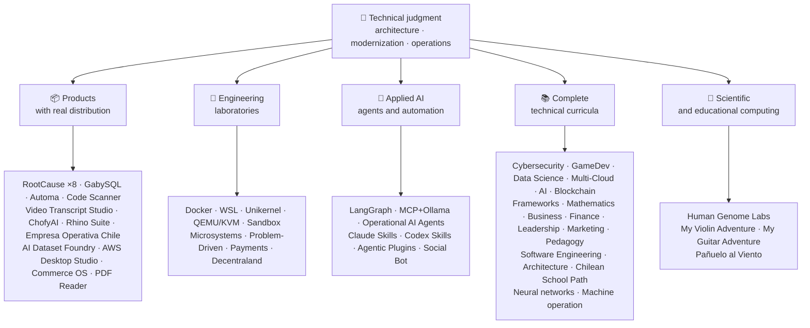

<!-- Synced from the public GitHub profile on 2026-10-16. -->

<div align="center" dir="rtl">

# 👋ولادیمیر آیسینا

## **راه حل معماری·پیر Full-Stack·تحول دیجیتال·مدیریت و عملیات**

**حرفه ای در علوم کامپیوتر و مهندسی محاسبات و مدیریت کسب و کار آموزش دیده است، با 16 سال ساخت و ساز و نرم افزار عملیاتی در محیط های واقعی. من کسب و کار، افراد، فرآیندها و تکنولوژی را به طراحی، ارزیابی، تحویل و حفظ راه حل با قضاوت فنی و یک دیدگاه عملیاتی متصل می کنم - با حمایت شواهد قابل راستی آزمایی در این حساب GitHub.**

[](https://vladimiracunadev-create.github.io/)
[](https://www.linkedin.com/in/vladimir-acu%C3%B1a-valdebenito-11924a29/)
[](mailto:vladimir.acuna.dev@gmail.com)

[](#حرفه-ای)
[](#محصولات-با-توزیع-واقعی)
[](#ویژگی-های-فنی-کامل)

<!-- STATS:START -->
[](https://github.com/vladimiracunadev-create?tab=repositories)
[](https://github.com/vladimiracunadev-create?tab=repositories)
[](#سیستم-در-یک-نگاه)
[](#ویژگی-های-فنی-کامل)
[](https://github.com/vladimiracunadev-create?tab=repositories)
<!-- STATS:END -->

[](https://github.com/vladimiracunadev-create?tab=repositories)
[](https://github.com/vladimiracunadev-create?tab=followers)

[🌐 Portfolio (22 languages)](https://vladimiracunadev-create.github.io/) ·
[🧩 Ecosystem](#سیستم-در-یک-نگاه) ·
[⚡ Evaluate me in 10 minutes](#اگر-10-دقیقه-وقت-دارید-تا-من-را-ارزیابی-کنید) ·
[✅ Professional scope](#حرفه-ای) ·
[🧭 Non-coding management](#مدیریت-مدیریت-و-فرصت-های-شغلی-غیر-مشارکتی) ·
[📋 Role matrix](PROFESIONAL_ROLES.md) ·
[📬 Contact](#تماس)

**🌐 نسخه‌های کامل:** [Español](README.md) · [English](README.en.md) · [Português](README.pt.md) · [Italiano](README.it.md) · [Français](README.fr.md) · [简体中文](README.zh.md) · [繁體中文](README.zh-TW.md) · [日本語](README.ja.md) · [한국어](README.ko.md) · [Türkçe](README.tr.md) · [Русский](README.ru.md) · [Tiếng Việt](README.vi.md) · [ไทย](README.th.md) · [Deutsch](README.de.md) · [Українська](README.uk.md) · [Polski](README.pl.md) · [العربية](README.ar.md) · [فارسی](README.fa.md) · [Bahasa Indonesia](README.id.md) · [Nederlands](README.nl.md) · [हिन्दी](README.hi.md) · [Ελληνικά](README.el.md)

**هسته فنی:**
PHP 8 · Python · Rust · Go · Node/TS · Java 21 · .NET 8 · Dart/Flutter · WASM
· AWS · Terraform · Kubernetes · Docker · n8n · LangGraph/MCP · CI/CD · FinOps · Observability

**پل تجاری-تکنولوژی:**
فرآیند و تجزیه و تحلیل الزامات·ارزیابی راه حل·هماهنگی تحویل·عملیات و استمرار·مدیریت ریسک·محصول و خدمات·آموزش فنی

</div>

---

> [!NOTE]
> This profile does not turn opportunities into experience. Proven technical experience, transferable skills, viable applications, and future development goals are explicitly separated. Linked GitHub evidence is executable or documentary; where something is **not** finished, it is stated as such.

## 🎯آنچه در اینجا پیدا خواهید کرد

این یک «یک repo» نیست: این یک اکوسیستم با استانداردهای مشترک است.

- 🔁 **دانلود بازی Reroducible**- کلون، اجرا، اعتبار
- 🧰 **ابزار استاندارد سازی**فایل های Makefiles، Hub CLI`doctor`و`smoke`در هر مخزن
- 🛡️ **دفاع در عمق**اسکن مخفی، سیاست ها و شیوه های آشکارا ممنوع
- 📈 **قابلیت پذیری** — `/health`, `/ready`, `/metrics`, داشبورد و قابلیت ردیابی
- 📚 **آرشیو برچسب های مرتبط**- استخدام کننده، مبتدی، DevOps یا امنیت، بسته به مخزن.
- 📦 **توزیع محصول**- نسخه های قابل دانلود، چکه ها و ساخت شواهد؛ امضاهای تجاری / فروشگاه اعلام شده در صورت لزوم.
- 🌍 **Internationalization** — portfolio in 22 languages (ES · EN · PT · IT · FR · ZH · ZH-TW · JA · KO · TR · RU · VI · TH · DE · UK · PL · AR · FA · ID · NL · HI · EL).
- 🧭 **صداقت فنی**هر پرونده ای که برچسب زده شود`OPERATIONAL`, `DOCUMENTED/SCAFFOLD`یا`PLANNED`.

## ✅وضعیت قابل تایید

| Surface | Concrete evidence |
|---|---|
| 🧪 **پوشش تست** | GabySQL**828 تست**+  fu**503.8M**(0 وحشت)·عملیات Empresa در شیلی**158 تست** ·Automa**150 pytest** ·CI چند بعدیOS CI |
| 🤖 **تولید کنندگان** | LangGraph RealWorld**25/25 بازگشت عملیاتی**(مورد های 01 تا 25، 100٪ پوشش)·بازیگران AI عملیاتی**13 عامل**با**39 معیاری برای evals** |
| 🔗 **Polyglot یکپارچگی** | **20 مورد**فرستنده:n8n**19 عملیات عملیاتی**به صورت جداگانه با Docker حسابرسی می شود.· **18+ موتورهای DB** · **20+** ·11 الگو |
| 📦 **Distribution** | **151 releases** across an ecosystem of **64 owned public repositories** · installers and artifacts `.exe` · `.msi` · `.dmg` · `.apk` with checksums and build evidence; commercial/store signatures in progress where applicable |
| 🛡️ **زنجیره تامین** | کدQL·Semgrep·Bandit·Trivy·Grype·گیتیکوس·تروفه ها·CycloneDX SBOM·کارت امتیاز |
| 📚 **Curricula** | **14530 کلاس**قابل تایید در 21 برنامه، شمارش شده توسط[a workflow](.github/workflows/stats.yml)از ساختار مخزن واقعی یا یک منبع قابل راستی که در مخزن اعلام شده است – که نه با دست نوشته شده است –·هر برنامه وضعیت و محدودیت های سرمقاله خود را اعلام می کند |
| 🌐 **نمونه کارها** | نصب PWA· **22 زبان** · **154 PDF**تولید شده توسط خط لوله·CV Data API·Android·فانوس دریایی 100 |
| 🔒 **تله** | عدم تقارن صفر در محصولات قانونی و عملکرد Empresa در هر ساخت (بدون Android)`INTERNET`اجازه) |
| 🌐 **سایت های منتشر شده** | **56 صفحه**55 فرود، یک محصول، برنامه یا هدایت کننده اکوسیستم، به علاوه نمونه کارها – هر کدام از مخزن خود را·همه 56 تایید شده با HTTP`200` |

## 🗺️سیستم در یک نگاه



## 📦محصولات با توزیع واقعی

نرم افزاری که دانلود، نصب و استفاده می شود - نه تنها کلون شده است.

| Product | What it is | Stack | Delivery |
|---|---|---|---|
| [🔍 **RootCause Windows**](https://github.com/vladimiracunadev-create/rootcause-windows-inspector) | Cybersecurity forensics: every anomalous resource distortion may be the first sign of a threat. Diagnose first, intervene later | Rust 🦀 · ETW/WPR | **v0.19.0** · **16 releases** · **5 editions**: GUI · Portable · CLI · PowerShell · VS Code · [landing](https://vladimiracunadev-create.github.io/rootcause-windows-inspector/) |
| [📱 **RootCause Mobile**](https://github.com/vladimiracunadev-create/rootcause-mobile-inspector) | The mobile sibling: a forensic sensor that compares each app against itself, flags stalkerware, and separates granted permissions from merely requested ones | Flutter · Kotlin · Swift | **v0.8.0** · verifiable Android APK · 5 languages · **zero telemetry** · [landing](https://vladimiracunadev-create.github.io/rootcause-mobile-inspector/) |
| [🍎 **RootCause macOS**](https://github.com/vladimiracunadev-create/rootcause-macos-inspector) | نسخه macOS`launchd`پایداری، دروازه بان، SIP، FileVault، X protection، TCC مجوزهای، فرایندهای امضا شده و همسایگان شبکه - هر سطح در برابر یک حالت شناخته شده بررسی می شود | Rust🦀 ·macOS 13+ | **v0.1.0** ·اولین انتشار منتشر شده·Apache-2.0· [landing](https://vladimiracunadev-create.github.io/rootcause-macos-inspector/) |
| [🖥️ **RootCause Server**](https://github.com/vladimiracunadev-create/rootcause-server) | The server sibling: correlates what no single log sees together — exposed surface, access-attempt bursts, a session granted to that same address, critical file integrity, and sensor silence — and turns it into one actionable sentence | Rust 🦀 · Windows · Linux · macOS | **v0.2.0** · **18 rules** with evidence and runbook · never executes actions on its own · local console without web dependencies · **no published release yet** · [landing](https://vladimiracunadev-create.github.io/rootcause-server/) |
| [🌐 **RootCause Web**](https://github.com/vladimiracunadev-create/rootcause-web-inspector) | Browser forensic sensor: cookies, email sessions, extensions, downloads, permissions, and pages that imitate a real window | JavaScript · MV3 extension | **v0.2.0** · no published release yet · panel on `127.0.0.1` · zero dependencies · zero telemetry verified in CI · [landing](https://vladimiracunadev-create.github.io/rootcause-web-inspector/) |
| [₿ **RootCause Bitcoin Defense**](https://github.com/vladimiracunadev-create/rootcause-bitcoin-defense) | Watch-only defense for Bitcoin custody: inventories the origin of each key, cross-checks it with published warnings, and explains root cause with evidence | JavaScript · Windows app · local panel | **v0.3.0** · **2 releases** · zero dependencies · never asks for seeds · verified in CI · [landing](https://vladimiracunadev-create.github.io/rootcause-bitcoin-defense/) |
| [⛓️ **RootCause Blockchain Security**](https://github.com/vladimiracunadev-create/rootcause-blockchain-security) | Multi-chain watch-only console: inventories contracts, proxies, oracles, bridges, governance, and dependencies, and generates root-cause runbooks | JavaScript · Windows app · local panel | **v0.3.0** in the repository · published release: `v0.1.0` · zero dependencies · never asks for private keys · verified in CI · [landing](https://vladimiracunadev-create.github.io/rootcause-blockchain-security/) |
| [📷 **RootCause QR Inspector**](https://github.com/vladimiracunadev-create/rootcause-qr-inspector) | برنامه محلی آندروید برای بررسی کدهای QR قبل از عمل: توضیح می دهد 26 سیگنال، جدا کردن حقایق از فرضیه ها و صادرات شواهد قرمز | Flutter·دارت | **v0.1.4** · **5 انتشار** · **107 تست** ·Android APK منتشر شده·قابل اعتماد بودن SHA-256·امضای بسته فنی: امضاهای تجاری / فروشگاه در پیشرفت·عدم تقارن صفر· [landing](https://vladimiracunadev-create.github.io/rootcause-qr-inspector/) |
| [🏢 **Empresa Operativa Chile**](https://github.com/vladimiracunadev-create/empresa-operativa-chile) | Guides a SpA from before incorporation to each monthly close: incorporation with evidence, VAT carry-forward, F29 draft, immutable close, and audit log. Every rule points to its official source | JavaScript · Rust · PWA | **v1.5.0** · Android · Windows · browser · **158 tests** · **0 production dependencies** · zero telemetry · [landing](https://vladimiracunadev-create.github.io/empresa-operativa-chile/) |
| [🔍 **Universal Code Scanner**](https://github.com/vladimiracunadev-create/universal-code-scanner) | QR and barcode reader that **interprets before acting**: 16 local URL risk signals and explicit confirmation | Flutter · Dart | **v1.1.0** · Android · iOS · macOS · PWA · encrypted history **AES-256-GCM** · [landing](https://vladimiracunadev-create.github.io/universal-code-scanner/) |
| [🗄️ **GabySQL**](https://github.com/vladimiracunadev-create/gabysql) | Embedded database: single `.db` file, WAL, cost-based optimizer, HTTP/JSON API | Rust 🦀 | Windows · macOS · Linux · [landing](https://vladimiracunadev-create.github.io/gabysql/) |
| [🤖 **Automa PC**](https://github.com/vladimiracunadev-create/automa-pc) | Local orchestrator: JSON flows that open real windows, interact with the DOM, and leave evidence | Python · Playwright · pywebview | **v0.3.0** · **27 flows** · published and verifiable installer · [landing](https://vladimiracunadev-create.github.io/automa-pc/) |
| [🏭 **AI Dataset Foundry**](https://github.com/vladimiracunadev-create/ai-dataset-foundry) | Local-first factory that turns PDF, Word, web, Git, JSON, and CSV into auditable datasets for pretraining, fine-tuning, RAG, and evaluation | Python | **v0.2.0** · Windows + offline Android · first published release · [landing](https://vladimiracunadev-create.github.io/ai-dataset-foundry/) |
| [☁️ **AWS Desktop Studio**](https://github.com/vladimiracunadev-create/aws-desktop-studio) | Local-first app with 15 AWS inventory integrations, 20 tutorials, CLI/SSO, and read-only defaults; implementation in progress, not universal access | JavaScript · Windows | **v0.1.1** · first published release · [landing](https://vladimiracunadev-create.github.io/aws-desktop-studio/) |
| [🧭 **Commerce OS**](https://github.com/vladimiracunadev-create/commerce-operating-system) | Guided conceptual demo of commercial operations: catalog, stock, CRM, orders, mock payments, and traceability | JavaScript · Web · Windows · Android | **v0.3.0** · **2 releases** · no real money or Chilean tax authority integration · [landing](https://vladimiracunadev-create.github.io/commerce-operating-system/) |
| [📄 **PDF Reader**](https://github.com/vladimiracunadev-create/pdf-reader-windows-android) | Android-first local read-only reader, with no-crop zoom, reopenable history, WhatsApp sharing, and default-reader selection | HTML · Web · Android · Windows | **v0.3.3** · signed APK · no accounts, sensitive permissions, or telemetry · [landing](https://vladimiracunadev-create.github.io/pdf-reader-windows-android/) |
| [🎙️ **Video Transcript Studio**](https://github.com/vladimiracunadev-create/video-transcript-studio) | One video, playlist, or **entire YouTube channel** to text with timestamps. It does not rely on existing subtitles: Whisper recognizes audio **on your machine**, with no API, account, or key to configure | Python · PySide6 · FastAPI · faster-whisper | **v0.2.0** · Windows desktop + local panel on `127.0.0.1` + CLI, **sharing the same queue** · MD · PDF · TXT · SRT · VTT · JSON · MP3 · OGG · **89 tests** · bundled FFmpeg · zero telemetry · [landing](https://vladimiracunadev-create.github.io/video-transcript-studio/) |
| [🎨 **ChofyAI Studio**](https://github.com/vladimiracunadev-create/chofyai-studio) | Local creative AI launcher: orchestrates Qwen3-TTS, whisper.cpp, FaceFusion, AceForge, and ComfyUI | Tauri 2 · Rust · React | v0.5.1 · **5/5 tools with real inference** · macOS Apple Silicon · experimental Windows · **no published release yet** · [site](https://vladimiracunadev-create.github.io/chofyai-studio/) |
| [🦏 **Rhino Suite**](https://github.com/vladimiracunadev-create/rhino-suite) | Office suite from scratch: document rules do not depend on the DOM — HTML is only a projection | Rust/WASM · Go · React 19 | Evolutionary monorepo by phases · [landing](https://vladimiracunadev-create.github.io/rhino-suite/) |
| [🎻 **My Violin Adventure**](https://github.com/vladimiracunadev-create/violin-adventure) | Educational app for children: chromatic tuner, audio-clock-accurate metronome, songs with real violin | Tauri 2 · React · TS | **v1.3.0** · Windows · Android · Linux · macOS · PWA · [landing](https://vladimiracunadev-create.github.io/violin-adventure/) |
| [🎸 **My Guitar Adventure**](https://github.com/vladimiracunadev-create/guitarra-adventure) | The plucked-string sibling: 24 lessons in 6 worlds, 6-string tuner, drift-free metronome, and 11 real guitar notes | Tauri 2 · React · TS | **v1.0.0** · Windows · Android · Linux · macOS · iOS · PWA · no accounts, ads, or online dependency · [landing](https://vladimiracunadev-create.github.io/guitarra-adventure/) |
| [🧣 **Pañuelo al Viento**](https://github.com/vladimiracunadev-create/panuelo-al-viento-cueca-app) | Cueca از سن 10: 24 کلاس در 8 سطح، 72 فعالیت، آزمایشگاه شش پالس (3+3 و 2+2)، و نمودار کف قابل دسترس است. می گوید که**مکمل ها، نه جایگزین**معلمان و صاحبان فرهنگ | Flutter·دارت | **v0.2.0** ·Android 7+·ویندوز 10/11·دانلود بازی APK·EXE·MSI·قابل حمل· **29 تست + 2 اعتبار سنجی** ·هیچ دوربین، میکروفون، حساب، تبلیغات یا اینترنت· [landing](https://vladimiracunadev-create.github.io/panuelo-al-viento-cueca-app/) |

## 🧪آزمایشگاه های مهندسی

| Repo | آنچه که نشان می دهد |
|---|---|
| [🐳 **Problem-Driven Systems Lab**](https://github.com/vladimiracunadev-create/problem-driven-systems-lab) | **20 real problems** (latency under load, N+1, retry storms, leaks, monoliths, cache stampede, backpressure, zero-downtime migration, forgotten DLQ) with high-fidelity injected failures, solved in **7 stacks**: PHP 8 · Python · Node.js · Java 21 · .NET 8 · **Go 1.23** · **Rust 1.83** · [landing](https://vladimiracunadev-create.github.io/problem-driven-systems-lab/) |
| [📆 **Social Bot Scheduler**](https://github.com/vladimiracunadev-create/social-bot-scheduler) | **v4.10.0** · **20 مورد**منبع: n8n**18+ موتورهای DB** —**19 عملیات عملیاتی**به صورت جداگانه با Docker حسابرسی می شود.**8 لایه**حسابرسی، محافظان، شکستن مدار و DLQ· [landing](https://vladimiracunadev-create.github.io/social-bot-scheduler/) |
| [🧰 **Microsistemas**](https://github.com/vladimiracunadev-create/microsistemas) | **12 میکروکارهای تشخیصی و مدرن سازی**PHP·محلی Read- Only MCP server·سخت شدن در 3 مرحله· [landing](https://vladimiracunadev-create.github.io/microsistemas/) |
| [🧪 **Docker Labs**](https://github.com/vladimiracunadev-create/docker-labs) | **۱۳ آزمایشگاه**در یک پلت فرم 4service + خودکار`.exe`نصب کننده با Launcher· [landing](https://vladimiracunadev-create.github.io/docker-labs/) |
| [🐳 **WSL Labs**](https://github.com/vladimiracunadev-create/wsl-labs) | **12 مورد**در`wslc`موتور ظروف بومی WSL –**بدون Docker Desktop** · [landing](https://vladimiracunadev-create.github.io/wsl-labs/) |
| [⚡ **Unikernel Labs**](https://github.com/vladimiracunadev-create/unikernel-labs) | "Docker Desktop for Unikernels" : کنترل ویندوز بر UniDSM با WSL2 backend`kraft`QEMU / KVM· [landing](https://vladimiracunadev-create.github.io/unikernel-labs/) |
| [🧰 **QEMU/KVM Labs**](https://github.com/vladimiracunadev-create/qemu-kvm-labs) | **12 آزمایشگاه**مجازی سازی واقعی با QEMU، KVM، libvirt، Cloud-init و`vm-manager`در لینوکس و WSL2· [landing](https://vladimiracunadev-create.github.io/qemu-kvm-labs/) |
| [🛡️ **Sandbox Labs**](https://github.com/vladimiracunadev-create/sandbox-labs) | انزوای لینوکس: اجرای کد شخص ثالث، فایل ها و مدل های تجاری تحت سیاست های اعلام شده و**گزارش های امضا شده که در واقع کنترل ها اعمال می شوند** · **۳۶ مورد**در دو خانواده – ۱۵ بازار فنی و ۲۱ سرمایه –·گواهی تجربی و آموزشی، * نه یک محصول امنیتی *· [landing](https://vladimiracunadev-create.github.io/sandbox-labs/) |
| [💳 **Universal Payments Engineering Lab**](https://github.com/vladimiracunadev-create/universal-payments-engineering-lab) | **28 خانواده پرداخت**در یک دموی محلی خود توضیحی: دولت ها، کللی، آشتی، امنیت و راهنماهای پیاده سازی· [landing](https://vladimiracunadev-create.github.io/universal-payments-engineering-lab/) |
| [🕹️ **Decentraland Social Arcade**](https://github.com/vladimiracunadev-create/decentraland-social-arcade) | تجربه بومی Decentraland Social 3D: یک MVP و یک معماری چند بازی با SDK7، ECS و TypeScript·مستند اسپانیایی·پرداخت یا تلهومتر |
| [☁️ **AWS Projects**](https://github.com/vladimiracunadev-create/proyectos-aws) | موارد پیشرفته که هر یک از آنها یک سرویس AWS را اضافه می کند**و**قابلیت جدید GitHub Actions·SAA-C03·DVA-C02·پوشش SOA-C02 |

## 🤖کاربردی AI

| Repo | آنچه که نشان می دهد |
|---|---|
| [🤖 **LangGraph RealWorld**](https://github.com/vladimiracunadev-create/langgraph-realworld) | **25/25 بازگشت عملیاتی**- حالت نوع، مسیرهای مشروط، جریان NDJSON، حالت DEMO / LIVE، 8 لایه امنیتی، زنجیره نگهداری SHA-256 |
| [🧭 **Operational AI Agents**](https://github.com/vladimiracunadev-create/operational-ai-agents) | **13 operational agents** for Claude Code and compatible runtimes: each receives a complete mission —repository evolution, legacy modernization, curriculum design, portfolio publishing, security remediation, incident analysis— under a declared contract, human gates, and verifiable evidence · **39 deterministic evals** · 34 tests · zero-deps (stdlib only) · Linux · macOS · Windows · [site](https://vladimiracunadev-create.github.io/operational-ai-agents/) |
| [🧠 **MCP + Ollama Local**](https://github.com/vladimiracunadev-create/mcp-ollama-local) | Local-first AI with MCP tools in a sandbox · `127.0.0.1` bind · multilayer trust profile · honest about its limits |
| [🧩 **Agentic Plugins Toolkit**](https://github.com/vladimiracunadev-create/agentic-plugins-toolkit) | **6 agentic plugins** installable in Claude Code, OpenAI/Codex, Copilot, Gemini, and MCP from one source: `repository-engineering`, `legacy-modernization`, `learning-program-studio`, `product-evolution`, `portfolio-governance`, and `rootcause-response` · **69 generated views without drift** —each runtime receives its format from the same contract— · zero-deps · Linux · macOS · Windows · [site](https://vladimiracunadev-create.github.io/agentic-plugins-toolkit/) |
| [🧰 **Claude Skills Toolkit**](https://github.com/vladimiracunadev-create/claude-skills-toolkit) | **15 agentic skills** for Claude Code · **security**: 12-layer `security-audit` (OSV · KEV · EPSS · SAST · container · secrets) and 14-stage `bitcoin-custody-audit` · **repo gates**: `pre-commit-guard`, `pre-push-guard`, `yaml-control`, `md-lint-fix`, `python-lint-guard` · **coherence**: `repo-coherence-audit`, `version-bump`, `python-version-control`, `python-deps-pinning` · **Docker**: `docker-cleanup`, `docker-compose-doctor` · **docs**: `md-to-doc` · zero-deps · cross-platform |
| [🧰 **Codex Skills Toolkit**](https://github.com/vladimiracunadev-create/codex-skills-toolkit) | **19 agentic skills** for Codex: security and supply chain, preflight, functional flows, resilience and state, release evidence, Python/YAML/Markdown gates, versioning, dependencies, Docker, and documents · Python-first · `pnpm` · Linux · macOS · Windows · [site](https://vladimiracunadev-create.github.io/codex-skills-toolkit/) |

## 📚ویژگی های فنی کامل

برنامه های اکتشافی در اسپانیایی، با وضعیت و محدوده اعلام شده توسط هر مخزن. 21 برنامه اضافه شده به**14530 کلاس**شمارش شده توسط[a workflow](.github/workflows/stats.yml)از ساختار مخزن واقعی یا یک منبع قابل راستی که در مخزن اعلام شده است؛ نشان هر هفته تازه می شود و توسط دست نوشته نمی شود.

🧭 [**Lifelong Learning Ecosystem**](https://github.com/vladimiracunadev-create/lifelong-learning-ecosystem)یک قطب نمای تغذیه شده است که 30 مسیر واقعی را در 6 ناحیه از طریق نقشه های بصری و یک قطب نمای بصری متصل می کند.[accessible offline portal](https://vladimiracunadev-create.github.io/lifelong-learning-ecosystem/)این به عنوان یک برنامه اضافی شمرده نمی شود.

| Program | Classes | Scope |
|---|---:|---|
| [🔢 **Computational Mathematics**](https://github.com/vladimiracunadev-create/computational-mathematics-program) | 360 | از شمارش روی انگشتان تا بازتولید یک کاغذ· **360 تظاهرات قاطع تایید شده در CI** ·1080 نوت بوک·۴۸۹- واژه نامه· [site](https://vladimiracunadev-create.github.io/computational-mathematics-program/) |
| [🏦 **Finance and Banking**](https://github.com/vladimiracunadev-create/finance-and-banking-evolution-program) | 356 | 534 h·ریاضیات مالی و IFRS اعتبار، ریسک، بازل III، امور مالی باز، DLT، ثابت کوین ها و MiCA· **27 مورد** · **تست های 298** · [site](https://vladimiracunadev-create.github.io/finance-and-banking-evolution-program/) |
| [🎮 **GameDev**](https://github.com/vladimiracunadev-create/modern-gamedev-program) | 352 | Mathematics and C#/C++/GDScript → shaders, AI, multiplayer, VR/AR · Godot · Unity · Unreal · **10 Godot labs verified in CI** (301 checks) · [site](https://vladimiracunadev-create.github.io/modern-gamedev-program/) |
| [🛡️ **Cybersecurity**](https://github.com/vladimiracunadev-create/modern-cybersecurity-program) | 360 | **v1.3.0** ·20 قسمت·بنیادهای Red Team، DFIR، امنیت ابر، بهره برداری از dev، CTF و امنیت بازی·نقشه برداری برای**7 گواهینامه** ·برنامه Android / Web·PDF Manual·CI، امنیت و صفحات تایید شده· [site](https://vladimiracunadev-create.github.io/modern-cybersecurity-program/) |
| [📈 **Marketing, Sales, and Growth**](https://github.com/vladimiracunadev-create/marketing-sales-growth-evolution-program) | 336 | 24 بخش با تعاریف عملیاتی، ورق های اندازه گیری، بی اعتبار بودن واقعی، و زمینه تنظیم مقررات شیلی· **v1.6.0** ·1.29M کلمات·17 مسیر مبتنی بر نقش· [site](https://vladimiracunadev-create.github.io/marketing-sales-growth-evolution-program/) |
| [🏢 **Business Creation**](https://github.com/vladimiracunadev-create/modern-business-creation-program) | 336 | ایجاد و کار یک شرکت واقعی در شیلی: از ایده به مشارکت، اقتدار مالیاتی، عملیات، بحران و خروج·360 نمودار·1،251-termary·1،548 صفحه راهنمای· [site](https://vladimiracunadev-create.github.io/modern-business-creation-program/) |
| [🏛️ **Architecture and Built Environment**](https://github.com/vladimiracunadev-create/architecture-built-environment-learning-program) | 830 | 83 قسمت·60 جلسه ی یکپارچه·34 مسیر·منابع قابل ردیابی·مارک معکوس، خواننده آفلاین و صفحات GitHub· [site](https://vladimiracunadev-create.github.io/architecture-built-environment-learning-program/) |
| [🇨🇱 **Chilean School Learning Path**](https://github.com/vladimiracunadev-create/chilean-school-learning-path) | 8,841 | درجه 1 -12· **۴،۱۵ تجربه برنامه های درسی یکپارچه** · **2823 اهداف یادگیری** ·منابع ذهنی·هیچ پیشنهادی و بررسی تخصصی انسانی هنوز در انتظار نیست· [site](https://vladimiracunadev-create.github.io/chilean-school-learning-path/) |
| [🧭 **Modern Software Engineering**](https://github.com/vladimiracunadev-create/modern-software-engineering-program) | 480 | 40 قسمت و 8 مرحله·پایه ها، محصول، معماری، امنیت، DevOps، SRE، SPEC، AI و سیستم های چند عاملی·وضعیت سرمقاله اعلام شده توسط مخزن· [site](https://vladimiracunadev-create.github.io/modern-software-engineering-program/) |
| [🎓 **Pedagogy and Learning Sciences**](https://github.com/vladimiracunadev-create/education-pedagogy-learning-sciences-program) | 300 | از چگونگی یادگیری یک فرد به چگونگی آموزش معلمان·25 قسمت· **هر کلاسی وضعیت و محدودیت های خود را اعلام می کند.** ·سواد اولیه، روش های مقایسه ای، نیازهای آموزشی خاص، همزیستی، تنوع فرهنگی و شواهد بین المللی·1097-termary, 325 Dias و 60-active Class bank·14 مسیر شغلی با نقش·LMS-Exportable· **v2.1.0** · [site](https://vladimiracunadev-create.github.io/education-pedagogy-learning-sciences-program/) |
| [☁️ **Multi-Cloud**](https://github.com/vladimiracunadev-create/multi-cloud-engineering-program) | 288 | AWS·Azure·GCP·Kubernetes·سازنده : Terraform·SRE·FinOps· **1،288 ساعت** ·288 آزمایشگاه با شواهد JSON·1032 منابع ردیابی·2884 صفحه راهنمای PDF· [site](https://vladimiracunadev-create.github.io/multi-cloud-engineering-program/) |
| [🎖️ **Executive Leadership**](https://github.com/vladimiracunadev-create/executive-leadership-founder-program) | 288 | از داشتن اولین نتیجه خود برای رهبری یک شرکت و تاسیس خود: تیم ها، KPI /OKR، امور مالی، محصول، خطر، هیئت مدیره و M&A·24 مورد، 96 آزمایشگاه و 39 قالب· [site](https://vladimiracunadev-create.github.io/executive-leadership-founder-program/) |
| [🐍 **Python Data Science**](https://github.com/vladimiracunadev-create/python-data-science-program) | 232 | Polars، ML+Optuna/SHAP، PyTorch/LLMs/LoRA، MLOps·برنامه های ویندوز بومی + Android APK· [site](https://vladimiracunadev-create.github.io/python-data-science-program/) |
| [🧠 **AI Evolution**](https://github.com/vladimiracunadev-create/artificial-intelligence-evolution-program) | 184 | نماد | یادگیری عمیق | LLM ها، RAG، عوامل، ایمنی و مرز· **v0.17.0** · **708 دفترچه** · **148 مقاله بنیادی** ·برنامه های آفلاین ویندوز، Android و PWA· [site](https://vladimiracunadev-create.github.io/artificial-intelligence-evolution-program/) |
| [🌐 **Comparative Programming**](https://github.com/vladimiracunadev-create/polyglot-programming-labs) | 176 | یک مفهوم،**10 زبان**تایید شده در CI -**1،360 پیاده سازی**- به علاوه**1،750 برنامه**در زبان های زنده (COBOL، Fortran، Ada، RPG، MUMPS ...) و alas of of the**60 کارت در 15 خانواده** ·v1.1.0· [site](https://vladimiracunadev-create.github.io/polyglot-programming-labs/) |
| [🧩 **Frameworks Compared**](https://github.com/vladimiracunadev-create/framework-ecosystems-labs) | 149 | یک قرارداد اجرایی، بدون آداپتور، در برابر Express، FastAPI، Spring Boot، ASP.NET، Django، Rails، Laravel، React، Vue، Svelte و بیشتر·12 قسمت· **70 کلاس ساخت** · **397 مورد تایید در CI** · **منابع ISBN/DOI** · [site](https://vladimiracunadev-create.github.io/framework-ecosystems-labs/) |
| [🗄️ **Databases**](https://github.com/vladimiracunadev-create/database-systems-labs) | 74 | **v3.0.0** ·مهندسی پایگاه داده در 15 بخش·230 ساعت· **منبع قابل اثبات برای هر ادعایی**120 منبع با ISBN، DEC یا استاندارد·همان مورد در 27 موتور حل شد·306- بلند مدت·150 pytest· [site](https://vladimiracunadev-create.github.io/database-systems-labs/) |
| [📐 **Psychometrics and Assessment**](https://github.com/vladimiracunadev-create/psychometrics-and-assessment-program) | 40 | چگونه یک ابزار اندازه گیری ساخته شده، به ثمر رسانده، معتبر و حسابرسی شده است·8 قسمت·موتور اجرایی با**5 ابزار و 344 آیتم، 276 Public-domain** |
| [⛓️ **Blockchain**](https://github.com/vladimiracunadev-create/blockchain-learning-path) | 66 | **v0.14.0** ·از صفر تا زیرساخت های مالی قابل برنامه ریزی و تجزیه و تحلیل های زنجیره ای· **91 شیوه**و**363 تست** ·قراردادهای با Foundry (تحریم و عایق) و تجزیه و تحلیل استاتیک Slither در CI·برنامه های آفلاین با باز کردن باینری و شمارش محتویات آن تایید شده است· [site](https://vladimiracunadev-create.github.io/blockchain-learning-path/) |
| [🧠 **Neural Network Training Labs**](https://github.com/vladimiracunadev-create/neural-network-training-labs) | 31 | 7 ماژول·≈ساعت ≈· **93 دفترچه یادداشت**- 31 کلاس، 31 نسخه دانشجویی و 31 راه حل -·سوالات، نقشه های بصری، شیوه ها و ارزیابی با داده های عمومی واقعی·PyTorch· [study site](https://vladimiracunadev-create.github.io/neural-network-training-labs/) |
| [🕹️ **Machine Operator**](https://github.com/vladimiracunadev-create/machine-operator-program) | 451 | **41 ماژول آموزش**یک در هر ماشین· **502 h 15 دقیقه** ·سیستم ها، کنترل ها، فیزیک، ایمنی و طراحی شبیه سازی با منابع در هر کلاس·* هنوز هم شبیه ساز اجرایی نیست و این گونه اعلام می شود |

## 🔬محاسبات علمی

| Repo | آنچه که نشان می دهد |
|---|---|
| [🧬 **Human Genome Labs**](https://github.com/vladimiracunadev-create/human-genome-labs) | پلتفرم genomics Reroducible: Typed`ScientificResult<T>`قراردادها، FASTA / GFF / VCF، ماژول ها با**بلوغ و شواهد صریح**صداقت رادیکال: * تشخیص بالینی انجام نمی دهد *· [site](https://vladimiracunadev-create.github.io/human-genome-labs/) |

## ⚡اگر 10 دقیقه وقت دارید تا من را ارزیابی کنید

ایده فقط نگاه کردن به کد نیست: دیدن کد است.**چگونه فکر می کنم**چگونه سند می کنم و چگونه همه چیز را اجرا می کنم.

**مسیر A – قابلیت های واقعی و ارکستر**(من مورد علاقه ام)

```bash
git clone https://github.com/vladimiracunadev-create/social-bot-scheduler.git
```

شما گردش های کاری، معیارها، داشبورد ها و محافظ ها را در 19 مورد و 18 موتور DB مشاهده خواهید کرد.

**جاده B – زیرساخت های قابل بازیافت در دقیقه**

```bash
git clone https://github.com/vladimiracunadev-create/docker-labs.git
```

**مسیر C – نمایندگان با حالت تایپ**

```bash
git clone https://github.com/vladimiracunadev-create/langgraph-realworld.git
```

**مسیر D – محصول قانونی Rust بدون نظارت**

دانلود بازی The installer یا binary از[RootCause releases](https://github.com/vladimiracunadev-create/rootcause-windows-inspector/releases)و تایید`SHA256SUMS`.

## 🧠استانداردهایی که در سراسر مخازن اعمال می کنم

- **اولین DX**اگر اجرای آن آسان نباشد، به عنوان یک دموی یا به عنوان یک پایگاه تیمی مفید نیست.
- **قابلیت اطمینان از روز 1**- معیارها و قابلیت ردیابی، نه یک پس انداز.
- **امنیت به عنوان خط لوله**اسکن مخفی، SBOM در هر آزادی، به طور واضح ممنوع است.
- **انعطاف پذیری واقعی**– قابلیت تشخیص، شکستن مدار و تخریب کنترل شده
- **Polyglot با طراحی**زبان و موتور انتخاب شده توسط مورد استفاده، هرگز با مد.
- **صداقت در مورد وضعیت**یک بار تغییر نام داده شد (`Multisimulador` → `machine-operator-program`برای جلوگیری از نرم افزار امیدوار کننده که هنوز وجود ندارد.
- **نشانه ها هستند، نه شواهد**هر بار که دوباره اعلام می کند**آنچه که انجام نمی دهد**.
- **مدل خارجی**- دامنه ابتدا طراحی شده است؛ رابط یک پیش بینی است.
- **کار خارجی به عنوان خارجی اعلام می شود**از 70 نمایندگی عمومی حساب، 64 نفر کار خودم هستند. شش بعدی –[`agentic-qe`](https://github.com/vladimiracunadev-create/agentic-qe), [`Anthropic-Cybersecurity-Skills`](https://github.com/vladimiracunadev-create/Anthropic-Cybersecurity-Skills), [`erpnext`](https://github.com/vladimiracunadev-create/erpnext), [`OpenExecutive`](https://github.com/vladimiracunadev-create/OpenExecutive), [`raptor`](https://github.com/vladimiracunadev-create/raptor)و[`security-audit-skill`](https://github.com/vladimiracunadev-create/security-audit-skill)چنگال هستند و از تمام ارقام برای کار خودم محروم هستند.

## ✅حرفه ای

پس زمینه دوگانه من -**مهندسی کامپیوتر و محاسبات + مدیریت کسب و کار**- به من کمک می کند تا اهداف کسب و کار را به تصمیمات فنی و محدودیت های فنی به گزینه های روشن برای عملیات، محصول، مشتریان و رهبری تبدیل کنم.

### 🎯هویت اصلی

| Role | Backing |
|---|---|
| **راه حل معماری** | طراحی سیستم های مقیاس پذیر با قضاوت تکاملی |
| **معماری مدرن سازی** | تکامل میراث واقعی (PHP 5.x) 8.x، بازسازی تدریجی بدون وقفه عملیات |
| **ارشد Full-Stack / Tech Lead** | معماری، اجرای و استانداردهای سیستم عامل های واقعی (+16 سال) |
| **معماری اتوماسیون AI** | سیستم های عامل با LangGraph /MCP و n8n با محافظان جریان می یابد |

### ↗ گسترش طبیعی

**مهندسی ارکستر AI** · **سیستم ها / مهندس Rust** · **مهندس موبایل (Flutter)** · **راه حل های مهندسی** · **سازنده محصول فنی** · **مربی فنی** · **مشاور تحول دیجیتال** · **Business / Applied Analysis** · **عملیات محصول فنی**

### ⚙️محدوده های تکمیلی

مهندسی پلتفرم / IDP·DevOps / CI-CD·مهندسی Cloud / AWS·کاربرد SRE·مهندسی اتوماسیون·مشاور فنی تجاری

## 🧭مدیریت، مدیریت و فرصت های شغلی غیر مشارکتی

این دامنه ادعا نمی کند که هر عنوانی در آن نگهداری شده است. این اولویت بندی کار را در جایی که ترکیبی از محاسبات، مدیریت کسب و کار و شواهد عمومی می تواند بدون برنامه نویسی به عنوان وظیفه اصلی ایجاد ارزش کند، اولویت بندی می کند.

| خانواده حرفه ای | تشخیص نقش | طبقه بندی صداقت | Coding | شواهد و شرایط |
|---|---|---|---|---|
| **رهبری تکنولوژی** | مدیر IT·مدیریت عملیات IT·مدیر تحول دیجیتال·CIO | **برنامه ریزی بالقوه / هدف آینده** | هیچ/معجزه | پایه فنی قوی؛ افراد، بودجه، فروشنده و پاسخگویی اجرایی باید به طور جداگانه اثبات شوند |
| **مدیریت پروژه** | پروژه هماهنگ کننده / مدیریت·PMO·دانلود بازی Master·تحویل سریع | **قابلیت انتقال / قابلیت درخواست** | هیچ/معجزه | تحویل و انتشار شواهد؛ تیم رسمی، بودجه و مسئولیت حمایت از آن همچنان یک شکاف است |
| **مدیریت کسب و کار** | مدیر کسب و کار·مدیریت/عملیات مدیر·مدیر قرارداد | **کاربرد بالقوه** | هیچ کس | درجه کسب و کار و مصنوعات عملیاتی؛ نیاز به مالکیت تایید شده از منابع، مردم و تامین کنندگان |
| **استراتژی و تغییر** | استراتژی مشاور·تغییر مدیر·برنامه ریزی شرکت·نوآوری / تحول | **قابلیت انتقال / قابلیت درخواست** | هیچ کس | مدرن سازی میراث و ارزیابی راه حل؛ نتایج پذیرش سازمانی باید نشان داده شود |
| **تحلیل کسب و کار** | تحلیلگر کسب و کار·تحلیل گر کاربردی / requirements Analysis·BPM·بهبود مستمر | **قابلیت انتقال / قابلیت درخواست** | هیچ/معجزه | مدل سازی دامنه و شواهد مورد نیاز؛ موارد ذینفعان خارجی این ادعا را تقویت می کنند |
| **محصول و خدمات** | مالک محصول / مدیر·عملیات محصول·خدمات تحویل·موفقیت مشتری | **قابلیت انتقال / قابلیت درخواست** | هیچ/معجزه | نقشه های جاده، چرخه عمر، آزاد سازی و عملیات؛ P&L، نمونه کارها مشتری و شواهد SLA با نقش متفاوت است |
| **مدیریت امنیت سایبری** | GRC·کنترل IT Auditor·تکنولوژی ریسک·امنیت اطلاعات / Continuity | **کاربرد بالقوه** | هیچ/معجزه | کنترل ها و ریشه ها به دلیل شواهد؛ حسابرسی های سازمانی و اعتبار های مربوطه در انتظار |
| **تجارت و فروش** | تکنولوژی Presale·راه حل های مشاور·فنی KAM·B2B توسعه کسب و کار | **قابلیت انتقال / قابلیت درخواست** | هیچ کس | راه حل قوی / ترجمه ارزش؛ سهمیه بندی، حساب و مذاکره قرارداد ادعا نمی شود |
| **مدیریت و مدیریت کنترل** | بودجه / تحلیلگر·پروژه ارزیابی·FP & A·کنترل مدیریت | **کاربرد بالقوه** | هیچ کس | دارایی / عملیات؛ بودجه واقعی، بیانیه های مالی و KPI های شرکتی مورد نیاز است |
| **Quality** | Process/Quality Analyst · Process Auditor · Continuous Improvement | **Transferable / application potential** | None/occasional | Gates, tests, metrics, and reproducibility; formal quality-system ownership remains a gap |
| **Education** | Technical Trainer · Facilitator · Academic Coordinator · EdTech / Instructional Designer | **Transferable / application potential** | None/occasional | 21 programs and 14,530 classes; formal teaching and learner outcomes must be evidenced separately |
| **تدارکات و تامین کنندگان** | خرید·عرضه / عملیات هماهنگ کننده·فروشنده / مدیر عامل | **کاربرد بالقوه** | هیچ کس | فرآیند و پایگاه دولت؛ تدارکات واقعی، موجودی و عملکرد تامین کننده مورد نیاز است |
| **داده ها و مدیریت AI** | داده های Steward·مدیریت داده ها·اتخاذ AI / حاکمیت | **قابلیت انتقال / قابلیت درخواست** | هیچ/معجزه | مجموعه داده های قابل حسابرسی و عوامل انسانی؛ سیاست های سازمانی و کمیته ها همچنان شکاف هستند |
| **بخش عمومی** | مدرن سازی نهادی·هماهنگ کننده ICT·پروژه های دیجیتال·برنامه ریزی عمومی | **کاربرد بالقوه** | هیچ کس | سیستم های متن شیلی و قابل ردیابی؛ ادعا نمی شود که خرید عمومی و تجربه بخش |

The [full Spanish role matrix](PROFESIONAL_ROLES.md) details objectives, responsibilities, market experience, complementary knowledge, evidence, compatibility, and gaps across all 14 families.

## 🤖جریان توسعه AI-Assisted Development Flow

| Tool | Main use |
|---|---|
| **کد کلود** | بررسی معماری، پیاده سازی و مستندات فنی |
| **ChatGPT Plus** | تجزیه و تحلیل، معماری و تکرار (از سال 2023) |
| **Codex** | تولید کد و بازسازی |
| **ضد جاذبه** | افزایش پیشرفت و جریان اتوماسیون |
| **VS Code / OpenCode** | محیط های با کمک AI یکپارچه |

> من قضاوت فنی خودم، اعتبار انسانی و جهت معماری را ترکیب می کنم. هوش مصنوعی ظرفیت، سرعت و دستیابی را تقویت می کند – جایگزین تجربه نمی شود.

## 📌در دسترس بودن

**Open to:** Senior Full-Stack · Architecture · Legacy modernization · Platform/IDP · Application SRE · pragmatic DevOps · Automation · AI Automation · business/functional analysis · IT project coordination · Product Operations · digital transformation · solutions consulting/presales · technical education · quality and continuous improvement · AI adoption and governance

**ارزیابی با توجه به دامنه هر نقش:**مالک محصول / مدیر محصول فنی·خدمات تحویل·عملیات IT·خطر تکنولوژی GRC·مدیریت و عملیات·کنترل مدیریت·مدرن سازی بخش عمومی عناوین اجرایی و مدیریت عمومی اهداف توسعه آینده هستند، نه ادعا تجربه.

**تغییر:**از راه دور یا هیبریدی، بسته به پروژه.

## 📬تماس

[](https://vladimiracunadev-create.github.io/)
[](https://www.linkedin.com/in/vladimir-acu%C3%B1a-valdebenito-11924a29/)
[](https://gitlab.com/vladimir.acuna.dev-group/vladimir.acuna.dev-group)
[](mailto:vladimir.acuna.dev@gmail.com)

---

<div align="center">

[🤝 Contribute](CONTRIBUTING.en.md) ·
[🛡️ Security](SECURITY.en.md) ·
[⚖️ Code of Conduct](CODE_OF_CONDUCT.en.md)

<sub>ReadME همگام با حالت قابل اثبات مخازن عمومی - چهره ها و تغییرات خواندن از طریق API -·آخرین تایید: 12 اکتبر 2026</sub>

</div>
