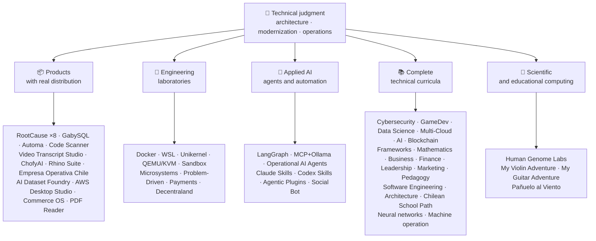

<!-- Synced from the public GitHub profile on 2026-10-16. -->

<div align="center">

# 👋व्लादिमीर Acuña

## **समाधान वास्तुकार·वरिष्ठ पूर्ण-स्टैक·डिजिटल रूपांतरण·प्रबंधन और संचालन**

**Professionally trained in Computer Science and Computing Engineering and Business Administration, with 16+ years building and operating software in real environments. I connect business, people, processes, and technology to design, evaluate, deliver, and sustain solutions with technical judgment and an operational view — backed by verifiable evidence in this GitHub account.**

[](https://vladimiracunadev-create.github.io/)
[](https://www.linkedin.com/in/vladimir-acu%C3%B1a-valdebenito-11924a29/)
[](mailto:vladimir.acuna.dev@gmail.com)

[](#वयवसयक-कषतर)
[](#उतपद-रयल-डसटरबयशन-क-सथ)
[](#तकनक-पठयकरम)

<!-- STATS:START -->
[](https://github.com/vladimiracunadev-create?tab=repositories)
[](https://github.com/vladimiracunadev-create?tab=repositories)
[](#परसथतक-ततर-एक-झलक-म)
[](#तकनक-पठयकरम)
[](https://github.com/vladimiracunadev-create?tab=repositories)
<!-- STATS:END -->

[](https://github.com/vladimiracunadev-create?tab=repositories)
[](https://github.com/vladimiracunadev-create?tab=followers)

[🌐 Portfolio (22 languages)](https://vladimiracunadev-create.github.io/) ·
[🧩 Ecosystem](#परसथतक-ततर-एक-झलक-म) ·
[⚡ Evaluate me in 10 minutes](#यद-आपक-पस-10-मनट-ह-त-मझ-खल-करन-क-लए) ·
[✅ Professional scope](#वयवसयक-कषतर) ·
[🧭 Non-coding management](#परबधन-परशसन-और-गर-कडग-करयर-क-अवसर) ·
[📋 Role matrix](PROFESIONAL_ROLES.md) ·
[📬 Contact](#सपरक)

**🌐 पूर्ण संस्करण:** [Español](README.md) · [English](README.en.md) · [Português](README.pt.md) · [Italiano](README.it.md) · [Français](README.fr.md) · [简体中文](README.zh.md) · [繁體中文](README.zh-TW.md) · [日本語](README.ja.md) · [한국어](README.ko.md) · [Türkçe](README.tr.md) · [Русский](README.ru.md) · [Tiếng Việt](README.vi.md) · [ไทย](README.th.md) · [Deutsch](README.de.md) · [Українська](README.uk.md) · [Polski](README.pl.md) · [العربية](README.ar.md) · [فارسی](README.fa.md) · [Bahasa Indonesia](README.id.md) · [Nederlands](README.nl.md) · [हिन्दी](README.hi.md) · [Ελληνικά](README.el.md)

**तकनीकी कोर:**
PHP 8 · Python · Rust · Go · Node/TS · Java 21 · .NET 8 · Dart/Flutter · WASM
· AWS · Terraform · Kubernetes · Docker · n8n · LangGraph/MCP · CI/CD · FinOps · Observability

**व्यापार प्रौद्योगिकी पुल:**
प्रक्रिया और आवश्यकताओं विश्लेषण·समाधान मूल्यांकन·वितरण समन्वय·संचालन और निरंतरता·जोखिम प्रबंधन·उत्पाद और सेवा·तकनीकी शिक्षा

</div>

---

> [!NOTE]
> यह प्रोफ़ाइल अनुभव में अवसर नहीं बदलती है। सिद्ध तकनीकी अनुभव, हस्तांतरणीय कौशल, व्यवहार्य अनुप्रयोग और भविष्य के विकास के लक्ष्य स्पष्ट रूप से अलग हो जाते हैं। लिंक्ड गिटहब सबूत निष्पादन योग्य या दस्तावेजी है; जहां कुछ है**नहीं**समाप्त हो गया, यह इस तरह के रूप में कहा जाता है।

## 🎯आपको यहाँ क्या मिलेगा

यह "एक रेपो" नहीं है: यह साझा मानकों के साथ एक पारिस्थितिकी तंत्र है।

- 🔁 **Reproducible demos**— क्लोन, रन, मान्य।
- 🧰 **मानकीकृत टूलिंग**- मेकफ़ाइल्स, हब सीएलआई,`doctor`, और`smoke`प्रति भंडार
- 🛡️ **गहराई में रक्षा**- गुप्त स्कैनिंग, नीतियों और स्पष्ट रूप से निषिद्ध प्रथाओं।
- 📈 **अवलोकन** — `/health`, `/ready`, `/metrics`डैशबोर्ड, और अनुरेखणता।
- 📚 **ऑडियंस-एवेयर प्रलेखन**- रिपोजिटरी के आधार पर भर्तीकर्ता, शुरुआतकर्ता, देवोप, या सुरक्षा।
- 📦 **उत्पाद वितरण**- डाउनलोड करने योग्य रिलीज, चेकसम और सबूत का निर्माण; वाणिज्यिक / स्टोर हस्ताक्षर जब लागू किया लंबित घोषित किया गया।
- 🌍 **अंतर्राष्ट्रीयकरण**22 भाषाओं में पोर्टफोलियो (ES)·एन·पीटी·आईटी·FR·ZH).
- 🧭 **तकनीकी ईमानदारी**— प्रत्येक मामले में लेबल`OPERATIONAL`, `DOCUMENTED/SCAFFOLD`या`PLANNED`.

## ✅सत्यापन योग्य स्थिति

| सतह | ठोस सबूत |
|---|---|
| 🧪 **टेस्ट कवरेज** | GabySQL**828 टेस्ट**+ फ्यूज़िंग ओवर**503.8M क्वेरीज़**(0 panics)·Empresa ओपेरा चिल**158 परीक्षण** ·ऑटोमा**150 pytest** ·बहु-OS CI |
| 🤖 **उत्पादन ग्रेड एजेंट** | लैंग्वेज रियलवर्ल्ड**25/25 परिचालन परिवर्धन**(मामसूम 01-25, 100% कवरेज)·ऑपरेशनल एआई एजेंट**13 एजेंट**साथ**39 नियतिवादी evals** |
| 🔗 **Polyglot एकीकरण** | **20 मामले**प्रेषक → n8n → receiver —**19 परिचालन**व्यक्तिगत रूप से डॉकर के साथ लेखा परीक्षा· **18+ DB इंजन** · **20+ कंटेनर** ·11 पैटर्न |
| 📦 **वितरण** | **151 रिलीज़**एक पारिस्थितिकी तंत्र के पार**64 स्वामित्व वाली सार्वजनिक भंडार** ·संस्थापक और कलाकृतियों`.exe` · `.msi` · `.dmg` · `.apk`चेकसम और साक्ष्य का निर्माण; प्रगति पर वाणिज्यिक / स्टोर हस्ताक्षर जहां लागू हो |
| 🛡️ **आपूर्ति श्रृंखला** | कोड·Semgrep·बंदी·त्रिवी·Grype·गिटलाक·TruffleHog·चक्रवातDX SBOM·स्कोरकार्ड |
| 📚 **Curricula** | **14,530 classes** verifiable across 21 programs, counted by [a workflow](.github/workflows/stats.yml) from real repository structure or a verifiable source declared in the repository —not written by hand— · every program declares its editorial status and limitations |
| 🌐 **पोर्टफोलियो** | इंस्टॉल करने योग्य PWA· **22 भाषाएँ** · **154 PDF**पाइपलाइन द्वारा उत्पन्न·CV डेटा API·संधारित्र एंड्रॉयड·लाइटहाउस 100 |
| 🔒 **टेलीमेट्री** | फोरेंसिक उत्पादों और Empresa ओपेरा चिले में शून्य टेलीमेट्री - हर निर्माण में सत्यापित (कोई Android नहीं)`INTERNET`अनुमति |
| 🌐 **प्रकाशित स्थल** | **56 GitHub पेज साइटें**-55 लैंडिंग, एक प्रति उत्पाद, कार्यक्रम, या पारिस्थितिकी तंत्र नेविगेटर, साथ ही पोर्टफोलियो- प्रत्येक अपने स्वयं के भंडार से तैनात·सभी 56 HTTP के साथ सत्यापित`200` |

## 🗺️पारिस्थितिकी तंत्र एक झलक में



## 📦उत्पाद रियल डिस्ट्रीब्यूशन के साथ

सॉफ्टवेयर जो डाउनलोड, इंस्टाल किया गया है और इस्तेमाल किया गया है - न केवल क्लोन किया गया।

| उत्पाद | क्या है | स्टैक | डिलिवरी |
|---|---|---|---|
| [🔍 **RootCause Windows**](https://github.com/vladimiracunadev-create/rootcause-windows-inspector) | साइबर सुरक्षा फोरेंसिक: हर सर्वसम्मतिपूर्ण संसाधन विरूपण एक खतरे का पहला संकेत हो सकता है। पहले निदान, बाद में हस्तक्षेप | रुस्ट🦀 ·EETW/WPR | **v0.19.0** · **16 रिलीज़** · **5 संस्करण**A-GUI·पोर्टेबल·सी एल आई·पावरशेल·वीएस कोड· [landing](https://vladimiracunadev-create.github.io/rootcause-windows-inspector/) |
| [📱 **RootCause Mobile**](https://github.com/vladimiracunadev-create/rootcause-mobile-inspector) | मोबाइल भाई-बहन: एक फोरेंसिक सेंसर जो प्रत्येक ऐप को अपने खिलाफ तुलना करता है, झंडे के तारेवेयर, और अलग-अलग अनुमतियों को केवल अनुरोधित लोगों से अलग करता है। | फ्लुटर·कोट्टलिन·स्विफ्ट | **v0.8.0** ·Android APK·5 भाषाओं· **शून्य टेलीमेट्री** · [landing](https://vladimiracunadev-create.github.io/rootcause-mobile-inspector/) |
| [🍎 **RootCause macOS**](https://github.com/vladimiracunadev-create/rootcause-macos-inspector) | MacOS संस्करण:`launchd`दृढ़ता, गेटकीपर, एसआईपी, फ़ाइलवॉल्ट, एक्सप्रोटेक्ट, टीसीसी अनुमतियां, हस्ताक्षरित प्रक्रियाएं और नेटवर्क पड़ोसी - प्रत्येक सतह को एक ज्ञात-अच्छा राज्य के खिलाफ जांच की जाती है | रुस्ट🦀 ·MacOS 13+ | **v0.1.0** ·प्रथम प्रकाशित रिलीज़·अपाचे-2.0· [landing](https://vladimiracunadev-create.github.io/rootcause-macos-inspector/) |
| [🖥️ **RootCause Server**](https://github.com/vladimiracunadev-create/rootcause-server) | The server sibling: correlates what no single log sees together — exposed surface, access-attempt bursts, a session granted to that same address, critical file integrity, and sensor silence — and turns it into one actionable sentence | Rust 🦀 · Windows · Linux · macOS | **v0.2.0** · **18 rules** with evidence and runbook · never executes actions on its own · local console without web dependencies · **no published release yet** · [landing](https://vladimiracunadev-create.github.io/rootcause-server/) |
| [🌐 **RootCause Web**](https://github.com/vladimiracunadev-create/rootcause-web-inspector) | ब्राउज़र फोरेंसिक सेंसर: कुकीज़, ईमेल सत्र, एक्सटेंशन, डाउनलोड, अनुमतियां और पृष्ठ जो वास्तविक विंडो की नकल करते हैं | जावास्क्रिप्ट·MV3 एक्सटेंशन | **v0.2.0** ·अभी तक कोई प्रकाशित रिलीज़ नहीं·पैनल पर`127.0.0.1` ·शून्य निर्भरता·CI में सत्यापित शून्य टेलीमेट्री· [landing](https://vladimiracunadev-create.github.io/rootcause-web-inspector/) |
| [₿ **RootCause Bitcoin Defense**](https://github.com/vladimiracunadev-create/rootcause-bitcoin-defense) | Watch-only defense for Bitcoin custody: inventories the origin of each key, cross-checks it with published warnings, and explains root cause with evidence | JavaScript · Windows app · local panel | **v0.3.0** · **2 releases** · zero dependencies · never asks for seeds · verified in CI · [landing](https://vladimiracunadev-create.github.io/rootcause-bitcoin-defense/) |
| [⛓️ **RootCause Blockchain Security**](https://github.com/vladimiracunadev-create/rootcause-blockchain-security) | मल्टी-चेन घड़ी केवल सांत्वना: आविष्कारों के अनुबंध, प्रॉक्सी, oracles, पुल, शासन, और निर्भरता, और जड़-काउज़ runbooks उत्पन्न | जावास्क्रिप्ट·Windows app·स्थानीय पैनल | **v0.3.0**भंडार में·प्रकाशित रिलीज़:`v0.1.0` ·शून्य निर्भरता·कभी निजी कुंजी के लिए पूछता है·CI में सत्यापित· [landing](https://vladimiracunadev-create.github.io/rootcause-blockchain-security/) |
| [📷 **RootCause QR Inspector**](https://github.com/vladimiracunadev-create/rootcause-qr-inspector) | Local Android app for inspecting QR codes before acting: explains 26 signals, separates facts from hypotheses, and exports redacted evidence | Flutter · Dart | **v0.1.4** · **5 releases** · **107 tests** · published Android APK · verifiable SHA-256 · technical APK package signature; commercial/store signatures in progress · zero telemetry · [landing](https://vladimiracunadev-create.github.io/rootcause-qr-inspector/) |
| [🏢 **Empresa Operativa Chile**](https://github.com/vladimiracunadev-create/empresa-operativa-chile) | प्रत्येक मासिक बंद करने के लिए निगमन से पहले एक SpA गाइड: साक्ष्य के साथ निगमन, VAT कैरी-फॉरवर्ड, F29 ड्राफ्ट, अचल बंद और ऑडिट लॉग. हर नियम अपने आधिकारिक स्रोत को इंगित करता है | जावास्क्रिप्ट·रुस्ट·पीडब्लूए | **v1.5.0** ·Android·Windows·ब्राउज़र· **158 परीक्षण** · **0 उत्पादन निर्भरता** ·शून्य टेलीमेट्री· [landing](https://vladimiracunadev-create.github.io/empresa-operativa-chile/) |
| [🔍 **Universal Code Scanner**](https://github.com/vladimiracunadev-create/universal-code-scanner) | QR और बारकोड रीडर**अभिनय से पहले व्याख्या**16 स्थानीय यूआरएल जोखिम संकेत और स्पष्ट पुष्टि | फ्लुटर·डार्ट | **v1.1.0** ·Android·आईओएस·मैक ओएस·पीडब्लूए·एन्क्रिप्टेड इतिहास**AES-256-GCM** · [landing](https://vladimiracunadev-create.github.io/universal-code-scanner/) |
| [🗄️ **GabySQL**](https://github.com/vladimiracunadev-create/gabysql) | एम्बेडेड डेटाबेस: एकल`.db`फ़ाइल, WAL, लागत आधारित अनुकूलनकर्ता, HTTP / JSON API | रुस्ट🦀 | Windows·मैक ओएस·लिनक्स· [landing](https://vladimiracunadev-create.github.io/gabysql/) |
| [🤖 **Automa PC**](https://github.com/vladimiracunadev-create/automa-pc) | स्थानीय ऑर्केस्ट्रेटर: JSON प्रवाह जो वास्तविक खिड़कियां खोलते हैं, DOM के साथ बातचीत करते हैं, और सबूत छोड़ देते हैं | पायथन·प्लेराइट·Pywebview | **v0.3.0** · **27 प्रवाह** ·प्रकाशित और सत्यापन योग्य इंस्टॉलर· [landing](https://vladimiracunadev-create.github.io/automa-pc/) |
| [🏭 **AI Dataset Foundry**](https://github.com/vladimiracunadev-create/ai-dataset-foundry) | स्थानीय-पहली फैक्ट्री जो पूर्ववर्ती, ठीक-ट्यूनिंग, आरएजी और मूल्यांकन के लिए लेखापरीक्षित डेटासेट में पीडीएफ, वर्ड, वेब, गिट, जेएसओएन और सीएसवी को बदल देती है। | पायथन | **v0.2.0** ·Windows + Internet Android·प्रथम प्रकाशित रिलीज़· [landing](https://vladimiracunadev-create.github.io/ai-dataset-foundry/) |
| [☁️ **AWS Desktop Studio**](https://github.com/vladimiracunadev-create/aws-desktop-studio) | 15 AWS इन्वेंट्री एकीकरण, 20 ट्यूटोरियल, CLI/SSO, और केवल डिफॉल्ट के साथ स्थानीय-पहली ऐप; प्रगति में कार्यान्वयन, सार्वभौमिक पहुंच नहीं | जावास्क्रिप्ट·Windows | **v0.1.1** ·प्रथम प्रकाशित रिलीज़· [landing](https://vladimiracunadev-create.github.io/aws-desktop-studio/) |
| [🧭 **Commerce OS**](https://github.com/vladimiracunadev-create/commerce-operating-system) | व्यावसायिक संचालन के निर्देशित वैचारिक डेमो: सूची, स्टॉक, सीआरएम, ऑर्डर, नकली भुगतान और पता लगाने की क्षमता | जावास्क्रिप्ट·वेब·Windows·Android | **v0.3.0** · **2 रिलीज़** ·कोई वास्तविक धन या चिली कर प्राधिकरण एकीकरण· [landing](https://vladimiracunadev-create.github.io/commerce-operating-system/) |
| [📄 **PDF Reader**](https://github.com/vladimiracunadev-create/pdf-reader-windows-android) | एंड्रॉयड सबसे पहले स्थानीय पढ़ने वाले पाठक, जिसमें कोई क्रॉप ज़ूम, पुनर्खुली इतिहास, व्हाट्सएप शेयरिंग और डिफ़ॉल्ट पठनीय चयन नहीं है। | एचटीएमएल·वेब·Android·Windows | **v0.3.3** ·APK·कोई लेखा, संवेदनशील अनुमतियां, या टेलीमेट्री· [landing](https://vladimiracunadev-create.github.io/pdf-reader-windows-android/) |
| [🎙️ **Video Transcript Studio**](https://github.com/vladimiracunadev-create/video-transcript-studio) | एक वीडियो, प्लेलिस्ट, या**पूरे यूट्यूब चैनल**पाठ्यपुस्तक के साथ पाठ करने के लिए। यह मौजूदा उपशीर्षक पर निर्भर नहीं है: व्हिस्पर ऑडियो को पहचानता है**अपनी मशीन पर**, कोई API, खाता, या कुंजी के साथ विन्यस्त करने के लिए | पायथन·PySide6·फास्टएपीआई·तेज़-whisper | **v0.2.0** ·Windows डेस्कटॉप + स्थानीय पैनल पर`127.0.0.1`+ CLI,**उसी कतार को साझा करना** ·एमडी·PDF·TXT·एसआरटी·VTT·जेएसओएन·एमपी 3·ओजीजी· **89 परीक्षण** ·बंडल Fmpeg·शून्य टेलीमेट्री· [landing](https://vladimiracunadev-create.github.io/video-transcript-studio/) |
| [🎨 **ChofyAI Studio**](https://github.com/vladimiracunadev-create/chofyai-studio) | स्थानीय रचनात्मक एआई लॉन्चर: ऑर्केस्ट्रेट Qwen3-TTS, whisper.cpp, FaceFusion, AceForge, and ComfyUI | 2·रुस्ट·प्रतिक्रिया | v0.5.1· **5/5 उपकरण, जो वास्तविक निवेश के साथ हैं** ·MacOS Apple सिलिकॉन·प्रयोगात्मक Windows· **अभी तक कोई प्रकाशित रिलीज़ नहीं** · [site](https://vladimiracunadev-create.github.io/chofyai-studio/) |
| [🦏 **Rhino Suite**](https://github.com/vladimiracunadev-create/rhino-suite) | खरोंच से कार्यालय सूट: दस्तावेज़ नियम DOM पर निर्भर नहीं करते - एचटीएमएल केवल एक प्रक्षेपण है | जंग/WASM·गो·19 अधिनियम | चरणों द्वारा विकासवादी मोनोरेपो· [landing](https://vladimiracunadev-create.github.io/rhino-suite/) |
| [🎻 **My Violin Adventure**](https://github.com/vladimiracunadev-create/violin-adventure) | बच्चों के लिए शैक्षिक ऐप: क्रोमेटिक ट्यूनर, ऑडियो-क्लॉक-अकरीट मेट्रोनोम, वास्तविक वायलिन के साथ गीत | 2·प्रतिक्रिया·टीएस | **v1.3.0** ·Windows·Android·लिनक्स·मैक ओएस·पीडब्लूए· [landing](https://vladimiracunadev-create.github.io/violin-adventure/) |
| [🎸 **My Guitar Adventure**](https://github.com/vladimiracunadev-create/guitarra-adventure) | प्लक-स्ट्रिंग सिबलिंग: 6 दुनिया में 24 सबक, 6 स्ट्रिंग ट्यूनर, बहाव मुक्त मेट्रोनोम और 11 वास्तविक गिटार नोट | 2·प्रतिक्रिया·टीएस | **v1.0.0** ·Windows·Android·लिनक्स·मैक ओएस·आईओएस·पीडब्लूए·कोई खाता, विज्ञापन, या ऑनलाइन निर्भरता नहीं· [landing](https://vladimiracunadev-create.github.io/guitarra-adventure/) |
| [🧣 **Pañuelo al Viento**](https://github.com/vladimiracunadev-create/panuelo-al-viento-cueca-app) | 10 वर्ष की आयु से क्यूका: 8 स्तरों में 24 वर्ग, 72 गतिविधियाँ, छह-पल्स लैब (3+3 और 2+2+2) और सुलभ मंजिल आरेख। यह बताता है कि यह**पूरक, प्रतिस्थापित नहीं**शिक्षकों और संस्कृति वाहक | फ्लुटर·डार्ट | **v0.2.0** ·Android 7+·Windows 10/11·APK·EXE·एमएसआई·पोर्टेबल· **29 परीक्षण + 2 सत्यापनकर्ता** ·कोई कैमरा, माइक्रोफोन, खाता, विज्ञापन, या इंटरनेट· [landing](https://vladimiracunadev-create.github.io/panuelo-al-viento-cueca-app/) |

## 🧪इंजीनियरिंग प्रयोगशाला

| रेपो | यह क्या दर्शाता है |
|---|---|
| [🐳 **Problem-Driven Systems Lab**](https://github.com/vladimiracunadev-create/problem-driven-systems-lab) | **20 वास्तविक समस्याएं**(लोड के तहत विलंबता, N+1, पुनः प्रयास तूफान, लीक, मोनोलिथ्स, कैश स्टैम्पेड, बैकप्रेशर, शून्य-डाउनटाइम माइग्रेशन, भूल गए DLQ) उच्च-विश्वविद्यालय इंजेक्शन विफलताओं के साथ, हल में**7 स्टैक**PHP 8·पायथन·Node.js·जावा 21·8 .NET· **1.23** · **रुस्ट 1.83** · [landing](https://vladimiracunadev-create.github.io/problem-driven-systems-lab/) |
| [📆 **Social Bot Scheduler**](https://github.com/vladimiracunadev-create/social-bot-scheduler) | **v4.10.0** · **20 मामले**स्रोत → n8n → receiver over**18+ DB इंजन** —**19 परिचालन**व्यक्तिगत रूप से डॉकर के साथ लेखा परीक्षा**8-परत**लेखा परीक्षा, idempotency रेलिंग, सर्किट ब्रेकर, और DLQ· [landing](https://vladimiracunadev-create.github.io/social-bot-scheduler/) |
| [🧰 **Microsistemas**](https://github.com/vladimiracunadev-create/microsistemas) | **12 नैदानिक और आधुनिकीकरण microapps**PHP के लिए·केवल MCP सर्वर·3 चरणों में सख्त· [landing](https://vladimiracunadev-create.github.io/microsistemas/) |
| [🧪 **Docker Labs**](https://github.com/vladimiracunadev-create/docker-labs) | **13 प्रयोगशालाएं**4-सेवा प्लेटफॉर्म + स्वचालित पर`.exe`लॉन्चर के साथ इंस्टॉलर· [landing](https://vladimiracunadev-create.github.io/docker-labs/) |
| [🐳 **WSL Labs**](https://github.com/vladimiracunadev-create/wsl-labs) | **12 मामले**पर`wslc`मूल WSL कंटेनर इंजन**बिना किसी डेस्कटॉप के** · [landing](https://vladimiracunadev-create.github.io/wsl-labs/) |
| [⚡ **Unikernel Labs**](https://github.com/vladimiracunadev-create/unikernel-labs) | "Deckers डेस्कटॉप": Windows नियंत्रण WSL2 बैकएंड के साथ यूनिक्राफ्ट पर,`kraft`QEMU/KVM· [landing](https://vladimiracunadev-create.github.io/unikernel-labs/) |
| [🧰 **QEMU/KVM Labs**](https://github.com/vladimiracunadev-create/qemu-kvm-labs) | **12 लैब्स**QEMU, KVM, libvirt, क्लाउड-इनिट और के साथ वास्तविक वर्चुअलाइजेशन`vm-manager`लिनक्स और WSL2 पर· [landing](https://vladimiracunadev-create.github.io/qemu-kvm-labs/) |
| [🛡️ **Sandbox Labs**](https://github.com/vladimiracunadev-create/sandbox-labs) | लिनक्स अलगाव: घोषित नीतियों और के तहत तीसरे पक्ष के कोड, फ़ाइलों और व्यापार मॉडल चलाता है**वास्तव में लागू नियंत्रण के हस्ताक्षरित सबूत का उत्सर्जन करता है** · **36 मामले**दो परिवारों में -15 तकनीकी और 21 पूंजी बाजार -·प्रयोगात्मक और शैक्षिक घोषित, *नहीं एक सुरक्षा उत्पाद*· [landing](https://vladimiracunadev-create.github.io/sandbox-labs/) |
| [💳 **Universal Payments Engineering Lab**](https://github.com/vladimiracunadev-create/universal-payments-engineering-lab) | **28 भुगतान परिवारों**एक स्थानीय स्व-विस्तार डेमो में: राज्यों, लेजर, पारस्परिकता, सुरक्षा और कार्यान्वयन गाइड· [landing](https://vladimiracunadev-create.github.io/universal-payments-engineering-lab/) |
| [🕹️ **Decentraland Social Arcade**](https://github.com/vladimiracunadev-create/decentraland-social-arcade) | Native Decentraland social 3D अनुभव: एक MVP और SDK7, ECS, and टाइपस्क्रिप्ट के साथ एक बहु-खेल वास्तुकला·स्पेनिश दस्तावेज़ीकरण·कोई भुगतान या टेलीमेट्री |
| [☁️ **AWS Projects**](https://github.com/vladimiracunadev-create/proyectos-aws) | प्रगतिशील मामले जहां प्रत्येक व्यक्ति एक एडब्ल्यूएस सेवा जोड़ता है**और**एक नई GitHub कार्य क्षमता·SAA-C03·DVA-C02·SOA-C02 कवरेज |

## 🤖एअर इंडिया

| रेपो | यह क्या दर्शाता है |
|---|---|
| [🤖 **LangGraph RealWorld**](https://github.com/vladimiracunadev-create/langgraph-realworld) | **25/25 परिचालन परिवर्धन**टाइप स्टेट, सशर्त मार्ग, एनडीजेएसएन स्ट्रीमिंग, डीईएमओ / लाइव मोड, 8 सुरक्षा परतें, शाह-256 श्रृंखला हिरासत की |
| [🧭 **Operational AI Agents**](https://github.com/vladimiracunadev-create/operational-ai-agents) | **13 परिचालन एजेंट**क्लाउड कोड और संगत रनटाइम्स के लिए: प्रत्येक को एक पूर्ण मिशन प्राप्त होता है -अनुभवी विकास, विरासत आधुनिकीकरण, पाठ्यक्रम डिजाइन, पोर्टफोलियो प्रकाशन, सुरक्षा उपचार, घटना विश्लेषण- एक घोषित अनुबंध, मानव द्वार और सत्यापन योग्य सबूत के तहत· **39 नियतिवादी evals** ·34 परीक्षण·शून्य-डिप्स (केवल स्टिलिब)·लिनक्स·मैक ओएस·Windows· [site](https://vladimiracunadev-create.github.io/operational-ai-agents/) |
| [🧠 **MCP + Ollama Local**](https://github.com/vladimiracunadev-create/mcp-ollama-local) | एक सैंडबॉक्स में MCP उपकरण के साथ स्थानीय-पहली AI· `127.0.0.1`बांधना·बहुपरत ट्रस्ट प्रोफाइल·अपनी सीमा के बारे में ईमानदार |
| [🧩 **Agentic Plugins Toolkit**](https://github.com/vladimiracunadev-create/agentic-plugins-toolkit) | **6 एजेंटिक प्लगइन्स**क्लाउड कोड, OpenAI/Codex, Copilot, Gemini, और MCP में एक स्रोत से इंस्टॉल करने योग्य:`repository-engineering`, `legacy-modernization`, `learning-program-studio`, `product-evolution`, `portfolio-governance`, और`rootcause-response` · **69 बिना किसी बहाव के दृष्टिकोण पैदा**प्रत्येक रनटाइम को उसी अनुबंध से अपना प्रारूप प्राप्त होता है-·शून्य-डीप·लिनक्स·मैक ओएस·Windows· [site](https://vladimiracunadev-create.github.io/agentic-plugins-toolkit/) |
| [🧰 **Claude Skills Toolkit**](https://github.com/vladimiracunadev-create/claude-skills-toolkit) | **15 मनोवैज्ञानिक कौशल**क्लाउड कोड के लिए· **सुरक्षा**: 12-परत`security-audit`(OSV)·केवी·ईपीएस·एस.टी.·कंटेनर·रहस्य) और 14-चरण`bitcoin-custody-audit` · **रेपो गेट**: `pre-commit-guard`, `pre-push-guard`, `yaml-control`, `md-lint-fix`, `python-lint-guard` · **सहगामी**: `repo-coherence-audit`, `version-bump`, `python-version-control`, `python-deps-pinning` · **डकर**: `docker-cleanup`, `docker-compose-doctor` · **doc**: `md-to-doc` ·शून्य-डीप·क्रॉस-प्लेटफॉर्म |
| [🧰 **Codex Skills Toolkit**](https://github.com/vladimiracunadev-create/codex-skills-toolkit) | **19 मनोवैज्ञानिक कौशल**कोडेक्स के लिए: सुरक्षा और आपूर्ति श्रृंखला, प्रीफ्लाइट, कार्यात्मक प्रवाह, लचीलापन और राज्य, रिलीज सबूत, पायथन / या एमएल / मैकडाउन गेट्स, संस्करण, निर्भरता, डोकर और दस्तावेज़·पायथन-first· `pnpm` ·लिनक्स·मैक ओएस·Windows· [site](https://vladimiracunadev-create.github.io/codex-skills-toolkit/) |

## 📚तकनीकी पाठ्यक्रम

स्पेनिश में अनुक्रमिक कार्यक्रम, प्रत्येक भंडार द्वारा घोषित स्थिति और दायरे के साथ। 21 कार्यक्रम में शामिल हो गए**14,530 कक्षा**, द्वारा गिना[a workflow](.github/workflows/stats.yml)वास्तविक भंडार संरचना या एक सत्यापन योग्य स्रोत से जो भंडार में घोषित किया गया है; बैज साप्ताहिक ताज़ा करता है और हाथ से नहीं लिखा जाता है।

🧭 [**Lifelong Learning Ecosystem**](https://github.com/vladimiracunadev-create/lifelong-learning-ecosystem)दृश्य मानचित्रों और एक के माध्यम से 6 क्षेत्रों में 30 वास्तविक पथों को जोड़ने वाला एक federated कम्पास है[accessible offline portal](https://vladimiracunadev-create.github.io/lifelong-learning-ecosystem/)इसे अतिरिक्त प्रोग्राम के रूप में नहीं गिना जाता है।

| कार्यक्रम | कक्षा | स्कोप |
|---|---:|---|
| [🔢 **Computational Mathematics**](https://github.com/vladimiracunadev-create/computational-mathematics-program) | 360 | उंगलियों पर गिनती से एक कागज को फिर से उत्पन्न करने के लिए· **CI में सत्यापित 360 नियतात्मक प्रदर्शन** ·1,080 नोटबुक·489-term शब्दावली· [site](https://vladimiracunadev-create.github.io/computational-mathematics-program/) |
| [🏦 **Finance and Banking**](https://github.com/vladimiracunadev-create/finance-and-banking-evolution-program) | 356 | 534 h·वित्तीय गणित और IFRS → क्रेडिट, जोखिम, बेसल III, खुला वित्त, DLT, स्थिरcoins, और MiCA· **27 मामले** · **298 परीक्षण** · [site](https://vladimiracunadev-create.github.io/finance-and-banking-evolution-program/) |
| [🎮 **GameDev**](https://github.com/vladimiracunadev-create/modern-gamedev-program) | 352 | गणित और C#/C++/GDScript → छायाकार, AI, बहु-player, VR/AR·गोडो·यूनिटी·अवास्तविक· **10 गॉडॉट लैब्स सीआई में सत्यापित**(301 चेक)· [site](https://vladimiracunadev-create.github.io/modern-gamedev-program/) |
| [🛡️ **Cybersecurity**](https://github.com/vladimiracunadev-create/modern-cybersecurity-program) | 360 | **v1.3.0** ·20 भाग·नींव → रेड टीम, DFIR, क्लाउड सुरक्षा, dev, CTF और गेम सुरक्षा का फायदा उठाती है·नक्शा**7 प्रमाणन** ·ऑफ़लाइन Android / Web App·PDF·CI, सुरक्षा और पेज सत्यापित· [site](https://vladimiracunadev-create.github.io/modern-cybersecurity-program/) |
| [📈 **Marketing, Sales, and Growth**](https://github.com/vladimiracunadev-create/marketing-sales-growth-evolution-program) | 336 | परिचालन परिभाषाओं, माप पत्रों, सत्यापन योग्य ग्रंथ सूची और चिली नियामक संदर्भ के साथ 24 भागों· **v1.6.0** ·1.29M शब्द·17 भूमिका-आधारित पथ· [site](https://vladimiracunadev-create.github.io/marketing-sales-growth-evolution-program/) |
| [🏢 **Business Creation**](https://github.com/vladimiracunadev-create/modern-business-creation-program) | 336 | चिली में एक वास्तविक कंपनी बनाएं और संचालित करें: विचार से लेकर निगमन, कर प्राधिकरण, संचालन, संकट और निकास तक·360 आरेख·1,251-term शब्दावली·1,548-पृष्ठ मैनुअल· [site](https://vladimiracunadev-create.github.io/modern-business-creation-program/) |
| [🏛️ **Architecture and Built Environment**](https://github.com/vladimiracunadev-create/architecture-built-environment-learning-program) | 830 | 83 भाग·60 एकीकृत सत्र·34 पथ·पता लगाने योग्य सूत्र·Markdown, ऑफ़लाइन रीडर, और गिटहब पेज· [site](https://vladimiracunadev-create.github.io/architecture-built-environment-learning-program/) |
| [🇨🇱 **Chilean School Learning Path**](https://github.com/vladimiracunadev-create/chilean-school-learning-path) | 8,841 | ग्रेड 1-12· **4,156 एकीकृत क्रॉस-करिकुलर अनुभवों** · **2,823 सीखने के उद्देश्य** ·Mineduc सूत्र·कोई लंबित प्रस्ताव और विशेष मानव समीक्षा अभी भी लंबित· [site](https://vladimiracunadev-create.github.io/chilean-school-learning-path/) |
| [🧭 **Modern Software Engineering**](https://github.com/vladimiracunadev-create/modern-software-engineering-program) | 480 | 40 भाग और 8 चरण·नींव → उत्पाद, वास्तुकला, सुरक्षा, देवोप्स, SRE, युक्ति, एआई और बहु-एजेंट सिस्टम·संपादकीय स्थिति को रिपोज़िटरी द्वारा घोषित किया गया· [site](https://vladimiracunadev-create.github.io/modern-software-engineering-program/) |
| [🎓 **Pedagogy and Learning Sciences**](https://github.com/vladimiracunadev-create/education-pedagogy-learning-sciences-program) | 300 | From how a person learns to how teachers are trained · 25 parts · **each class declares its evidence state and limits** · early literacy, comparative methods, specific educational needs, coexistence, cultural diversity, and international evidence · 1,097-term glossary, 325 diagrams, and a 60-activity classroom bank · 14 career paths by role · LMS-exportable · **v2.1.0** · [site](https://vladimiracunadev-create.github.io/education-pedagogy-learning-sciences-program/) |
| [☁️ **Multi-Cloud**](https://github.com/vladimiracunadev-create/multi-cloud-engineering-program) | 288 | AWS·नीला·जीसीपी·कुबेरनेट्स·टेरेफॉर्म·SRE·फिनोप· **1,288 घंटे** ·JSON सबूत के साथ 288 लैब्स·1,032 ट्रेस स्रोत·2,884-page PDF मैनुअल· [site](https://vladimiracunadev-create.github.io/multi-cloud-engineering-program/) |
| [🎖️ **Executive Leadership**](https://github.com/vladimiracunadev-create/executive-leadership-founder-program) | 288 | अपने पहले परिणाम के मालिक से एक कंपनी का नेतृत्व करने और अपने आप को ढूंढने के लिए: टीमों, KPI/OKR, वित्त, उत्पाद, जोखिम, बोर्ड और M&A·24 मामले, 96 लैब्स और 39 टेम्पलेट· [site](https://vladimiracunadev-create.github.io/executive-leadership-founder-program/) |
| [🐍 **Python Data Science**](https://github.com/vladimiracunadev-create/python-data-science-program) | 232 | ध्रुवीय, एमएल + ऑप्टुना / एसएचएपी, पाइटोर्च / एलएलएम / लोरा, एमएलओपी·Windows App + Android APK· [site](https://vladimiracunadev-create.github.io/python-data-science-program/) |
| [🧠 **AI Evolution**](https://github.com/vladimiracunadev-create/artificial-intelligence-evolution-program) | 184 | प्रतीकात्मक → probabilistic → गहरी शिक्षा → LLM, RAG, एजेंट, सुरक्षा, और फ्रंटियर· **v0.17.0** · **708 नोटबुक** · **148 आधार कागज** ·ऑफ़लाइन Windows, Android, and PWA Apps· [site](https://vladimiracunadev-create.github.io/artificial-intelligence-evolution-program/) |
| [🌐 **Comparative Programming**](https://github.com/vladimiracunadev-create/polyglot-programming-labs) | 176 | एक अवधारणा,**10 भाषाओं**CI में सत्यापित**1,360 कार्यान्वयन**- प्लस**1,632 प्रोग्राम**अभी भी रहने वाली भाषाओं (COBOL, Fortran, Ada, RPG, MUMPS) में और एक atlas of the language of a s.**15 परिवारों में 60 कार्ड** ·v1.1.0· [site](https://vladimiracunadev-create.github.io/polyglot-programming-labs/) |
| [🧩 **Frameworks Compared**](https://github.com/vladimiracunadev-create/framework-ecosystems-labs) | 149 | एक निष्पादन योग्य अनुबंध, बिना एडाप्टर के, एक्सप्रेस, फास्टएपीआई, स्प्रिंग बूट, एएसपी.नेट, डीजेंगो, रेल, लारवेल, रिएक्ट, वीयू, स्वेल्ट और अधिक के खिलाफ·12 भागों· **70 निर्मित कक्षाएं** · **397 मामलों में CI में सत्यापित** · **210 ISBN/DOI स्रोत** · [site](https://vladimiracunadev-create.github.io/framework-ecosystems-labs/) |
| [🗄️ **Databases**](https://github.com/vladimiracunadev-create/database-systems-labs) | 74 | **v3.0.0** ·15 भागों में डेटाबेस इंजीनियरिंग·230 घंटे· **हर दावे के लिए सत्यापन योग्य स्रोत**: ISBN, DOI, या मानक के साथ 120 स्रोत·उसी मामले में 27 इंजनों में हल हुआ·306-term शब्दावली·150 pytest· [site](https://vladimiracunadev-create.github.io/database-systems-labs/) |
| [📐 **Psychometrics and Assessment**](https://github.com/vladimiracunadev-create/psychometrics-and-assessment-program) | 40 | कैसे एक माप उपकरण बनाया गया है, स्कोर किया, मान्य, और लेखा परीक्षा·8 भाग·साथ में निष्पादन योग्य इंजन**5 उपकरण और 344 आइटम, 276 सार्वजनिक डोमेन** |
| [⛓️ **Blockchain**](https://github.com/vladimiracunadev-create/blockchain-learning-path) | 66 | **v0.14.0** ·शून्य से प्रोग्राम करने योग्य वित्तीय बुनियादी ढांचे और ऑन-चेन एनालिटिक्स तक· **91 प्रथाओं**और**363 परीक्षण** ·सी.आई. में फाउंड्री (फ्यूज़िंग एंड इनवेरेंट्स) और स्लैट स्टेटिक विश्लेषण के साथ अनुबंध·ऑफ़लाइन ऐप द्विआधारी खोलने और इसकी सामग्री की गिनती करके सत्यापित· [site](https://vladimiracunadev-create.github.io/blockchain-learning-path/) |
| [🧠 **Neural Network Training Labs**](https://github.com/vladimiracunadev-create/neural-network-training-labs) | 31 | 7 मॉड्यूल·≈214 घंटे· **93 नोटबुक**31 कक्षाएं, 31 छात्र संस्करण और 31 समाधान-·प्रश्न, दृश्य मानचित्र, प्रथाओं और वास्तविक सार्वजनिक डेटा के साथ आकलन·PyTorch· [study site](https://vladimiracunadev-create.github.io/neural-network-training-labs/) |
| [🕹️ **Machine Operator**](https://github.com/vladimiracunadev-create/machine-operator-program) | 451 | **41 प्रशिक्षण मॉड्यूल**मशीन प्रति एक· **502 h 15 मिनट** ·सिस्टम, नियंत्रण, भौतिकी, सुरक्षा और सिमुलेशन डिजाइन प्रति वर्ग स्रोतों के साथ·अभी तक निष्पादन योग्य सिम्युलेटर नहीं है, और इसे उस तरह से घोषित किया गया है* |

## 🔬वैज्ञानिक कम्प्यूटिंग

| रेपो | यह क्या दर्शाता है |
|---|---|
| [🧬 **Human Genome Labs**](https://github.com/vladimiracunadev-create/human-genome-labs) | Reproducible genomics मंच: टाइप`ScientificResult<T>`अनुबंध, FASTA/GFF3/VCF, मॉड्यूल के साथ**स्पष्ट परिपक्वता और सबूत*** यह नैदानिक निदान नहीं करता है*· [site](https://vladimiracunadev-create.github.io/human-genome-labs/) |

## ⚡यदि आपके पास 10 मिनट हैं तो मुझे खाली करने के लिए

यह विचार सिर्फ कोड को देखने के लिए नहीं है: यह देखना है**मैं कैसे सोचूं**मैं सब कुछ कैसे कर सकता हूँ, मैं कैसे कर सकता हूँ, कैसे मैं सब कुछ कर सकता हूँ।

**रूट A - रियल servability और orchestration***(मेरे पसंदीदा)*

```bash
git clone https://github.com/vladimiracunadev-create/social-bot-scheduler.git
```

आप 19 मामलों और 18+ डीबी इंजनों में वर्कफ़्लो, मैट्रिक, डैशबोर्ड और रेलिंग देखेंगे।

**रूट B - मिनटों में पुन: प्रयोज्य बुनियादी ढांचे**

```bash
git clone https://github.com/vladimiracunadev-create/docker-labs.git
```

**रूट C — टाइप्ड स्टेट के साथ एजेंट**

```bash
git clone https://github.com/vladimiracunadev-create/langgraph-realworld.git
```

**रूट डी - जंग फोरेंसिक उत्पाद, क्लोनिंग के बिना**

इंस्टॉलर या सीएलआई द्विआधारी डाउनलोड करें[RootCause releases](https://github.com/vladimiracunadev-create/rootcause-windows-inspector/releases)सत्यापित करना`SHA256SUMS`.

## 🧠वे मानक जिन्हें मैं सभी रिपॉज़िटरी में लागू करता हूँ

- **DX पहले**- अगर यह चलाने में आसान नहीं है, तो यह डेमो के रूप में या टीम बेस के रूप में उपयोगी नहीं है।
- **1 दिन से अवलोकन**— मीट्रिक और अनुरेखण, एक बाद नहीं।
- **पाइपलाइन के रूप में सुरक्षा**- गुप्त स्कैनिंग, SBOM प्रति रिलीज, स्पष्ट रूप से निषिद्ध प्रथाओं।
- **वास्तविक लचीलापन**- idempotency, सर्किट ब्रेकर, और नियंत्रित गिरावट।
- **डिजाइन द्वारा Polyglot**— भाषा और इंजन का प्रयोग करके किया जाता है, कभी फैशन से नहीं।
- **स्थिति के बारे में ईमानदारी**— एक रेपो का नाम बदल दिया गया था (`Multisimulador` → `machine-operator-program`) आशाजनक सॉफ्टवेयर से बचने के लिए जो अभी तक मौजूद नहीं है।
- **बैज संकेत हैं, सबूत नहीं**प्रत्येक रेपो भी घोषणा करता है**क्या नहीं करना चाहिए**.
- **मॉडल बाहरी**- डोमेन को पहले डिजाइन किया गया है; इंटरफ़ेस एक प्रक्षेपण है।
- **बाह्य कार्य को बाह्य घोषित किया जाता है**- खाता के 70 सार्वजनिक भंडारों की, 64 मेरा अपना काम है। अन्य छह —[`agentic-qe`](https://github.com/vladimiracunadev-create/agentic-qe), [`Anthropic-Cybersecurity-Skills`](https://github.com/vladimiracunadev-create/Anthropic-Cybersecurity-Skills), [`erpnext`](https://github.com/vladimiracunadev-create/erpnext), [`OpenExecutive`](https://github.com/vladimiracunadev-create/OpenExecutive), [`raptor`](https://github.com/vladimiracunadev-create/raptor), और[`security-audit-skill`](https://github.com/vladimiracunadev-create/security-audit-skill)- फोर्क हैं और मेरे काम के लिए सभी आंकड़ों से बाहर रखा गया है।

## ✅व्यावसायिक क्षेत्र

मेरी दोहरी पृष्ठभूमि —**कंप्यूटर विज्ञान और कम्प्यूटिंग इंजीनियरिंग + बिजनेस एडमिनिस्ट्रेशन**- मुझे व्यावसायिक लक्ष्यों को तकनीकी निर्णयों और तकनीकी बाधाओं को संचालन, उत्पाद, ग्राहकों और नेतृत्व के लिए स्पष्ट विकल्पों में बदलने में मदद करता है।

### 🎯कोर पहचान

| भूमिका | समर्थन |
|---|---|
| **समाधान वास्तुकार** | विकासवादी निर्णय के साथ मॉड्यूलर, स्केलेबल सिस्टम डिजाइन |
| **विरासत आधुनिकीकरण वास्तुकार** | वास्तविक विरासत विकास (PHP 5.x → 8x, बिना किसी रुकावट के वृद्धिशील पुनर्निर्माण) |
| **वरिष्ठ पूर्ण-स्टैक / टेक लीड** | वास्तुकला, निष्पादन और वास्तविक प्लेटफार्मों पर मानकों (+16 वर्ष) |
| **एआई स्वचालन वास्तुकार** | लैंगग्राफ/एमसीपी के साथ एजेंटिक सिस्टम और n8n रेलिंग के साथ बहती है |

### ↗ स्वाभाविक विस्तार

**एआई ऑर्केस्ट्रेशन इंजीनियर** · **सिस्टम / जंग इंजीनियर** · **मोबाइल इंजीनियर (फ्लटर)** · **समाधान इंजीनियर** · **तकनीकी उत्पाद बिल्डर** · **तकनीकी ट्रेनर** · **डिजिटल ट्रांसफॉर्मेशन सलाहकार** · **व्यापार / कार्यात्मक विश्लेषक** · **तकनीकी उत्पाद संचालन**

### ⚙️पूरक क्षेत्र

प्लेटफार्म इंजीनियर / आईडीपी·देवऑप्स / सीआई-सीडी·क्लाउड / एडब्ल्यूएस इंजीनियर·आवेदन SRE·स्वचालन इंजीनियर·तकनीकी सलाहकार

## 🧭प्रबंधन, प्रशासन और गैर कोडिंग कैरियर के अवसर

यह दायरा दावा नहीं करता कि हर शीर्षक आयोजित किया गया है। यह उन काम को प्राथमिकता देता है जहां कंप्यूटिंग, व्यापार प्रशासन और सार्वजनिक सबूतों का संयोजन कोर कर्तव्य होने के बिना कोडिंग के मूल्य बना सकता है।

| व्यावसायिक परिवार | मान्यता प्राप्त भूमिका | ईमानदार वर्गीकरण | कोड | साक्ष्य और शर्त |
|---|---|---|---|---|
| **प्रौद्योगिकी नेतृत्व** | आईटी के प्रमुख·IT Operations Manager·डिजिटल ट्रांसफॉर्मेशन मैनेजर·सी आई आई | **अनुप्रयोग क्षमता / भविष्य लक्ष्य** | None/occasional | मजबूत तकनीकी आधार; लोग, बजट, विक्रेता और कार्यकारी जवाबदेही को अलग से साबित किया जाना चाहिए |
| **परियोजना प्रबंधन** | आईटी परियोजना समन्वयक / प्रबंधक·PMO·स्क्रम मास्टर·Aile Delivery | **हस्तांतरणीय / अनुप्रयोग क्षमता** | None/occasional | डिलिवरी और रिहा सबूत; औपचारिक टीम, बजट और प्रायोजक जिम्मेदारी एक अंतर बनी हुई है |
| **व्यवसाय प्रशासन** | व्यवसाय प्रशासक·प्रशासन / संचालन प्रबंधक·अनुबंध प्रशासक | **अनुप्रयोग** | कोई नहीं | व्यापार की डिग्री और परिचालन कलाकृतियों; संसाधनों, लोगों और आपूर्तिकर्ताओं के सत्यापित स्वामित्व की आवश्यकता है |
| **रणनीति और परिवर्तन** | रणनीति सलाहकार·प्रबंधक बदलें·कॉर्पोरेट योजना·नवाचार / परिवर्तन | **हस्तांतरणीय / अनुप्रयोग क्षमता** | कोई नहीं | विरासत आधुनिकीकरण और समाधान मूल्यांकन; संगठनात्मक गोद लेने के परिणामों को प्रदर्शित किया जाना चाहिए |
| **व्यापार विश्लेषण** | व्यापार विश्लेषक·कार्यात्मक /प्राप्ति विश्लेषक·बीपीएम·सतत सुधार | **हस्तांतरणीय / अनुप्रयोग क्षमता** | None/occasional | डोमेन मॉडलिंग और आवश्यकताओं के सबूत; बाहरी हितधारक मामलों दावे को मजबूत करेगा |
| **उत्पाद और सेवा** | उत्पाद मालिक/प्रबंधक·उत्पाद संचालन·सेवा वितरण·ग्राहक सफलता | **हस्तांतरणीय / अनुप्रयोग क्षमता** | None/occasional | रोडमैप, लाइफसाइकल, रिलीज़ और संचालन; पीएंडएल, ग्राहक पोर्टफोलियो और एसएलए सबूत भूमिका के अनुसार भिन्न होते हैं |
| **साइबर सुरक्षा प्रबंधन** | जीआरसी·आईटी नियंत्रण लेखा परीक्षक·प्रौद्योगिकी जोखिम·सूचना सुरक्षा / निरंतरता | **अनुप्रयोग** | None/occasional | नियंत्रण और रूटकैउज़ सबूत; संगठनात्मक लेखा परीक्षा और प्रासंगिक क्रेडेंशियल लंबित हैं |
| **वाणिज्यिक और बिक्री** | प्रौद्योगिकी Presales·समाधान सलाहकार·तकनीकी KAM·B2B व्यवसाय विकास | **हस्तांतरणीय / अनुप्रयोग क्षमता** | कोई नहीं | मजबूत समाधान/मूल्य अनुवाद; कोटा, खाता पोर्टफोलियो, और अनुबंध वार्ता का दावा नहीं किया जाता है |
| **वित्त और प्रबंधन नियंत्रण** | बजट / लागत विश्लेषक·परियोजना मूल्यांकन·FP&A·प्रबंधन नियंत्रण | **अनुप्रयोग** | कोई नहीं | वित्त / वित्त / अधिनियमों की कलाकृतियों; वास्तविक बजट, वित्तीय बयान और कॉर्पोरेट KPI की आवश्यकता है |
| **गुणवत्ता** | प्रक्रिया / गुणवत्ता विश्लेषक·प्रक्रिया लेखा परीक्षक·सतत सुधार | **हस्तांतरणीय / अनुप्रयोग क्षमता** | None/occasional | गेट्स, परीक्षण, मीट्रिक और उत्तरदायित्व; औपचारिक गुणवत्ता प्रणाली स्वामित्व एक अंतर रहता है |
| **शिक्षा** | तकनीकी ट्रेनर·सुविधा·अकादमिक समन्वयक·एडटेक / निर्देशन डिजाइनर | **हस्तांतरणीय / अनुप्रयोग क्षमता** | None/occasional | 21 कार्यक्रम और 14,530 कक्षाएं; औपचारिक शिक्षण और शिक्षार्थी परिणामों को अलग से प्रमाणित किया जाना चाहिए |
| **रसद और आपूर्तिकर्ता** | खरीद·आपूर्ति / ऑपरेशन समन्वयक·विक्रेता/संविदा प्रबंधक | **अनुप्रयोग** | कोई नहीं | प्रक्रिया और प्रशासन का आधार; वास्तविक खरीद, सूची और आपूर्तिकर्ता प्रदर्शन की आवश्यकता है |
| **डेटा और एआई शासन** | डेटा स्ट्वर्ड·डाटा प्रशासन·एआई अपनाने / शासन | **हस्तांतरणीय / अनुप्रयोग क्षमता** | None/occasional | लेखापरीक्षित डेटासेट और मानव-गणित एजेंट; संगठनात्मक नीतियों और समितियों एक अंतर बने |
| **Public sector** | Institutional Modernization · ICT Coordinator · Digital Projects · Public Planning | **Application potential** | None | Chilean-context systems and traceability; public procurement and sector experience are not claimed |

The [full Spanish role matrix](PROFESIONAL_ROLES.md) details objectives, responsibilities, market experience, complementary knowledge, evidence, compatibility, and gaps across all 14 families.

## 🤖एआई-एसिस्टेड डेवलपमेंट फ्लो

| उपकरण | मुख्य उपयोग |
|---|---|
| **क्लाउड कोड** | वास्तु समीक्षा, कार्यान्वयन और तकनीकी प्रलेखन |
| **ChatGPT Plus** | विश्लेषण, वास्तुकला और पुनरावृत्ति (२०२३ से) |
| **कोडेक्स** | कोड जनरेशन और रिफैक्टरिंग |
| **Antigravity** | विकास और स्वचालन प्रवाह का त्वरण |
| **VS कोड / OpenCode** | एकीकृत एआई सहायता के साथ वातावरण |

> मैं अपने तकनीकी निर्णय, मानव सत्यापन और वास्तुशिल्प दिशा को जोड़ती हूं। एआई क्षमता, गति और पहुंच को बढ़ाता है - यह अनुभव की जगह नहीं लेता है।

## 📌उपलब्धता

**करने के लिए खुला:**वरिष्ठ पूर्ण-स्टैक·आर्किटेक्चर·विरासत आधुनिकीकरण·प्लेटफार्म / IDP·आवेदन SRE·Pragmatic DevOps·स्वचालन·एआई स्वचालन·व्यावसायिक विश्लेषण·आईटी परियोजना समन्वय·उत्पाद संचालन·डिजिटल रूपांतरण·समाधान परामर्श/बिक्री·तकनीकी शिक्षा·गुणवत्ता और निरंतर सुधार·एआई गोद लेने और शासन

**Evaluated according to each role’s scope:** Product Owner / technical Product Manager · Service Delivery · IT Operations · GRC / technology risk · administration and operations · management control · public-sector modernization. Executive and general-management titles are future development goals, not claimed experience.

**मोटलिटी:**रिमोट या हाइब्रिड परियोजना के आधार पर।

## 📬संपर्क

[](https://vladimiracunadev-create.github.io/)
[](https://www.linkedin.com/in/vladimir-acu%C3%B1a-valdebenito-11924a29/)
[](https://gitlab.com/vladimir.acuna.dev-group/vladimir.acuna.dev-group)
[](mailto:vladimir.acuna.dev@gmail.com)

---

<div align="center">

[🤝 Contribute](CONTRIBUTING.en.md) ·
[🛡️ Security](SECURITY.en.md) ·
[⚖️ Code of Conduct](CODE_OF_CONDUCT.en.md)

<sub>README ने सार्वजनिक प्रस्तावों की सत्यापित स्थिति के साथ सिंक्रनाइज़ किया - एपीआई के माध्यम से पढ़ने के लिए कॉन्फ़िगर और परिवर्तन -·अंतिम सत्यापन: अक्टूबर 12, 2026।</sub>

</div>
