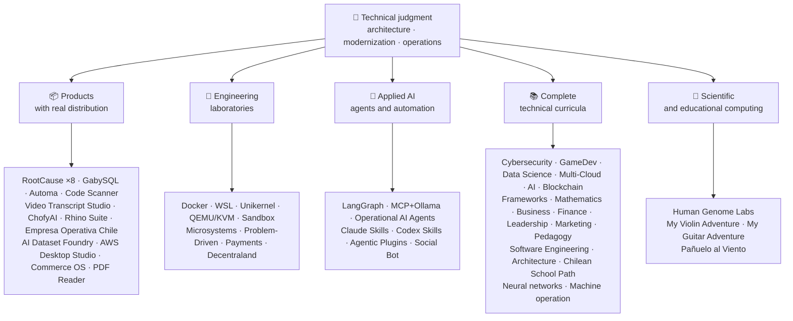

<!-- Synced from the public GitHub profile on 2026-10-16. -->

<div align="center">

# 👋Vladimir Acuña

## **Arsitek Solusi·Senior Full- Stack·Transformasi Digital·Manajemen & Operasi**

**Secara profesional terlatih dalam Ilmu Komputer dan Teknik Komputer dan Administrasi Bisnis, dengan 16 tahun membangun dan perangkat lunak operasi di lingkungan nyata. Saya menghubungkan bisnis, orang, proses, dan teknologi untuk merancang, mengevaluasi, memberikan, dan mempertahankan solusi dengan penilaian teknis dan pandangan operasional - didukung oleh bukti yang dapat diverifikasi dalam akun GitHub ini.**

[](https://vladimiracunadev-create.github.io/)
[](https://www.linkedin.com/in/vladimir-acu%C3%B1a-valdebenito-11924a29/)
[](mailto:vladimir.acuna.dev@gmail.com)

[](#scope-profesional)
[](#produk-dengan-distribusi-nyata)
[](#curricula-teknis-lengkap)

<!-- STATS:START -->
[](https://github.com/vladimiracunadev-create?tab=repositories)
[](https://github.com/vladimiracunadev-create?tab=repositories)
[](#ekosistem-pada-a-glance)
[](#curricula-teknis-lengkap)
[](https://github.com/vladimiracunadev-create?tab=repositories)
<!-- STATS:END -->

[](https://github.com/vladimiracunadev-create?tab=repositories)
[](https://github.com/vladimiracunadev-create?tab=followers)

[🌐 Portfolio (22 languages)](https://vladimiracunadev-create.github.io/) ·
[🧩 Ecosystem](#ekosistem-pada-a-glance) ·
[⚡ Evaluate me in 10 minutes](#jika-kau-memiliki-10-menit-untuk-mengevaluasi-aku) ·
[✅ Professional scope](#scope-profesional) ·
[🧭 Non-coding management](#manajemen-administrasi-dan-non--coding-kesempatan-karir) ·
[📋 Role matrix](PROFESIONAL_ROLES.md) ·
[📬 Contact](#kontak)

**🌐 Versi lengkap:** [Español](README.md) · [English](README.en.md) · [Português](README.pt.md) · [Italiano](README.it.md) · [Français](README.fr.md) · [简体中文](README.zh.md) · [繁體中文](README.zh-TW.md) · [日本語](README.ja.md) · [한국어](README.ko.md) · [Türkçe](README.tr.md) · [Русский](README.ru.md) · [Tiếng Việt](README.vi.md) · [ไทย](README.th.md) · [Deutsch](README.de.md) · [Українська](README.uk.md) · [Polski](README.pl.md) · [العربية](README.ar.md) · [فارسی](README.fa.md) · [Bahasa Indonesia](README.id.md) · [Nederlands](README.nl.md) · [हिन्दी](README.hi.md) · [Ελληνικά](README.el.md)

**Inti teknis:**
PHP 8 · Python · Rust · Go · Node/TS · Java 21 · .NET 8 · Dart/Flutter · WASM
· AWS · Terraform · Kubernetes · Docker · n8n · LangGraph/MCP · CI/CD · FinOps · Observability

**Bisnis-jembatan teknologi:**
analisis proses dan persyaratan·evaluasi solusi·koordinasi pengiriman·operasi dan kontinuitas·manajemen risiko·produk dan layanan·pendidikan teknis

</div>

---

> [!NOTE]
> Profil ini tidak mengubah peluang menjadi pengalaman. Diproduksi pengalaman teknis, keterampilan transferable, aplikasi yang layak, dan tujuan pembangunan masa depan secara eksplisit dipisahkan. Terkait dengan bukti GitHub dapat dieksekusi atau dokumenter; dimana sesuatu berada**tidak**selesai, itu dinyatakan seperti itu.

## 🎯Apa yang akan Anda temukan di sini

Ini bukan "satu repo": ini adalah ekosistem dengan standar bersama.

- 🔁 **Demo dapat direproduksi**- Klon, lari, validasi.
- 🧰 **Standardisasi Tooling**- Makefiles, Hub CRI,`doctor`, dan`smoke`per repositori.
- 🛡️ **Pertahanan dalam kedalaman**- Pemindaian rahasia, kebijakan, dan praktek terlarang secara eksplisit.
- 📈 **Observasi** — `/health`, `/ready`, `/metrics`, dasbor, dan traceability.
- 📚 **Dokumentasi audiencearenalitentment**- perekrut, pemula, DevOps, atau keamanan, tergantung pada repositori.
- 📦 **Pemrograman distribusi**- bisa diunduh rilis, checksums, dan membuat bukti; tanda tangan komersial / store dideklarasikan sebagai tertunda ketika berlaku.
- 🌍 **Internasionalisasi**- Portofolio dalam 22 bahasa (ES·EN·PT·IT·FR·ZH).
- 🧭 **Kejujuran teknis**- setiap kasus berlabel`OPERATIONAL`, `DOCUMENTED/SCAFFOLD`, atau`PLANNED`.

## ✅Status Dapat Diverifikasi

| Permukaan | Bukti beton |
|---|---|
| 🧪 **Uji cakupan** | GabySQL**828 tes**+ fuzzing over**Kueri 503.8M**(0 panik)·Empresa Operativa Chile**158 tests** ·Automa**150 pytest** ·multi- OS CI |
| 🤖 **Agen-kelas-produksi** | LangGrafik RealWorld**25 / 25 backend operasional**(kasus 01- 25, 100% cakupan)·Agen AI Operasional**13 agen**dengan**39 deterministik eval** |
| 🔗 **Integrasi Polyglot** | **20 kasus**- = Sender Avern8n Penerima = -**19 operasional**, secara individual diaudit dengan Docker -· **18 + mesin DB** · **20 + kontainer** ·11 pola |
| 📦 **Distribusi** | **151 rilis**di seluruh ekosistem**64 repositori publik milik** ·installers dan artifak`.exe` · `.msi` · `.dmg` · `.apk`dengan jumlah dan bukti yang ada; tanda tangan komersial / toko dalam proses dimana dapat diterapkan |
| 🛡️ **Rantai Supply** | CodeQL·Semgrep·Bandit·Trivy·Grype·Gitleaks·TruffleHog·CycloneDX SBOM·Scorecard |
| 📚 **Curricula** | **Kelas 14,530**diverifikasi di seluruh 21 program, dihitung oleh[a workflow](.github/workflows/stats.yml)dari struktur repositori nyata atau sumber yang dapat diverifikasi dideklarasikan dalam repositori - tidak ditulis dengan tangan -·setiap program mendeklarasikan status editorial dan keterbatasan |
| 🌐 **Portfolio** | PWA yang dapat dipasang· **22 bahasa** · **154 PDFs**dihasilkan oleh pipeline·API Data CV·Capacitor Android·Lighthouse 100 |
| 🔒 **Telemetri** | Zero telemetry in forensic products and Empresa operativa Chile - verified in every build (no Android`INTERNET`ijin) |
| 🌐 **Situs yang dipublikasikan** | **56 Situs Halaman GitHub**- 55 pendaratan, satu per produk, program, atau navigator ekosistem, ditambah portofolio - masing-masing dikerahkan dari repositori sendiri·semua 56 diverifikasi dengan HTTP`200` |

## 🗺️Ekosistem Pada A Glance



## 📦Produk Dengan Distribusi Nyata

Perangkat lunak yang diunduh, terpasang, dan dipakai - tidak hanya dikloning.

| Produk | Apa itu | Stack | Pengiriman |
|---|---|---|---|
| [🔍 **RootCause Windows**](https://github.com/vladimiracunadev-create/rootcause-windows-inspector) | Forensik Cybersecurity: setiap distorsi sumber daya yang aneh mungkin merupakan tanda pertama dari ancaman. Diagnoose first, intervents later | Rust🦀 ·ETW / WPR | **v0.19.0** · **16 rilis** · **5 edisi**GUI·Portabel·CLI·Shell PowerShell·Kode VS· [landing](https://vladimiracunadev-create.github.io/rootcause-windows-inspector/) |
| [📱 **RootCause Mobile**](https://github.com/vladimiracunadev-create/rootcause-mobile-inspector) | Saudara-saudara seluler: sebuah sensor forensik yang membandingkan setiap aplikasi terhadap dirinya sendiri, flag stalkerware, dan memisahkan hak pemberian dari yang hanya diminta | Flutter·Kotlin·Swift | **v0.8.0** ·Android APK dapat diverifikasi·5 bahasa· **nol telemetri** · [landing](https://vladimiracunadev-create.github.io/rootcause-mobile-inspector/) |
| [🍎 **RootCause macOS**](https://github.com/vladimiracunadev-create/rootcause-macos-inspector) | Edisi macOS:`launchd`Kegigihan, Gatekeeper, SIP, FileVault, XProtection, TCC permission, signed process, dan jaringan tetangga - setiap permukaan diperiksa terhadap negara-negara yang baik | Rust🦀 ·MaOS 13 + | **v0.1,0** ·rilis pertama yang diterbitkan·Apache -2.0· [landing](https://vladimiracunadev-create.github.io/rootcause-macos-inspector/) |
| [🖥️ **RootCause Server**](https://github.com/vladimiracunadev-create/rootcause-server) | Sibling server: menghubungkan apa yang tidak ada log melihat bersama - permukaan yang terkena, percobaan meledak, sesi yang diberikan ke alamat yang sama, integritas file kritis, dan sensor diam - dan mengubahnya menjadi satu kalimat yang dapat ditindaklanjuti | Rust🦀 ·Jendela·Linux·Mapos | **v0.2.0** · **18 aturan**dengan bukti dan buku panduan·tidak pernah mengeksekusi aksi sendiri·konsol lokal tanpa ketergantungan web· **belum ada rilis yang diterbitkan** · [landing](https://vladimiracunadev-create.github.io/rootcause-server/) |
| [🌐 **RootCause Web**](https://github.com/vladimiracunadev-create/rootcause-web-inspector) | Sensor forensik peramban: cookie, sesi email, ekstensi, pengunduhan, izin, dan halaman yang meniru jendela yang nyata | JavaScript·Ekstensi MV3 | **v0.2.0** ·belum ada rilis yang diterbitkan·panel hidup`127.0.0.1` ·ketergantungan nol·nol telemetri diverifikasi dalam CI· [landing](https://vladimiracunadev-create.github.io/rootcause-web-inspector/) |
| [₿ **RootCause Bitcoin Defense**](https://github.com/vladimiracunadev-create/rootcause-bitcoin-defense) | Pengawasan hanya untuk hak asuh Bitcoin: menginventori asal dari setiap kunci, lintas-memeriksa dengan peringatan yang diterbitkan, dan menjelaskan akar menyebabkan dengan bukti | JavaScript·Aplikasi Windows·panel lokal | **v0.3.0** · **2 rilis** ·ketergantungan nol·tidak pernah meminta benih·Diverifikasi dalam CI· [landing](https://vladimiracunadev-create.github.io/rootcause-bitcoin-defense/) |
| [⛓️ **RootCause Blockchain Security**](https://github.com/vladimiracunadev-create/rootcause-blockchain-security) | Jam rantai ganda - hanya konsol: inventory kontrak, proksi, oracles, jembatan, pemerintahan, dan ketergantungan, dan menghasilkan root - menyebabkan runbooks | JavaScript·Aplikasi Windows·panel lokal | **v0.3.0**dalam repositori·rilis diterbitkan:`v0.1.0` ·ketergantungan nol·tidak pernah meminta kunci privat·Diverifikasi dalam CI· [landing](https://vladimiracunadev-create.github.io/rootcause-blockchain-security/) |
| [📷 **RootCause QR Inspector**](https://github.com/vladimiracunadev-create/rootcause-qr-inspector) | Aplikasi Android Lokal untuk memeriksa kode QR sebelum bertindak: menjelaskan 26 sinyal, memisahkan fakta dari hipotesis, dan ekspor bukti yang dihapus | Flutter·Dart | **v0.1,4** · **5 rilis** · **107 tes** ·published Android APK·diverifikasi SHA- 256·tanda tangan paket APK teknis; signature komersial / store sedang berlangsung·nol telemetri· [landing](https://vladimiracunadev-create.github.io/rootcause-qr-inspector/) |
| [🏢 **Empresa Operativa Chile**](https://github.com/vladimiracunadev-create/empresa-operativa-chile) | Memimpin SPA dari sebelum memasukkan ke setiap penutupan bulanan: memasukkan barang bukti, VAT carry- maju, F29 draft, dekat, dan audit log. Setiap peraturan menunjuk ke sumber resminya. | JavaScript·Rust·PWA | **v1.5,0** ·Android·Jendela·peramban· **158 tests** · **Ketergantungan produksi 0** ·nol telemetri· [landing](https://vladimiracunadev-create.github.io/empresa-operativa-chile/) |
| [🔍 **Universal Code Scanner**](https://github.com/vladimiracunadev-create/universal-code-scanner) | Pembaca QR dan Barcode yang**Meninterpretasikan sebelum bertindak**: 16 sinyal risiko URL lokal dan konfirmasi eksplisit | Flutter·Dart | **v1.0** ·Android·iOS·Mapos·PWA·riwayat terenkripsi**AES- 256- GCM** · [landing](https://vladimiracunadev-create.github.io/universal-code-scanner/) |
| [🗄️ **GabySQL**](https://github.com/vladimiracunadev-create/gabysql) | Basis data yang terbenamb: tunggal`.db`berkas, WAL, optimizer berbasis kost, HTTP / JSON API | Rust🦀 | Jendela·Mapos·Linux· [landing](https://vladimiracunadev-create.github.io/gabysql/) |
| [🤖 **Automa PC**](https://github.com/vladimiracunadev-create/automa-pc) | Organisasi lokal: JSON mengalir jendela asli yang terbuka, berinteraksi dengan DOM, dan meninggalkan bukti | Python·Dramawan·pywebview | **v0.3.0** · **27 arus** ·pemasang yang dapat diterbitkan dan diverifikasi· [landing](https://vladimiracunadev-create.github.io/automa-pc/) |
| [🏭 **AI Dataset Foundry**](https://github.com/vladimiracunadev-create/ai-dataset-foundry) | Pabrik pertama yang mengubah PDF, Word, Web, Git, JSON, dan CSV menjadi data yang dapat diaudit untuk pretraining, fine- tuning, RAG, dan evaluasi | Python | **v0.2.0** ·Windows + offline Android·rilis pertama yang diterbitkan· [landing](https://vladimiracunadev-create.github.io/ai-dataset-foundry/) |
| [☁️ **AWS Desktop Studio**](https://github.com/vladimiracunadev-create/aws-desktop-studio) | Aplikasi pertama locall- dengan 15% inventaris AWS, 20 tutorial, CLI / SSO, dan baca-saja baku; implementasi dalam proses, bukan akses universal | JavaScript·Jendela | **v0.1,1** ·rilis pertama yang diterbitkan· [landing](https://vladimiracunadev-create.github.io/aws-desktop-studio/) |
| [🧭 **Commerce OS**](https://github.com/vladimiracunadev-create/commerce-operating-system) | Demo konseptual guided dari operasi komersial: katalog, saham, CRM, perintah, pembayaran mock, dan traceabilitas | JavaScript·Web·Jendela·Android | **v0.3.0** · **2 rilis** ·tidak ada uang asli atau otoritas pajak Chilean integrasi· [landing](https://vladimiracunadev-create.github.io/commerce-operating-system/) |
| [📄 **PDF Reader**](https://github.com/vladimiracunadev-create/pdf-reader-windows-android) | Android--pertama pembaca lokal hanya-baca, dengan zum tidak-crop, reopenable sejarah, WhatsApp sharing, dan pilihan pembaca-default | HTML·Web·Android·Jendela | **v0.3.3** ·APK ditandatangani·tidak ada akun, izin sensitif, atau telemetri· [landing](https://vladimiracunadev-create.github.io/pdf-reader-windows-android/) |
| [🎙️ **Video Transcript Studio**](https://github.com/vladimiracunadev-create/video-transcript-studio) | Satu video, daftar putar, atau**seluruh kanal YouTube**untuk teks dengan penanda waktu. Ini tidak bergantung pada subtitel yang ada: Berbisik mengenali audio**di mesin Anda**, tanpa API, akun, atau kunci untuk mengkonfigurasi | Python·PySide6·FastAPI·Lebih cepat... Bisikan... | **v0.2.0** ·Desktop Windows + panel lokal hidup`127.0.0.1`+ CLI,**berbagi antrian yang sama** ·MD·PDF·TXT·SRT·VTT·JSON·MP3·OGG· **89 tes** ·bundled FFmpeg·nol telemetri· [landing](https://vladimiracunadev-create.github.io/video-transcript-studio/) |
| [🎨 **ChofyAI Studio**](https://github.com/vladimiracunadev-create/chofyai-studio) | Peluncur AI kreatif lokal: mendalangi Qwen3-TTS, bisikan-bisikan, FaceFasi, AceForge, dan ComfyUI | Tauri 2·Rust·Bereaksi | v0.5.1· **5 / 5 alat dengan inferensi nyata** ·Silikon MakOS Apple·Windows Eksperimen· **belum ada rilis yang diterbitkan** · [site](https://vladimiracunadev-create.github.io/chofyai-studio/) |
| [🦏 **Rhino Suite**](https://github.com/vladimiracunadev-create/rhino-suite) | Suite kantor dari awal: aturan dokumen tidak bergantung pada DOM - HTML hanya sebuah proyeksi | Rust / WASM·Pergi·Bereaksi 19 | Evolusi monorepo oleh fase· [landing](https://vladimiracunadev-create.github.io/rhino-suite/) |
| [🎻 **My Violin Adventure**](https://github.com/vladimiracunadev-create/violin-adventure) | Aplikasi pendidikan untuk anak-anak: tuner kromatik, audio-jam - akurat metronome, lagu-lagu dengan biola nyata | Tauri 2·Bereaksi·TS | **v1.3.0** ·Jendela·Android·Linux·Mapos·PWA· [landing](https://vladimiracunadev-create.github.io/violin-adventure/) |
| [🎸 **My Guitar Adventure**](https://github.com/vladimiracunadev-create/guitarra-adventure) | Saudara-string yang diplucked-: 24 pelajaran di 6 dunia, 6-string tuner, drift- gratis metronome, dan 11 catatan gitar nyata | Tauri 2·Bereaksi·TS | **v1.0.0** ·Jendela·Android·Linux·Mapos·iOS·PWA·tidak ada akun, iklan, atau ketergantungan online· [landing](https://vladimiracunadev-create.github.io/guitarra-adventure/) |
| [🧣 **Pañuelo al Viento**](https://github.com/vladimiracunadev-create/panuelo-al-viento-cueca-app) | Cueca dari usia 10: 24 kelas dalam 8 tingkat, 72 aktivitas, lab enam pulse (3 + 3 dan 2 + 2 + 2), dan diagram lantai yang dapat diakses. Ini menyatakan bahwa itu**pelengkap, tidak menggantikan**, guru dan pembawa budaya | Flutter·Dart | **v0.2.0** ·Android 7 +·Windows 10 / 11·APK·EXE·MSI·portabel· **29 tes + 2 validators** ·tidak ada kamera, mikrofon, akun, iklan, atau internet· [landing](https://vladimiracunadev-create.github.io/panuelo-al-viento-cueca-app/) |

## 🧪Laboratorium Teknik

| Repo | Apa yang menunjukkan |
|---|---|
| [🐳 **Problem-Driven Systems Lab**](https://github.com/vladimiracunadev-create/problem-driven-systems-lab) | **20 masalah nyata**(latensi di bawah beban, N + 1, coba badai, kebocoran, monolith, stapede cache, backpresde, migrasi zero-downtime, dilupakan DLQ) dengan high- setia kegagalan disuntikkan, dipecahkan dalam**7 tumpukan**PHP 8·Python·Node.js·Java 21·- 8.· **Pergi 1.23** · **Rust 1.83** · [landing](https://vladimiracunadev-create.github.io/problem-driven-systems-lab/) |
| [📆 **Social Bot Scheduler**](https://github.com/vladimiracunadev-create/social-bot-scheduler) | **v4.10.0** · **20 kasus**sumber penerima sinyal berikut:**18 + mesin DB** —**19 operasional**, secara individual diaudit dengan Docker -**Lapisan 8**audit, idempotency guardrails, circuit breaker, and DLQ· [landing](https://vladimiracunadev-create.github.io/social-bot-scheduler/) |
| [🧰 **Microsistemas**](https://github.com/vladimiracunadev-create/microsistemas) | **12 diagnostik dan microapps modernisasi**untuk PHP·lokal baca-hanya server MCP·Hardening dalam 3 fase· [landing](https://vladimiracunadev-create.github.io/microsistemas/) |
| [🧪 **Docker Labs**](https://github.com/vladimiracunadev-create/docker-labs) | **13 laboratorium**pada platform 4- service + otomatis`.exe`installer dengan peluncur· [landing](https://vladimiracunadev-create.github.io/docker-labs/) |
| [🐳 **WSL Labs**](https://github.com/vladimiracunadev-create/wsl-labs) | **12 kasus**nyala`wslc`, mesin WSL kontainer asli -**tanpa Docker Desktop** · [landing](https://vladimiracunadev-create.github.io/wsl-labs/) |
| [⚡ **Unikernel Labs**](https://github.com/vladimiracunadev-create/unikernel-labs) | "Docker Desktop untuk unikernels": Kontrol Windows atas Unikraft dengan backend WSL2,`kraft`+ QEMU / KVM· [landing](https://vladimiracunadev-create.github.io/unikernel-labs/) |
| [🧰 **QEMU/KVM Labs**](https://github.com/vladimiracunadev-create/qemu-kvm-labs) | **12 laboratorium**dari virtualisasi nyata dengan QEMU, KVM, libvirt, cloud- init, dan`vm-manager`pada Linux dan WSL2· [landing](https://vladimiracunadev-create.github.io/qemu-kvm-labs/) |
| [🛡️ **Sandbox Labs**](https://github.com/vladimiracunadev-create/sandbox-labs) | Isolasi Linux: menjalankan kode pihak ketiga, berkas, dan model bisnis di bawah kebijakan yang dideklarasikan dan**memancarkan bukti yang ditandatangani yang mengontrol benar-benar diterapkan** · **36 kasus**dalam dua keluarga - 15 teknis dan 21 kapital- pasar -·mendeklarasikan eksperimental dan pendidikan, * Bukan produk keamanan *· [landing](https://vladimiracunadev-create.github.io/sandbox-labs/) |
| [💳 **Universal Payments Engineering Lab**](https://github.com/vladimiracunadev-create/universal-payments-engineering-lab) | **28 keluarga pembayaran**dalam demo penjelasan-lokal: Kondisi, buku besar, rekonsiliasi, keamanan, dan panduan implementasi· [landing](https://vladimiracunadev-create.github.io/universal-payments-engineering-lab/) |
| [🕹️ **Decentraland Social Arcade**](https://github.com/vladimiracunadev-create/decentraland-social-arcade) | Native Decentraland sosial 3D pengalaman: satu MVP dan multi- game arsitektur dengan SDK7, ECS, dan TypeScript·Dokumentasi Spanyol·tidak ada pembayaran atau telemetri |
| [☁️ **AWS Projects**](https://github.com/vladimiracunadev-create/proyectos-aws) | Kasus progresif di mana masing-masing menambahkan satu layanan AWS**dan**kemampuan baru dari GitHub Actions·SAA- C03·DVA- C02·C02 SOA- cakupan |

## 🤖AI Terapan

| Repo | Apa yang menunjukkan |
|---|---|
| [🤖 **LangGraph RealWorld**](https://github.com/vladimiracunadev-create/langgraph-realworld) | **25 / 25 backend operasional**- negara typed, rute kondisional, streaming NDJSON, mode DEMO / LIVE, 8 lapisan keamanan, SHA-256 rantai hak asuh |
| [🧭 **Operational AI Agents**](https://github.com/vladimiracunadev-create/operational-ai-agents) | **13 agen operasional**untuk Claude Code dan waktu-waktu jalan yang kompatibel: masing-masing menerima misi lengkap - evolusi repositori, modernisasi warisan, desain kurikulum, penerbitan portofolio, perbaikan keamanan, analisis insiden - di bawah kontrak yang dinyatakan, gerbang manusia, dan bukti yang dapat diverifikasi· **39 deterministik eval** ·34 tes·zero- deps (hanya stdlib)·Linux·Mapos·Jendela· [site](https://vladimiracunadev-create.github.io/operational-ai-agents/) |
| [🧠 **MCP + Ollama Local**](https://github.com/vladimiracunadev-create/mcp-ollama-local) | Local- pertama AI dengan alat MCP dalam sebuah sandbox· `127.0.0.1`bind·profil trust multilayer·jujur tentang batas |
| [🧩 **Agentic Plugins Toolkit**](https://github.com/vladimiracunadev-create/agentic-plugins-toolkit) | **6 plugin agentic**terinstall dalam Claude Code, OpenAI / Codex, Copilot, Gemini, dan MCP dari satu sumber:`repository-engineering`, `legacy-modernization`, `learning-program-studio`, `product-evolution`, `portfolio-governance`, dan`rootcause-response` · **69 tampilan yang dihasilkan tanpa drift**- setiap waktu berjalan menerima format dari kontrak yang sama -·zero- deps·Linux·Mapos·Jendela· [site](https://vladimiracunadev-create.github.io/agentic-plugins-toolkit/) |
| [🧰 **Claude Skills Toolkit**](https://github.com/vladimiracunadev-create/claude-skills-toolkit) | **15 Agnentic skills**untuk Claude Code· **keamanan**: 12-layer`security-audit`(OSV·KEV·EPSS·SAST·kontainer·rahasia) dan 14-stage`bitcoin-custody-audit` · **gerbang repo**: `pre-commit-guard`, `pre-push-guard`, `yaml-control`, `md-lint-fix`, `python-lint-guard` · **koherensi**: `repo-coherence-audit`, `version-bump`, `python-version-control`, `python-deps-pinning` · **Docker**: `docker-cleanup`, `docker-compose-doctor` · **docs**: `md-to-doc` ·zero- deps·platform-cross |
| [🧰 **Codex Skills Toolkit**](https://github.com/vladimiracunadev-create/codex-skills-toolkit) | **19 keahlian agnentic**untuk Codex: keamanan dan rantai pasokan, preflight, aliran fungsional, ketahanan dan negara, melepaskan bukti, Python / YAML / Markdown gerbang, versi, ketergantungan, Docker, dan dokumen·Pythagon- pertama· `pnpm` ·Linux·Mapos·Jendela· [site](https://vladimiracunadev-create.github.io/codex-skills-toolkit/) |

## 📚Curricula Teknis Lengkap

Program Sequential dalam bahasa Spanyol, dengan status dan lingkup dideklarasikan oleh setiap repositori. 21 program ditambahkan ke**Kelas 14,530**(Yang dihitung dengan hisab) oleh malaikat Jibril.[a workflow](.github/workflows/stats.yml)dari struktur repositori nyata atau sumber yang dapat diverifikasi dideklarasikan dalam repositori; lencana menyegarkan mingguan dan tidak ditulis dengan tangan.

🧭 [**Lifelong Learning Ecosystem**](https://github.com/vladimiracunadev-create/lifelong-learning-ecosystem)adalah kompas federasi menghubungkan 30 jalur nyata di 6 daerah melalui peta visual dan[accessible offline portal](https://vladimiracunadev-create.github.io/lifelong-learning-ecosystem/); ini tidak dihitung sebagai sebuah program tambahan.

| Program | Kelas | Scope |
|---|---:|---|
| [🔢 **Computational Mathematics**](https://github.com/vladimiracunadev-create/computational-mathematics-program) | 360 | Dari mengandalkan jari untuk mereproduksi kertas· **360 deterministik demonstrasi diverifikasi dalam CI** ·1.080 notebook·489- istilah glossary· [site](https://vladimiracunadev-create.github.io/computational-mathematics-program/) |
| [🏦 **Finance and Banking**](https://github.com/vladimiracunadev-create/finance-and-banking-evolution-program) | 356 | 534 h·matematika keuangan dan kredit IFRS, risiko, Basel III, keuangan terbuka, DLT, stalecoins, dan MiCA· **27 kasus** · **298 tes** · [site](https://vladimiracunadev-create.github.io/finance-and-banking-evolution-program/) |
| [🎮 **GameDev**](https://github.com/vladimiracunadev-create/modern-gamedev-program) | 352 | Matematika dan C # / C + + / GDScript penggeser, Al, multiplayer, VR / AR·Titik·Persatuan·Tidak nyata· **10 laboratorium Godot diverifikasi dalam CI**(301 cek)· [site](https://vladimiracunadev-create.github.io/modern-gamedev-program/) |
| [🛡️ **Cybersecurity**](https://github.com/vladimiracunadev-create/modern-cybersecurity-program) | 360 | **v1.3.0** ·20 bagian·fondasi Tim Merah, DFIR, keamanan awan, explodev, CTF, dan keamanan permainan·dipetakan ke**7 sertifikat** ·aplikasi Android / web luring·Manual PDF·CI, Keamanan, dan Halaman diverifikasi· [site](https://vladimiracunadev-create.github.io/modern-cybersecurity-program/) |
| [📈 **Marketing, Sales, and Growth**](https://github.com/vladimiracunadev-create/marketing-sales-growth-evolution-program) | 336 | 24 bagian dengan definisi operasional, lembar pengukuran, bibliografi yang dapat diverifikasi, dan konteks regulasi Chili· **v1.6.0** ·1.29M kata·17 jalur berbasis· [site](https://vladimiracunadev-create.github.io/marketing-sales-growth-evolution-program/) |
| [🏢 **Business Creation**](https://github.com/vladimiracunadev-create/modern-business-creation-program) | 336 | Membuat dan mengoperasikan perusahaan nyata di Chili: dari ide untuk memasukkan, otoritas pajak, operasi, krisis, dan keluar·Metagram 360·1,251-term glossary·1.548- halaman manual· [site](https://vladimiracunadev-create.github.io/modern-business-creation-program/) |
| [🏛️ **Architecture and Built Environment**](https://github.com/vladimiracunadev-create/architecture-built-environment-learning-program) | 830 | 83 bagian·60 sesi integratif·34 path·sumber terlacak·Markdown, pembaca luring, dan Halaman GitHub· [site](https://vladimiracunadev-create.github.io/architecture-built-environment-learning-program/) |
| [🇨🇱 **Chilean School Learning Path**](https://github.com/vladimiracunadev-create/chilean-school-learning-path) | 8,841 | Kelas 1-12· **4.156 pengalaman terintegrasi.** · **2,823 belajar tujuan** ·Sumber MINEDUC·tidak ada proposal yang tertunda dan tinjauan khusus manusia masih tertunda· [site](https://vladimiracunadev-create.github.io/chilean-school-learning-path/) |
| [🧭 **Modern Software Engineering**](https://github.com/vladimiracunadev-create/modern-software-engineering-program) | 480 | 40 bagian dan 8 tahap·fondasi produk strenk, arsitektur, keamanan, DevOps, SRE, SPEC, AI, dan multi- sistem agen·status editorial dideklarasikan oleh repositori· [site](https://vladimiracunadev-create.github.io/modern-software-engineering-program/) |
| [🎓 **Pedagogy and Learning Sciences**](https://github.com/vladimiracunadev-create/education-pedagogy-learning-sciences-program) | 300 | Dari bagaimana seseorang belajar bagaimana guru dilatih·25 bagian· **setiap kelas menyatakan bukti negara dan batas** ·literasi awal, metode komparatif, kebutuhan pendidikan spesifik, koeksistensi, keragaman budaya, dan bukti internasional·1,097- istilah Glossary, 325 diagram, dan 60-aktivitas bank kelas·14 jalur karir oleh peran·LMS-exportable· **v2.1.0** · [site](https://vladimiracunadev-create.github.io/education-pedagogy-learning-sciences-program/) |
| [☁️ **Multi-Cloud**](https://github.com/vladimiracunadev-create/multi-cloud-engineering-program) | 288 | AWS·Azure·GCP·Kubernetes·Terraform·SRE·FinOps· **1.288 jam** ·288 laboratorium dengan bukti JSON·1,032 sumber dilacak·Manual 2.884- halaman PDF· [site](https://vladimiracunadev-create.github.io/multi-cloud-engineering-program/) |
| [🎖️ **Executive Leadership**](https://github.com/vladimiracunadev-create/executive-leadership-founder-program) | 288 | Dari memiliki hasil pertama Anda untuk memimpin perusahaan dan mendirikan tim Anda sendiri: tim, KPI / OKR, keuangan, produk, risiko, papan, dan M & A·24 kasus, 96 lab, dan 39 contoh· [site](https://vladimiracunadev-create.github.io/executive-leadership-founder-program/) |
| [🐍 **Python Data Science**](https://github.com/vladimiracunadev-create/python-data-science-program) | 232 | Polars, ML + Optuna / SHAP, PyTorch / LLM / LoRA, MLOps·native Windows app + Android APK· [site](https://vladimiracunadev-create.github.io/python-data-science-program/) |
| [🧠 **AI Evolution**](https://github.com/vladimiracunadev-create/artificial-intelligence-evolution-program) | 184 | Symbolic → probabilistic → deep learning → LLMs, RAG, agents, safety, and frontier · **v0.17.0** · **708 notebooks** · **148 foundational papers** · offline Windows, Android, and PWA apps · [site](https://vladimiracunadev-create.github.io/artificial-intelligence-evolution-program/) |
| [🌐 **Comparative Programming**](https://github.com/vladimiracunadev-create/polyglot-programming-labs) | 176 | Satu konsep,**10 bahasa**Diverifikasi dalam CI -**1.360 implementasi**- Plus**1.632 program**dalam bahasa yang masih hidup (COBOL, Fortran, Ada, RPG, MUMPS...) dan atlas**60 kartu dalam 15 keluarga** ·v1.0· [site](https://vladimiracunadev-create.github.io/polyglot-programming-labs/) |
| [🧩 **Frameworks Compared**](https://github.com/vladimiracunadev-create/framework-ecosystems-labs) | 149 | Satu kontrak executable, tanpa adaptor, melawan Express, FastAPI, Spring Boot, ASP.NET, Django, Rail, Laravel, React, Vue, Svelte, dan banyak lagi·12 bagian· **70 kelas yang dibangun** · **397 kasus diverifikasi dalam CI** · **Sumber ISBN / DOI 210** · [site](https://vladimiracunadev-create.github.io/framework-ecosystems-labs/) |
| [🗄️ **Databases**](https://github.com/vladimiracunadev-create/database-systems-labs) | 74 | **v3.0.0** ·basis data rekayasa dalam 15 bagian·230 jam· **sumber yang dapat diverifikasi untuk setiap klaim**: 120 sumber dengan ISBN, DOI, atau standar·kasus yang sama diselesaikan dalam 27 mesin·306 istilah glossary·150 pytest· [site](https://vladimiracunadev-create.github.io/database-systems-labs/) |
| [📐 **Psychometrics and Assessment**](https://github.com/vladimiracunadev-create/psychometrics-and-assessment-program) | 40 | Bagaimana alat pengukuran dibangun, mencetak, memvalidasi, dan diaudit·8 bagian·mesin dapat dieksekusi dengan**5 instrumen dan 344 item, 276 public-domain** |
| [⛓️ **Blockchain**](https://github.com/vladimiracunadev-create/blockchain-learning-path) | 66 | **v0.14.0** ·dari nol ke pemrograman infrastruktur keuangan dan analytics on-chain· **91 praktek**dan**363 tes** ·kontrak dengan Foundry (fuzzing and invariants) dan analisis statis Slither dalam CI·aplikasi offline diverifikasi dengan membuka biner dan menghitung isinya· [site](https://vladimiracunadev-create.github.io/blockchain-learning-path/) |
| [🧠 **Neural Network Training Labs**](https://github.com/vladimiracunadev-create/neural-network-training-labs) | 31 | 7 modul·214 jam· **93 buku catatan**- 31 kelas, 31 versi mahasiswa, dan 31 solusi -·pertanyaan, peta visual, praktek, dan penilaian dengan data publik yang nyata·PyTorch· [study site](https://vladimiracunadev-create.github.io/neural-network-training-labs/) |
| [🕹️ **Machine Operator**](https://github.com/vladimiracunadev-create/machine-operator-program) | 451 | **41 modul pelatihan**, satu per mesin· **502 j 15 menit** ·sistem, kontrol, fisika, keselamatan, dan desain simulasi dengan sumber per kelas·* tidak ada simulator executable belum, dan itu dideklarasikan seperti itu * |

## 🔬Komputer Ilmiah

| Repo | Apa yang menunjukkan |
|---|---|
| [🧬 **Human Genome Labs**](https://github.com/vladimiracunadev-create/human-genome-labs) | Platform genomik reproduksif: diketik`ScientificResult<T>`kontrak, FASTA / GFF3 / VCF, modul dengan**Kedewasaan eksplisit dan bukti**Kejujuran radikal: * tidak melakukan diagnosis klinis *· [site](https://vladimiracunadev-create.github.io/human-genome-labs/) |

## ⚡Jika kau memiliki 10 menit untuk mengevaluasi aku

Idenya bukan hanya untuk melihat kode: itu adalah untuk melihat**bagaimana saya berpikir**, bagaimana saya mendokumentasikan, dan bagaimana saya membuat semuanya dapat dieksekusi.

**Rute A-Observabilitas nyata dan orkestra**♪ (Favoritku) ♪

```bash
git clone https://github.com/vladimiracunadev-create/social-bot-scheduler.git
```

Anda akan melihat aliran kerja, metrik, dashboard, dan pagar di 19 kasus dan 18 + mesin DB.

**Rute B - infrastruktur reproduksi dalam beberapa menit**

```bash
git clone https://github.com/vladimiracunadev-create/docker-labs.git
```

**Route C - Agen dengan keadaan diketik**

```bash
git clone https://github.com/vladimiracunadev-create/langgraph-realworld.git
```

**Route D - Produk forensik Rust, tanpa kloning**

Unduh pemasang atau biner CLI dari[RootCause releases](https://github.com/vladimiracunadev-create/rootcause-windows-inspector/releases)dan memverifikasi`SHA256SUMS`.

## 🧠Standar yang saya terapkan di semua repositori

- **DX pertama**- Jika tidak mudah untuk menjalankan, tidak berguna sebagai demo atau sebagai basis tim.
- **Observasi dari hari pertama**- Metrik dan traceabilitas, bukan setelah pemikiran.
- **Keamanan sebagai baris pipa**- Pemindaian rahasia, SBOM per rilis, praktek terlarang secara eksplisit.
- **Ketahanan nyata**- Idempotensi, pemutus sirkuit, dan degradasi terkendali.
- **Polyglot berdasarkan desain**- bahasa dan mesin yang dipilih dengan kasus penggunaan, tidak pernah dengan fashion.
- **Kejujuran tentang status**- satu repo diganti namanya (`Multisimulador` → `machine-operator-program`) untuk menghindari perangkat lunak yang menjanjikan yang belum ada.
- **Lencana adalah sinyal, bukan bukti**- Setiap repo juga menyatakan**apa TIDAK DILAKUKAN**.
- **Model keluar**- domain dirancang pertama; antarmuka adalah proyeksi.
- **Pekerjaan eksternal dinyatakan sebagai eksternal**- Dari 70 repositor publik rekening, 64 adalah pekerjaan saya sendiri. Enam lainnya -[`agentic-qe`](https://github.com/vladimiracunadev-create/agentic-qe), [`Anthropic-Cybersecurity-Skills`](https://github.com/vladimiracunadev-create/Anthropic-Cybersecurity-Skills), [`erpnext`](https://github.com/vladimiracunadev-create/erpnext), [`OpenExecutive`](https://github.com/vladimiracunadev-create/OpenExecutive), [`raptor`](https://github.com/vladimiracunadev-create/raptor), dan[`security-audit-skill`](https://github.com/vladimiracunadev-create/security-audit-skill)- Adalah garpu dan tidak termasuk dari semua angka untuk pekerjaan saya sendiri.

## ✅Scope Profesional

Latar belakangku...**Ilmu Komputer dan Teknik Komputer + Administrasi Bisnis**- membantu saya menerjemahkan tujuan bisnis ke dalam keputusan teknis dan kendala teknis ke pilihan yang jelas untuk operasi, produk, pelanggan, dan kepemimpinan.

### 🎯Identitas Inti

| Peran | Backing |
|---|---|
| **Arsitek Solusi** | Modular, rancangan sistem skalable dengan penilaian evolusioner |
| **Arsitek Modernisasi Legacy** | Evolusi warisan nyata (PHP 5.x 8.x, refaktoring insurmental tanpa mengganggu operasi) |
| **Ketua Senior Stack / Tech** | Arsitektur, eksekusi, dan standar pada platform nyata (+ 16 tahun) |
| **Arsitek Audisi AI Automatisasi** | Sistem bawaan dengan LangGraph / MCP dan n8n arus dengan guardrails |

### ↗ Ekspansi alami

**Insinyur Orkestra AI** · **Sistem / Mesin Rust** · **Engineer Mobile (Flutter)** · **Insinyur Solusi** · **Pembangun Produk Teknis** · **Teknisi Trainer** · **Konsultan Transformasi Digital** · **Penganalisa Bisnis / Fungsional** · **Operasi Produk Teknis**

### ⚙️Ruang lingkup pelengkap

Insinyur Platform / IDP·DevOps / CI- CD·Cloud / AWS Engineer·Aplikasi SRE·Insinyur Automatisasi·Konsultan teknik- komersial

## 🧭Manajemen, Administrasi, dan Non- Coding Kesempatan Karir

Lingkup ini tidak mengklaim bahwa setiap judul telah diadakan. Hal ini memprioritaskan pekerjaan di mana kombinasi komputasi, administrasi bisnis, dan bukti publik dapat menciptakan nilai tanpa coding menjadi tugas utama.

| Keluarga profesional | Peran yang dikenali | Klasifikasi Jujur | Coding | Bukti dan kondisi |
|---|---|---|---|---|
| **Teknologi kepemimpinan** | Kepala IT·Manajer Operasi IT·Manajer Transformasi Digital·CIO | **Potensi aplikasi / tujuan masa depan** | Tidak ada / sesekali | Dasar teknis yang kuat; orang, anggaran, vendor, dan akuntabilitas eksekutif harus terbukti secara terpisah |
| **Manajemen projek** | Koordinat Projek IT / Manajer·PMO·Scrum Master·Pengiriman Agile | **Potensi transferable / application** | Tidak ada / sesekali | Pengiriman dan melepaskan bukti; tim formal, anggaran, dan tanggung jawab sponsor tetap kesenjangan |
| **Administrasi bisnis** | Administrator Bisnis·Administrasi / Manajer Operasi·Administrator Kontrak | **Potensi aplikasi** | Nihil | Gelar bisnis dan artifak operasional; kebutuhan kepemilikan sumber daya yang diverifikasi, orang, dan pemasok |
| **Strategi dan perubahan** | Konsultan Strategi·Ubah Manajer·Perencanaan Perusahaan·Inovasi / Transformasi | **Potensi transferable / application** | Nihil | Evaluasi modernisasi dan solusi Legacy; hasil adopsi organisasi harus ditunjukkan |
| **Analisis bisnis** | Analisis Bisnis·Penganalisa Fungsi / Requisionary·BPM·Informa Terus-menerus | **Potensi transferable / application** | Tidak ada / sesekali | Model dan bukti persyaratan Domain; kasus-kasus pengintaian eksternal akan memperkuat klaim |
| **Produk dan layanan** | Pemilik / Manajer Produk·Operasi Produk·Pengiriman Layanan·Sukses Pelanggan | **Potensi transferable / application** | Tidak ada / sesekali | Roadmap, lifecycle, rilis, dan operasi; P & L, portfolio pelanggan, dan bukti SLA bervariasi dengan peran |
| **Manajemen keamanan cyber** | GRC·IT Controls Auditor·Resiko Teknologi·Keamanan Informasi / Kelanjutan | **Potensi aplikasi** | Tidak ada / sesekali | Kontrol dan RootCause bukti; audit organisasi dan kredensial relevan tertunda |
| **Komersial dan penjualan** | Teknologi Presales·Konsultan Solusi·Teknis KAM·B2B Development Business | **Potensi transferable / application** | Nihil | Penyelesaian / nilai / yang kuat; kuota, portofolio akun, dan negosiasi kontrak tidak diklaim |
| **Keuangan dan kontrol manajemen** | Analisis Anggaran / Biaya·Evaluasi Projek·FP & A·Kendali Manajemen | **Potensi aplikasi** | Nihil | Artifak FinOps / FinOps; anggaran yang sebenarnya, laporan keuangan, dan KPI perusahaan diperlukan |
| **Kualitas** | Penganalisa Kualitas / Proses·Audititor Proses·Informa Terus-menerus | **Potensi transferable / application** | Tidak ada / sesekali | Gates, tes, metrik, dan reproduksi; kepemilikan sistem kualitasformal tetap kesenjangan |
| **Pendidikan** | Teknisi Trainer·Facilitator·Koordinat Akademik·EdTech / Designer Instructional | **Potensi transferable / application** | Tidak ada / sesekali | 21 program dan 14,530 kelas; Guru dan pembelajaran formal hasil harus dibuktikan secara terpisah |
| **Penyontrolan dan pemasok** | Pemasangan·Penyedia / Koordinat Operasi·Manajer Vendor / Kontrak | **Potensi aplikasi** | Nihil | Dasar proses dan administrasi; pengadaan yang nyata, inventaris, dan kinerja pemasok diperlukan |
| **Pemerintahan Data dan AI** | Steward Data·Pemerintahan Data·Adopsi / Pemerintah AI | **Potensi transferable / application** | Tidak ada / sesekali | Datanya dapat ditatah dan agen yang terukur; kebijakan organisasi dan komite tetap menjadi celah |
| **Sektor publik** | Modernisasi Institusional·Koordinat ICT·Proyek Digital·Perencanaan Publik | **Potensi aplikasi** | Nihil | Sistem dan tracebilitas konteks anak-anak. Pengadaan publik dan pengalaman sektor tidak diklaim. |

The[full Spanish role matrix](PROFESIONAL_ROLES.md)Tujuan, tanggung jawab, pengalaman pasar, pengetahuan yang lengkap, bukti, kompatibilitas, dan celah di seluruh 14 keluarga.

## 🤖Alur pengembangan berbantuan AI

| Alat | Penggunaan utama |
|---|---|
| **Kode Claude** | Review arsitektur, implementasi, dan dokumentasi teknis |
| **CATGPT Plus** | Analisis, arsitektur, dan iterasi (sejak 2023) |
| **Codex** | Pembuatan kode dan memfaktorkan ulang |
| **Antigravity** | Percepatan pengembangan dan otomatisasi mengalir |
| **Kode VS / OpenCode** | Lingkungan dengan bantuan AI terintegrasi |

> Aku menggabungkan penilaian teknisku sendiri, validasi manusia, dan arah arsitektur. AI memperkuat kapasitas, kecepatan, dan jangkauan - tidak menggantikan pengalaman.

## 📌Ketersediaan

**Buka ke:**Senior Full- Stack·Arsitektur·Modernisasi Legacy·Platform / IDP·Aplikasi SRE·DevOps pragmatis·Automatisasi·ADE AutomatisName·analisis bisnis / fungsional·Koordinat proyek IT·Operasi Produk·transformasi digital·solusi konsultasi / prapenjualan·pendidikan teknis·perbaikan kualitas dan kontinyu·Adopsi dan pemerintahan AI

**Dievaluasi menurut setiap lingkup peran:**Manajer Produk Pemilik / teknis·Pengiriman Layanan·Operasi IT·GRC / teknologi berisiko·administrasi dan operasi·kontrol manajemen·public-sektor modernisasi. Judul manajemen eksekutif dan general adalah tujuan pembangunan masa depan, bukan pengalaman yang diklaim.

**Modalitas:**remote atau hybrid, tergantung pada proyek.

## 📬Kontak

[](https://vladimiracunadev-create.github.io/)
[](https://www.linkedin.com/in/vladimir-acu%C3%B1a-valdebenito-11924a29/)
[](https://gitlab.com/vladimir.acuna.dev-group/vladimir.acuna.dev-group)
[](mailto:vladimir.acuna.dev@gmail.com)

---

<div align="center">

[🤝 Contribute](CONTRIBUTING.en.md) ·
[🛡️ Security](SECURITY.en.md) ·
[⚖️ Code of Conduct](CODE_OF_CONDUCT.en.md)

<sub>README disinkronkan dengan kondisi yang dapat diverifikasi dari repositori publik - angka dan perubahan dibaca melalui API -·verifikasi terakhir: 12 Oktober 2026.</sub>

</div>
