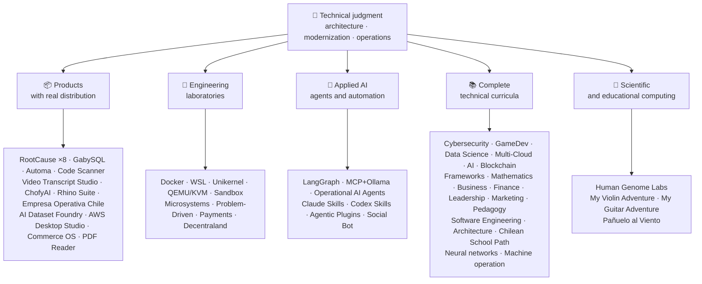

<!-- Synced from the public GitHub profile on 2026-10-16. -->

<div align="center">

# 👋블라디미르 Acuña

## **솔루션 Architect·수석 풀-스택·디지털 전환·관리 및 운영**

**16년 이상의 건물과 운영 소프트웨어를 갖춘 컴퓨터 과학 및 컴퓨팅 공학 및 비즈니스 관리 분야에서 전문적으로 훈련. I Connect Business, people, process, and technology to design, assessment, Deliver, and keep solution with technical resolution and operational view — 이 GitHub 계정에서 검증 가능한 증거로 백업.**

[](https://vladimiracunadev-create.github.io/)
[](https://www.linkedin.com/in/vladimir-acu%C3%B1a-valdebenito-11924a29/)
[](mailto:vladimir.acuna.dev@gmail.com)

[](#전문-범위)
[](#real-distribution을-통한-제품)
[](#완전한-기술-교육과정)

<!-- STATS:START -->
[](https://github.com/vladimiracunadev-create?tab=repositories)
[](https://github.com/vladimiracunadev-create?tab=repositories)
[](#한눈에-보는-생태계)
[](#완전한-기술-교육과정)
[](https://github.com/vladimiracunadev-create?tab=repositories)
<!-- STATS:END -->

[](https://github.com/vladimiracunadev-create?tab=repositories)
[](https://github.com/vladimiracunadev-create?tab=followers)

[🌐 Portfolio (22 languages)](https://vladimiracunadev-create.github.io/) ·
[🧩 Ecosystem](#한눈에-보는-생태계) ·
[⚡ Evaluate me in 10 minutes](#저를-평가할-시간이-10분이라면) ·
[✅ Professional scope](#전문-범위) ·
[🧭 Non-coding management](#관리-관리-비-코딩-경력-기회) ·
[📋 Role matrix](PROFESIONAL_ROLES.md) ·
[📬 Contact](#연락처)

**🌐 전체 버전:** [Español](README.md) · [English](README.en.md) · [Português](README.pt.md) · [Italiano](README.it.md) · [Français](README.fr.md) · [简体中文](README.zh.md) · [繁體中文](README.zh-TW.md) · [日本語](README.ja.md) · [한국어](README.ko.md) · [Türkçe](README.tr.md) · [Русский](README.ru.md) · [Tiếng Việt](README.vi.md) · [ไทย](README.th.md) · [Deutsch](README.de.md) · [Українська](README.uk.md) · [Polski](README.pl.md) · [العربية](README.ar.md) · [فارسی](README.fa.md) · [Bahasa Indonesia](README.id.md) · [Nederlands](README.nl.md) · [हिन्दी](README.hi.md) · [Ελληνικά](README.el.md)

**기술적인 핵심:**
PHP 8 · Python · Rust · Go · Node/TS · Java 21 · .NET 8 · Dart/Flutter · WASM
· AWS · Terraform · Kubernetes · Docker · n8n · LangGraph/MCP · CI/CD · FinOps · Observability

**사업 기술 교량:**
공정 및 요구 사항 분석·솔루션 평가·납품 coordination·운영 및 연속성·위험 관리·제품 및 서비스·기술 교육

</div>

---

> [!NOTE]
> 이 프로필은 경험에 기회를 끄지 않습니다. 입증된 기술적인 경험, transferable 기술, viable 신청 및 미래 발달 목표는 명시적으로 분리됩니다. Linked GitHub 증거는 실행 또는 문서화입니다. 뭔가가 있는 곳**뚱 베어**완료, 그것은 같은 명시.

## 🎯여기에서 확인할 수 있는 내용

이것은 "하나의 재포": 그것은 공유 표준 생태계입니다.

- 🔁 **Reproducible 데모**— clone, 실행, 검증.
- 🧰 **표준화 된 툴링**— Makefiles, 허브 CLI,`doctor`, 및`smoke`저장소 당.
- 🛡️ **방어력**- 비밀 검사, 정책 및 명시적으로 금지 관행.
- 📈 **옵션 정보** — `/health`, `/ready`, `/metrics`, 대쉬보드 및 추적성.
- 📚 **Audience-aware 문서**- 채용자, 초급자, DevOps, 또는 보안, 저장소에 따라.
- 📦 **제품 유통**— 다운로드 가능한 릴리즈, 체크섬, 그리고 증거를 구축; 상업/스토어 서명은 적용할 때 보류로 선언.
- 🌍 **국제화**— 6개국의 포트폴리오 (ES)·₢ 킹·유형: pt·...·담당자: Mr. wang·ZH).
- 🧭 **기술 정직**— 각 케이스 라벨`OPERATIONAL`, `DOCUMENTED/SCAFFOLD`, 또는`PLANNED`.

## ✅검증된 상태

| Surface | Concrete evidence |
|---|---|
| 🧪 **시험 적용** | 프로젝트**828 테스트**+ 훈제 이상**503.8M 쿼리**(0개의 판)·Empresa, 칠레**158 테스트** ·오토마**150 파이트** ·멀티OS CI |
| 🤖 **생산 급료 대리인** | 랭그라프 RealWorld**25/25 운영한 후원**(케이스 01-25, 100% 적용)·운영 AI 에이전트**13 대리인**으로**39개의 신중한 evals** |
| 🔗 **Polyglot 통합** | **20 건**sender→n8n→receiver —**19 운영**, 독수리로 개별적으로 감사-· **18+ DB 엔진** · **20 + 용기** ·11 패턴 |
| 📦 **의 특징** | **151 릴리스**생태계의 전반**64개 소유의 공공 저장소** ·설치 및 artifacts`.exe` · `.msi` · `.dmg` · `.apk`checksums와 build proof; 적용 가능한 진행 상황을 위한 상용/스토어 서명 |
| 🛡️ **공급 체인** | 코드QL·뚱 베어·팟캐스트·팟캐스트·뚱 베어·팟캐스트·TruffleHog의 특징·사이클론디X SBOM·팟캐스트 |
| 📚 **의약** | **14,530 클래스**21개 프로그램 전반에 걸쳐 검증 가능[a workflow](.github/workflows/stats.yml)실제 저장소 구조 또는 저장소에 선언 된 검증 가능한 소스에서 - 손으로 작성하지 않음·각 프로그램은 편집 상태 및 제한을 선언합니다. |
| 🌐 **의논하기** | PWA 설치· **22 개 언어** · **154 PDF의**생성물 : 파이프라인·CV 자료 API·축전기 인조 인간·등대 100 |
| 🔒 **원격 측정** | forensic 제품 및 Empresa Operativa Chile의 Zero telemetry - 모든 빌드에서 확인 (안드로이드 없음)`INTERNET`(주) |
| 🌐 **관련 사이트** | **56 GitHub 페이지 사이트**—55 착륙, 제품, 프로그램, 또는 생태계 항해자 당 하나, 포트폴리오 플러스 - 각각 자체 저장소에서 배치·모든 56 HTTP로 확인`200` |

## 🗺️한눈에 보는 생태계



## 📦Real Distribution을 통한 제품

다운로드 된 소프트웨어, 설치 및 사용 — 뿐만 아니라 복제.

| Product | What it is | Stack | Delivery |
|---|---|---|---|
| [🔍 **RootCause Windows**](https://github.com/vladimiracunadev-create/rootcause-windows-inspector) | Cybersecurity forensics: every anomalous resource distortion may be the first sign of a threat. Diagnose first, intervene later | Rust 🦀 · ETW/WPR | **v0.19.0** · **16 releases** · **5 editions**: GUI · Portable · CLI · PowerShell · VS Code · [landing](https://vladimiracunadev-create.github.io/rootcause-windows-inspector/) |
| [📱 **RootCause Mobile**](https://github.com/vladimiracunadev-create/rootcause-mobile-inspector) | 모바일 사이블링: 자체에 대한 각 응용 프로그램을 비교하는 법의 센서, 플래그 스토커웨어, 그리고 별도의 권한은 단지 요청한 것들 | 팟캐스트·팟캐스트·퀵메뉴 | **0.0.0 다운로드** ·APK를 다운로드·5 개 언어· **0개의 telemetry** · [landing](https://vladimiracunadev-create.github.io/rootcause-mobile-inspector/) |
| [🍎 **RootCause macOS**](https://github.com/vladimiracunadev-create/rootcause-macos-inspector) | macOS 판:`launchd`지속, Gatekeeper, SIP, FileVault, XProtect, TCC 권한, 서명 프로세스 및 네트워크 이웃 - 알려진 좋은 상태에 대해 모든 표면 검사 | 뚱 베어🦀 ·맥 OS 13+ | **₢ 킹** ·첫 번째 출판된 출시·아파치 2.0· [landing](https://vladimiracunadev-create.github.io/rootcause-macos-inspector/) |
| [🖥️ **RootCause Server**](https://github.com/vladimiracunadev-create/rootcause-server) | 서버 sibling: 단일 로그가 함께 볼 수 없는 상관관계 - 노출된 표면, 액세스 권한 파열, 동일한 주소, 중요 파일 무결성 및 센서 침묵에 부여된 세션, 그리고 하나의 행동 가능한 문장으로 전환 | 뚱 베어🦀 ·윈도우·리눅스·맥 OS | **v0.2.0의** · **18 규칙**증거와 runbook으로·자신의 행동을 결코 실행하지·웹 의존성없이 로컬 콘솔· **아직 공개되지 않음** · [landing](https://vladimiracunadev-create.github.io/rootcause-server/) |
| [🌐 **RootCause Web**](https://github.com/vladimiracunadev-create/rootcause-web-inspector) | Browser forensic sensor: cookies, email sessions, extensions, downloads, permissions, and pages that imitate a real window | JavaScript · MV3 extension | **v0.2.0** · no published release yet · panel on `127.0.0.1` · zero dependencies · zero telemetry verified in CI · [landing](https://vladimiracunadev-create.github.io/rootcause-web-inspector/) |
| [₿ **RootCause Bitcoin Defense**](https://github.com/vladimiracunadev-create/rootcause-bitcoin-defense) | Watch-only defense for Bitcoin custody: inventories the origin of each key, cross-checks it with published warnings, and explains root cause with evidence | JavaScript · Windows app · local panel | **v0.3.0** · **2 releases** · zero dependencies · never asks for seeds · verified in CI · [landing](https://vladimiracunadev-create.github.io/rootcause-bitcoin-defense/) |
| [⛓️ **RootCause Blockchain Security**](https://github.com/vladimiracunadev-create/rootcause-blockchain-security) | Multi-chain watch-only console: inventories contracts, proxies, oracles, bridges, governance, and dependencies, and generates root-cause runbooks | JavaScript · Windows app · local panel | **v0.3.0** in the repository · published release: `v0.1.0` · zero dependencies · never asks for private keys · verified in CI · [landing](https://vladimiracunadev-create.github.io/rootcause-blockchain-security/) |
| [📷 **RootCause QR Inspector**](https://github.com/vladimiracunadev-create/rootcause-qr-inspector) | 행동하기 전에 QR 코드를 검사하는 로컬 안드로이드 앱 : 26 신호를 설명하고, 저하로부터 사실 분리하고, 적정 증거를 수출 | 팟캐스트·팟캐스트 | **v0.1.4의** · **5개의 출시** · **107 테스트** ·안드로이드 APK를 게시·verifiable SHA-256를·기술 APK 패키지 서명; 진행중인 상업 / 상점 서명·0개의 telemetry· [landing](https://vladimiracunadev-create.github.io/rootcause-qr-inspector/) |
| [🏢 **Empresa Operativa Chile**](https://github.com/vladimiracunadev-create/empresa-operativa-chile) | Guides a SpA from before incorporation to each monthly close: incorporation with evidence, VAT carry-forward, F29 draft, immutable close, and audit log. Every rule points to its official source | JavaScript · Rust · PWA | **v1.5.0** · Android · Windows · browser · **158 tests** · **0 production dependencies** · zero telemetry · [landing](https://vladimiracunadev-create.github.io/empresa-operativa-chile/) |
| [🔍 **Universal Code Scanner**](https://github.com/vladimiracunadev-create/universal-code-scanner) | QR and barcode reader that **interprets before acting**: 16 local URL risk signals and explicit confirmation | Flutter · Dart | **v1.1.0** · Android · iOS · macOS · PWA · encrypted history **AES-256-GCM** · [landing](https://vladimiracunadev-create.github.io/universal-code-scanner/) |
| [🗄️ **GabySQL**](https://github.com/vladimiracunadev-create/gabysql) | 임베디드 데이터베이스: 단일`.db`파일, WAL, 비용 기반 최적화기, HTTP / JSON API | 뚱 베어🦀 | 윈도우·맥 OS·리눅스· [landing](https://vladimiracunadev-create.github.io/gabysql/) |
| [🤖 **Automa PC**](https://github.com/vladimiracunadev-create/automa-pc) | Local Orchestrator: JSON은 실제 창을 열고 DOM과 상호 작용하며, 증거를 남깁니다. | 팟캐스트·팟캐스트·pywebview의 장점 | **0.0.1 다운로드** · **27의 교류** ·출판 및 검증 가능한 설치· [landing](https://vladimiracunadev-create.github.io/automa-pc/) |
| [🏭 **AI Dataset Foundry**](https://github.com/vladimiracunadev-create/ai-dataset-foundry) | PDF, Word, 웹, Git, JSON 및 CSV를 사전 훈련, 미세 조정, RAG 및 평가를위한 감사 데이터 세트로 전환하는 로컬 최초의 공장 | 팟캐스트 | **v0.2.0의** ·Windows + 오프라인 Android·첫 번째 출판된 출시· [landing](https://vladimiracunadev-create.github.io/ai-dataset-foundry/) |
| [☁️ **AWS Desktop Studio**](https://github.com/vladimiracunadev-create/aws-desktop-studio) | Local-first app with 15 AWS inventory integrations, 20 tutorials, CLI/SSO, and read-only defaults; implementation in progress, not universal access | JavaScript · Windows | **v0.1.1** · first published release · [landing](https://vladimiracunadev-create.github.io/aws-desktop-studio/) |
| [🧭 **Commerce OS**](https://github.com/vladimiracunadev-create/commerce-operating-system) | Guided conceptual demo of commercial operations: catalog, stock, CRM, orders, mock payments, and traceability | JavaScript · Web · Windows · Android | **v0.3.0** · **2 releases** · no real money or Chilean tax authority integration · [landing](https://vladimiracunadev-create.github.io/commerce-operating-system/) |
| [📄 **PDF Reader**](https://github.com/vladimiracunadev-create/pdf-reader-windows-android) | Android-first local read-only reader, with no-crop zoom, reopenable history, WhatsApp sharing, and default-reader selection | HTML · Web · Android · Windows | **v0.3.3** · signed APK · no accounts, sensitive permissions, or telemetry · [landing](https://vladimiracunadev-create.github.io/pdf-reader-windows-android/) |
| [🎙️ **Video Transcript Studio**](https://github.com/vladimiracunadev-create/video-transcript-studio) | 한 비디오, 재생 목록, 또는**전체 YouTube 채널**타임스탬프와 텍스트. 기존 자막에 의존하지 않습니다. Whisper는 오디오를 인식**당신의 기계에**, API, 계정, 또는 구성하는 열쇠 없이 | 팟캐스트·PySide6의 특징·빠른 API·빠른 위스키 | **v0.2.0의** ·Windows 데스크톱 + 로컬 패널`127.0.0.1`+ CLI,**같은 큐를 공유** ·담당자: Mr. s. com·PDF 파일·TXT의·RSS 피드·VTT 소개·의논하기·MP3의·의 OGG· **89 시험** ·묶인 FFmpeg·0개의 telemetry· [landing](https://vladimiracunadev-create.github.io/video-transcript-studio/) |
| [🎨 **ChofyAI Studio**](https://github.com/vladimiracunadev-create/chofyai-studio) | Local Creative AI launcher: 관현악 Qwen3-TTS, whisper.cpp, FaceFusion, AceForge, ComfyUI | 타우리 2·뚱 베어·퀵메뉴 | 0.0.1 다운로드· **5/5 실제 inference 도구** ·macOS 애플 실리콘·실험적인 Windows· **아직 공개되지 않음** · [site](https://vladimiracunadev-create.github.io/chofyai-studio/) |
| [🦏 **Rhino Suite**](https://github.com/vladimiracunadev-create/rhino-suite) | 스크래치의 오피스 스위트: 문서 규칙은 DOM에 의존하지 않습니다 — HTML은 단지 투영입니다 | 녹/WASM·으로·반응 19 | 진화 monorepo 단계별· [landing](https://vladimiracunadev-create.github.io/rhino-suite/) |
| [🎻 **My Violin Adventure**](https://github.com/vladimiracunadev-create/violin-adventure) | Educational app for children: chromatic tuner, audio-clock-accurate metronome, songs with real violin | Tauri 2 · React · TS | **v1.3.0** · Windows · Android · Linux · macOS · PWA · [landing](https://vladimiracunadev-create.github.io/violin-adventure/) |
| [🎸 **My Guitar Adventure**](https://github.com/vladimiracunadev-create/guitarra-adventure) | The plucked-string sibling: 24 lessons in 6 worlds, 6-string tuner, drift-free metronome, and 11 real guitar notes | Tauri 2 · React · TS | **v1.0.0** · Windows · Android · Linux · macOS · iOS · PWA · no accounts, ads, or online dependency · [landing](https://vladimiracunadev-create.github.io/guitarra-adventure/) |
| [🧣 **Pañuelo al Viento**](https://github.com/vladimiracunadev-create/panuelo-al-viento-cueca-app) | Cueca from age 10: 24 classes in 8 levels, 72 activities, six-pulse lab (3+3 and 2+2+2), and accessible floor diagrams. It states that it **complements, not replaces**, teachers and culture bearers | Flutter · Dart | **v0.2.0** · Android 7+ · Windows 10/11 · APK · EXE · MSI · portable · **29 tests + 2 validators** · no camera, microphone, account, ads, or internet · [landing](https://vladimiracunadev-create.github.io/panuelo-al-viento-cueca-app/) |

## 🧪엔지니어링 연구소

| 의논하기 | 어떤 의미 |
|---|---|
| [🐳 **Problem-Driven Systems Lab**](https://github.com/vladimiracunadev-create/problem-driven-systems-lab) | **20 실제 문제**(부하, N+1의 재기 폭풍, 누출, 모놀리, 캐시 스탬프, backpressure, 0-downtime 마이그레이션, 잊어 DLQ) 높은-피델리 인젝트 실패, 해결**7개의 더미**: PHP 8·팟캐스트·Node.js를 사용하려면·Java 21의·.NET 8의· **1.23로 이동** · **녹 1.83** · [landing](https://vladimiracunadev-create.github.io/problem-driven-systems-lab/) |
| [📆 **Social Bot Scheduler**](https://github.com/vladimiracunadev-create/social-bot-scheduler) | **0.0.0.0.0.0 과** · **20 건**source→n8n→receiver에**18+ DB 엔진** —**19 운영**, 독수리로 개별적으로 감사-**8 층**감사, 불투명 난간, 회로 차단기 및 DLQ· [landing](https://vladimiracunadev-create.github.io/social-bot-scheduler/) |
| [🧰 **Microsistemas**](https://github.com/vladimiracunadev-create/microsistemas) | **12 진단과 현대화 microapps**PHP에 대한·로컬 읽기 전용 MCP 서버·3 단계의 경화· [landing](https://vladimiracunadev-create.github.io/microsistemas/) |
| [🧪 **Docker Labs**](https://github.com/vladimiracunadev-create/docker-labs) | **13 실험실**4대 서비스 플랫폼 + 자동화`.exe`launcher와 설치· [landing](https://vladimiracunadev-create.github.io/docker-labs/) |
| [🐳 **WSL Labs**](https://github.com/vladimiracunadev-create/wsl-labs) | **12 cases** on `wslc`, the native WSL container engine — **without Docker Desktop** · [landing](https://vladimiracunadev-create.github.io/wsl-labs/) |
| [⚡ **Unikernel Labs**](https://github.com/vladimiracunadev-create/unikernel-labs) | “다중한 데스크톱”: WSL2 백엔드를 가진 Unikraft에 Windows 통제,`kraft`+ QEMU/KVM의· [landing](https://vladimiracunadev-create.github.io/unikernel-labs/) |
| [🧰 **QEMU/KVM Labs**](https://github.com/vladimiracunadev-create/qemu-kvm-labs) | **12 실험실**QEMU, KVM, libvirt, 클라우드 init, 및 실제 가상화의`vm-manager`리눅스 및 WSL2· [landing](https://vladimiracunadev-create.github.io/qemu-kvm-labs/) |
| [🛡️ **Sandbox Labs**](https://github.com/vladimiracunadev-create/sandbox-labs) | Linux isolation: 선언된 정책과 밑에 제삼자 부호, 파일 및 사업 모형을 실행하십시오**실제로 적용되는 통제의 서명한 증거** · **36 건**2개의 가족 —15명의 기술 및 21개의 자본 시장—·실험 및 교육 선언, * 보안 제품 *· [landing](https://vladimiracunadev-create.github.io/sandbox-labs/) |
| [💳 **Universal Payments Engineering Lab**](https://github.com/vladimiracunadev-create/universal-payments-engineering-lab) | **28 결제 가족**로컬 자체 설명 데모: 상태, ledger, 재건축, 보안, 구현 가이드· [landing](https://vladimiracunadev-create.github.io/universal-payments-engineering-lab/) |
| [🕹️ **Decentraland Social Arcade**](https://github.com/vladimiracunadev-create/decentraland-social-arcade) | Native Decentraland 소셜 3D 경험: MVP와 SDK7, ECS, TypeScript를 가진 멀티게임 아키텍처·English 한국어·지불 또는 원격 측정 |
| [☁️ **AWS Projects**](https://github.com/vladimiracunadev-create/proyectos-aws) | Progressive cases where each one adds one AWS service **and** a new GitHub Actions capability · SAA-C03 · DVA-C02 · SOA-C02 coverage |

## 🤖응용 AI

| 의논하기 | 어떤 의미 |
|---|---|
| [🤖 **LangGraph RealWorld**](https://github.com/vladimiracunadev-create/langgraph-realworld) | **25/25 운영한 후원**— 유형 상태, 조건 경로, NDJSON 스트리밍, DEMO/LIVE 모드, 8 보안 레이어, custody의 SHA-256 체인 |
| [🧭 **Operational AI Agents**](https://github.com/vladimiracunadev-create/operational-ai-agents) | **13 운영 대리인**Claude Code 및 호환 실행 시간: 각은 완전한 임무를받습니다. - 구조 진화, 유산 현대화, 커리큘럼 디자인, 포트폴리오 출판, 보안 구제, 사건 분석 - 선언 계약, 인간 문 및 검증 가능한 증거· **39개의 신중한 evals** ·34 테스트·0-deps (stdlib 전용)·리눅스·맥 OS·윈도우· [site](https://vladimiracunadev-create.github.io/operational-ai-agents/) |
| [🧠 **MCP + Ollama Local**](https://github.com/vladimiracunadev-create/mcp-ollama-local) | 샌드박스의 MCP 도구와 현지 최초의 AI· `127.0.0.1`팟캐스트·다중층 신뢰 프로필·그 한계에 대해 정직 |
| [🧩 **Agentic Plugins Toolkit**](https://github.com/vladimiracunadev-create/agentic-plugins-toolkit) | **6개의 대리인 플러그인**Claude Code, OpenAI/Codex, Copilot, Gemini 및 MCP에서 설치 가능:`repository-engineering`, `legacy-modernization`, `learning-program-studio`, `product-evolution`, `portfolio-governance`, 및`rootcause-response` · **69 생성된 조회 수 없이 drift**—각 실행 시간은 같은 계약에서 형식을받습니다.·0-deps의·리눅스·맥 OS·윈도우· [site](https://vladimiracunadev-create.github.io/agentic-plugins-toolkit/) |
| [🧰 **Claude Skills Toolkit**](https://github.com/vladimiracunadev-create/claude-skills-toolkit) | **15 agentic skills** for Claude Code · **security**: 12-layer `security-audit` (OSV · KEV · EPSS · SAST · container · secrets) and 14-stage `bitcoin-custody-audit` · **repo gates**: `pre-commit-guard`, `pre-push-guard`, `yaml-control`, `md-lint-fix`, `python-lint-guard` · **coherence**: `repo-coherence-audit`, `version-bump`, `python-version-control`, `python-deps-pinning` · **Docker**: `docker-cleanup`, `docker-compose-doctor` · **docs**: `md-to-doc` · zero-deps · cross-platform |
| [🧰 **Codex Skills Toolkit**](https://github.com/vladimiracunadev-create/codex-skills-toolkit) | **19 에이전트 기술**Codex: 보안 및 공급망, 선명하고 기능적인 흐름, 탄력 및 상태, 방출 증거, Python/YAML/Markdown 문, 판결, 종결, 도크러 및 문서·Python-first(펄스)· `pnpm` ·리눅스·맥 OS·윈도우· [site](https://vladimiracunadev-create.github.io/codex-skills-toolkit/) |

## 📚완전한 기술 교육과정

스페인어의 순차적 프로그램, 상태 및 범위는 각 저장소에 의해 선언. 21개의 프로그램 추가**14,530 클래스**, 으로 계산[a workflow](.github/workflows/stats.yml)실제 저장소 구조 또는 저장소에 선언 된 검증 가능한 소스에서; 배지는 매주 새로 고침하고 손으로 작성되지 않습니다.

🧭 [**Lifelong Learning Ecosystem**](https://github.com/vladimiracunadev-create/lifelong-learning-ecosystem) is a federated compass connecting 30 real paths across 6 areas through visual maps and an [accessible offline portal](https://vladimiracunadev-create.github.io/lifelong-learning-ecosystem/); it is not counted as an additional program.

| 의 특징 | 의 특징 | 의논하기 |
|---|---:|---|
| [🔢 **Computational Mathematics**](https://github.com/vladimiracunadev-create/computational-mathematics-program) | 360 | 손가락에 넣기에서 종이를 재생· **360개의 신중한 시연** ·1,080 노트북·489-term 광택· [site](https://vladimiracunadev-create.github.io/computational-mathematics-program/) |
| [🏦 **Finance and Banking**](https://github.com/vladimiracunadev-create/finance-and-banking-evolution-program) | 356 | 534 시간·금융 수학 및 IFRS → 신용, 위험, Basel III, 개방 금융, DLT, Stablecoins 및 MiCA· **27 건의 사례** · **298 테스트** · [site](https://vladimiracunadev-create.github.io/finance-and-banking-evolution-program/) |
| [🎮 **GameDev**](https://github.com/vladimiracunadev-create/modern-gamedev-program) | 352 | 수학 및 C # / C++ / GDScript → 쉐이더, AI, 멀티플레이어, VR / AR·혜진·뚱 베어·뚱 베어· **CI에서 확인 된 10 Godot 실험실**(301건)· [site](https://vladimiracunadev-create.github.io/modern-gamedev-program/) |
| [🛡️ **Cybersecurity**](https://github.com/vladimiracunadev-create/modern-cybersecurity-program) | 360 | **₢ 킹** ·20 부품·기초 → Red Team, DFIR, 클라우드 보안, 분산, CTF 및 게임 보안·지도로**7 인증** ·오프라인 Android/웹 앱·PDF 설명서·CI, 보안 및 페이지 확인· [site](https://vladimiracunadev-create.github.io/modern-cybersecurity-program/) |
| [📈 **Marketing, Sales, and Growth**](https://github.com/vladimiracunadev-create/marketing-sales-growth-evolution-program) | 336 | 운영 정의, 측정 시트, 검증 가능한 생물학적, 칠레 규제 상황에 24 부품· **0.0.0.0 다운로드** ·1.29M 단어·17개의 역할 기반 경로· [site](https://vladimiracunadev-create.github.io/marketing-sales-growth-evolution-program/) |
| [🏢 **Business Creation**](https://github.com/vladimiracunadev-create/modern-business-creation-program) | 336 | 칠레에서 실제 회사를 만들고 운영합니다. 설립, 세금 기관, 운영, 위기 및 출구에 대한 아이디어에서·360도·1,251 용어 광택·1,548 페이지 설명서· [site](https://vladimiracunadev-create.github.io/modern-business-creation-program/) |
| [🏛️ **Architecture and Built Environment**](https://github.com/vladimiracunadev-create/architecture-built-environment-learning-program) | 830 | 83 부품·60개의 통합 세션·34 경로·추적 가능한 소스·Markdown, 오프라인 리더, GitHub 페이지· [site](https://vladimiracunadev-create.github.io/architecture-built-environment-learning-program/) |
| [🇨🇱 **Chilean School Learning Path**](https://github.com/vladimiracunadev-create/chilean-school-learning-path) | 8,841 | 학년 1-12· **4,156 통합 크로스 컬리어** · **2,823 학습 목표** ·MINEDUC 소스·공개 제안 및 전문 인적 검토는 여전히 종료· [site](https://vladimiracunadev-create.github.io/chilean-school-learning-path/) |
| [🧭 **Modern Software Engineering**](https://github.com/vladimiracunadev-create/modern-software-engineering-program) | 480 | 40 부품 및 8 단계·기초 → 제품, 건축, 안전, DevOps, SRE, SPEC, AI 및 다중 시약 체계·repository에 의해 선언 된 편집 상태· [site](https://vladimiracunadev-create.github.io/modern-software-engineering-program/) |
| [🎓 **Pedagogy and Learning Sciences**](https://github.com/vladimiracunadev-create/education-pedagogy-learning-sciences-program) | 300 | 선생님이 훈련하는 방법을 배우는 방법·25 부품· **각 클래스는 증거 국가와 한계를 선언합니다.** ·초기의 문학, 비교 방법, 특정 교육 요구, 협동, 문화 다양성, 국제 증거·1,097-term 광택, 325 다이어그램 및 60-activity 교실 은행·14 역할에 의한 경력 경로·LMS 호환· **₢ 킹** · [site](https://vladimiracunadev-create.github.io/education-pedagogy-learning-sciences-program/) |
| [☁️ **Multi-Cloud**](https://github.com/vladimiracunadev-create/multi-cloud-engineering-program) | 288 | AWS 지원·는·GCP(주)·쿠버네티스·의 특징·₢ 킹·핀 핑· **1,288 시간** ·288 JSON 증거와 실험실·1,032 추적 소스·2,884 페이지 PDF 설명서· [site](https://vladimiracunadev-create.github.io/multi-cloud-engineering-program/) |
| [🎖️ **Executive Leadership**](https://github.com/vladimiracunadev-create/executive-leadership-founder-program) | 288 | 회사를 선도하고 자신만의 팀을 이끌고, KPI/OKR, 금융, 제품, 위험, 보드 및 M&A를 자체적으로 관리하여·24건, 96건, 39건· [site](https://vladimiracunadev-create.github.io/executive-leadership-founder-program/) |
| [🐍 **Python Data Science**](https://github.com/vladimiracunadev-create/python-data-science-program) | 232 | 극, ML + Optuna / SHAP, PyTorch / LLMs / LoRA, MLOps·기본 Windows 앱 + Android APK· [site](https://vladimiracunadev-create.github.io/python-data-science-program/) |
| [🧠 **AI Evolution**](https://github.com/vladimiracunadev-create/artificial-intelligence-evolution-program) | 184 | 심볼 → probabilistic → 깊은 학습 → LLMs, RAG, 대리인, 안전, 및 국경· **v0.17.0의** · **708 노트북** · **148 기초지** ·오프라인 Windows, Android 및 PWA 앱· [site](https://vladimiracunadev-create.github.io/artificial-intelligence-evolution-program/) |
| [🌐 **Comparative Programming**](https://github.com/vladimiracunadev-create/polyglot-programming-labs) | 176 | 1개의 개념,**10 개 언어**CI에서 확인하기 —**1,360 구현**- 더하기**1,632 프로그램**아직도 살고있는 언어 (COBOL, Fortran, Ada, RPG, MUMPS...)과 아틀라스의**15개 가족 60개 카드** ·₢ 킹· [site](https://vladimiracunadev-create.github.io/polyglot-programming-labs/) |
| [🧩 **Frameworks Compared**](https://github.com/vladimiracunadev-create/framework-ecosystems-labs) | 149 | 어댑터가 없는 한 실행 가능한 계약, Express, FastAPI, Spring Boot, ASP.NET, Django, Rails, Laravel, React, Vue, Svelte 등·12 부품· **70 내장 클래스** · **397건 CI에서 확인된 경우** · **210 ISBN/DOI 소스** · [site](https://vladimiracunadev-create.github.io/framework-ecosystems-labs/) |
| [🗄️ **Databases**](https://github.com/vladimiracunadev-create/database-systems-labs) | 74 | **0.0.0.0의** ·15개 부품 엔지니어링·230시간· **모든 청구에 대한 검증 가능한 소스**: ISBN, DOI, 또는 표준 120 소스·27 엔진에서 해결되는 동일한 케이스·306-term 광택·150 파이트· [site](https://vladimiracunadev-create.github.io/database-systems-labs/) |
| [📐 **Psychometrics and Assessment**](https://github.com/vladimiracunadev-create/psychometrics-and-assessment-program) | 40 | 측정 계기가 내장되어 있고, 평가되고, 검증되고, 감사·8개 부품·실행 가능한 엔진**5개 상품 및 344개 상품, 276개 공공주** |
| [⛓️ **Blockchain**](https://github.com/vladimiracunadev-create/blockchain-learning-path) | 66 | **v0.14.0** · from zero to programmable financial infrastructure and on-chain analytics · **91 practices** and **363 tests** · contracts with Foundry (fuzzing and invariants) and Slither static analysis in CI · offline apps verified by opening the binary and counting its contents · [site](https://vladimiracunadev-create.github.io/blockchain-learning-path/) |
| [🧠 **Neural Network Training Labs**](https://github.com/vladimiracunadev-create/neural-network-training-labs) | 31 | 7개의 단위·≈214 시간· **93 노트북**—31 클래스, 31 학생 버전, 31 솔루션—·질문, 시각지도, 관행 및 실제 자료로 평가·핑크· [study site](https://vladimiracunadev-create.github.io/neural-network-training-labs/) |
| [🕹️ **Machine Operator**](https://github.com/vladimiracunadev-create/machine-operator-program) | 451 | **41 교육 모듈**, 기계 당 하나· **502 h 15 분** ·시스템, 제어, 물리, 안전, 및 클래스 당 소스와 시뮬레이션 디자인·* 아직 실행할 수 없는 시뮬레이터, 그리고 그것은 그 way* 선언됩니다 |

## 🔬과학 컴퓨팅

| 의논하기 | 어떤 의미 |
|---|---|
| [🧬 **Human Genome Labs**](https://github.com/vladimiracunadev-create/human-genome-labs) | Reproducible genomics 플랫폼: 유형`ScientificResult<T>`계약, FASTA/GFF3/VCF의 단위**명시적 성숙과 증거**. Radical 정직: * 그것은 임상 진단*를 실행하지 않습니다· [site](https://vladimiracunadev-create.github.io/human-genome-labs/) |

## ⚡저를 평가할 시간이 10분이라면

아이디어는 코드를 볼 수 없습니다 : 그것은 볼 수 있습니다**어떻게 생각**, 어떻게 문서, 그리고 어떻게 모든 실행을 만드는.

**A 루트 - 실제 관찰성 및 관현*** (내가 좋아)*

```bash
git clone https://github.com/vladimiracunadev-create/social-bot-scheduler.git
```

워크플로우, 메트릭, 대시보드, 가드 레일을 19건 이상, 18+ DB엔드를 볼 수 있습니다.

**Route B - 몇 분 안에 재현 가능한 인프라**

```bash
git clone https://github.com/vladimiracunadev-create/docker-labs.git
```

**Route C - 유형 상태와 에이전트**

```bash
git clone https://github.com/vladimiracunadev-create/langgraph-realworld.git
```

**Route D - cloning없이 Rust forensic 제품**

installer 또는 CLI 바이너리를 다운로드[RootCause releases](https://github.com/vladimiracunadev-create/rootcause-windows-inspector/releases)관련 기사`SHA256SUMS`.

## 🧠모든 저장소에 적용하는 표준

- **DX 첫 번째**— 실행이 쉽지 않은 경우, 데모 또는 팀 기지로 유용하지 않습니다.
- **당일 1의 관측**— 메트릭과 추적성, afterthought.
- **보안을 파이프라인으로**— 비밀 검사, SBOM 당 릴리스, 명시적으로 금지 관행.
- **실제 탄력**- idempotency, 회로 차단기 및 통제되는 degradation.
- **디자인에 의하여 Polyglot**- 사용 사례에 의해 선택된 언어 및 엔진, 패션에 의해 결코.
- **상태에 대해 정직**— 1개의 repo는 이름이 되었습니다 (`Multisimulador` → `machine-operator-program`) 아직 존재하지 않는 Promising 소프트웨어를 피하기 위해.
- **배지는 신호, 증거가 아닙니다**— 각 repo는 또한 선언합니다**그것은하지 않습니다**.
- **모델 outward**— 도메인은 먼저 설계; 인터페이스는 투사입니다.
- **외부 작업은 외부로 선언됩니다.**—의 계정의 70 공개 저장소, 64 내 자신의 작품입니다. 다른 6 -[`agentic-qe`](https://github.com/vladimiracunadev-create/agentic-qe), [`Anthropic-Cybersecurity-Skills`](https://github.com/vladimiracunadev-create/Anthropic-Cybersecurity-Skills), [`erpnext`](https://github.com/vladimiracunadev-create/erpnext), [`OpenExecutive`](https://github.com/vladimiracunadev-create/OpenExecutive), [`raptor`](https://github.com/vladimiracunadev-create/raptor), 및[`security-audit-skill`](https://github.com/vladimiracunadev-create/security-audit-skill)— 포크는 내 자신의 작품에 대한 모든 인물에서 제외됩니다.

## ✅전문 범위

내 이중 배경 —**컴퓨터 과학 및 컴퓨팅 공학 + 비즈니스 관리**— 저는 사업 목표에 기술 결정과 기술 제약을 작업, 제품, 고객 및 리더십에 대한 명확한 옵션으로 번역하는 데 도움이됩니다.

### 🎯핵심 정체성

| - 연혁 | 의 의 의 의 의 의 의 의 의 의 의 의 의 의 의 의 의 의 의 의 의 의 의 의 의 의 의 의 의 의 의 의 의 의 의 의 의 의 의 의 의 의 의 의 의 의 의 의 의 의 의 의 의 의 의 의 의 의 의 의 의 의 의 의 의 의 의 의 의 의 의 의 의 의 의 의 의 의 의 의 의 의 의 의 의 의 의 의 의 의 의 의 의 의 의 의 의 의 의 의 의 의 의 의 의 의 의 의 의 의 의 의 의 의 의 의 의 의 의 의 의 의 의 의 의 의 의 의 |
|---|---|
| **솔루션 Architect** | 모듈, 진화 판을 가진 확장 가능한 시스템 설계 |
| **건축 설계** | 실제 유산 진화 (PHP 5.x→8.x, 중단 작업 없이 증가하는) |
| **수석 풀스택 / 기술 리드** | 실제 플랫폼의 아키텍처, 실행 및 표준 (+16 년) |
| **AI 자동화 건축** | 랑그래프/MCP와 n8n를 가진 대리인 체계는 난간을 가진 흐릅니다 |

### ↗ 자연스러운 확장

**AI 관현 엔지니어** · **시스템 / Rust 엔지니어** · **모바일 엔지니어 (Flutter)** · **솔루션 엔지니어** · **기술 제품 Builder** · **기술 트레이너** · **디지털 전환 컨설턴트** · **사업/기능분석** · **기술 제품 운영**

### ⚙️관련 범위

플랫폼 엔지니어 / IDP·DevOps / CI-CD의·클라우드/ASME 엔지니어·신청 SRE·자동화 엔지니어·기술 협력사

## 🧭관리, 관리, 비 코딩 경력 기회

이 범위는 각 제목이 개최 된 것을 주장하지 않습니다. 컴퓨팅, 사업 관리의 조합이 되는 작업을 우선적으로 하고, 공적 증거는 코딩 없이 가치를 창조할 수 있다.

| 가족의 | 인정된 역할 | Honest 분류 | 의 특징 | 증거 및 상태 |
|---|---|---|---|---|
| **기술 리더십** | IT의 머리·IT 운영 관리자·디지털 전환 관리자·(주)씨오 | **신청 잠재력/ 미래 목표** | 없음/occasional | 강력한 기술적인 기초; 사람들, 예산, 납품업자 및 행정 책임은 따로따로 입증되어야 합니다 |
| **사업소개** | IT 프로젝트 코디네이터/Manager·팟캐스트·스크럼 마스터·Agile 납품 | **Transferable / 응용 분야** | 없음/occasional | 배달 및 공개 증거; 공식적인 팀, 예산 및 스폰서 책임은 격차를 남아 있습니다 |
| **사업 관리** | 사업 관리자·관리/운영 관리자·계약 관리자 | **적용 분야** | ᄋᄋᄋ | 비즈니스 학위 및 운영 자작; 자원의 확인된 소유권, 사람들, 및 공급 업체 |
| **전략 및 변화** | 전략 컨설턴트·관련 기사·기업 계획·혁신 / 변혁 | **Transferable / 응용 분야** | ᄋᄋᄋ | 기존의 현대화 및 솔루션 평가; 조직 채택 결과가 입증되어야한다. |
| **사업 분석** | 사업 Analyst·기능/요구 분석가·BPM(비밀)·지속적인 개선 | **Transferable / 응용 분야** | 없음/occasional | 도메인 모델링 및 요구 사항 증거; 외부 이해 관계자 사례는 주장을 강화할 것 |
| **제품 및 서비스** | 제품 소유자/Manager·제품 운영·서비스 납품·고객 성공 | **Transferable / 응용 분야** | 없음/occasional | 로드맵, 라이프사이클, 릴리즈, 운영; P&L, 고객 포트폴리오, SLA 증거는 역할에 따라 다릅니다. |
| **Cybersecurity 관리** | 사이트맵·IT 제어 감사·기술 위험·정보 보안 / 지속성 | **적용 분야** | 없음/occasional | 통제 및 뿌리 원인 증거; 조직 감사 및 관련 자격은 폐기됩니다 |
| **상업 및 판매** | 기술 Presales·Solutions 컨설턴트·기술 KAM·B2B 사업 개발 | **Transferable / 응용 분야** | ᄋᄋᄋ | 강력한 솔루션/값 번역; 할당량, 계정 포트폴리오, 계약 협상은 주장하지 않습니다 |
| **금융 및 관리 제어** | 예산/비용 분석·프로젝트 평가·FP&A의 특징·관리제어 | **적용 분야** | ᄋᄋᄋ | 금융/금융의 자; 실제 예산, 금융 문, 기업 KPIs 필요 |
| **Quality** | Process/Quality Analyst · Process Auditor · Continuous Improvement | **Transferable / application potential** | None/occasional | Gates, tests, metrics, and reproducibility; formal quality-system ownership remains a gap |
| **교육과정** | 기술 트레이너·관련 제품·학술대회·EdTech / 교육 디자이너 | **Transferable / 응용 분야** | 없음/occasional | 21 프로그램과 14,530 클래스; 공식 교육 및 학습자 결과는 별도로 증거해야합니다 |
| **물류 및 공급 업체** | 회사연혁·공급/운영 조정기·Vendor/Contract 관리자 | **적용 분야** | ᄋᄋᄋ | 공정 및 관리 기초; 실제 조달, 재고, 및 공급 업체 성능이 필요합니다. |
| **데이터 및 AI 관리** | 데이터 스튜어드·데이터 Governance·AI Adoption / 정부 | **Transferable / 응용 분야** | 없음/occasional | 감사 데이터셋 및 인적자원; 조직 정책 및 위원회는 격차를 유지 |
| **공공 부문** | 기관 현대화·ICT 코디네이터·디지털 프로젝트·공공 계획 | **적용 분야** | ᄋᄋᄋ | Chilean-context 시스템 및 추적성; 공공 조달 및 부문 경험은 주장하지 않습니다 |

The [full Spanish role matrix](PROFESIONAL_ROLES.md) details objectives, responsibilities, market experience, complementary knowledge, evidence, compatibility, and gaps across all 14 families.

## 🤖AI-Assisted 개발 흐름

| 의 특징 | 제품정보 |
|---|---|
| **Claude 코드** | 건축 검토, 구현 및 기술 문서 |
| **ChatGPT 플러스** | 분석, 건축, 그리고 이행 (since 2023) |
| **암호** | Code 생성 및 재발견 |
| **품질 관리** | 개발 및 자동화의 가속도 |
| **VS 코드 / OpenCode** | 통합 AI 지원 환경 |

> 나는 내 자신의 기술 판정, 인간 검증, 건축 방향을 결합. AI는 용량, 속도 및 도달을 증폭합니다. - 그것은 경험을 대체하지 않습니다.

## 📌가용성

**다음을:**수석 풀-스택·의 특징·관련 제품·플랫폼/IDP·신청 SRE·의붓기·회사연혁·AI 자동화·사업/기능 분석·IT 프로젝트 조정·제품 운영·디지털 변환·솔루션 컨설팅/판매·기술 교육·품질 및 지속적인 개선·AI 채택 및 관리

**각 역할의 범위에 따라 평가:**Product Owner / 기술 제품 관리자·서비스 납품·IT 운영·GRC / 기술 위험·관리 및 운영·관리 제어·공공 감독 현대화. 경영진 및 일반 경영진은 미래 개발 목표이며, 주장하지 않은 경험입니다.

**모델 번호:**프로젝트에 따라 원격 또는 하이브리드.

## 📬연락처

[](https://vladimiracunadev-create.github.io/)
[](https://www.linkedin.com/in/vladimir-acu%C3%B1a-valdebenito-11924a29/)
[](https://gitlab.com/vladimir.acuna.dev-group/vladimir.acuna.dev-group)
[](mailto:vladimir.acuna.dev@gmail.com)

---

<div align="center">

[🤝 Contribute](CONTRIBUTING.en.md) ·
[🛡️ Security](SECURITY.en.md) ·
[⚖️ Code of Conduct](CODE_OF_CONDUCT.en.md)

<sub>README는 공개 저장소의 검증 가능한 상태와 동기화 - 구성 및 변경 API를 통해 읽습니다.·최종 검증: 10월 12, 2026.</sub>

</div>
