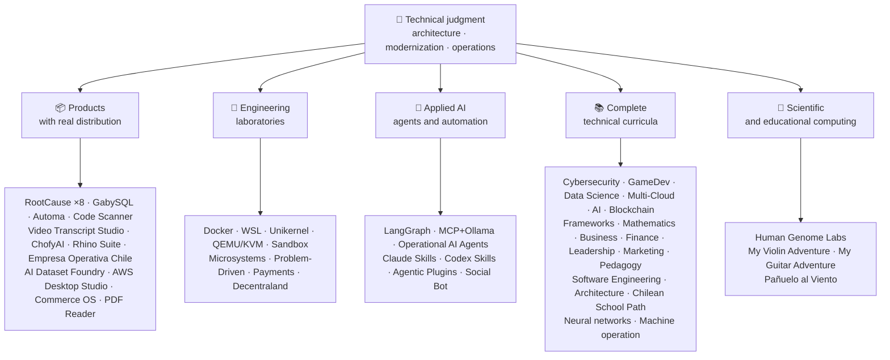

<!-- Synced from the public GitHub profile on 2026-10-16. -->

<div align="center">

# 👋Vladimir Acuña

## **Kiến trúc giải quyết·Người đầy đủ cao cấp·Biến hình số·Quản lý & thao tác**

**Professionally trained in Computer Science and Computing Engineering and Business Administration, with 16+ years building and operating software in real environments. I connect business, people, processes, and technology to design, evaluate, deliver, and sustain solutions with technical judgment and an operational view — backed by verifiable evidence in this GitHub account.**

[](https://vladimiracunadev-create.github.io/)
[](https://www.linkedin.com/in/vladimir-acu%C3%B1a-valdebenito-11924a29/)
[](mailto:vladimir.acuna.dev@gmail.com)

[](#phạm-vi-chuyên-nghiệp)
[](#những-sản-phẩm-có-thật-sự-được-phân-phối)
[](#máy-tính-trình-duyệt-kỹ-thuật-toàn-bộ)

<!-- STATS:START -->
[](https://github.com/vladimiracunadev-create?tab=repositories)
[](https://github.com/vladimiracunadev-create?tab=repositories)
[](#hệ-thống-sinh-thái-đang-hưng-thịnh)
[](#máy-tính-trình-duyệt-kỹ-thuật-toàn-bộ)
[](https://github.com/vladimiracunadev-create?tab=repositories)
<!-- STATS:END -->

[](https://github.com/vladimiracunadev-create?tab=repositories)
[](https://github.com/vladimiracunadev-create?tab=followers)

[🌐 Portfolio (22 languages)](https://vladimiracunadev-create.github.io/) ·
[🧩 Ecosystem](#hệ-thống-sinh-thái-đang-hưng-thịnh) ·
[⚡ Evaluate me in 10 minutes](#nếu-anh-có-10-phút-để-đánh-giá-tôi) ·
[✅ Professional scope](#phạm-vi-chuyên-nghiệp) ·
[🧭 Non-coding management](#quản-lý-quản-lý-và-không-kiểm-soát-sự-bất-tiện-của-các-nhà-kinh-doanh) ·
[📋 Role matrix](PROFESIONAL_ROLES.md) ·
[📬 Contact](#liên-hệ)

**🌐 Phiên bản đầy đủ:** [Español](README.md) · [English](README.en.md) · [Português](README.pt.md) · [Italiano](README.it.md) · [Français](README.fr.md) · [简体中文](README.zh.md) · [繁體中文](README.zh-TW.md) · [日本語](README.ja.md) · [한국어](README.ko.md) · [Türkçe](README.tr.md) · [Русский](README.ru.md) · [Tiếng Việt](README.vi.md) · [ไทย](README.th.md) · [Deutsch](README.de.md) · [Українська](README.uk.md) · [Polski](README.pl.md) · [العربية](README.ar.md) · [فارسی](README.fa.md) · [Bahasa Indonesia](README.id.md) · [Nederlands](README.nl.md) · [हिन्दी](README.hi.md) · [Ελληνικά](README.el.md)

**Trung tâm kỹ thuật:**
PHP 8 · Python · Rust · Go · Node/TS · Java 21 · .NET 8 · Dart/Flutter · WASM
· AWS · Terraform · Kubernetes · Docker · n8n · LangGraph/MCP · CI/CD · FinOps · Observability

**Cầu công nghệ kinh doanh–:**
Phân tích tiến trình và yêu cầu·Đánh giá giải pháp·phối hợp giao hàng·thao tác và liên tục·rủi ro quản lý·sản phẩm và dịch vụ·Giáo dục kỹ thuật

</div>

---

> [!NOTE]
> Hồ sơ này không biến cơ hội thành kinh nghiệm. Kinh nghiệm kỹ thuật, kỹ năng chuyển giao, ứng dụng khả thi và mục tiêu phát triển tương lai được tách biệt rõ ràng. Bằng chứng liên kết của GitHub có thể thực hiện được hoặc tài liệu; nơi có một cái gì đó**không phải**xong, được nói như thế.

## 🎯Những gì bạn sẽ tìm thấy ở đây

Đây không phải là “một sự bãi bỏ: đó là một hệ sinh thái có cùng tiêu chuẩn.

- 🔁 **Bản thử nghiệm không được hỗ trợ**- Nhân bản, chạy, xác nhận.
- 🧰 **Bánh ngọt chuẩn hoá**- Tạo ra tập tin, máy nghe trộm,`doctor`, và`smoke`Mỗi kho.
- 🛡️ **Phòng thủ sâu**— quét bí mật, chính sách và những thực hành rõ ràng bị cấm đoán.
- 📈 **Khả năng quan sát** — `/health`, `/ready`, `/metrics`Bảng điều khiển, và khả năng truy tìm.
- 📚 **Tài liệu hướng dẫn khán giả- ý thức**— Người tuyển dụng, người mới bắt đầu, người bị giam giữ, hay người bảo vệ, tùy thuộc vào kho tàng.
- 📦 **Phân phối sản phẩm**— Những chương trình phát hành, kiểm tra và xây dựng bằng chứng; những ký hiệu thương mại/ hàng hóa được công bố là đang chờ khi được áp dụng.
- 🌍 **Quốc tế hoá**— Danh mục đầu tư trong 22 ngôn ngữ (ES·EN·PT·IT·FR·ZH).
- 🧭 **Thành thật với kỹ thuật viên**- mọi trường hợp được dán nhãn`OPERATIONAL`, `DOCUMENTED/SCAFFOLD`, hoặc`PLANNED`.

## ✅Trạng thái có thể truy cập

| Bề mặt | Bằng chứng cụ thể |
|---|---|
| 🧪 **Kiểm tra tin tức** | GabySQUL**Thử ra 828**+ fuzzing trên**503. 8M truy vấn**(0 hoảng loạn)·Empresa Operativa Chile**Thử ra 158** ·Automa**150 py thử** ·Thông tin đa MSName |
| 🤖 **Các tác vụ cấp sản xuất** | Thế giới thật LangGraph**Hậu phương hoạt động 25/25**(case 01–25, 100% tin tức)·Đặc vụ AI hoạt động**13 đặc vụ**có**39 phép đánh giá xác định** |
| 🔗 **Sự kết hợp của bản sắc** | **20 thùng**Trình gửi ảnh cho người nhận thư —**19 Hoạt động**Từng cá nhân được kiểm toán với Docker· **18+B động cơ** · **20+ container** ·11 mẫu |
| 📦 **Phân phối** | **151 bản phát hành**xuyên qua hệ sinh thái của**64 thuộc quyền sở hữu các kho công cộng** ·Bộ cài đặt và tạo tác`.exe` · `.msi` · `.dmg` · `.apk`với việc kiểm tra tổng và tạo bằng chứng; thương mại/tore chữ ký trong tiến trình mà có thể ứng dụng |
| 🛡️ **Chuỗi cung cấp** | CodeQL·Semgrep·Cướp·Trivy·Grype·Gitleaks·TruffleHog·CM SBOM CcconeDX·Điểm |
| 📚 **Curricula** | **14.530 lớp**có thể kiểm tra trên 21 chương trình, được tính bằng[a workflow](.github/workflows/stats.yml)từ cơ cấu kho chứa thực sự hoặc một nguồn có thể xác nhận được tuyên bố trong kho - không phải bằng tay·Mỗi chương trình tuyên bố trạng thái và giới hạn của nó |
| 🌐 **Portfolio** | PWA có thể cài đặt· **22 ngôn ngữ** · **154 PDFs**tạo bởi ống dẫn·Name·Bộ tạo tích hợp a- rô- bốt·Căn nhà sáng 100 |
| 🔒 **Kính viễn vọng** | Không có máy đo trong sản phẩm pháp y và Empresa Operativa Chile — được kiểm tra trong mỗi tòa nhà (không có người máy)`INTERNET`Cho phép |
| 🌐 **Xuất ra các trang** | **56 trang GitHub**-55 hạ cánh, mỗi sản phẩm, chương trình, hay hệ sinh thái, cộng với danh mục đầu tư - mỗi người triển khai từ kho riêng của mình·tất cả 56 được kiểm tra với HTTP`200` |

## 🗺️Hệ thống sinh thái đang hưng thịnh



## 📦Những sản phẩm có thật sự được phân phối

Phần mềm được tải về, cài đặt và sử dụng — không chỉ là vô tính.

| Sản phẩm | Cái gì đây? | Bộ | Giao hàng |
|---|---|---|---|
| [🔍 **RootCause Windows**](https://github.com/vladimiracunadev-create/rootcause-windows-inspector) | Giám sát an ninh mạng: mỗi sự méo mó tài nguyên gây rối loạn có thể là dấu hiệu đầu tiên của mối đe dọa. Chẩn đoán trước, sau đó mới can thiệp. | Rust🦀 ·ETW/WPR | **v0.19.0** · **16 bản phát hành** · **5 ấn bản**Giao diện·Cổng·CLI·Name·Mã hệ thống VS· [landing](https://vladimiracunadev-create.github.io/rootcause-windows-inspector/) |
| [📱 **RootCause Mobile**](https://github.com/vladimiracunadev-create/rootcause-mobile-inspector) | Anh em di động: một cảm biến pháp lý so sánh mỗi ứng dụng với chính nó, cờ hiển thị phần mềm rình rập, và tách quyền hạn ra khỏi yêu cầu | Bóng·Kotlin·Xlô- venName | **v0.8.0** ·BAR ADNNADAPK·5 ngôn ngữ· **Không đo** · [landing](https://vladimiracunadev-create.github.io/rootcause-mobile-inspector/) |
| [🍎 **RootCause macOS**](https://github.com/vladimiracunadev-create/rootcause-macos-inspector) | & xuất macOS:`launchd`Kiên trì, giữ cổng, SIP, FileVault, XProtect, TCC cho phép, ký kết các tiến trình và các nước lân cận mạng lưới — mỗi bề mặt được kiểm tra chống lại một trạng thái tốt được biết đến | Rust🦀 ·MacOS 13+ | **v0. 1. 0** ·Bản phát hành đầu tiên·Apache-2.0· [landing](https://vladimiracunadev-create.github.io/rootcause-macos-inspector/) |
| [🖥️ **RootCause Server**](https://github.com/vladimiracunadev-create/rootcause-server) | Anh em máy chủ: tương quan với những gì không có bản ghi nào thấy cùng nhau — bề mặt bị phơi bày, các vụ nổ không được truy cập, phiên chạy được chấp thuận cùng địa chỉ, sự toàn vẹn tập tin quan trọng, và sự im lặng của bộ cảm biến — và biến nó thành một câu có thể hành động | Rust🦀 ·Cửa sổ·Linux·McOS | **v0.2.0** · **18 quy tắc**với bằng chứng và sổ tay·Không bao giờ thực hiện hành động của mình·bàn giao tiếp cục bộ không có phụ thuộc trên mạng· **chưa xuất bản** · [landing](https://vladimiracunadev-create.github.io/rootcause-server/) |
| [🌐 **RootCause Web**](https://github.com/vladimiracunadev-create/rootcause-web-inspector) | Cảm biến pháp y duyệt: cookie, phiên chạy email, phần mở rộng, tải về, quyền hạn và trang có thể bắt chước một cửa sổ thật | JavaScript·Phần mở rộng MV3 | **v0.2.0** ·chưa xuất bản·bảng điều khiển trên`127.0.0.1` ·Không có phụ thuộc·Comment· [landing](https://vladimiracunadev-create.github.io/rootcause-web-inspector/) |
| [₿ **RootCause Bitcoin Defense**](https://github.com/vladimiracunadev-create/rootcause-bitcoin-defense) | Chỉ phòng vệ cho sự giám sát của Bitcoin: phát minh ra nguồn gốc của mỗi phím, kiểm tra chéo nó với những cảnh báo được công bố, và giải thích nguyên nhân gốc với bằng chứng | JavaScript·Ứng dụng Windows·Bảng cục bộ | **v0.3.0** · **2 bản phát hành** ·Không có phụ thuộc·Không bao giờ hỏi thăm hạt giống·Comment· [landing](https://vladimiracunadev-create.github.io/rootcause-bitcoin-defense/) |
| [⛓️ **RootCause Blockchain Security**](https://github.com/vladimiracunadev-create/rootcause-blockchain-security) | Bàn giao tiếp đa kênh chỉ có xem: phát minh ra hợp đồng, ủy quyền, lời bói thẻ, cầu nối, quản trị và phụ thuộc, và tạo ra những cuốn sách chạy root | JavaScript·Ứng dụng Windows·Bảng cục bộ | **v0.3.0**trong kho·đã xuất:`v0.1.0` ·Không có phụ thuộc·không bao giờ yêu cầu chìa khóa riêng·Comment· [landing](https://vladimiracunadev-create.github.io/rootcause-blockchain-security/) |
| [📷 **RootCause QR Inspector**](https://github.com/vladimiracunadev-create/rootcause-qr-inspector) | Ứng dụng ADro cục bộ để kiểm tra mã QR trước khi hành động: giải thích 26 tín hiệu, tách các dữ kiện từ giả thuyết, và xuất ra các bằng chứng bị sửa chữa | Bóng·Dart | **v0.1.4** · **5 Số lần phát hành** · **Thử ra 107** ·đã xuất bản ADrom APK·Tải- 26 có thể kiểm tra·Gửi tín hiệu đến gói AK kỹ thuật; đang tiến hành các tín hiệu thương mại/đồ thị·Không đo· [landing](https://vladimiracunadev-create.github.io/rootcause-qr-inspector/) |
| [🏢 **Empresa Operativa Chile**](https://github.com/vladimiracunadev-create/empresa-operativa-chile) | Hướng dẫn một người từ trước khi kết hợp hàng tháng: kết hợp với bằng chứng, chuyển tiếp, F29, đóng cửa và kiểm toán. Mọi quy tắc đều chỉ ra nguồn gốc chính thức của nó | JavaScript·Rust·PWA | **v1. 5. 0** ·An- rô- a- rô- a- rô- a·Cửa sổ·Bộ duyệt· **Thử ra 158** · **0 sản xuất phụ thuộc** ·Không đo· [landing](https://vladimiracunadev-create.github.io/empresa-operativa-chile/) |
| [🔍 **Universal Code Scanner**](https://github.com/vladimiracunadev-create/universal-code-scanner) | QR và độc giả mã vạch mà**Giải nghĩa trước khi diễn**: 16 URL địa phương tín hiệu rủi ro và xác nhận rõ ràng | Bóng·Dart | **v1.0** ·An- rô- a- rô- a- rô- a·iOS·McOS·PWA·đã mã hóa lịch sử**AES-256-GCM** · [landing](https://vladimiracunadev-create.github.io/universal-code-scanner/) |
| [🗄️ **GabySQL**](https://github.com/vladimiracunadev-create/gabysql) | Cơ sở dữ liệu nhúng:`.db`Tập tin, WAL, tối ưu hóa dựa trên chi phí, HTTP/JSON API | Rust🦀 | Cửa sổ·McOS·Linux· [landing](https://vladimiracunadev-create.github.io/gabysql/) |
| [🤖 **Automa PC**](https://github.com/vladimiracunadev-create/automa-pc) | Bộ dàn nhạc địa phương: JSON chảy những dòng mở cửa sổ thật, tương tác với các hệ thống điện thoại và để lại bằng chứng | Python·Trình biên soạn·pywebview | **v0.3.0** · **27 luồng** ·đã xuất bản và kiểm tra bộ cài đặt có thể kiểm tra· [landing](https://vladimiracunadev-create.github.io/automa-pc/) |
| [🏭 **AI Dataset Foundry**](https://github.com/vladimiracunadev-create/ai-dataset-foundry) | Nhà máy đầu tiên địa phương biến PDF, Word, web, Git, JSON, và CSV thành bộ dữ liệu có thể kiểm tra trước, chỉnh sửa, RAG, và đánh giá | Python | **v0.2.0** ·Windows + máy tính không hợp lệ·Bản phát hành đầu tiên· [landing](https://vladimiracunadev-create.github.io/ai-dataset-foundry/) |
| [☁️ **AWS Desktop Studio**](https://github.com/vladimiracunadev-create/aws-desktop-studio) | Ứng dụng đầu tiên địa phương với 15 dữ liệu kiểm kê, 20 hướng dẫn, CLI/SSO, và chỉ đọc mặc định; thực hiện trong tiến trình, không truy cập phổ quát | JavaScript·Cửa sổ | **v0.1.1** ·Bản phát hành đầu tiên· [landing](https://vladimiracunadev-create.github.io/aws-desktop-studio/) |
| [🧭 **Commerce OS**](https://github.com/vladimiracunadev-create/commerce-operating-system) | Bản đại diện khái niệm hướng dẫn của các hoạt động thương mại: catalog, cổ phiếu, CM, mệnh lệnh, thanh toán giả mạo và tính theo dõi | JavaScript·Mạng·Cửa sổ·An- rô- a- rô- a- rô- a | **v0.3.0** · **2 bản phát hành** ·Không có tiền thật hay sự hợp tác về thuế ở Chile· [landing](https://vladimiracunadev-create.github.io/commerce-operating-system/) |
| [📄 **PDF Reader**](https://github.com/vladimiracunadev-create/pdf-reader-windows-android) | Trình đọc chỉ máy tính người dùng i-one đầu tiên, với không phóng đại, lịch sử mở lại, chia sẻ Whats AppS share, và chọn lọc máy đọc mặc định | HTML·Mạng·An- rô- a- rô- a- rô- a·Cửa sổ | **v0.3.3** ·Đã ký AQ·không tài khoản, quyền hạn nhạy cảm, hay khả năng đo lường· [landing](https://vladimiracunadev-create.github.io/pdf-reader-windows-android/) |
| [🎙️ **Video Transcript Studio**](https://github.com/vladimiracunadev-create/video-transcript-studio) | Một video, danh sách nhạc, hoặc**Toàn bộ kênh YouTube**để nhắn tin với nhãn thời gian. Nó không phụ thuộc vào phụ đề có sẵn: Thì thầm nhận ra âm thanh**trên máy tính của bạn**Không có hệ thống ADI, tài khoản hay phím để cấu hình | Python·PySide6·FastAPI·Nhanh hơn-whisper | **v0.2.0** ·Name`127.0.0.1`+ CLI,**chia sẻ cùng hàng đợi** ·MD·PDF·TXT·STT·VTT·JSON·MP3·OGG· **89 lần thử** ·FFmpe đã gói·Không đo· [landing](https://vladimiracunadev-create.github.io/video-transcript-studio/) |
| [🎨 **ChofyAI Studio**](https://github.com/vladimiracunadev-create/chofyai-studio) | Súng phóng tên lửa AI sáng tạo địa phương: dàn nhạc Qwen3-TTS, thì thầm.cpp, FaceFusion, AceForge, và ComfyUI | Tauri 2·Rust·Phản ứng | v0.5.1· **5 phần 5 công cụ có suy luận thật** ·Name·thử cửa sổ· **chưa xuất bản** · [site](https://vladimiracunadev-create.github.io/chofyai-studio/) |
| [🦏 **Rhino Suite**](https://github.com/vladimiracunadev-create/rhino-suite) | Phòng văn phòng từ đầu: luật tài liệu không phụ thuộc vào chất HTML — HTML chỉ là hình chiếu | Rust/WASM·Đi·Phản ứng 19 | Đơn điệu tiến hóa theo giai đoạn· [landing](https://vladimiracunadev-create.github.io/rhino-suite/) |
| [🎻 **My Violin Adventure**](https://github.com/vladimiracunadev-create/violin-adventure) | Ứng dụng giáo dục cho trẻ em: sromatic musictor, sound-time chính xác nhịp điệu, các bài hát với violin thực | Tauri 2·Phản ứng·Ts | **v1.3. 0** ·Cửa sổ·An- rô- a- rô- a- rô- a·Linux·McOS·PWA· [landing](https://vladimiracunadev-create.github.io/violin-adventure/) |
| [🎸 **My Guitar Adventure**](https://github.com/vladimiracunadev-create/guitarra-adventure) | Anh em ruột: 24 bài học trong 6 thế giới, 6 dây, nhịp điệu không bị trôi dạt, và 11 nốt guitar thật. | Tauri 2·Phản ứng·Ts | **v1.0. 0** ·Cửa sổ·An- rô- a- rô- a- rô- a·Linux·McOS·iOS·PWA·không tài khoản, quảng cáo, hay phụ thuộc trực tuyến· [landing](https://vladimiracunadev-create.github.io/guitarra-adventure/) |
| [🧣 **Pañuelo al Viento**](https://github.com/vladimiracunadev-create/panuelo-al-viento-cueca-app) | Cueca từ tuổi 10: 24 lớp trong 8 cấp độ, 72 hoạt động, phòng thí nghiệm 6 lớp (1 + 3 và 2 + 2 + 2) và biểu đồ sàn nhà có thể truy cập. Nó nói rằng nó**Phụ thêm, không thay thế**Giáo viên và người mang văn hóa | Bóng·Dart | **v0.2.0** ·An- rô- a- gát 7+·Cửa sổ 10/11Name·ApK·EXE·MRI·xách tay· **29 Thử + 2 chứng nhận** ·Không máy ảnh, micro, tài khoản, quảng cáo, hoặc internet· [landing](https://vladimiracunadev-create.github.io/panuelo-al-viento-cueca-app/) |

## 🧪Phòng thí nghiệm kỹ thuật

| Ủy thác | Nó cho thấy gì? |
|---|---|
| [🐳 **Problem-Driven Systems Lab**](https://github.com/vladimiracunadev-create/problem-driven-systems-lab) | **20 vấn đề thật sự**(Tọa độ dưới tải, N + 1, thử lại bão, rò rỉ, khối đá, bãi rác, áp suất trở lại, di cư không-thời gian, bị lãng quên DLQ) với thất bại tiêm cao, được giải quyết trong**7 chồng**: PHP 8·Python·N thú y·Java 21·8 giờ tối.· **Đi 1.23** · **Rust 1.83** · [landing](https://vladimiracunadev-create.github.io/problem-driven-systems-lab/) |
| [📆 **Social Bot Scheduler**](https://github.com/vladimiracunadev-create/social-bot-scheduler) | **v4. 10. 0** · **20 thùng**Bộ nhận mã nguồn 8n8n**18+B động cơ** —**19 Hoạt động**Từng cá nhân được kiểm toán với Docker**8- xan- xau**Kiểm tra, đường ray bảo vệ nhân sự, đột nhập và DLQ· [landing](https://vladimiracunadev-create.github.io/social-bot-scheduler/) |
| [🧰 **Microsistemas**](https://github.com/vladimiracunadev-create/microsistemas) | **12 Các vi rượu vi mạch chuẩn đoán và hiện đại hóa**cho PHP·Máy chủ chỉ đọc MCP cục bộ·Làm cứng lại 3 giai đoạn· [landing](https://vladimiracunadev-create.github.io/microsistemas/) |
| [🧪 **Docker Labs**](https://github.com/vladimiracunadev-create/docker-labs) | **13 Phòng thí nghiệm**trên một nền tảng 4 dịch vụ và tự động hoá`.exe`Bộ cài đặt có tên lửa· [landing](https://vladimiracunadev-create.github.io/docker-labs/) |
| [🐳 **WSL Labs**](https://github.com/vladimiracunadev-create/wsl-labs) | **12 thùng**trên`wslc`Máy bán hàng bán hàng bán hàng bán tự động**Không có màn hình nền Docker** · [landing](https://vladimiracunadev-create.github.io/wsl-labs/) |
| [⚡ **Unikernel Labs**](https://github.com/vladimiracunadev-create/unikernel-labs) | “ Màn hình nền cho unikernels: Windows điều khiển Unikraft với hậu phương của WSL2,`kraft`+ QEMU/KVM· [landing](https://vladimiracunadev-create.github.io/unikernel-labs/) |
| [🧰 **QEMU/KVM Labs**](https://github.com/vladimiracunadev-create/qemu-kvm-labs) | **12 Phòng thí nghiệm**của sự ảo hóa thực với QEMU, KVM, libvirt, đám mây, và`vm-manager`trên Linux và WSL2· [landing](https://vladimiracunadev-create.github.io/qemu-kvm-labs/) |
| [🛡️ **Sandbox Labs**](https://github.com/vladimiracunadev-create/sandbox-labs) | Sự cô lập Linux: chạy mã số ba bên, tập tin và mô hình kinh doanh theo chính sách được công bố và**phát ra bằng chứng đã được ký mà điều khiển thực sự áp dụng** · **36 thùng**Trong hai gia đình, 15 nhân viên kỹ thuật và 21 thị trường chính·Phát biểu thực nghiệm và giáo dục, không phải một sản phẩm bảo mật.· [landing](https://vladimiracunadev-create.github.io/sandbox-labs/) |
| [💳 **Universal Payments Engineering Lab**](https://github.com/vladimiracunadev-create/universal-payments-engineering-lab) | **28 Gia đình thanh toán**trong bản yêu cầu tự giải thích địa phương: các bang, sổ cái, hòa giải, an ninh và các hướng dẫn thực hiện· [landing](https://vladimiracunadev-create.github.io/universal-payments-engineering-lab/) |
| [🕹️ **Decentraland Social Arcade**](https://github.com/vladimiracunadev-create/decentraland-social-arcade) | Kinh nghiệm xã hội 3D thuộc địa: một phương pháp MVP và một kiến trúc đa trò chơi với SDK7, ECS và TypeS·Tài liệu hướng dẫn tiếng Tây Ban Nha·không thanh toán hay đo lường |
| [☁️ **AWS Projects**](https://github.com/vladimiracunadev-create/proyectos-aws) | Những vụ án mà mỗi vụ thêm một dịch vụ AWS**và**Một khả năng hành động của GitHub mới·SaA-C03·DVA-C02·Trình tin SOA-C02 |

## 🤖AI ứng dụng

| Ủy thác | Nó cho thấy gì? |
|---|---|
| [🤖 **LangGraph RealWorld**](https://github.com/vladimiracunadev-create/langgraph-realworld) | **Hậu phương hoạt động 25/25**--- đánh máy, đường đi điều kiện, phát sóng NDJSON, chế độ DEMO/LVE, 8 lớp bảo mật, chia đôi 256 chuỗi giám sát |
| [🧭 **Operational AI Agents**](https://github.com/vladimiracunadev-create/operational-ai-agents) | **13 đặc vụ hoạt động**Đối với luật Claude và các điều hành tương thích: mỗi người nhận được một nhiệm vụ hoàn chỉnh — sự tiến hóa được tổ chức, di sản hóa, thiết kế chương trình học, công bố danh mục, bảo hiểm, phân tích sự cố - dưới một hợp đồng đã được công bố, cổng con người, và bằng chứng có thể xác minh· **39 phép đánh giá xác định** ·34 lần thử·Không- deps (chỉ lib)·Linux·McOS·Cửa sổ· [site](https://vladimiracunadev-create.github.io/operational-ai-agents/) |
| [🧠 **MCP + Ollama Local**](https://github.com/vladimiracunadev-create/mcp-ollama-local) | AI thứ nhất với công cụ MCP trong một hộp cát· `127.0.0.1`Buộc·Hồ sơ tin tưởng nhiều máy·Trung thực về giới hạn của nó |
| [🧩 **Agentic Plugins Toolkit**](https://github.com/vladimiracunadev-create/agentic-plugins-toolkit) | **Phần bổ sung 6 tác vụ**Có thể cài đặt trong mã Claude, OpenAI/Codex, Copitor, Song Tử và MCP từ một nguồn:`repository-engineering`, `legacy-modernization`, `learning-program-studio`, `product-evolution`, `portfolio-governance`, và`rootcause-response` · **69 tạo ra ô xem không bị trôi dạt**- Mỗi lần nhận được định dạng của nó từ cùng một hợp đồng·Không- deps·Linux·McOS·Cửa sổ· [site](https://vladimiracunadev-create.github.io/agentic-plugins-toolkit/) |
| [🧰 **Claude Skills Toolkit**](https://github.com/vladimiracunadev-create/claude-skills-toolkit) | **15 kỹ năng tác nhân**cho mã Claude· **Bảo mật**:: 12-acher`security-audit`(SÔI Đ÷Comment·EPSS·LAST·Hộp·Bí mật) và 14 giai đoạn`bitcoin-custody-audit` · **Mở cổng lại.**: `pre-commit-guard`, `pre-push-guard`, `yaml-control`, `md-lint-fix`, `python-lint-guard` · **Sự đồng thuận**: `repo-coherence-audit`, `version-bump`, `python-version-control`, `python-deps-pinning` · **Docker**: `docker-cleanup`, `docker-compose-doctor` · **Các bác sĩ**: `md-to-doc` ·Không- deps·Stencils |
| [🧰 **Codex Skills Toolkit**](https://github.com/vladimiracunadev-create/codex-skills-toolkit) | **19 kỹ năng đặc biệt**Đối với Codex: an ninh và chuỗi cung ứng, trước khi bay, dòng chức năng, khả năng phục hồi và trạng thái, phát hành bằng chứng, Python/YAML/ Markdown Gate, phiên bản, phụ thuộc, Docker và tài liệu·Python- 1· `pnpm` ·Linux·McOS·Cửa sổ· [site](https://vladimiracunadev-create.github.io/codex-skills-toolkit/) |

## 📚Máy tính trình duyệt kỹ thuật toàn bộ

Sequential programs in Spanish, with status and scope declared by each repository. The 21 programs add up to **14,530 classes**, counted by [a workflow](.github/workflows/stats.yml) from real repository structure or a verifiable source declared in the repository; the badge refreshes weekly and is not written by hand.

🧭 [**Lifelong Learning Ecosystem**](https://github.com/vladimiracunadev-create/lifelong-learning-ecosystem)là một la bàn liên kết 30 con đường thật trên 6 khu vực thông qua bản đồ thị giác và một[accessible offline portal](https://vladimiracunadev-create.github.io/lifelong-learning-ecosystem/); nó không được tính là một chương trình bổ sung.

| Chương trình | Hạng | Phạm vị |
|---|---:|---|
| [🔢 **Computational Mathematics**](https://github.com/vladimiracunadev-create/computational-mathematics-program) | 360 | Từ việc đếm trên ngón tay đến việc tái sản xuất một tờ giấy· **Đã kiểm tra 360 cuộc biểu tình xác định trong CN** ·1. 080 cuốn sổ·Bản chú giải 489- hạn· [site](https://vladimiracunadev-create.github.io/computational-mathematics-program/) |
| [🏦 **Finance and Banking**](https://github.com/vladimiracunadev-create/finance-and-banking-evolution-program) | 356 | 534 h · financial mathematics and IFRS → credit, risk, Basel III, open finance, DLT, stablecoins, and MiCA · **27 cases** · **298 tests** · [site](https://vladimiracunadev-create.github.io/finance-and-banking-evolution-program/) |
| [🎮 **GameDev**](https://github.com/vladimiracunadev-create/modern-gamedev-program) | 352 | Toán học và C#/C++/GDGD maker  lushers, Al, đa người chơi, VR/AR·Godot·Hợp nhất·Không thật· **10 Phòng thí nghiệm Godot được xác nhận ở CI**(301 Kiểm tra)· [site](https://vladimiracunadev-create.github.io/modern-gamedev-program/) |
| [🛡️ **Cybersecurity**](https://github.com/vladimiracunadev-create/modern-cybersecurity-program) | 360 | **v1.3. 0** ·20 phần·Tổ chức nhóm đỏ, DFIR, an ninh đám mây, khai thác dev, CTF, và bảo mật trò chơi·Bản đồ**7 xác thực** ·Name·Sổ tay PDF·Đã kiểm tra các trang, CI, Security và Pages· [site](https://vladimiracunadev-create.github.io/modern-cybersecurity-program/) |
| [📈 **Marketing, Sales, and Growth**](https://github.com/vladimiracunadev-create/marketing-sales-growth-evolution-program) | 336 | 24 phần với định nghĩa hoạt động, bảng đo đạc, tính toán bản thảo, và ngữ cảnh điều chỉnh Chile· **v1. 6. 0** ·1.29M từ·17 đường đi dựa trên vai trò· [site](https://vladimiracunadev-create.github.io/marketing-sales-growth-evolution-program/) |
| [🏢 **Business Creation**](https://github.com/vladimiracunadev-create/modern-business-creation-program) | 336 | Tạo và điều hành một công ty thực sự ở Chile: từ ý tưởng đến hợp tác, quyền thuế, hoạt động, khủng hoảng và thoát·360 sơ đồ·1, 251 hạn·Sổ tay 1, 548 trang· [site](https://vladimiracunadev-create.github.io/modern-business-creation-program/) |
| [🏛️ **Architecture and Built Environment**](https://github.com/vladimiracunadev-create/architecture-built-environment-learning-program) | 830 | 83 phần·60 phiên chạy không có tính chất cao·34 đường·Nguồn có thể theo dõi·Đánh dấu, đọc ngoài và trang GitHub· [site](https://vladimiracunadev-create.github.io/architecture-built-environment-learning-program/) |
| [🇨🇱 **Chilean School Learning Path**](https://github.com/vladimiracunadev-create/chilean-school-learning-path) | 8,841 | Lớp 1–12· **4.156 kinh nghiệm kết hợp giữa các chu kỳ** · **2. 823 mục tiêu học tập** ·Nguồn của Jimmy·Không có đề nghị chờ đợi và phê bình chuyên môn của con người vẫn còn chờ· [site](https://vladimiracunadev-create.github.io/chilean-school-learning-path/) |
| [🧭 **Modern Software Engineering**](https://github.com/vladimiracunadev-create/modern-software-engineering-program) | 480 | 40 phần và 8 giai đoạn·Nền tảng sản phẩm, kiến trúc, an ninh, DevOps, SRE, SPEC, Al và nhiều hệ thống đa tác nhân·Trạng thái biên tập được tuyên bố bởi kho· [site](https://vladimiracunadev-create.github.io/modern-software-engineering-program/) |
| [🎓 **Pedagogy and Learning Sciences**](https://github.com/vladimiracunadev-create/education-pedagogy-learning-sciences-program) | 300 | Từ cách một người học hỏi đến cách giáo viên được huấn luyện·25 phần· **Mỗi lớp tuyên bố trạng thái và giới hạn của mình** ·Việc biết chữ sớm, phương pháp so sánh, nhu cầu giáo dục cụ thể, sự tồn tại, đa dạng văn hóa và bằng chứng quốc tế·1,097 năm bóng loáng, 325 biểu đồ, và một ngân hàng lớp học 60 hoạt động·14 con đường sự nghiệp·Name· **v2.1. 0** · [site](https://vladimiracunadev-create.github.io/education-pedagogy-learning-sciences-program/) |
| [☁️ **Multi-Cloud**](https://github.com/vladimiracunadev-create/multi-cloud-engineering-program) | 288 | AWS·Azure·GCP·Kubernetes·Name·SRE·FinOps· **1,288 giờ** ·288 phòng thí nghiệm với bằng chứng JSON·1,032 nguồn theo dõi·Sổ tay PDF 2. 884 trang· [site](https://vladimiracunadev-create.github.io/multi-cloud-engineering-program/) |
| [🎖️ **Executive Leadership**](https://github.com/vladimiracunadev-create/executive-leadership-founder-program) | 288 | Từ việc sở hữu kết quả đầu tiên của bạn đến việc lãnh đạo một công ty và thành lập các nhóm riêng của bạn: các nhóm, KPI/OKR, tài chính, sản phẩm, rủi ro, bảng điều khiển và M&A·24 vụ án, 96 phòng thí nghiệm và 39 mẫu vật· [site](https://vladimiracunadev-create.github.io/executive-leadership-founder-program/) |
| [🐍 **Python Data Science**](https://github.com/vladimiracunadev-create/python-data-science-program) | 232 | Hình cực, ML+Optuna/SHAP, PyTorch/LMs/LoRA, MLOps·Ứng dụng Windows bản địa + An- mô- sin A- ven· [site](https://vladimiracunadev-create.github.io/python-data-science-program/) |
| [🧠 **AI Evolution**](https://github.com/vladimiracunadev-create/artificial-intelligence-evolution-program) | 184 | Tính xác suất tượng trưng cho việc học sâu sắc LM, RAG, đặc vụ, an toàn và biên giới· **v0.17.0** · **778 sổ ghi chép** · **Giấy có nền tảng 148** ·Name· [site](https://vladimiracunadev-create.github.io/artificial-intelligence-evolution-program/) |
| [🌐 **Comparative Programming**](https://github.com/vladimiracunadev-create/polyglot-programming-labs) | 176 | Một khái niệm,**10 ngôn ngữ**Xác nhận bằng CI —**1.360 lượt thực hiện**--và**1. 632 chương trình**trong ngôn ngữ vẫn còn sống (COBOL, Forran, Ada, RPG, MUPS...) và một atlas của**60 lá bài trong 15 gia đình** ·v1.0· [site](https://vladimiracunadev-create.github.io/polyglot-programming-labs/) |
| [🧩 **Frameworks Compared**](https://github.com/vladimiracunadev-create/framework-ecosystems-labs) | 149 | Một hợp đồng thực hiện được, không có người thích nghi, không có tốc độ cao, không có tốc độ cao, không có tốc độ, không có tốc độ, không có tốc độ, mùa xuân, AP.NET, Django, Rails, Laravel, Phản ứng, Vue, Svelte, và nhiều hơn nữa·12 phần· **70 lớp đã xây dựng** · **397 vụ án được xác nhận ở CIA** · **210 ISBN/DOI Nguồn** · [site](https://vladimiracunadev-create.github.io/framework-ecosystems-labs/) |
| [🗄️ **Databases**](https://github.com/vladimiracunadev-create/database-systems-labs) | 74 | **v3.0** ·Công nghệ cơ sở dữ liệu trong 15 phần·230 giờ· **nguồn có thể kiểm tra cho mỗi yêu cầu**: 120 nguồn có ISBN, DOI, hoặc tiêu chuẩn·Cùng một trường hợp được giải quyết trong 27 động cơ·Bản chú giải 30- 6- nhiệm kỳ·150 py thử· [site](https://vladimiracunadev-create.github.io/database-systems-labs/) |
| [📐 **Psychometrics and Assessment**](https://github.com/vladimiracunadev-create/psychometrics-and-assessment-program) | 40 | Làm thế nào để chế tạo, ghi điểm, xác nhận và kiểm toán·8 phần·Cơ chế thực hiện với**5 nhạc cụ và 334 mục, 276 công- làm việc chung** |
| [⛓️ **Blockchain**](https://github.com/vladimiracunadev-create/blockchain-learning-path) | 66 | **v0.14.0** ·từ 0 đến cơ sở hạ tầng tài chính có thể lập trình được và trên máy tính phân tích· **91 thực hành**và**Thử 333** ·Hợp đồng với Nhà phát hiện (tiếng va chạm và tiếng Ý) và phân tích tĩnh Slither ở CIA·Comment· [site](https://vladimiracunadev-create.github.io/blockchain-learning-path/) |
| [🧠 **Neural Network Training Labs**](https://github.com/vladimiracunadev-create/neural-network-training-labs) | 31 | 7 Mô- đun·214 tiếng· **93 cuốn sổ tay**31 lớp học, 31 bản dịch sinh viên, và 31 giải pháp·câu hỏi, bản đồ thị giác, thực hành và đánh giá với dữ liệu công cộng thực tế·PyTorch· [study site](https://vladimiracunadev-create.github.io/neural-network-training-labs/) |
| [🕹️ **Machine Operator**](https://github.com/vladimiracunadev-create/machine-operator-program) | 451 | **41 mô- đun huấn luyện**, mỗi máy một người· **502 H 15 phút** ·hệ thống, điều khiển, vật lý, an toàn và mô phỏng thiết kế với các nguồn trên mỗi lớp·Chưa có trình mô phỏng thực hiện được, và nó được công bố như vậy. |

## 🔬Tính toán khoa học

| Ủy thác | Nó cho thấy gì? |
|---|---|
| [🧬 **Human Genome Labs**](https://github.com/vladimiracunadev-create/human-genome-labs) | Nền tảng gen có khả năng bị thay đổi: đã gõ`ScientificResult<T>`hợp đồng, FASTA/GFF3/VCF, modules với**Sự thành thục và bằng chứng rõ ràng**Thành thật hoàn hảo: Nó không thực hiện chẩn đoán lâm sàng.· [site](https://vladimiracunadev-create.github.io/human-genome-labs/) |

## ⚡Nếu anh có 10 phút để đánh giá tôi

Ý tưởng không chỉ là chỉ nhìn vào mã: nó là để xem**Tôi nghĩ sao?**tài liệu của tôi, và cách tôi làm mọi thứ có thể thực hiện được.

**Đường A — Thật sự khó đi và có sự dàn xếp***(người tôi yêu thích)*

```bash
git clone https://github.com/vladimiracunadev-create/social-bot-scheduler.git
```

Bạn sẽ thấy dòng chảy, số đo, bảng điều khiển và đường ống bảo vệ trong 19 trường hợp và 18+DB động cơ.

**Đường B — Cơ sở hạ tầng có khả năng phục hồi trong vài phút**

```bash
git clone https://github.com/vladimiracunadev-create/docker-labs.git
```

**Đường C — Các đặc vụ có chữ**

```bash
git clone https://github.com/vladimiracunadev-create/langgraph-realworld.git
```

**Đường D — Đi quá trình pháp y, không nhân bản**

Tải về các chương trình cài đặt hay clI từ[RootCause releases](https://github.com/vladimiracunadev-create/rootcause-windows-inspector/releases)và xác nhận`SHA256SUMS`.

## 🧠Những tiêu chuẩn tôi áp dụng xuyên qua các kho

- **DX trước**— nếu không dễ để chạy, thì nó không hữu ích như một bản mẫu hoặc một đội.
- **Khả năng quan sát từ ngày 1**--- thước đo và khả năng theo dõi, chứ không phải suy nghĩ khác.
- **Bảo mật như đường ống dẫn**— quét bí mật, SBOM trên một bản phóng thích, rõ ràng là cấm kỵ.
- **Sức bật thật sự**- Sự vô tội, sự phá vòng quanh và sự suy thoái có kiểm soát.
- **Đa thức bằng thiết kế**— ngôn ngữ và động cơ được chọn bằng cách sử dụng trường hợp, không bao giờ theo thời trang.
- **Trung thực về tình trạng**- Một lần nữa được đổi tên (`Multisimulador` → `machine-operator-program`Để tránh phần mềm hứa hẹn mà chưa tồn tại.
- **Huy hiệu là tín hiệu, không phải bằng chứng.**— mỗi người trả tiền cũng tuyên bố**những gì nó không làm**.
- **Mô hình bên ngoài**— lĩnh vực được thiết kế trước; giao diện là một hình chiếu.
- **Công việc bên ngoài được công bố là bên ngoài**— trong 70 sách báo công cộng của sự tường thuật, 64 sách là của riêng tôi. Sáu người kia —[`agentic-qe`](https://github.com/vladimiracunadev-create/agentic-qe), [`Anthropic-Cybersecurity-Skills`](https://github.com/vladimiracunadev-create/Anthropic-Cybersecurity-Skills), [`erpnext`](https://github.com/vladimiracunadev-create/erpnext), [`OpenExecutive`](https://github.com/vladimiracunadev-create/OpenExecutive), [`raptor`](https://github.com/vladimiracunadev-create/raptor), và[`security-audit-skill`](https://github.com/vladimiracunadev-create/security-audit-skill)— là những cái nĩa và bị loại trừ khỏi mọi hình vẽ cho công việc của tôi.

## ✅Phạm vi chuyên nghiệp

Cả hai nền tảng —**Khoa học máy tính và cơ chế tính và quản lý kinh doanh**— giúp tôi dịch mục tiêu kinh doanh thành các quyết định kỹ thuật và giới hạn kỹ thuật thành những lựa chọn rõ ràng cho các hoạt động, sản phẩm, khách hàng và lãnh đạo.

### 🎯Nhận diện lõi

| Nhiệm vụ | Lùi |
|---|---|
| **Kiến trúc giải quyết** | Một hệ thống có thể nhân rộng với sự phán đoán tiến hóa |
| **Kiến trúc hiện đại hóa di sản** | Tiến hóa di sản thật (PHP 5. x x 8. x, tăng dần phục hồi mà không ngắt quãng) |
| **Thượng cấp cao-Stack / Tech lead** | Kiến trúc, thực hiện và tiêu chuẩn trên nền tảng thật (+16 năm) |
| **Kiến trúc tự động AI** | Hệ thống đặc vụ với LangGraph/MCP và n8n chảy với thanh quản bảo vệ |

### ↗ Mở rộng tự nhiên

**AI Orchestration Engineer** · **Systems / Rust Engineer** · **Mobile Engineer (Flutter)** · **Solutions Engineer** · **Technical Product Builder** · **Technical Trainer** · **Digital Transformation Consultant** · **Business / Functional Analyst** · **Technical Product Operations**

### ⚙️Phạm vi khen ngợi

Nền tảng:·DevOps / CI-CD·Mây / Kỹ sư AWS·Ứng dụng SRE·Kỹ sư tự động hóa·Cố vấn kỹ thuật- thương mại

## 🧭Quản lý, quản lý và không kiểm soát sự bất tiện của các nhà kinh doanh

Phạm vi này không cho rằng mọi tước hiệu đều được giữ. Nó ưu tiên cho việc kết hợp giữa máy tính, quản lý kinh doanh và bằng chứng công cộng có thể tạo ra giá trị mà không cần lập trình là nhiệm vụ cốt lõi.

| * Gia đình chuyên nghiệp * | Nhận diện vai trò | Phân loại trung thực | Mã hoá | Bằng chứng và điều kiện |
|---|---|---|---|---|
| **Lãnh đạo công nghệ** | Đầu trang IT·Bộ quản lý thao tác IT·Bộ quản lý biến hình số·CIO | **Ứng dụng tiềm năng/ Mục tiêu tương lai** | Không có/gcasional | Cơ sở kỹ thuật vững chắc; người ta, ngân sách, nhà cung cấp và trách nhiệm quản trị phải được chứng minh riêng biệt |
| **Quản lý dự án** | Bộ quản lý/ hủy bỏ chương trình IT·PMO·Srum Master·Name | **Có khả năng chuyển tiếp/ ứng dụng** | Không có/gcasional | Giao hàng và đưa ra bằng chứng; đội hình thức, ngân sách và tài trợ trách nhiệm vẫn còn là một khoảng cách |
| **Bộ quản lý kinh doanh** | Quản trị kinh doanh·Quản lý/ Operations·Quản trị hợp đồng | **tiềm năng ứng dụng** | Không có | Bằng cấp kinh doanh và các cổ vật hoạt động; cần kiểm tra quyền sở hữu tài nguyên, con người và nhà cung cấp |
| **Chiến thuật và thay đổi** | Cố vấn chiến thuật·Đổi bộ quản lý·Kế hoạch tập đoàn·Đổi mới/ Biến đổi | **Có khả năng chuyển tiếp/ ứng dụng** | Không có | Di sản hóa và đánh giá giải pháp; kết quả nhận nuôi tổ chức phải được chứng minh |
| **Phân tích kinh doanh** | Phân tích thương mại·Phân tích hàm/ Số lần·BPM·Sự cải thiện liên tục | **Có khả năng chuyển tiếp/ ứng dụng** | Không có/gcasional | Những vụ kiện bên ngoài có thể củng cố quyền đòi hỏi và mô hình địa phương. |
| **Sản phẩm và dịch vụ** | Bộ quản lý/ sở hữu sản phẩm·Thao tác sản xuất·Giao dịch·Thành công theo ý riêng | **Có khả năng chuyển tiếp/ ứng dụng** | Không có/gcasional | Các sơ đồ, xe đạp cứu hộ, phát hành và hoạt động; P&L, danh mục khách hàng và SLA bằng chứng khác nhau tùy theo vai trò |
| **Quản lý an ninh mạng** | GRS·Bộ quản lý máy chiếu·Nguy cơ về công nghệ·Thông tin bảo mật/ Hằng ngày | **tiềm năng ứng dụng** | Không có/gcasional | Kiểm soát và căn cứ vì bằng chứng; các cuộc kiểm tra và giấy ủy nhiệm về tổ chức vẫn còn |
| **Commercial and sales** | Technology Presales · Solutions Consultant · Technical KAM · B2B Business Development | **Transferable / application potential** | None | Strong solution/value translation; quota, account portfolio, and contract negotiation are not claimed |
| **Quản lý tài chính và quản lý** | Ngân sách sản xuất/Cost phân tích·Đánh giá dự án·FP & A·Điều khiển bộ quản lý | **tiềm năng ứng dụng** | Không có | Tài chính/ Các cổ vật; ngân sách thực sự, tuyên bố tài chính và công ty KPIs là cần thiết |
| **Chất lượng** | Phân tích độ trong tiến trình/Qality·Trình thử giọng tiến trình·Sự cải thiện liên tục | **Có khả năng chuyển tiếp/ ứng dụng** | Không có/gcasional | Gates, thử nghiệm, số liệu, và tính dễ bị ảnh hưởng; sở hữu hệ thống chất lượng chính thức vẫn còn là một khoảng trống |
| **Giáo dục** | Huấn luyện viên kỹ thuật·Trình tạo đối tượng·Trình phối hợp học·EdTeoch / Giới thiệu về giáo dục | **Có khả năng chuyển tiếp/ ứng dụng** | Không có/gcasional | 21 chương trình và 14.530 lớp; kết quả chính thức của việc dạy dỗ và học viên phải được chứng minh riêng biệt |
| **Hậu cần và cung cấp** | Chu kỳ·Bộ tạo tập tin/giải mã·Nhà cung cấp/máy chủ kết nối | **tiềm năng ứng dụng** | Không có | Cần có các tiến trình và cơ sở quản trị; các công cụ thật sự thu thập, kiểm kê và hiệu quả cung cấp |
| **Bộ quản lý dữ liệu và AI** | Bộ quản lý dữ liệu·Bộ điều khiển dữ liệu·Nhận nuôi và lãnh đạo | **Có khả năng chuyển tiếp/ ứng dụng** | Không có/gcasional | Bộ dữ liệu nghe được và các đại lý do con người quản lý; các chính sách và ủy ban tổ chức vẫn còn là một khoảng trống |
| **Khu vực công cộng** | Sự tân tiến hóa trong chế độ chế độ hóa·Trình phối hợp CT·Dự án số·Kế hoạch công cộng | **tiềm năng ứng dụng** | Không có | Không ai cho rằng hệ thống văn bản và định vị được; không phải là kinh nghiệm thu thập và kinh nghiệm khu vực công cộng |

Hạt[full Spanish role matrix](PROFESIONAL_ROLES.md)Mục tiêu chi tiết, trách nhiệm thị trường, kinh nghiệm thị trường, kiến thức bổ sung, bằng chứng, sự tương thích và khoảng cách trong tất cả 14 gia đình.

## 🤖Quy trình phát triển có AI hỗ trợ

| Công cụ | Dùng chính |
|---|---|
| **Mã Claude** | Xem xét kiến trúc, thực hiện và tài liệu kỹ thuật |
| **ChatGPT Plus** | Phân tích, kiến trúc và lặp lại (từ năm 2023) |
| **Cổ bản** | Name |
| **Phản trọng** | Gia tốc dòng chảy phát triển và tự động hóa |
| **Mã VS / OpenCode** | Môi trường có hỗ trợ AI tích hợp |

> Tôi kết hợp những nhận định kỹ thuật của mình, sự xác nhận của con người và sự hướng dẫn kiến trúc. Khả năng, tốc độ và đạt của trí tuệ của AI được phóng đại lên — không thay thế được kinh nghiệm.

## 📌Tính khả năng

**Mở cửa:**Người đầy đủ cao cấp·Kiến trúc·Sự hiện đại hóa di sản·Nền tảng/IDP·Ứng dụng SRE·Thực tế DevOps·Tự động hoá·Tự động hoá Al·phân tích doanh nghiệp/ chức năng·Sự phối hợp của dự án IT·Thao tác sản xuất·Sự chuyển đổi số·Giải pháp cho các nhà tư vấn/góa·Giáo dục kỹ thuật·chất lượng và sự cải tiến liên tục·Nhận nuôi và quản trị AI

**Đánh giá thấp theo phạm vi của mỗi vai trò:**Chủ sản xuất/ quản lý sản phẩm kỹ thuật·Giao dịch·Bộ xử lý IT·GC/ Công nghệ mạo hiểm·quản lý và thao tác·Điều khiển bộ quản lý·Hiện đại hóa xã hội. Điều hành và các chức danh tổng quát là mục tiêu phát triển tương lai, chứ không phải kinh nghiệm.

**Nhân khẩu:**tùy thuộc vào dự án.

## 📬Liên hệ

[](https://vladimiracunadev-create.github.io/)
[](https://www.linkedin.com/in/vladimir-acu%C3%B1a-valdebenito-11924a29/)
[](https://gitlab.com/vladimir.acuna.dev-group/vladimir.acuna.dev-group)
[](mailto:vladimir.acuna.dev@gmail.com)

---

<div align="center">

[🤝 Contribute](CONTRIBUTING.en.md) ·
[🛡️ Security](SECURITY.en.md) ·
[⚖️ Code of Conduct](CODE_OF_CONDUCT.en.md)

<sub>Dịch bởi Vũ Hạnh, Mai Linh, Nga, Huy Tô, Huy Tô, Yuki, Ann, Phương·Xác thực cuối cùng: ngày 12 tháng 10 năm 2026.</sub>

</div>
