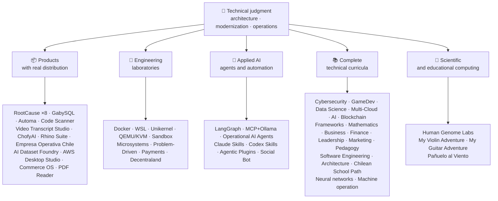

<!-- Synced from the public GitHub profile on 2026-10-16. -->

<div align="center">

# 👋弗拉基米爾·阿庫尼亞

## **解決方案架構·高階全速板·數字轉換·管理和業務**

**專業接受電腦科學與計算工程與工商管理專業培訓,擁有16年以上在真實環境下的建設和操作軟體. 我將商業、人、流程和技術與技術判斷和業務觀點聯絡起來,以設計、評價、交付和維持解決方案,並在GitHub賬戶中以可核實的證據作為後盾。**

[](https://vladimiracunadev-create.github.io/)
[](https://www.linkedin.com/in/vladimir-acu%C3%B1a-valdebenito-11924a29/)
[](mailto:vladimir.acuna.dev@gmail.com)

[](#專業範圍)
[](#具有實際分佈的產品)
[](#完成技術課程)

<!-- STATS:START -->
[](https://github.com/vladimiracunadev-create?tab=repositories)
[](https://github.com/vladimiracunadev-create?tab=repositories)
[](#生態系統一一)
[](#完成技術課程)
[](https://github.com/vladimiracunadev-create?tab=repositories)
<!-- STATS:END -->

[](https://github.com/vladimiracunadev-create?tab=repositories)
[](https://github.com/vladimiracunadev-create?tab=followers)

[🌐 Portfolio (22 languages)](https://vladimiracunadev-create.github.io/) ·
[🧩 Ecosystem](#生態系統一一) ·
[⚡ Evaluate me in 10 minutes](#如果你有十分鐘的時間來評價我) ·
[✅ Professional scope](#專業範圍) ·
[🧭 Non-coding management](#管理行政和非編碼職業機會) ·
[📋 Role matrix](PROFESIONAL_ROLES.md) ·
[📬 Contact](#聯絡人)

**🌐 完整版本:** [Español](README.md) · [English](README.en.md) · [Português](README.pt.md) · [Italiano](README.it.md) · [Français](README.fr.md) · [簡體中文](README.zh.md) · [繁體中文](README.zh-TW.md) · [日本語](README.ja.md) · [한국어](README.ko.md) · [Türkçe](README.tr.md) · [Русский](README.ru.md) · [Tiếng Việt](README.vi.md) · [ไทย](README.th.md) · [Deutsch](README.de.md) · [Українська](README.uk.md) · [Polski](README.pl.md) · [العربية](README.ar.md) · [فارسی](README.fa.md) · [Bahasa Indonesia](README.id.md) · [Nederlands](README.nl.md) · [हिन्दी](README.hi.md) · [Ελληνικά](README.el.md)

**技術核心:**
PHP 8 · Python · Rust · Go · Node/TS · Java 21 · .NET 8 · Dart/Flutter · WASM
· AWS · Terraform · Kubernetes · Docker · n8n · LangGraph/MCP · CI/CD · FinOps · Observability

**商業-技術橋樑:**
程式和要求分析·解決方案評價·執行協調·業務和連續性·風險管理·產品和服務·技術教育

</div>

---

> [!NOTE]
> 這一概況並沒有將機會轉化為經驗。 已證實的技術經驗、可轉讓的技能、可行的應用和未來發展目標明確分開。 連結到的 GitHub 證據是可執行的或檔案的; 某物在哪裡**不詳**完成後,即為完成。

## 🎯你在這裡能找到什麼

這不是“一回式”的:它是具有共同標準的生態系統。

- 🔁 **可複製的演示**——克隆,執行,驗證.
- 🧰 **標準化工具**檔案,CLI中心,`doctor`,以及`smoke`每個儲存器。
- 🛡️ **深入防禦**秘密掃描、政策和明確禁止的做法。
- 📈 **觀察性** — `/health`, `/ready`, `/metrics`儀表板 和可追蹤性
- 📚 **觀眾認識檔案**——根據暫存器的不同,招募者,初學者,DevOps,或安全性.
- 📦 **產品銷售**可下載的釋出、核對和建立證據;酌情宣佈商業/儲存簽名待決。
- 🌍 **國際化**——以6種語文編寫的教材(ES)·EN 語·常規·資訊科技·法語·) ,"中國共產黨黨史人物彙編"(第1輯).
- 🧭 **技術誠實**- 每一個案件都標註在標籤上`OPERATIONAL`, `DOCUMENTED/SCAFFOLD`,或 ,或 ,`PLANNED`.

## ✅可核實狀態

| 表面 | 具體證據 |
|---|---|
| 🧪 **測試覆蓋率** | 蓋比SQL**828個測試**+ 模糊過**503.8M次查詢**(0恐慌) (笑聲)·智利企業**158次試驗** ·自動**150個火試** ·多作業系統分類 |
| 🤖 **生產級製劑** | 朗格勒真實世界**25/25 業務後端**(病例01-25,100%覆蓋)·業務助理**13名特工人員**與**39個確定性評估** |
| 🔗 **多塊塊融合** | **20個案件**傳送者 n8n 收發者-**19起業務**,個人審計 與多克 -· **18+ DB 發動機** · **20個以上集裝箱** ·11種模式 |
| 📦 **分發** | **151次釋放**跨越生態系統的**64個擁有的公共儲存庫** ·安裝器和文物`.exe` · `.msi` · `.dmg` · `.apk`核對和建立證據; 酌情在商業/儲存中籤名 |
| 🛡️ **供應鏈** | 程式碼QL·衛星·匪幫·特里維·格萊普·巨頭·旋轉木偶·旋風DX SBOM·計分卡 |
| 📚 **課程** | **14 530個班級**21個方案可核查,按[a workflow](.github/workflows/stats.yml)或可核查的來源,·每個節目都宣佈其編輯地位和限制 |
| 🌐 **組合** | 可安裝的 PWA· **22種語言** · **154個PDF**管道產生的·CV 資料 API·電容安卓·燈塔 100 |
| 🔒 **遙測** | 法證產品和智利企業的零遙測——在每個建築中都得到核實(無Android)`INTERNET`許可權) |
| 🌐 **出版網站** | **56個基特胡佈網頁網站**-55次著陸,每件產品、程式或生態系統導航員一次,加上組合——從自己的儲存庫部署·全部56個已與HTTP核實`200` |

## 🗺️生態系統一一



## 📦具有實際分佈的產品

軟體被下載,安裝,使用——不僅被克隆.

| 產品 | 是什麼來著? | 堆疊 | 交付 |
|---|---|---|---|
| [🔍 **RootCause Windows**](https://github.com/vladimiracunadev-create/rootcause-windows-inspector) | 網路安全法證:每一次異常的資源扭曲,都可能是威脅的第一個跡象. 先診斷,後干預 | 鏽🦀 ·ETW/WPR 電子資料交換系統 | **0.19.0 維基百科中的相關條目: 維基百科** · **16次釋出** · **5個版本**: 圖形介面·可移植·國家學習水平·電殼·VS 程式碼· [landing](https://vladimiracunadev-create.github.io/rootcause-windows-inspector/) |
| [📱 **RootCause Mobile**](https://github.com/vladimiracunadev-create/rootcause-mobile-inspector) | 移動兄弟:一個法證感測器,將每個應用程式與自己進行比較,標出跟蹤器的旗子,並將所授予的許可與僅要求的許可分開。 | 小蝶 , 蝶 , 蝶 , 蝶 , 蝶 , 蝶·科特林語Name·輕取 | **以0.8.0計** ·可核查的Android APK·5種語言· **零遙測** · [landing](https://vladimiracunadev-create.github.io/rootcause-mobile-inspector/) |
| [🍎 **RootCause macOS**](https://github.com/vladimiracunadev-create/rootcause-macos-inspector) | macOS 版 :`launchd`持續、守門、SIP、FileVault、XProtect、TCC許可權、簽名程序和網路鄰居——每個表面都對照已知的良好狀態檢查 | 鏽🦀 ·macOS 13+ 常規 | **單位:千分之一** ·首次釋出·阿帕奇-2.0 維基月球線上解說-阿帕奇-2.0· [landing](https://vladimiracunadev-create.github.io/rootcause-macos-inspector/) |
| [🖥️ **RootCause Server**](https://github.com/vladimiracunadev-create/rootcause-server) | 伺服器兄弟關係:將沒有單一日誌所看到的東西聯絡起來——曝光的表面、訪問的嘗試、給予同一地址的會話、關鍵檔案完整性和感測器的沉默——並將其變成一個可操作的句子 | 鏽🦀 ·視窗·連結·macOS 系統 | **以0.2.0計** · **18 第 條**證據和記錄·從未單獨執行動作·本地控制檯, 不含網路依賴性· **目前尚未釋出** · [landing](https://vladimiracunadev-create.github.io/rootcause-server/) |
| [🌐 **RootCause Web**](https://github.com/vladimiracunadev-create/rootcause-web-inspector) | 瀏覽器法證感測器: cookie, 電子郵件會話, 擴充套件, 下載, 許可權, 以及模模擬實視窗的頁面 | Java 指令碼·MV3 擴充套件 | **以0.2.0計** ·目前尚未釋出·面板開口`127.0.0.1` ·零依賴關係·在 CI 中驗證的零遙測· [landing](https://vladimiracunadev-create.github.io/rootcause-web-inspector/) |
| [₿ **RootCause Bitcoin Defense**](https://github.com/vladimiracunadev-create/rootcause-bitcoin-defense) | 僅監視Bitcoin監管的辯護:盤點每把鑰匙的來源,用公佈的警告進行交叉核對,用證據解釋根源 | Java 指令碼·視窗應用程式·本地面板 | **維基月球0.3.0** · **2次釋出** ·零依賴關係·永遠不要要求種子·已核實的 CI· [landing](https://vladimiracunadev-create.github.io/rootcause-bitcoin-defense/) |
| [⛓️ **RootCause Blockchain Security**](https://github.com/vladimiracunadev-create/rootcause-blockchain-security) | 多鏈只監視控制檯:庫存合同、代理、甲骨文、橋樑、治理和依賴性,生成根源執行本 | Java 指令碼·視窗應用程式·本地面板 | **維基月球0.3.0**儲存器中·已釋出發行 :`v0.1.0` ·零依賴關係·從未要求私鑰·已核實的 CI· [landing](https://vladimiracunadev-create.github.io/rootcause-blockchain-security/) |
| [📷 **RootCause QR Inspector**](https://github.com/vladimiracunadev-create/rootcause-qr-inspector) | 用於檢查 QR 程式碼的本地Android app 操作前: 解釋 26 個訊號, 將事實與假說區分開來, 並輸出被編輯的證據 | 小蝶 , 蝶 , 蝶 , 蝶 , 蝶 , 蝶·達特 | **編號為0.1.4** · **5次釋出** · **107次測試** ·已出版的Android APK·可核查的SHA-256·APK 成套技術簽名;商業/儲存簽名正在進行·零遙測· [landing](https://vladimiracunadev-create.github.io/rootcause-qr-inspector/) |
| [🏢 **Empresa Operativa Chile**](https://github.com/vladimiracunadev-create/empresa-operativa-chile) | 將註冊前的證券交易指南改為每月關閉:附有證據的註冊、增值稅結轉、F29草案、不可改變的關閉和審計記錄。 每一個規則都指向它的官方來源 | Java 指令碼·鏽·太平洋婦女協會 | **5月1日,紐約** ·機器人·視窗·瀏覽器· **158次試驗** · **0個生產依賴** ·零遙測· [landing](https://vladimiracunadev-create.github.io/empresa-operativa-chile/) |
| [🔍 **Universal Code Scanner**](https://github.com/vladimiracunadev-create/universal-code-scanner) | QR 和條碼讀取器**行動前的翻譯**: 16個本地URL風險訊號並明確確認 | 小蝶 , 蝶 , 蝶 , 蝶 , 蝶 , 蝶·達特 | **維基百科中的相關條目: 維基語錄連結:名人名言 - 分類** ·機器人·iOS 系統·macOS 系統·太平洋婦女協會·加密歷史**AES-256-GCM 導彈** · [landing](https://vladimiracunadev-create.github.io/universal-code-scanner/) |
| [🗄️ **GabySQL**](https://github.com/vladimiracunadev-create/gabysql) | 嵌入式資料庫:單`.db`檔案, WAL, 基於成本的最佳化器, HTTP/ JSON API | 鏽🦀 | 視窗·macOS 系統·連結· [landing](https://vladimiracunadev-create.github.io/gabysql/) |
| [🤖 **Automa PC**](https://github.com/vladimiracunadev-create/automa-pc) | 本地管絃樂器:JSON 流出開啟真實視窗,與 DOM 互動,留下證據 | 蟒蛇·劇作家·pywebview 頁面檢視 | **維基月球0.3.0** · **27個流動** ·已公佈和可核查的安裝器· [landing](https://vladimiracunadev-create.github.io/automa-pc/) |
| [🏭 **AI Dataset Foundry**](https://github.com/vladimiracunadev-create/ai-dataset-foundry) | 本地第一工廠,將PDF、Word、Web、Git、JSON和CSV轉化為可審計的資料集,用於預訓、微調、RAG和評價 | 蟒蛇 | **以0.2.0計** ·Windows + 離線Android 軟體·首次釋出· [landing](https://vladimiracunadev-create.github.io/ai-dataset-foundry/) |
| [☁️ **AWS Desktop Studio**](https://github.com/vladimiracunadev-create/aws-desktop-studio) | 本地第一應用程式,包含15個AWS庫存整合,20個教程,CLI/SSO,以及只讀預設;執行中,沒有普及 | Java 指令碼·視窗 | **編號為0.1.1** ·首次釋出· [landing](https://vladimiracunadev-create.github.io/aws-desktop-studio/) |
| [🧭 **Commerce OS**](https://github.com/vladimiracunadev-create/commerce-operating-system) | 商業業務的引導概念示範:目錄、庫存、客戶關係管理、訂單、模擬付款和可追蹤性 | Java 指令碼·網頁·視窗·機器人 | **維基月球0.3.0** · **2次釋出** ·沒有任何實收資金或智利稅務當局的一體化· [landing](https://vladimiracunadev-create.github.io/commerce-operating-system/) |
| [📄 **PDF Reader**](https://github.com/vladimiracunadev-create/pdf-reader-windows-android) | Android- 第一臺本地只讀讀取器, 其無剪輯縮放, 可重開歷史、 WhatsApp 共享以及預設讀取器選擇 | HTML 語言·網頁·機器人·視窗 | **0.3.3 資料** ·已簽名的APK·沒有賬戶、敏感許可權或遙測· [landing](https://vladimiracunadev-create.github.io/pdf-reader-windows-android/) |
| [🎙️ **Video Transcript Studio**](https://github.com/vladimiracunadev-create/video-transcript-studio) | 影片、播放列表或**整個YouTube頻道**以時間戳來文字。 它不依賴現有的字幕: 低聲識別音訊**訣竟**,沒有 API、賬戶或金鑰來配置 | 蟒蛇·雙管6·FastAPI 軟體·快速低聲 | **以0.2.0計** ·視窗桌面+ 本地面板在`127.0.0.1`+CLI, + + + + + + + + + + + + + + + + + + + + + + + + + + + + + + + + + + + + + + + + + + + + + + + + + + + + + + + + + + + + + + + + + + + + + + + + + + + + + + + + + + + + + + + + + + + + + + + + + + + + + + + + + + + + + + + + + + + + + + + + + + + + +**共享相同的佇列** ·貨幣·個人檔案·自動除錯·特別審判庭·虛擬TT·傑森,你好嗎?·MP3 調變解調器·歐格· **89次測試** ·捆綁的FFmpeg 軟體·零遙測· [landing](https://vladimiracunadev-create.github.io/video-transcript-studio/) |
| [🎨 **ChofyAI Studio**](https://github.com/vladimiracunadev-create/chofyai-studio) | 本地創意AI發射裝置:管弦樂團 Qune3-TTS,低語.cpp,FaceFusion,AceForge,和ComfyUI | 陶里語 2·鏽·反應 | 5.1 以內· **5/5 工具,並有真實的推論** ·macOS 蘋果矽·實驗視窗· **目前尚未釋出** · [site](https://vladimiracunadev-create.github.io/chofyai-studio/) |
| [🦏 **Rhino Suite**](https://github.com/vladimiracunadev-create/rhino-suite) | 從頭開始的辦公套件:文件規則不依賴於 DOM —— HTML 僅僅是一個投影 | 粗口/瓦斯米·去吧,我們走·反應 19 | 按相位演化的單重力· [landing](https://vladimiracunadev-create.github.io/rhino-suite/) |
| [🎻 **My Violin Adventure**](https://github.com/vladimiracunadev-create/violin-adventure) | 兒童教育應用:花色調奏器、錄音鍾精確的節拍器、有真琴的歌曲 | 陶里語 2·反應·TS 調製 | **編號: 1.3.0** ·視窗·機器人·連結·macOS 系統·太平洋婦女協會· [landing](https://vladimiracunadev-create.github.io/violin-adventure/) |
| [🎸 **My Guitar Adventure**](https://github.com/vladimiracunadev-create/guitarra-adventure) | 接弦的弟弟: 6個世界的24個課,6個弦調奏者,無漂流的節奏, 和11個真正的吉他音符 | 陶里語 2·反應·TS 調製 | **單曲 1. 0.0** ·視窗·機器人·連結·macOS 系統·iOS 系統·太平洋婦女協會·沒有賬戶、廣告或線上依賴· [landing](https://vladimiracunadev-create.github.io/guitarra-adventure/) |
| [🧣 **Pañuelo al Viento**](https://github.com/vladimiracunadev-create/panuelo-al-viento-cueca-app) | 10歲的Cueca:8級24個班級,72個活動,6個脈衝實驗室(3+3和2+2+2),以及可訪問的地平圖. 宣告如下:**補充,而不是替換**教師和文化傳承者 | 小蝶 , 蝶 , 蝶 , 蝶 , 蝶 , 蝶·達特 | **以0.2.0計** ·7+號機器人·Windows 10/11 視窗 10/11·APK 自動交換·EXE 資料·模里西斯·行動式· **29個測試+2個驗證器** ·沒有相機、麥克風、賬戶、廣告或網際網路· [landing](https://vladimiracunadev-create.github.io/panuelo-al-viento-cueca-app/) |

## 🧪工程實驗室

| 重播( R) | 所顯示的 |
|---|---|
| [🐳 **Problem-Driven Systems Lab**](https://github.com/vladimiracunadev-create/problem-driven-systems-lab) | **20個真正的問題**(負載下緯度,N+1,重試風暴,出洩,單層,快取被印出,回壓,零下行遷移,被遺忘 DLQ) 具有高純度注入出故障,解入.**7個堆**: 首頁8·蟒蛇·節點.js·爪哇島21·.NET 8 資料· **衝出1.23** · **粗口1.83 號** · [landing](https://vladimiracunadev-create.github.io/problem-driven-systems-lab/) |
| [📆 **Social Bot Scheduler**](https://github.com/vladimiracunadev-create/social-bot-scheduler) | **以4.10.0計** · **20個案件**來源=n8n=收件者**18+ DB 發動機** —**19起業務**,個人審計 與多克 -**8層**審計、一手護欄、斷路器和DLQ· [landing](https://vladimiracunadev-create.github.io/social-bot-scheduler/) |
| [🧰 **Microsistemas**](https://github.com/vladimiracunadev-create/microsistemas) | **12個診斷和現代化微型應用程式**用於最高階·本地只讀的 MCP 伺服器·分三個階段進行硬化· [landing](https://vladimiracunadev-create.github.io/microsistemas/) |
| [🧪 **Docker Labs**](https://github.com/vladimiracunadev-create/docker-labs) | **13個實驗室**4個服務平臺+自動`.exe`裝有發射裝置的安裝器· [landing](https://vladimiracunadev-create.github.io/docker-labs/) |
| [🐳 **WSL Labs**](https://github.com/vladimiracunadev-create/wsl-labs) | **12個案件**開啟`wslc`,本地WSL集裝箱發動機——**不掛起子桌面** · [landing](https://vladimiracunadev-create.github.io/wsl-labs/) |
| [⚡ **Unikernel Labs**](https://github.com/vladimiracunadev-create/unikernel-labs) | “單核管的容器桌面” : 使用 WSL2 後端控制 Unikraft 的 Windows 控制器,`kraft`+ QEMU/KVM· [landing](https://vladimiracunadev-create.github.io/unikernel-labs/) |
| [🧰 **QEMU/KVM Labs**](https://github.com/vladimiracunadev-create/qemu-kvm-labs) | **12個實驗室**與QEMU、KVM、libvirt、雲-init以及`vm-manager`有關 Linux 和 WSL2 的· [landing](https://vladimiracunadev-create.github.io/qemu-kvm-labs/) |
| [🛡️ **Sandbox Labs**](https://github.com/vladimiracunadev-create/sandbox-labs) | Linux 隔離: 執行第三方程式碼、檔案, 以及宣佈的政策下的商務模式**簽發了實際適用控制措施的簽名證據** · **36個案件**15個技術市場和21個資本市場,·* 已申報為實驗和教育產品,* 不是安全產品*· [landing](https://vladimiracunadev-create.github.io/sandbox-labs/) |
| [💳 **Universal Payments Engineering Lab**](https://github.com/vladimiracunadev-create/universal-payments-engineering-lab) | **28個支付家庭**當地自我解釋演示:狀態、分類賬、對賬、安全和執行指南· [landing](https://vladimiracunadev-create.github.io/universal-payments-engineering-lab/) |
| [🕹️ **Decentraland Social Arcade**](https://github.com/vladimiracunadev-create/decentraland-social-arcade) | 原生的Decentraliand 社交 三維體驗:一個MVP和多遊戲架構,並配有 SDK7, ECS, 和 TypeScript·西班牙文文件·無付款或遙測 |
| [☁️ **AWS Projects**](https://github.com/vladimiracunadev-create/proyectos-aws) | Progressive cases where each one adds one AWS service **and** a new GitHub Actions capability · SAA-C03 · DVA-C02 · SOA-C02 coverage |

## 🤖應用AI

| 重播( R) | 所顯示的 |
|---|---|
| [🤖 **LangGraph RealWorld**](https://github.com/vladimiracunadev-create/langgraph-realworld) | **25/25 業務後端**——打出狀態,有條件的路線,NDJSON流線,DEMO/LIVE模式,8個安全層,SHA-256 監管鏈 |
| [🧭 **Operational AI Agents**](https://github.com/vladimiracunadev-create/operational-ai-agents) | **13個業務代理**克勞德密碼和相容執行時間:每個系統都收到一個完整的任務——儲存器演變、遺產現代化、課程設計、組合出版、安全補救、事件分析——根據申報的合同、人口和可核查的證據· **39個確定性評估** ·34個測試·零潛入( 僅限Stdlib)·連結·macOS 系統·視窗· [site](https://vladimiracunadev-create.github.io/operational-ai-agents/) |
| [🧠 **MCP + Ollama Local**](https://github.com/vladimiracunadev-create/mcp-ollama-local) | 沙盒中帶有 MCP 工具的本地首個AI· `127.0.0.1`繫結·多層信任配置·誠實地說,這是有限度的, |
| [🧩 **Agentic Plugins Toolkit**](https://github.com/vladimiracunadev-create/agentic-plugins-toolkit) | **6個代理外掛**可從一個來源在克洛德碼、OpenAI/Codex、副駕駛、雙子座和MCP中安裝:`repository-engineering`, `legacy-modernization`, `learning-program-studio`, `product-evolution`, `portfolio-governance`,以及`rootcause-response` · **69個生成的不漂移的檢視**——每次執行時間都從同一份合同中收到其格式.·零讀取·連結·macOS 系統·視窗· [site](https://vladimiracunadev-create.github.io/agentic-plugins-toolkit/) |
| [🧰 **Claude Skills Toolkit**](https://github.com/vladimiracunadev-create/claude-skills-toolkit) | **15個代理技能**克勞德程式碼· **安保服務**: 12 層`security-audit`維也納(OSV)·開源軟體國際化之簡體中文組·電子軟體系統·薩斯德·容器·保密)和14階段`bitcoin-custody-audit` · **重置閘門**: `pre-commit-guard`, `pre-push-guard`, `yaml-control`, `md-lint-fix`, `python-lint-guard` · **一致性**: `repo-coherence-audit`, `version-bump`, `python-version-control`, `python-deps-pinning` · **掛起點**: `docker-cleanup`, `docker-compose-doctor` · **文件**: `md-to-doc` ·零讀取·跨平臺 |
| [🧰 **Codex Skills Toolkit**](https://github.com/vladimiracunadev-create/codex-skills-toolkit) | **19個代理技能**用於編碼:安全和供應鏈、飛行前、功能流動、復原力和狀態、釋放證據、Python/YAML/Markdown門、版本、依賴、Docker和檔案·蟒蛇第一號· `pnpm` ·連結·macOS 系統·視窗· [site](https://vladimiracunadev-create.github.io/codex-skills-toolkit/) |

## 📚完成技術課程

西班牙語序列程式,每個儲存器都宣告狀態和範圍. 21個方案加起來是:**14 530個班級**,計算為[a workflow](.github/workflows/stats.yml),從真正的暫存器結構或暫存器中宣告的可核查源;徽章每週重新整理一次,不由手寫.

🧭 [**Lifelong Learning Ecosystem**](https://github.com/vladimiracunadev-create/lifelong-learning-ecosystem)是一個聯邦指南針,透過視覺地圖和影象圖連線6個地區的30個真實路徑[accessible offline portal](https://vladimiracunadev-create.github.io/lifelong-learning-ecosystem/);不計為附加程式。

| 程式 | 類 | 範圍 |
|---|---:|---|
| [🔢 **Computational Mathematics**](https://github.com/vladimiracunadev-create/computational-mathematics-program) | 360 | 從依靠手指到複製出紙· **360起在CI核實的決定性示威** ·1 080個筆記本·489個術語表· [site](https://vladimiracunadev-create.github.io/computational-mathematics-program/) |
| [🏦 **Finance and Banking**](https://github.com/vladimiracunadev-create/finance-and-banking-evolution-program) | 356 | 534小時·金融數學和《國際財務報告準則》 ——信貸、風險、巴塞爾三號、公開金融、DLT、穩定幣和MICA· **27個案件** · **298次測試** · [site](https://vladimiracunadev-create.github.io/finance-and-banking-evolution-program/) |
| [🎮 **GameDev**](https://github.com/vladimiracunadev-create/modern-gamedev-program) | 352 | 數學和C#/C++/GDScript → 陰影器,AI,多人遊戲,VR/AR·哥多特語·團結·虛幻· **在CI中核實的10個戈多實驗室**(301次檢查)· [site](https://vladimiracunadev-create.github.io/modern-gamedev-program/) |
| [🛡️ **Cybersecurity**](https://github.com/vladimiracunadev-create/modern-cybersecurity-program) | 360 | **編號: 1.3.0** ·20個部分·– 紅色團隊,DFIR,雲安全,開發dev,CTF,和遊戲安全·對映到**7份證書** ·離線Android/web app·PDF 手冊·核實了CI、安保和網頁· [site](https://vladimiracunadev-create.github.io/modern-cybersecurity-program/) |
| [📈 **Marketing, Sales, and Growth**](https://github.com/vladimiracunadev-create/marketing-sales-growth-evolution-program) | 336 | 24個部分,包括業務定義、計量單、可核查的參考書目和智利的監管背景· **千分之一.6.0 千分之一.** ·1.29M字數·17個基於角色的路徑· [site](https://vladimiracunadev-create.github.io/marketing-sales-growth-evolution-program/) |
| [🏢 **Business Creation**](https://github.com/vladimiracunadev-create/modern-business-creation-program) | 336 | 在智利建立和經營一家真正的公司:從想法到成立、稅務當局、業務、危機和退出·360 個圖表·1 251個任期詞彙表·1 548頁手冊· [site](https://vladimiracunadev-create.github.io/modern-business-creation-program/) |
| [🏛️ **Architecture and Built Environment**](https://github.com/vladimiracunadev-create/architecture-built-environment-learning-program) | 830 | 83個編·60屆綜合會議·34道路徑·可追蹤來源·下行、離線閱讀器和 GitHub Pages· [site](https://vladimiracunadev-create.github.io/architecture-built-environment-learning-program/) |
| [🇨🇱 **Chilean School Learning Path**](https://github.com/vladimiracunadev-create/chilean-school-learning-path) | 8,841 | 1至12年級· **4 156次綜合跨課程經驗** · **2 823個學習目標** ·聯剛特派團的訊息來源·尚未提出待決提案和尚未進行專門人力審查· [site](https://vladimiracunadev-create.github.io/chilean-school-learning-path/) |
| [🧭 **Modern Software Engineering**](https://github.com/vladimiracunadev-create/modern-software-engineering-program) | 480 | 40個部分和8個階段·基礎 → 產品、建築、安全、DevOps、SRE、SPEC、AI和多代理系統·資料庫宣佈的編輯地位· [site](https://vladimiracunadev-create.github.io/modern-software-engineering-program/) |
| [🎓 **Pedagogy and Learning Sciences**](https://github.com/vladimiracunadev-create/education-pedagogy-learning-sciences-program) | 300 | 從一個人如何學習到如何培訓教師·25個部分· **每一類都宣告其證據狀態和限度** ·早期識字、比較方法、具體教育需要、共處、文化多樣性和國際證據·1 097個定期詞彙表、325個圖表和60個活動課堂庫·按角色分列的14個職業道路·LMS 可出口· **維基百科中的相關條目: 維基語錄連結:名人名言 - 分類** · [site](https://vladimiracunadev-create.github.io/education-pedagogy-learning-sciences-program/) |
| [☁️ **Multi-Cloud**](https://github.com/vladimiracunadev-create/multi-cloud-engineering-program) | 288 | 自動取款機·阿蘇雷·GCP 常規·庫伯涅斯·地表·塞爾維亞·財務操作· **1 288小時** ·288個有JSON證據的實驗室·1 032個來源·2 884頁PDF手冊· [site](https://vladimiracunadev-create.github.io/multi-cloud-engineering-program/) |
| [🎖️ **Executive Leadership**](https://github.com/vladimiracunadev-create/executive-leadership-founder-program) | 288 | 從擁有第一個結果到領導一個公司和建立自己的團隊:團隊、KPI/OKR、金融、產品、風險、板子和併購·24個病例、96個實驗室和39個模板· [site](https://vladimiracunadev-create.github.io/executive-leadership-founder-program/) |
| [🐍 **Python Data Science**](https://github.com/vladimiracunadev-create/python-data-science-program) | 232 | 極地,ML+Optuna/SHAP,PyTorch/LLMS/LORA,MLOps·本地 Windows 應用程式 + Android APK· [site](https://vladimiracunadev-create.github.io/python-data-science-program/) |
| [🧠 **AI Evolution**](https://github.com/vladimiracunadev-create/artificial-intelligence-evolution-program) | 184 | 典型的 / 機率的 / 深層學習 / 法學碩士、 研究與培訓、代理、安全和邊境· **0.17.0 億** · **708個筆記本** · **148份基礎檔案** ·離線的 Windows, Android, 和 PWA 應用程式· [site](https://vladimiracunadev-create.github.io/artificial-intelligence-evolution-program/) |
| [🌐 **Comparative Programming**](https://github.com/vladimiracunadev-create/polyglot-programming-labs) | 176 | 有個概念**10種語言**由CI核實 -**1 360項執行**+ 加上**1 632個方案**以活語言(COBOL、Fortran、Ada、RPG、MUPS......)和地圖集**15個家庭的60張卡片** ·維基百科中的相關條目: 維基語錄連結:名人名言 - 分類· [site](https://vladimiracunadev-create.github.io/polyglot-programming-labs/) |
| [🧩 **Frameworks Compared**](https://github.com/vladimiracunadev-create/framework-ecosystems-labs) | 149 | 一份沒有介面卡的可執行合同,針對快遞、快活API、斯普林布特、ASP.NET、Django、Rails、Laravel、React、Vue、Svelte等·12個部分· **70個建築班級** · **397起在CI核實的案件** · **210 ISBN/DOI來源 網際網路檔案館的存檔,存檔日期2013-03-02.** · [site](https://vladimiracunadev-create.github.io/framework-ecosystems-labs/) |
| [🗄️ **Databases**](https://github.com/vladimiracunadev-create/database-systems-labs) | 74 | **單曲3. 0.0** ·15個部分的資料庫工程·230小時· **每項索賠的可核實來源**:120 有ISBN,DOI,或標準來源.·27個引擎破了同樣的案子·306個術語表·150個火試· [site](https://vladimiracunadev-create.github.io/database-systems-labs/) |
| [📐 **Psychometrics and Assessment**](https://github.com/vladimiracunadev-create/psychometrics-and-assessment-program) | 40 | 衡量工具如何構建、打分、驗證和審計·8個部分·可執行引擎, 使用**5項文書和344項,276項公共領域** |
| [⛓️ **Blockchain**](https://github.com/vladimiracunadev-create/blockchain-learning-path) | 66 | **0.14.0 維基百科** ·從零到可程式設計的金融基礎設施和鏈上分析· **91個做法**財務報告和已審計財務報表**363次測試** ·與開業公司(模糊和變化不定)和CI的Slither靜態分析的合同·開啟二進位制並計數其內容的離線應用程式· [site](https://vladimiracunadev-create.github.io/blockchain-learning-path/) |
| [🧠 **Neural Network Training Labs**](https://github.com/vladimiracunadev-create/neural-network-training-labs) | 31 | 7 modules · ≈214 hours · **93 notebooks** —31 classes, 31 student versions, and 31 solutions— · questions, visual maps, practices, and assessment with real public data · PyTorch · [study site](https://vladimiracunadev-create.github.io/neural-network-training-labs/) |
| [🕹️ **Machine Operator**](https://github.com/vladimiracunadev-create/machine-operator-program) | 451 | **41個培訓單元**,每臺一臺機器· **502小時15分鐘** ·系統、控制、物理、安全和模擬設計,每類源·*還沒有可執行模擬器,而且它被宣佈為這樣* |

## 🔬科學計算

| 重播( R) | 所顯示的 |
|---|---|
| [🧬 **Human Genome Labs**](https://github.com/vladimiracunadev-create/human-genome-labs) | 複製基因組學平臺:已打入`ScientificResult<T>`合同,FASTA/GFF3/VCF,模組與**明確到期和證據**. 絕對誠實:*它不進行臨床診斷*· [site](https://vladimiracunadev-create.github.io/human-genome-labs/) |

## ⚡如果你有十分鐘的時間來評價我

想法不僅僅是看程式碼,而是看**怎麼樣**記錄我的方式 以及我如何使一切可以執行

**A道——真正可觀察和有條理***(我最喜歡的) *

```bash
git clone https://github.com/vladimiracunadev-create/social-bot-scheduler.git
```

將會看到工作流程, 度量衡,儀表板, 和護欄, 覆蓋19個案例和18+ DB引擎。

**B道——幾分鐘內可複製的基礎設施**

```bash
git clone https://github.com/vladimiracunadev-create/docker-labs.git
```

**C道——具有型別狀態的代理**

```bash
git clone https://github.com/vladimiracunadev-create/langgraph-realworld.git
```

**D道——不克隆的粗糙法證產品**

從中下載安裝器或 CLI 二進位制[RootCause releases](https://github.com/vladimiracunadev-create/rootcause-windows-inspector/releases)並核實`SHA256SUMS`.

## 🧠標準一應用到所有倉庫

- **第一次DX遊戲**——如果執行不便,則作為演示或團隊基礎,並不有用.
- **第1天起的可觀察性**——衡量尺度和可追溯性,不是事後思考.
- **安全作為管道**——秘密掃描,每出一出SBOM,明令禁止的做法.
- **實際復原力**——一能分解,斷路器分解,並有控制的降解.
- **設計型多塊**——語言和引擎由用例選擇,從不由時尚選擇.
- **誠實的狀態**——一雷波被更名(.`Multisimulador` → `machine-operator-program`),以避免尚不存在的有希望的軟體.
- **徽章是訊號,不是證據**——每筆還本付息也宣告**做它不做的東西**.
- **型號向外**——域名設計為先;介面為投影.
- **對外工作被宣佈為對外工作**——該賬戶的70個公共庫藏中,有64個是我的工作. 其他六人 都已經...[`agentic-qe`](https://github.com/vladimiracunadev-create/agentic-qe), [`Anthropic-Cybersecurity-Skills`](https://github.com/vladimiracunadev-create/Anthropic-Cybersecurity-Skills), [`erpnext`](https://github.com/vladimiracunadev-create/erpnext), [`OpenExecutive`](https://github.com/vladimiracunadev-create/OpenExecutive), [`raptor`](https://github.com/vladimiracunadev-create/raptor),以及[`security-audit-skill`](https://github.com/vladimiracunadev-create/security-audit-skill)——是叉子,並且被排除在我自己工作的所有數字之外.

## ✅專業範圍

我的雙重背景**電腦科學與計算工程+工商管理**——幫助我把業務目標轉化為技術決定和技術制約轉化為明確的業務選擇,產品,客戶和領導權.

### 🎯核心身份

| 作用 | 備份 |
|---|---|
| **解決方案架構** | 具有進化判斷力的可縮放式系統設計 |
| **遺產現代化建築師** | 真正的遺產演變(PHP 5.x 8.x,增量再造而不會中斷操作). |
| **高階全層/技術鉛** | 實際平臺的架構、執行和標準(+16年) |
| **AI 自動化建築師** | 具有LangGraph/MCP和有護欄的n8n流動的代理系統 |

### ↗ 自然延伸

**AI 管絃樂工程師** · **系統/粗糙工程師** · **移動工程師(Flutter)** · **解決方案工程師** · **技術產品構建器** · **技術培訓人員** · **數字轉換顧問** · **業務/職能分析員** · **技術產品業務**

### ⚙️補充範圍

平臺工程師/境內流離失所者·開發/開發/開發/開發·雲/ AWS 工程師·應用程式 SRE·自動化工程師·技術商業諮詢人

## 🧭管理、行政和非編碼職業機會

這一範圍並不聲稱每個標題都得到了保留。 它優先考慮的是計算機、工商管理和公共證據的組合能夠創造價值而不會把編碼作為核心義務的工作。

| 專業家庭 | 公認作用 | 誠實的分類 | 編碼 | 證據和情況 |
|---|---|---|---|---|
| **技術領導** | 資訊科技主管·資訊科技業務經理·數字轉換管理器·首席資訊幹事 | **應用潛力/未來目標** | 無/偶然 | 強有力的技術基礎;人員、預算、供應商和行政問責制必須分別證明 |
| **專案管理** | 資訊科技專案協調員/管理人員·個人·斯克魯姆大師·急速交付 | **可轉讓/應用潛力** | 無/偶然 | 提供和釋放證據;正式團隊、預算和贊助者責任仍是一個空白 |
| **工商管理** | 工商管理者·行政/業務管理員·合同管理員 | **應用潛力** | 無 | 商業學位和業務文物;需要核實資源、人員和供應商的所有權 |
| **戰略和改革** | 戰略顧問·更改管理器·機構規劃·創新/轉型 | **可轉讓/應用潛力** | 無 | 遺產現代化和解決方案評價;必須展示組織採納成果 |
| **業務分析** | 業務分析員·職能/需求分析員·銀行和銀行·不斷改進 | **可轉讓/應用潛力** | 無/偶然 | 領域模型和要求證據;外部利益攸關方案件會加強索賠 |
| **產品和服務** | 產品所有人/經理·產品操作·提供服務·客戶成功 | **可轉讓/應用潛力** | 無/偶然 | 路線圖、生命週期、釋出和業務;P&L、客戶組合和SLA證據因作用而異 |
| **網路安全管理** | GRC 紅十字與紅新月聯會·資訊科技控制審計員·技術風險·資訊保安/連續性 | **應用潛力** | 無/偶然 | 控制和根原因證據;組織審計和有關證書有待審查 |
| **商業和銷售** | 技術·解決方案顧問·技術型KAM·B2B 企業發展 | **可轉讓/應用潛力** | 無 | 強有力的解決方案/價值翻譯;沒有要求配額、賬戶組合和合同談判 |
| **財務和管理控制** | 預算/成本分析·專案評價·計劃生育和艾滋病·管理控制 | **應用潛力** | 無 | 財務/財務處的文物;需要實際預算、財務報表和公司KPI |
| **質量** | 流程/質量分析員·過程審計員·不斷改進 | **可轉讓/應用潛力** | 無/偶然 | 蓋茨、測試、衡量尺度和可複製性;正式的質量系統所有權仍然是一個空白 |
| **學歷** | 技術培訓人員·主持人·學術協調員·EdTech / 指令設計器 | **可轉讓/應用潛力** | 無/偶然 | 21個方案和14 530個班級;正式教學和學習成果必須分別證明 |
| **後勤和供應商** | 採購·供應/業務協調員·供應商/合同管理員 | **應用潛力** | 無 | 流程和行政基礎;需要真正的採購、庫存和供應商業績 |
| **資料和人工智慧治理** | 資料管理·資料治理·AI 收養/治理 | **可轉讓/應用潛力** | 無/偶然 | 審計資料集和人文因素;組織政策和委員會仍然是個空白 |
| **公共部門** | 機構現代化·資訊和通訊技術協調員·數字專案·公共規劃 | **應用潛力** | 無 | 智利的文字系統和可追蹤性;公共採購和部門經驗沒有被提出 |

電話[full Spanish role matrix](PROFESIONAL_ROLES.md)詳細列出所有14個家庭的目標、責任、市場經驗、補充知識、證據、相容性和差距。

## 🤖AI-輔助發展流動

| 工具 | 主要用途 |
|---|---|
| **克勞德程式碼** | 建築審查、實施和技術檔案 |
| **聊天GPT 附加軟體** | 分析、結構和迭代(自2023年起) |
| **程式碼** | 程式碼生成和重構 |
| **反重力** | 加快發展和自動化流動 |
| **VS 程式碼/ 開啟程式碼** | 綜合AI援助的環境 |

> 我綜合了自己的技術判斷,人性驗證,建築方向. AI能增強能力,速度,以及達到——它不會取代經驗.

## 📌可用性

**開啟到 :**高階全速板·建築·遺產現代化·平臺/綜合發展方案·應用程式 SRE·實用的 DevOps 軟體·自動化·AI 自動化·業務/職能分析·資訊科技專案協調·產品操作·數字化轉換·諮詢/銷售·技術教育·質量和不斷改進·AI 收養和治理

**根據每個角色的範圍進行評估:**產品所有人/技術產品經理·提供服務·資訊科技業務·GRC/技術風險·行政和業務·管理控制·公共部門的現代化。 行政和一般管理頭銜是未來的發展目標,而不是聲稱的經驗。

**模式 :**遠端或混合,取決於專案。

## 📬聯絡人

[](https://vladimiracunadev-create.github.io/)
[](https://www.linkedin.com/in/vladimir-acu%C3%B1a-valdebenito-11924a29/)
[](https://gitlab.com/vladimir.acuna.dev-group/vladimir.acuna.dev-group)
[](mailto:vladimir.acuna.dev@gmail.com)

---

<div align="center">

[🤝 Contribute](CONTRIBUTING.en.md) ·
[🛡️ Security](SECURITY.en.md) ·
[⚖️ Code of Conduct](CODE_OF_CONDUCT.en.md)

<sub>README 與可核查的公共庫狀態同步——圖和變化透過API讀取——·最後核實:2026年10月12日。</sub>

</div>
