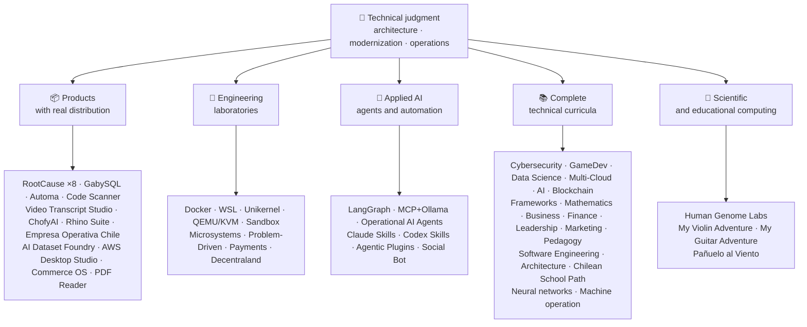

<div align="center" dir="rtl">

# 👋فلاديمير أكونيا

## **Solution Architect·أقدم مجموعة كاملة·التحول الرقمي·العمليات الإدارية**

**تدريب مهني في مجال علوم الحاسوب والهندسة الحاسوبية وإدارة الأعمال، مع بناء 16 سنة وبرمجيات تشغيلية في بيئات حقيقية. وأربط الأعمال التجارية، والناس، والعمليات، والتكنولوجيا بتصميم وتقييم الحلول وتقديمها والمحافظة عليها مع الحكم التقني ونظرة تنفيذية - مدعومة بأدلة يمكن التحقق منها في حساب غيت هوب هذا.**

[](https://vladimiracunadev-create.github.io/)
[](https://www.linkedin.com/in/vladimir-acu%C3%B1a-valdebenito-11924a29/)
[](mailto:vladimir.acuna.dev@gmail.com)

[](#النطاق-المهني)
[](#المنتجات-ذات-التوزيع-الحقيقي)
[](#المناهج-التقنية-الكاملة)

<!-- STATS:START -->
[](https://github.com/vladimiracunadev-create?tab=repositories)
[](https://github.com/vladimiracunadev-create?tab=repositories)
[](#النظام-الإيكولوجي-في-غلاف)
[](#المناهج-التقنية-الكاملة)
[](https://github.com/vladimiracunadev-create?tab=repositories)
<!-- STATS:END -->

[](https://github.com/vladimiracunadev-create?tab=repositories)
[](https://github.com/vladimiracunadev-create?tab=followers)

[🌐 Portfolio (6 languages)](https://vladimiracunadev-create.github.io/) ·
[🧩 Ecosystem](#النظام-الإيكولوجي-في-غلاف) ·
[⚡ Evaluate me in 10 minutes](#إذا-كان-لديك-10-دقائق-لتقييمي) ·
[✅ Professional scope](#النطاق-المهني) ·
[🧭 Non-coding management](#فرص-العمل-في-مجالات-الإدارة-والإدارة-وغير-الترميز) ·
[📋 Role matrix](PROFESIONAL_ROLES.md) ·
[📬 Contact](#الاتصال)

**🌐 النسخ الكاملة:** [Español](README.md) · [English](README.en.md) · [Português](README.pt.md) · [Italiano](README.it.md) · [Français](README.fr.md) · [简体中文](README.zh.md) · [繁體中文](README.zh-TW.md) · [日本語](README.ja.md) · [한국어](README.ko.md) · [Türkçe](README.tr.md) · [Русский](README.ru.md) · [Tiếng Việt](README.vi.md) · [ไทย](README.th.md) · [Deutsch](README.de.md) · [Українська](README.uk.md) · [Polski](README.pl.md) · [العربية](README.ar.md) · [فارسی](README.fa.md) · [Bahasa Indonesia](README.id.md) · [Nederlands](README.nl.md) · [हिन्दी](README.hi.md) · [Ελληνικά](README.el.md)

**الجوهر التقني:**
PHP 8 · Python · Rust · Go · Node/TS · Java 21 · .NET 8 · Dart/Flutter · WASM
· AWS · Terraform · Kubernetes · Docker · n8n · LangGraph/MCP · CI/CD · FinOps · Observability

**جسر تكنولوجيا الأعمال:**
تحليل العمليات والاحتياجات·تقييم الحل·تنسيق التنفيذ·العمليات والاستمرارية·إدارة المخاطر·المنتجات والخدمات·التعليم التقني

</div>

---

> [!NOTE]
> ولا يحول هذا الموجز الفرص إلى خبرة. فالخبرة التقنية الحتمية والمهارات القابلة للتحويل والتطبيقات القابلة للتطبيق والأهداف الإنمائية المستقبلية منفصلة صراحة. (الدليل المتصل (جيت هوب قابل للتنفيذ أو وثائقي، حيث يوجد شيء**لا**وقد تم الانتهاء من ذلك، وهو ما يُذكر على هذا النحو.

## 🎯ما الذي ستجده هنا

وهذا ليس &quot; إعادة واحدة &quot; : بل هو نظام إيكولوجي يتقاسم المعايير.

- 🔁 **التخفيضات القابلة للتكاثر**- مستنسخة، تشغيل، والتحقق.
- 🧰 **الأدوات الموحدة**-المكافآت، (هوب كلي)`doctor`و`smoke`لكل مستودع
- 🛡️ **الدفاع بعمق**- المسح السري والسياسات والممارسات المحظورة صراحة.
- 📈 **القابلية للاحترام** — `/health`, `/ready`, `/metrics`لوحات الـ (داش) و (التعقب)
- 📚 **وثائق التوعية بالسمعة**- المجند، المبتدئ، الفيروس، أو الأمن، حسب المستودع.
- 📦 **توزيع المنتجات**- الإطلاقات القابلة للحمل، والخصوم، وبناء الأدلة؛ والتوقيعات التجارية/التاريخية التي يُعلن أنها معلقة عند الاقتضاء.
- 🌍 **التدنيس**- حافظة بست لغات )الإيسا(·EN·PT·هو·FR·ZH.
- 🧭 **الأمانة التقنية**- كل حالة تحمل اسما`OPERATIONAL`, `DOCUMENTED/SCAFFOLD`أو`PLANNED`.

## ✅الحالة التي يمكن التحقق منها

| الوجه السطحي | أدلة ملموسة |
|---|---|
| 🧪 **التغطية بالاختبارات** | GabySQL**828 اختبارا**"و تذمر"**503.8M queries**(0 ذعر)·Empresa Operativa Chile**158 اختبارا** ·Automa**150 باوند** ·منظمة العفو الدولية المتعددة الأطراف |
| 🤖 **Production-grade agents** | LangGraph RealWorld **25/25 operational backends** (cases 01–25, 100% coverage) · Operational AI Agents **13 agents** with **39 deterministic evals** |
| 🔗 **الاندماج في المجتمع المحلي** | **20 حالة**مرسل**19 تشغيلية**"مراجعة بشكل فردي مع "دوكر· **18+ محركات ثنائي الفينيل متعدد البروم** · **20+ حاويات** ·11 نمطا |
| 📦 **التوزيع** | **151 بلاغا**عبر نظام إيكولوجي**64 مستودعاً عمومياً** ·المثبتات والقطع الأثرية`.exe` · `.msi` · `.dmg` · `.apk`مع إجراء فحصات وإثباتات؛ وتوقيعات تجارية/موقعة جارية حيثما ينطبق ذلك |
| 🛡️ **سلسلة الإمداد** | CodeQL·Semgrep·Bandit·Trivy·Grype·Gitleaks·TruffleHog·CycloneDX SBOM·بطاقة الإسكوار |
| 📚 **المناهج** | **530 14 فصلا**يمكن التحقق منها عبر 21 برنامجاً، حسب ما يُحسب[a workflow](.github/workflows/stats.yml)من هيكل المستودع الحقيقي أو مصدر قابل للتحقق معلن في المستودع - غير مكتوب باليد -·كل برنامج يعلن عن مركزه التحريري ومحدوديةه |
| 🌐 **Portfolio** | PWA غير القابلة للتركيب· **6 لغات** · **36 PDFs**منشأ خط أنابيب·CV Data API·Capacitor Android·Lighthouse 100 |
| 🔒 **التلف** | عدم إجراء أي قياس عن بعد في منتجات الطب الشرعي والإمبريسا أوبيراتيفا شيلي - تحقق من كل بناء (لا أندرويد)`INTERNET`إذن) |
| 🌐 **المواقع المنشورة** | **56 موقعاً لصفحة جيب**- 55 هبوطاً، واحد لكل منتج أو برنامج أو ملاح للنظم الإيكولوجية، بالإضافة إلى حافظة كل منها من مستودعها الخاص·جميع الـ 56 تم التحقق منها`200` |

## 🗺️النظام الإيكولوجي في غلاف



## 📦المنتجات ذات التوزيع الحقيقي

البرمجيات التي يتم تحميلها، تركيبها واستخدامها - ليس فقط مستنسخة.

| المنتجات | ما هو عليه | ستاك | التسليم |
|---|---|---|---|
| [🔍 **RootCause Windows**](https://github.com/vladimiracunadev-create/rootcause-windows-inspector) | Cybersecurity forensics: every anomalous resource distortion may be the first sign of a threat. دياغنوس أولا، تتدخل لاحقا | Rust🦀 ·ETW/WPR | **v0.19.0** · **16 عملية إطلاق** · **5 طبعات**: GUI·محمول·CLI·Power Shell·VS Code· [landing](https://vladimiracunadev-create.github.io/rootcause-windows-inspector/) |
| [📱 **RootCause Mobile**](https://github.com/vladimiracunadev-create/rootcause-mobile-inspector) | الأخت المتنقلة: جهاز استشعار شرعي يقارن كل طلب ضد نفسه، وجهاز تعقب الأعلام، وفصلها عن الطلبات فقط | Flutter·كوتلين·Swift | **v0.8.0** ·يمكن التحقق من أندروك·5 لغات· **صفر من القياس عن بعد** · [landing](https://vladimiracunadev-create.github.io/rootcause-mobile-inspector/) |
| [🍎 **RootCause macOS**](https://github.com/vladimiracunadev-create/rootcause-macos-inspector) | طبعة ماكوس:`launchd`الثبات، محفظة البوابة، برنامج SIP، الفيل فيو، البرمجيات الإلكترونية، الرخص من قبل لجنة التجارة الدولية، العمليات الموقعة، وجيران الشبكات - كل سطح متحقق من دولة معروفة | Rust🦀 ·ماجستير في الخدمات 13+ | **v0.1.0** ·أول إصدار منشور·Apache-2.0· [landing](https://vladimiracunadev-create.github.io/rootcause-macos-inspector/) |
| [🖥️ **RootCause Server**](https://github.com/vladimiracunadev-create/rootcause-server) | يربط ما لا يراه أحد من قطع الأشجار معا - طلقات سطحية مكشوفة، وفتحات محاولات الوصول، وجلسة مُنحت لهذا العنوان نفسه، وسلامة الملفات الحيوية، وصمت أجهزة الاستشعار - ويحوله إلى جملة قابلة للتنفيذ | Rust🦀 ·النوافذ·لينكس·ماكسو | **v0.2.0** · **18 قاعدة**مع الأدلة والكتب·لا تنفذ أبداً الأعمال لوحدها·التآمر المحلي بدون معالين على الشبكة· **لم تصدر بعد** · [landing](https://vladimiracunadev-create.github.io/rootcause-server/) |
| [🌐 **RootCause Web**](https://github.com/vladimiracunadev-create/rootcause-web-inspector) | جهاز استشعار الطب الشرعي للزجاج: الكوكيز، جلسات البريد الإلكتروني، الإرشادات، التنزيلات، التصاريح، الصفحات التي تقلل من النافذة الحقيقية | JavaScript·إمتداد MV3 | **v0.2.0** ·لم تصدر بعد·حلقة نقاش`127.0.0.1` ·عدم وجود أي معالين·لم يتم التحقق من أي قياس عن بعد في مركز التحقيقات الجنائية· [landing](https://vladimiracunadev-create.github.io/rootcause-web-inspector/) |
| [₿ **RootCause Bitcoin Defense**](https://github.com/vladimiracunadev-create/rootcause-bitcoin-defense) | (د) الدفاع عن (بيتكوين) فقط: جرد مصدر كل مفتاح، وفحصه بالتحذيرات المنشورة، وشرح السبب الجذري بالأدلة | JavaScript·تطبيق النوافذ·حلقة نقاش محلية | **v0.3.0** · **2 - الإطلاقات** ·عدم وجود أي معالين·لا تطلب أبداً البذور·تم التحقق منها في مركز التحقيقات الجنائية· [landing](https://vladimiracunadev-create.github.io/rootcause-bitcoin-defense/) |
| [⛓️ **RootCause Blockchain Security**](https://github.com/vladimiracunadev-create/rootcause-blockchain-security) | مجموعة من الوحدات التي تراقب فقط: عقود المخزونات، والبرقيات، والأوعية، والجسور، والحوكمة، والعالين، وتولد دفترات من جذورها | JavaScript·تطبيق النوافذ·حلقة نقاش محلية | **v0.3.0**في المستودع·النشرة المنشورة:`v0.1.0` ·عدم وجود أي معالين·لا تسأل أبداً عن المفاتيح الخاصة·تم التحقق منها في مركز التحقيقات الجنائية· [landing](https://vladimiracunadev-create.github.io/rootcause-blockchain-security/) |
| [📷 **RootCause QR Inspector**](https://github.com/vladimiracunadev-create/rootcause-qr-inspector) | تطبيقات (أندرويد) المحلية للتفتيش على رموز التردد العالي قبل القيام بالتصرف: تفسر 26 إشارة، وتفصل الحقائق عن الافتراضات، وتصدر أدلة مكررة | Flutter·دارت | **٠,١,٤** · **5 إطلاقات** · **107 اختبارات** ·نُشرت في مجلة أندروك·يمكن التحقق من صحة SHA-256·التوقيع على مجموعة من حزمة المعارف التقليدية؛ التوقيعات التجارية/التوقيعات الجارية·صفر من القياس عن بعد· [landing](https://vladimiracunadev-create.github.io/rootcause-qr-inspector/) |
| [🏢 **Empresa Operativa Chile**](https://github.com/vladimiracunadev-create/empresa-operativa-chile) | (أ) دليل على أن القيد في الحسابات يُدرج قبل ذلك إلى كل وثيقة شهرية: الإدراج بالأدلة، والاحتفاظ بالأدلة، والاحتفاظ بسجلات البيانات المالية، وسجل مراجعة الحسابات في إطار ضريبة القيمة المضافة، ورقم F29. كل قاعدة تشير إلى مصدرها الرسمي | JavaScript·Rust·PWA | **v1.5.0** ·أندرو·النوافذ·مصفف· **158 اختبارا** · **عدم وجود أي معالين للإنتاج** ·صفر من القياس عن بعد· [landing](https://vladimiracunadev-create.github.io/empresa-operativa-chile/) |
| [🔍 **Universal Code Scanner**](https://github.com/vladimiracunadev-create/universal-code-scanner) | قراء الـ "كيو آر" و "باركو"**الترجمة الشفوية قبل التصرّف**: 16 المحلية من إشارات الخطر وإثباتها صراحة | Flutter·دارت | **v1.1.0** ·أندرو·iOS·ماكسو·PWA·التاريخ المشفر**AES-256-GCM** · [landing](https://vladimiracunadev-create.github.io/universal-code-scanner/) |
| [🗄️ **GabySQL**](https://github.com/vladimiracunadev-create/gabysql) | قاعدة البيانات المدمجة: واحدة`.db`ملف، WAL، جهاز اختيار معتمد على التكلفة، HTTP/JSON API | Rust🦀 | النوافذ·ماكسو·لينكس· [landing](https://vladimiracunadev-create.github.io/gabysql/) |
| [🤖 **Automa PC**](https://github.com/vladimiracunadev-create/automa-pc) | الموصل المحلي: يتدفق المشتركون من النوافذ الحقيقية، ويتفاعلون مع إدارة الشؤون الإدارية، ويتركون الأدلة | Python·الكاتب·Pywebview | **v0.3.0** · **27 تدفقا** ·منشورة ويمكن التحقق منها· [landing](https://vladimiracunadev-create.github.io/automa-pc/) |
| [🏭 **AI Dataset Foundry**](https://github.com/vladimiracunadev-create/ai-dataset-foundry) | مصنع محلي يحوّل PDF و Word و web و Git و JSON و CSV إلى مجموعات بيانات قابلة للمراجعة من أجل التدريب المسبق، والتعديل، والتقدير، والتقديرات، والتقييم | Python | **v0.2.0** ·النوافذ + خارج الأندرويد·أول إصدار منشور· [landing](https://vladimiracunadev-create.github.io/ai-dataset-foundry/) |
| [☁️ **AWS Desktop Studio**](https://github.com/vladimiracunadev-create/aws-desktop-studio) | تطبيق محلي في إطار 15 عملية إدماج لمخزونات الأسلحة النووية، و 20 دراسة، و CLI/SSO، وتخلف عن سداد التكاليف فقط؛ والتنفيذ الجاري، وليس تعميم الوصول | JavaScript·النوافذ | **v0.1.1** ·أول إصدار منشور· [landing](https://vladimiracunadev-create.github.io/aws-desktop-studio/) |
| [🧭 **Commerce OS**](https://github.com/vladimiracunadev-create/commerce-operating-system) | إجراء استعراض مفاهيمي مرشد للعمليات التجارية: المفهرسة، والمخزون، وإدارة المخاطر المؤسسية، والأوامر، والمدفوعات المتحركة، وإمكانية التعقب | JavaScript·الشبكة·النوافذ·أندرو | **v0.3.0** · **2 - الإطلاقات** ·لا مال حقيقي أو دمج السلطة الضريبية الشيلية· [landing](https://vladimiracunadev-create.github.io/commerce-operating-system/) |
| [📄 **PDF Reader**](https://github.com/vladimiracunadev-create/pdf-reader-windows-android) | (أندرويد) الأول قارئ محلي فقط، مع زوم لا يُحصى، تاريخ قابل لإعادة فتحه، (ماساب) يتشارك، واختيار مُرتَبِع | HTML·الشبكة·أندرو·النوافذ | **v0.3.3** ·وقعت على بروتوكول كيوتو·لا حسابات أو إذن حساس أو قياس عن بعد· [landing](https://vladimiracunadev-create.github.io/pdf-reader-windows-android/) |
| [🎙️ **Video Transcript Studio**](https://github.com/vladimiracunadev-create/video-transcript-studio) | فيديو واحد، أو قائمة مسرحية، أو**قناة اليوتيوب بأكملها**للنص مع المصابيح لا يعتمد على الترجمات الفرعية الحالية ويبر يُدركُ الصوتَ**على آلة**بدون أيٍّ منافذٍ أو حسابٍ أو مفتاحٍ للتحدّي | Python·PySide6·FastAPI·أسرع | **v0.2.0** ·حاسوب مكتبي للنوافذ + لوحة محلية`127.0.0.1`+ CLI،**تقاسم نفس السؤال** ·MD·PDF·TXT·SRT·VTT·JSON·MP3·OG· **89 اختبارا** ·مجمّعة·صفر من القياس عن بعد· [landing](https://vladimiracunadev-create.github.io/video-transcript-studio/) |
| [🎨 **ChofyAI Studio**](https://github.com/vladimiracunadev-create/chofyai-studio) | محرر محلي إبداعي من طراز AI: أوشيدات Qwen3-TTS، الهمس، الواجهة، الفيسفوزيون، آيس فورج، كومفيو | Tauri 2·Rust·رد الفعل | v0.5.1· **5/5 أدوات ذات استدلال حقيقي** ·ماكوس آبل سيليكون·"النافذة التجريبية"· **لم تصدر بعد** · [site](https://vladimiracunadev-create.github.io/chofyai-studio/) |
| [🦏 **Rhino Suite**](https://github.com/vladimiracunadev-create/rhino-suite) | جناح المكتب من الصفر: قواعد الوثائق لا تتوقف على إدارة الشؤون الإدارية - لا يعد مشروع HTML سوى إسقاط | Rust/WASM·إذهب·الرد على المادة 19 | احتكار تطوري حسب المراحل· [landing](https://vladimiracunadev-create.github.io/rhino-suite/) |
| [🎻 **My Violin Adventure**](https://github.com/vladimiracunadev-create/violin-adventure) | برنامج تعليمي للأطفال: تلميح كروماتيكي، ميكروناوم الصوتي - الساعة، الأغاني التي بها كمان حقيقي | Tauri 2·رد الفعل·TS | **v1.3.0** ·النوافذ·أندرو·لينكس·ماكسو·PWA· [landing](https://vladimiracunadev-create.github.io/violin-adventure/) |
| [🎸 **My Guitar Adventure**](https://github.com/vladimiracunadev-create/guitarra-adventure) | الأخوة المُتَرَبَّة: 24 درساً في 6 عوالم، 6 تَرْكات، مَعْرُب مَعْلُوَة، و11 ملاحظة جيتار حقيقية | Tauri 2·رد الفعل·TS | **v1.0.0** ·النوافذ·أندرو·لينكس·ماكسو·iOS·PWA·لا حسابات أو إعلانات أو تبعية على الإنترنت· [landing](https://vladimiracunadev-create.github.io/guitarra-adventure/) |
| [🧣 **Pañuelo al Viento**](https://github.com/vladimiracunadev-create/panuelo-al-viento-cueca-app) | Cueca from age 10: 24 classes in 8 levels, 72 activities, six-pulse laboratory (3+3 and 2+2+2) and accessible floor diagrams. It states that it**مكمّلات، لا تحل محلها**المعلمون و الحاضنون | Flutter·دارت | **v0.2.0** ·أندرويد 7+·النوافذ 10/11·APK·EXE·MSI·محمول· **29 اختباراً + 2 مصدق** ·لا كاميرا، ميكروفون، حساب، إعلانات، أو إنترنت· [landing](https://vladimiracunadev-create.github.io/panuelo-al-viento-cueca-app/) |

## 🧪المختبرات الهندسية

| Repo | ما يُظهره |
|---|---|
| [🐳 **Problem-Driven Systems Lab**](https://github.com/vladimiracunadev-create/problem-driven-systems-lab) | **20 مشكلة حقيقية**(البطء تحت الحمولة، N+1، عواصف الاستحمام، التسرب، الأحاديث، الختم، الكساد، التراجع، الهجرة غير المتفرغة، النسيان DLQ) مع إخفاقات عالية في الحقن، حلت في**7 أكوام**: PHP 8·Python·Node.js·Java 21·-الشبكة 8· **Go 1.23** · **Rust 1.83** · [landing](https://vladimiracunadev-create.github.io/problem-driven-systems-lab/) |
| [📆 **Social Bot Scheduler**](https://github.com/vladimiracunadev-create/social-bot-scheduler) | **v4.10.0** · **20 حالة**المصدر →n8nrereceiver over**18+ محركات ثنائي الفينيل متعدد البروم** —**19 تشغيلية**"مراجعة بشكل فردي مع "دوكر**8 طوابق**مراجعة الحسابات، وحرس الايدز، وكسر الدوائر، وأجهزة الاتصال· [landing](https://vladimiracunadev-create.github.io/social-bot-scheduler/) |
| [🧰 **Microsistemas**](https://github.com/vladimiracunadev-create/microsistemas) | **12 جهازاً تشخيصياً وتحديثياً**PHP·خادم برنامج إم بي سي المحلي·التصلب في ثلاث مراحل· [landing](https://vladimiracunadev-create.github.io/microsistemas/) |
| [🧪 **Docker Labs**](https://github.com/vladimiracunadev-create/docker-labs) | **13 مختبرا**على منصة 4 خدمات + مؤتمتة`.exe`مطلي مع مُطلق· [landing](https://vladimiracunadev-create.github.io/docker-labs/) |
| [🐳 **WSL Labs**](https://github.com/vladimiracunadev-create/wsl-labs) | **12 قضية**على`wslc`محرك حاوية دبليو إس إل**بدون دوكر ديسكتوب** · [landing](https://vladimiracunadev-create.github.io/wsl-labs/) |
| [⚡ **Unikernel Labs**](https://github.com/vladimiracunadev-create/unikernel-labs) | &quot; حواسيب دوكر &quot; للغير المضرورة &quot; : (ويندوز) يسيطر على (يونيكرافت) مع (واس إل 2)`kraft`+ QEMU/KVM· [landing](https://vladimiracunadev-create.github.io/unikernel-labs/) |
| [🧰 **QEMU/KVM Labs**](https://github.com/vladimiracunadev-create/qemu-kvm-labs) | **12 مختبرا**of real virtualization with QEMU, KVM, libvirt, cloud-init, and`vm-manager`on Linux and WSL2· [landing](https://vladimiracunadev-create.github.io/qemu-kvm-labs/) |
| [🛡️ **Sandbox Labs**](https://github.com/vladimiracunadev-create/sandbox-labs) | العزلة: يدير القانون الخاص بالأطراف الثالثة والملفات ونماذج الأعمال في إطار السياسات المعلنة**دليل موقع على أيّة ضوابط طبقت** · **36 قضية**في أسرتين - ٥١١ أسرة تقنية و ٢١ سوقا رأسمالية -·* لم يُعلن عن إنتاج تجريبي وتثقيفي*· [landing](https://vladimiracunadev-create.github.io/sandbox-labs/) |
| [💳 **Universal Payments Engineering Lab**](https://github.com/vladimiracunadev-create/universal-payments-engineering-lab) | **28 أسرة مستفيدة**في مركز محلي للتفسير الذاتي: الولايات، ودفتر الأستاذ، والمصالحة، والأمن، وأدلة التنفيذ· [landing](https://vladimiracunadev-create.github.io/universal-payments-engineering-lab/) |
| [🕹️ **Decentraland Social Arcade**](https://github.com/vladimiracunadev-create/decentraland-social-arcade) | Native Decentraland social 3D experience: one MVP and a multi-game structure with SDK7, ECS, and TypeScript·الوثائق الإسبانية·عدم دفع أي مدفوعات أو قياس عن بعد |
| [☁️ **AWS Projects**](https://github.com/vladimiracunadev-create/proyectos-aws) | حالات تقدم حيث يضيف كل واحد خدمة واحدة من خدمات الأسلحة النووية**و**(أ) قدرة جديدة على العمل في (غيت هوب·SA-C03·DVA-C02·SOA-C02 coverage |

## 🤖الذكاء الاصطناعي التطبيقي

| Repo | ما يُظهره |
|---|---|
| [🤖 **LangGraph RealWorld**](https://github.com/vladimiracunadev-create/langgraph-realworld) | **25/25 المساندة التشغيلية**- الدولة المطبعة، والطرق المشروطة، وتدفقات NDJSON، وأسلوب إدارة الشؤون الاقتصادية والاجتماعية/الحياة، و 8 طبقات أمنية، وسلسلة الاحتجاز SHA-256 |
| [🧭 **Operational AI Agents**](https://github.com/vladimiracunadev-create/operational-ai-agents) | **13 من وكلاء العمليات**)ب( قانون كلود والزوابق المتسقة: يتلقى كل منهم مهمة كاملة - تطور الودائع، وتحديث الإرث، وتصميم المناهج، ونشر الحافظات، وإصلاح الأمن، وتحليل الحوادث - بموجب عقد معلن، وبوابات بشرية، وأدلة يمكن التحقق منها· **39 من الصمامات المحددة** ·34 اختبار·صفر - صفر (الاستدليب فقط)·لينكس·ماكسو·النوافذ· [site](https://vladimiracunadev-create.github.io/operational-ai-agents/) |
| [🧠 **MCP + Ollama Local**](https://github.com/vladimiracunadev-create/mcp-ollama-local) | مُصاب بمرض إدمان مُخدّرات في صندوق رمل· `127.0.0.1`مُلزمة·تعدد ملامح الثقة·صادقة بشأن حدوده |
| [🧩 **Agentic Plugins Toolkit**](https://github.com/vladimiracunadev-create/agentic-plugins-toolkit) | **6 مُنَوَّات عملاء**لا يمكن تركيبها في كلود كود، وفتحة، وقاعدة البيانات، وكوبليت، وجوز، وجوز، وجوز الهند، ومصدر من مصدر واحد:`repository-engineering`, `legacy-modernization`, `learning-program-studio`, `product-evolution`, `portfolio-governance`و`rootcause-response` · **69 رأيا مستمدا من عدم الانجراف**- كل مرة يتلقى فيها شكله من نفس العقد -·صفر·لينكس·ماكسو·النوافذ· [site](https://vladimiracunadev-create.github.io/agentic-plugins-toolkit/) |
| [🧰 **Claude Skills Toolkit**](https://github.com/vladimiracunadev-create/claude-skills-toolkit) | **15 مهارات عملاء**قانون كلود· **الأمن**: 12 مبيد`security-audit`(OSV)·KEV·EPSS·SAST·حاويات·الأسرار و14 مرحلة`bitcoin-custody-audit` · **بوابة إعادة البوابات**: `pre-commit-guard`, `pre-push-guard`, `yaml-control`, `md-lint-fix`, `python-lint-guard` · **الاتساق**: `repo-coherence-audit`, `version-bump`, `python-version-control`, `python-deps-pinning` · **(دوكر)**: `docker-cleanup`, `docker-compose-doctor` · **docs**: `md-to-doc` ·صفر·المزيجات المتعددة |
| [🧰 **Codex Skills Toolkit**](https://github.com/vladimiracunadev-create/codex-skills-toolkit) | **19 مهارات عمل**بالنسبة للمدونة: سلسلة الأمن والإمداد، وسرعان الطيران، والتدفقات الوظيفية، والقدرة على التكيف، والولاية، ودليل الإطلاق، وبوابات بيتون/يام إل/ماركداون، والنسخ، والعالين، ودوكر، والوثائق·(بيتون)· `pnpm` ·لينكس·ماكسو·النوافذ· [site](https://vladimiracunadev-create.github.io/codex-skills-toolkit/) |

## 📚المناهج التقنية الكاملة

برامج مستقلة باللغة الإسبانية، مع إعلان مركز كل مستودع ونطاقه. الـ 21 برنامج يضاف إلى**530 14 فصلا**"أعدّها"[a workflow](.github/workflows/stats.yml)من هيكل المستودع الحقيقي أو مصدر قابل للتحقق معلن في المستودع؛ وتعيد الشارة أسبوعياً ولا تكتب باليد.

🧭 [**Lifelong Learning Ecosystem**](https://github.com/vladimiracunadev-create/lifelong-learning-ecosystem)هو بوصلة اتحادية تربط 30 طريقا حقيقيا عبر 6 مناطق من خلال خرائط بصرية و[accessible offline portal](https://vladimiracunadev-create.github.io/lifelong-learning-ecosystem/); It is not counted as an additional program.

| Program | الفصول | النطاق |
|---|---:|---|
| [🔢 **Computational Mathematics**](https://github.com/vladimiracunadev-create/computational-mathematics-program) | 360 | من الاعتماد على الأصابع لإعادة إنتاج ورقة· **360 مظاهرة محددة تم التحقق منها في مركز التحقيقات الجنائية** ·080 1 دفتر ملاحظات·مسرد محدد المدة· [site](https://vladimiracunadev-create.github.io/computational-mathematics-program/) |
| [🏦 **Finance and Banking**](https://github.com/vladimiracunadev-create/finance-and-banking-evolution-program) | 356 | 534 ح·الرياضيات المالية والمعايير الدولية للإبلاغ المالي· **27 قضية** · **298 اختبارا** · [site](https://vladimiracunadev-create.github.io/finance-and-banking-evolution-program/) |
| [🎮 **GameDev**](https://github.com/vladimiracunadev-create/modern-gamedev-program) | 352 | الرياضيات و C#/C++/GDScript → shaders, AI, multiplayer, VR/AR·يا إلهي·الوحدة·غير واقعي· **تم التحقق من 10 مختبرات غودو في مركز التحقيقات الجنائية**(301 شيك)· [site](https://vladimiracunadev-create.github.io/modern-gamedev-program/) |
| [🛡️ **Cybersecurity**](https://github.com/vladimiracunadev-create/modern-cybersecurity-program) | 360 | **v1.3.0** ·20 جزءا·فريق أحمر، إدارة شؤون الإعلام، أمن السحاب، استغلال ديف، فرقة العمل المعنية بالقوارب، ولعبة الأمن·مجهزة**7 شهادات تصديق** ·خارج الشبكة الأندرويدية/البرنامج العالمي·دليل PDF·CI, Security, and Pages verified· [site](https://vladimiracunadev-create.github.io/modern-cybersecurity-program/) |
| [📈 **Marketing, Sales, and Growth**](https://github.com/vladimiracunadev-create/marketing-sales-growth-evolution-program) | 336 | 24 جزءاً منها مع التعاريف التشغيلية، وصحائف القياس، وبيبليوغرافيا يمكن التحقق منها، والسياق التنظيمي الشيلي· **v1.6.0** ·١-٢٩ كلمات·17 مساراً قائماً على الدور· [site](https://vladimiracunadev-create.github.io/marketing-sales-growth-evolution-program/) |
| [🏢 **Business Creation**](https://github.com/vladimiracunadev-create/modern-business-creation-program) | 336 | إنشاء وتشغيل شركة حقيقية في شيلي: من مرحلة التفكير إلى مرحلة التأسيس، والسلطة الضريبية، والعمليات، والأزمات، والخروج·360 رسما بيانيا·مسرد قصير الأجل قدره 251 1·دليل 548 1 صفحة· [site](https://vladimiracunadev-create.github.io/modern-business-creation-program/) |
| [🏛️ **Architecture and Built Environment**](https://github.com/vladimiracunadev-create/architecture-built-environment-learning-program) | 830 | 83 قطعة·60 دورة تكاملية·34 مسارا·المصادر القابلة للتعقب·مُعدّل، قارئ خارج الخط، وصحائف (جيت هوب)· [site](https://vladimiracunadev-create.github.io/architecture-built-environment-learning-program/) |
| [🇨🇱 **Chilean School Learning Path**](https://github.com/vladimiracunadev-create/chilean-school-learning-path) | 8,841 | الرتب ١-١٢· **156 4 تجربة متكاملة شاملة لعدة مناهج** · **823 2 هدفاً من أهداف التعلم** ·مصادر وزارة التعليم·لم يُبت بعد في المقترحات واستعراضات بشرية متخصصة· [site](https://vladimiracunadev-create.github.io/chilean-school-learning-path/) |
| [🧭 **Modern Software Engineering**](https://github.com/vladimiracunadev-create/modern-software-engineering-program) | 480 | 40 جزءا و 8 مراحل·:: المؤسسات → المنتج، والهيكل، والأمن، والأجهزة المعنية بالأجهزة، والبرمجيات، والصناعات، والصناعات، والصناعات، والصناعات، والصناعات، والنظم المتعددة العناصر·مركز التحرير الذي أعلنته الجهة الوديعة· [site](https://vladimiracunadev-create.github.io/modern-software-engineering-program/) |
| [🎓 **Pedagogy and Learning Sciences**](https://github.com/vladimiracunadev-create/education-pedagogy-learning-sciences-program) | 300 | من كيفية تعلم الشخص كيف يتم تدريب المعلمين·25 جزءا· **كل صنف يعلن أن الأدلة في حالة الحد** ·الإلمام المبكر، والأساليب المقارنة، والاحتياجات التعليمية المحددة، والتعايش، والتنوع الثقافي، والأدلة الدولية·097 1 مسرداً محدد المدة، 325 رسماً بيانياً، وبنك صف للنشاط 60·14 مسارا وظيفيا حسب الدور·LMS-exportable· **v2.1.0** · [site](https://vladimiracunadev-create.github.io/education-pedagogy-learning-sciences-program/) |
| [☁️ **Multi-Cloud**](https://github.com/vladimiracunadev-create/multi-cloud-engineering-program) | 288 | AWS·Azure·GCP·Kubernetes·Terraform·SRE·FinOps· **288 1 ساعة** ·288 مختبراً مع أدلة من شركة JSON·032 1 مصدراً متعقباً·884 2 صفحة دليل PDF· [site](https://vladimiracunadev-create.github.io/multi-cloud-engineering-program/) |
| [🎖️ **Executive Leadership**](https://github.com/vladimiracunadev-create/executive-leadership-founder-program) | 288 | من امتلاكك لنتيجة أولى لقيادة شركة وتأسيس فريقك الخاص: فريق "كولي" و"أوك ر" و"مال" و"نتوج" و"منتج" و"مركب" و"م.·24 حالة، و 96 مختبرا، و 39 نموذجا· [site](https://vladimiracunadev-create.github.io/executive-leadership-founder-program/) |
| [🐍 **Python Data Science**](https://github.com/vladimiracunadev-create/python-data-science-program) | 232 | القطبان، ML+Optuna/SHAP، Py Torch/LMs/LoRA، MLOps·برنامج النوافذ الأصلية + أندرويد· [site](https://vladimiracunadev-create.github.io/python-data-science-program/) |
| [🧠 **AI Evolution**](https://github.com/vladimiracunadev-create/artificial-intelligence-evolution-program) | 184 | ترجمة:· **v0.17.0** · **708 دفتر ملاحظات** · **148 ورقة أساسية** ·(ويندوز) خارج (أندرويد) و (بيوا)· [site](https://vladimiracunadev-create.github.io/artificial-intelligence-evolution-program/) |
| [🌐 **Comparative Programming**](https://github.com/vladimiracunadev-create/polyglot-programming-labs) | 176 | مفهوم واحد**10 لغات**تم التحقق منها في مركز التحقيقات الجنائية**360 1 تنفيذا**- مضافا إليه**632 1 برنامجاً**بلغات ما زالت موجودة (كوبول، فورتران، آدا، آر بي جي، إم بي إس) وزجاجة من**60 بطاقة في 15 أسرة** ·v1.1.0· [site](https://vladimiracunadev-create.github.io/polyglot-programming-labs/) |
| [🧩 **Frameworks Compared**](https://github.com/vladimiracunadev-create/framework-ecosystems-labs) | 149 | عقد واحد قابل للتنفيذ، بدون مكيفين، ضد شركة Express، وشركة FastAPI، وشركة سبرنغ بوت، وشركة ASP.NET، وDjango، وشركة رايلز، وشركة لارافل، وشركة React، وVue، وSvelte، وشركة أخرى·12 جزءا· **70 فصلاً من الفصول** · **397 حالة تم التحقق منها في التحقيق الجنائي** · **210 مصادر ISBN/DOI** · [site](https://vladimiracunadev-create.github.io/framework-ecosystems-labs/) |
| [🗄️ **Databases**](https://github.com/vladimiracunadev-create/database-systems-labs) | 74 | **ف-3-0.0** ·هندسة قواعد البيانات في 15 جزءا·230 ساعة· **المصدر القابل للتحقق لكل مطالبة**: 120 مصدرا مع ISBN أو DOI أو معيار·نفس القضية حُلّت في 27 محركاً·مسرد 306- الأجل·150 باوند· [site](https://vladimiracunadev-create.github.io/database-systems-labs/) |
| [📐 **Psychometrics and Assessment**](https://github.com/vladimiracunadev-create/psychometrics-and-assessment-program) | 40 | كيفية بناء أداة القياس، وسجلها، والتحقق منها، ومراجعة الحسابات·8 أجزاء·محرك قابل للتنفيذ**5 صكوك و 344 بندا، 276 من الأماكن العامة** |
| [⛓️ **Blockchain**](https://github.com/vladimiracunadev-create/blockchain-learning-path) | 66 | **v0.14.0** ·من صفر إلى بنية أساسية مالية قابلة للبرمجة ومحلل في سلسلة· **91 ممارسة**و**363 اختبار** ·العقود المبرمة مع مؤسسة (التشويش والتجار) وتحليلات ثابتة للأخشاب في مركز الاستخبارات المركزية·تطبيقات خارج الإنترنت تم التحقق منها بفتح المخزن و عد محتوياته· [site](https://vladimiracunadev-create.github.io/blockchain-learning-path/) |
| [🧠 **Neural Network Training Labs**](https://github.com/vladimiracunadev-create/neural-network-training-labs) | 31 | 7 وحدات نموذجية·▪ ▪214 ساعة· **93 دفتر ملاحظات**- ٣١ فصلا، و ٣١ نسخة للطلاب، و ٣١ حلا -·المسائل، والخرائط البصرية، والممارسات، والتقييم مع البيانات العامة الحقيقية·Py Torch· [study site](https://vladimiracunadev-create.github.io/neural-network-training-labs/) |
| [🕹️ **Machine Operator**](https://github.com/vladimiracunadev-create/machine-operator-program) | 451 | **41 وحدة تدريب**واحد لكل آلة· **502 h 15 min** ·النظم والضوابط والفيزياء والسلامة وتصميم المحاكاة مع مصادر لكل فئة·* لم يُنفذ أي مُحفز بعد، ويُعلن عن ذلك على هذا النحو* |

## 🔬الحوسبة العلمية

| Repo | ما يُظهره |
|---|---|
| [🧬 **Human Genome Labs**](https://github.com/vladimiracunadev-create/human-genome-labs) | منصة جينومات قابلة للتكاثر: نوع`ScientificResult<T>`العقود، وفرق التمويل المتناهي الصغر/العاملة في إطار التمويل المشترك، ووحدات نموذجية**النضج الواضح والأدلة**الصدق الإشعاعي: * لا يؤدي التشخيص السريري*· [site](https://vladimiracunadev-create.github.io/human-genome-labs/) |

## ⚡إذا كان لديك 10 دقائق لتقييمي

الفكرة ليست فقط أن ننظر إلى الرمز:**كيف أعتقد**كيف أوثق وكيف أجعل كل شيء قابل للتنفيذ

**الطريق ألف - القابلية للملاحظة والتشائم الحقيقية*** (أفضلي)*

```bash
git clone https://github.com/vladimiracunadev-create/social-bot-scheduler.git
```

سترون سير العمل، والمقاييس، ولوحات الدبابيس، وأجهزة الحراسة في 19 حالة و18+ محركات الـ دي بي.

**الطريق باء - الهياكل الأساسية القابلة للتكاثر في دقائق**

```bash
git clone https://github.com/vladimiracunadev-create/docker-labs.git
```

**الطريق جيم - العملاء الذين لديهم ولاية مطبعة**

```bash
git clone https://github.com/vladimiracunadev-create/langgraph-realworld.git
```

**الطريق دال - نتاج الطب الشرعي الشائع، بدون استنساخ**

تحميل المُسلّح أو مُعدّل (كيلي) من[RootCause releases](https://github.com/vladimiracunadev-create/rootcause-windows-inspector/releases)التحقق من`SHA256SUMS`.

## 🧠المعايير التي أطبقها في جميع أنحاء المخازن

- **DX أولا**- إذا لم يكن من السهل تشغيله، فإنه ليس مفيدا كقاعدة عامة أو كقاعدة فريق.
- **إمكانية الاحتفاط من اليوم 1**- مقاييس وقابلية للتعقب، وليس تفكيراً بعد ذلك.
- **الأمن في خط الأنابيب**- المسح السري، SBOM لكل إطلاق، ممارسات محظورة صراحة.
- **القدرة على التكيف**- الايدمان، وكسر الدائرة، والتدهور المراقب.
- **Polyglot by design**- اللغة والمحرك المختارين من خلال قضية الاستخدام، لا من خلال الموضة.
- **الصدق بشأن المركز**- أعيد تسمية إعادة واحدة )أ(`Multisimulador` → `machine-operator-program`() تجنب البرمجيات الواعدة التي لا توجد بعد.
- **(بادجز) هي إشارات، وليس دليلاً**- كل مذكرة أيضا تعلن**ما لا يفعله**.
- **النموذج الخارجي**- تم تصميم المجال أولا؛ والواجهة هي إسقاط.
- **يُعلن عن العمل الخارجي كعمل خارجي**- من بين المستودعات العامة للحساب البالغ عددها ٧٠ مكتبا، هناك ٦٤ مكتبا من أعمالي. الستة الآخرون[`agentic-qe`](https://github.com/vladimiracunadev-create/agentic-qe), [`Anthropic-Cybersecurity-Skills`](https://github.com/vladimiracunadev-create/Anthropic-Cybersecurity-Skills), [`erpnext`](https://github.com/vladimiracunadev-create/erpnext), [`OpenExecutive`](https://github.com/vladimiracunadev-create/OpenExecutive), [`raptor`](https://github.com/vladimiracunadev-create/raptor)و[`security-audit-skill`](https://github.com/vladimiracunadev-create/security-audit-skill)- هي الشوكات، وتستبعد من جميع الأرقام لعملي الخاص.

## ✅النطاق المهني

خلفيتي المزدوجة**الهندسة الحاسوبية والحساب الإلكتروني + إدارة الأعمال**- يساعدني على ترجمة أهداف الأعمال إلى قرارات تقنية وقيود تقنية إلى خيارات واضحة للعمليات، والناتج، والعملاء، والقيادة.

### 🎯الهوية الأساسية

| الدور | المساندة |
|---|---|
| **Solution Architect** | تصميم نظام متنقل قابل للتكدس مع حكم تطوري |
| **مهندسة تحديث الجراثيم** | التطور الحقيقي (PHP 5.x)8.x، إعادة التصنيع التدريجي دون توقف العمليات) |
| **أقدم مجموعة كاملة من التكنولوجيا** | الهيكلة والتنفيذ والمعايير المتعلقة بالمنابر الحقيقية (+16 سنة) |
| **AI Automation Architect** | Agentic systems with LangGraph/MCP and n8n flows with guardrails |

### ↗ التوسع الطبيعي

**مهندس أورشات** · **مهندس /مهند** · **مهندس متنقل (مُتمر)** · **مهندس الحلول** · **بناء المنتجات التقنية** · **التدريب التقني** · **خبير استشاري في التحول الرقمي** · **محلل أعمال/عمليات** · **العمليات التقنية للمنتجات**

### ⚙️النطاق التكميلي

مهندس منبر/معهد التنمية الدولية·أجهزة تنقية/مبادرة مكافحة التصحر·مهندس / ملاح·التطبيق·مهندس آلي·خبير استشاري تقني - تجاري

## 🧭فرص العمل في مجالات الإدارة والإدارة وغير الترميز

ولا يدعي هذا النطاق أن كل عنوان قد حُجز. وهو يعطي الأولوية للعمل حيث يمكن أن يؤدي الجمع بين الحساب وإدارة الأعمال والأدلة العامة إلى خلق قيمة دون أن يكون الترميز هو الواجب الأساسي.

| الأسرة المهنية | الأدوار المعترف بها | التصنيف الأشرف | الترميز | الأدلة والشرط |
|---|---|---|---|---|
| **قيادة التكنولوجيا** | رئيس تكنولوجيا المعلومات·مدير عمليات تكنولوجيا المعلومات·مدير التحول الرقمي·CIO | **إمكانية التطبيق/الهدف المقبل** | لا شيء/مرتب | قاعدة تقنية قوية؛ يجب إثبات الناس والميزانية والبائعين والمساءلة التنفيذية بصورة منفصلة |
| **إدارة المشروع** | منسق مشروع تكنولوجيا المعلومات/مدير·PMO·سيد (سكروم)·تسليم الأغيل | **إمكانية التحويل/التطبيق** | لا شيء/مرتب | تقديم الأدلة والإفراج عنها؛ ولا يزال الفريق الرسمي والميزانية ومسؤولية مقدميها يشكلان ثغرة |
| **إدارة الأعمال** | مدير أعمال·إدارة/مدير عمليات·مدير العقود | **إمكانية تطبيق** | لا | درجة الأعمال التجارية والصناعات الأثرية التشغيلية؛ الاحتياجات المتحققة من ملكية الموارد، والناس، والموردين |
| **الاستراتيجية والتغيير** | خبير استشاري·مدير التغيير·تخطيط الشركات·الابتكار/التحول | **إمكانية التحويل/التطبيق** | لا | تحديث الجمود وتقييم الحلول؛ ويجب إثبات نتائج الاعتماد التنظيمي |
| **تحليل الأعمال** | محلل أعمال·محلل المهام/الاحتياجات·BPM·التحسين المستمر | **إمكانية التحويل/التطبيق** | لا شيء/مرتب | Domain modeling and requirements evidence; external stakeholder cases would strengthen the claim |
| **المنتجات والخدمات** | مالك المنتجات/المانجر·العمليات الإنتاجية·تقديم الخدمات·نجاح العملاء | **إمكانية التحويل/التطبيق** | لا شيء/مرتب | :: نسق الطرق، ودورة الحياة، والإطلاقات، والعمليات؛ وحافظة عملاء، ودليل جيش تحرير السودان يختلف عن الدور |
| **إدارة أمن الفضاء الإلكتروني** | GRC·مراجع حسابات مراقبة تكنولوجيا المعلومات·جيم - المخاطر التكنولوجية·أمن المعلومات/الاستمرارية | **إمكانية تطبيق** | لا شيء/مرتب | الضوابط والأدلة المتعلقة بالحسابات؛ ولا تزال مراجعة الحسابات التنظيمية ووثائق التفويض ذات الصلة معلقة |
| **التجارة والمبيعات** | التكنولوجيا·مستشارة في مجال الحلول·Technical KAM·B2B Business Development | **إمكانية التحويل/التطبيق** | لا | عدم المطالبة بتسوية قوية/ترجمة قيمة؛ وحصص وحافظة حسابات والتفاوض بشأن العقود |
| **الرقابة المالية والإدارية** | محلل الميزانية/المحلل القطري·تقييم المشروع·FPA·الرقابة الإدارية | **إمكانية تطبيق** | لا | المعاملات المالية/المالية؛ والميزانيات الحقيقية والبيانات المالية ومؤشرات الشركات |
| **النوعية** | محلل العمليات/الملكية·مراجع حسابات عملية·التحسين المستمر | **إمكانية التحويل/التطبيق** | لا شيء/مرتب | Gates, tests, metrics, and reproducibility; formal quality-system ownership remains a gap |
| **التعليم** | التدريب التقني·الميسِّر·المنسق الأكاديمي·مصمم ادتكت/مصمم ادارية | **إمكانية التحويل/التطبيق** | لا شيء/مرتب | 21 برنامجاً و530 14 فصلاً؛ ويجب أن تكون نتائج التعليم والتعلم الرسمية واضحة بصورة منفصلة |
| **السوقيات والموردون** | المشتريات·منسق الإمدادات/العمليات·البائع/المدير المتعاقد | **إمكانية تطبيق** | لا | قاعدة العمليات والإدارة؛ والمشتريات الحقيقية والمخزونات وأداء الموردين |
| **إدارة البيانات والمبادرة** | Data Steward·إدارة البيانات·AI Adoption / Governance | **إمكانية التحويل/التطبيق** | لا شيء/مرتب | مجموعات البيانات القابلة للمراجعة والوكلاء الذين يُخضعون للاعتبارات الإنسانية؛ ولا تزال السياسات واللجان التنظيمية تشكل ثغرة |
| **القطاع العام** | التحديث المؤسسي·منسق تكنولوجيا المعلومات والاتصالات·المشاريع الرقمية·التخطيط العام | **إمكانية تطبيق** | لا | نظم الاتصالات بين شيلي وضوابطها وإمكانية التعقب؛ لا يُطالب بخبرات المشتريات العامة والقطاع |

The[full Spanish role matrix](PROFESIONAL_ROLES.md):: تفاصيل الأهداف والمسؤوليات وخبرة السوق والمعارف التكميلية والأدلة والتوافق والثغرات في جميع الأسر الـ 14.

## 🤖سير التطوير بمساعدة الذكاء الاصطناعي

| Tool | الاستخدام الرئيسي |
|---|---|
| **مدونة قواعد السلوك** | استعراض المحفوظات وتنفيذها والوثائق التقنية |
| **ChatGPT Plus** | التحليل والهيكل والتكرار (منذ 2023) |
| **الرمز** | إنتاج المواد وإعادة تصنيعها |
| **Antigravity** | التعجيل بتدفقات التنمية والتشغيل الآلي |
| **VS Code / OpenCode** | البيئات التي تقدم فيها المساعدة المتكاملة في مجال التنفيذ |

> أنا أجمع بين حكمي التقني، وإثبات صحة الإنسان، وتوجهي المعماري. إن منظمة العفو الدولية تُكمِّل القدرات والسرعة والوصول - فهي لا تحل محل الخبرة.

## 📌توافر

**مفتوح:**أقدم مجموعة كاملة·الهيكل التنظيمي·تحديث الجلود·المنبر/البرنامج المتكامل·التطبيق·جهاز التنقيب العملي·التلقائية·AI Automation·تحليل الأعمال/الوظائف·تنسيق مشاريع تكنولوجيا المعلومات·العمليات الإنتاجية·التحول الرقمي·الحلول الاستشارية/المشاريع·التعليم التقني·النوعية والتحسين المستمر·اعتماد وإدارة شؤون الإعلام

**)أ( قيمت وفقا لنطاق كل دور:**مالك المنتجات/مدير المنتجات التقنية·تقديم الخدمات·عمليات تكنولوجيا المعلومات·GRC/ technology risk·الإدارة والعمليات·الرقابة الإدارية·تحديث القطاع العام. والألقاب التنفيذية والإدارية العامة هي أهداف إنمائية في المستقبل، لا تُدعى التجربة.

**الطريقة:**نائي أو هجين، حسب المشروع.

## 📬الاتصال

[](https://vladimiracunadev-create.github.io/)
[](https://www.linkedin.com/in/vladimir-acu%C3%B1a-valdebenito-11924a29/)
[](https://gitlab.com/vladimir.acuna.dev-group/vladimir.acuna.dev-group)
[](mailto:vladimir.acuna.dev@gmail.com)

---

<div align="center">

[🤝 Contribute](CONTRIBUTING.en.md) ·
[🛡️ Security](SECURITY.en.md) ·
[⚖️ Code of Conduct](CODE_OF_CONDUCT.en.md)

<sub>تزامنت هذه المبادرة مع حالة المستودعات العامة التي يمكن التحقق منها - أي التكوينات والتغييرات التي تُقرأ عن طريق البروتوكول الاختياري لاتفاقية مناهضة التعذيب -·آخر عملية تحقق: 12 تشرين الأول/أكتوبر 2026.</sub>

</div>
