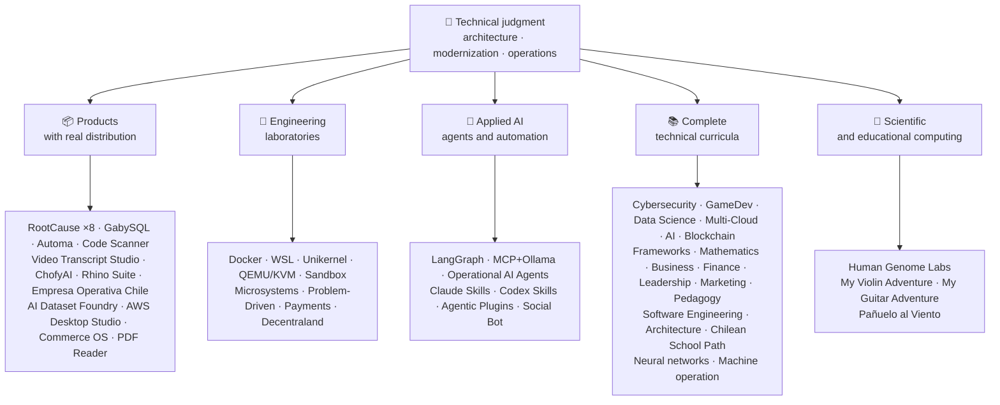

<div align="center">

# 👋Βλαντίμιρ Ακούνια

## **Αρχιτέκτονας Λύσης·Ανώτερος πλήρης στοίβα·Ψηφιακή Μεταμόρφωση·Διαχείριση & Λειτουργίες**

**Επαγγελματικά εκπαιδευμένο στην Επιστήμη Υπολογιστών και στην Μηχανική Υπολογιστών και Διοίκηση Επιχειρήσεων, με 16+ χρόνια κατασκευής και λειτουργικού λογισμικού σε πραγματικά περιβάλλοντα. Συνδέω τις επιχειρήσεις, τους ανθρώπους, τις διαδικασίες και την τεχνολογία με το σχεδιασμό, την αξιολόγηση, την παροχή και τη διατήρηση λύσεων με τεχνική κρίση και μια επιχειρησιακή άποψη — που υποστηρίζεται από επαληθεύσιμα στοιχεία σε αυτόν τον λογαριασμό GitHub.**

[](https://vladimiracunadev-create.github.io/)
[](https://www.linkedin.com/in/vladimir-acu%C3%B1a-valdebenito-11924a29/)
[](mailto:vladimir.acuna.dev@gmail.com)

[](#επαγγελματικό-πεδίο-εφαρμογής)
[](#προϊόντα-με-πραγματική-διανομή)
[](#πλήρης-τεχνική-επιμέλεια)

<!-- STATS:START -->
[](https://github.com/vladimiracunadev-create?tab=repositories)
[](https://github.com/vladimiracunadev-create?tab=repositories)
[](#ecosystem-σε-μια-λάμψη)
[](#πλήρης-τεχνική-επιμέλεια)
[](https://github.com/vladimiracunadev-create?tab=repositories)
<!-- STATS:END -->

[](https://github.com/vladimiracunadev-create?tab=repositories)
[](https://github.com/vladimiracunadev-create?tab=followers)

[🌐 Portfolio (6 languages)](https://vladimiracunadev-create.github.io/) ·
[🧩 Ecosystem](#ecosystem-σε-μια-λάμψη) ·
[⚡ Evaluate me in 10 minutes](#αν-έχετε-10-λεπτά-για-να-με-αξιολογήσετε) ·
[✅ Professional scope](#επαγγελματικό-πεδίο-εφαρμογής) ·
[🧭 Non-coding management](#διαχείριση-διοίκηση-και-μη-κωδικοποίηση-ευκαιρίες-καριέρας) ·
[📋 Role matrix](PROFESIONAL_ROLES.md) ·
[📬 Contact](#επαφή)

**🌐 Πλήρεις εκδόσεις:** [Español](README.md) · [English](README.en.md) · [Português](README.pt.md) · [Italiano](README.it.md) · [Français](README.fr.md) · [简体中文](README.zh.md) · [繁體中文](README.zh-TW.md) · [日本語](README.ja.md) · [한국어](README.ko.md) · [Türkçe](README.tr.md) · [Русский](README.ru.md) · [Tiếng Việt](README.vi.md) · [ไทย](README.th.md) · [Deutsch](README.de.md) · [Українська](README.uk.md) · [Polski](README.pl.md) · [العربية](README.ar.md) · [فارسی](README.fa.md) · [Bahasa Indonesia](README.id.md) · [Nederlands](README.nl.md) · [हिन्दी](README.hi.md) · [Ελληνικά](README.el.md)

**Τεχνικός πυρήνας:**
PHP 8 · Python · Rust · Go · Node/TS · Java 21 · .NET 8 · Dart/Flutter · WASM
· AWS · Terraform · Kubernetes · Docker · n8n · LangGraph/MCP · CI/CD · FinOps · Observability

**Γέφυρα «επιχειρησιακής τεχνολογίας»:**
ανάλυση διεργασιών και απαιτήσεων·αξιολόγηση λύσης·συντονισμός παράδοσης·πράξεις και συνέχεια·διαχείριση κινδύνων·προϊόν και υπηρεσία·τεχνική εκπαίδευση

</div>

---

> [!NOTE]
> Αυτό το προφίλ δεν μετατρέπει τις ευκαιρίες σε εμπειρία. Διαχωρίζονται ρητά οι αποδεδειγμένες τεχνικές εμπειρίες, οι μεταβιβάσιμες δεξιότητες, οι βιώσιμες εφαρμογές και οι μελλοντικοί αναπτυξιακοί στόχοι. Τα στοιχεία του Linked GitHub είναι εκτελέσιμα ή ντοκιμαντέρ, όπου κάτι είναι**όχι**Τελειωμένο, δηλώνεται ως τέτοιο.

## 🎯Τι θα Βρείτε Εδώ

Αυτό δεν είναι “μια repo”: είναι ένα οικοσύστημα με κοινά πρότυπα.

- 🔁 **Αναπαραγωγικά demos**— κλώνος, τρέχα, επικυρώσε.
- 🧰 **Τυποποιημένη εργαλειοθέτηση**— Makefiles, Hub CLI,`doctor`, και`smoke`ανά χώρο αποθήκευσης.
- 🛡️ **Άμυνα σε βάθος**— μυστική σάρωση, πολιτικές και ρητά απαγορευμένες πρακτικές.
- 📈 **Παρατηρησιμότητα** — `/health`, `/ready`, `/metrics`, ταμπλό και ιχνηλασιμότητα.
- 📚 **Τεκμηρίωση για το κοινό**— στρατολογητή, αρχάριο, DevOps ή ασφάλεια, ανάλογα με το χώρο αποθήκευσης.
- 📦 **Κατανομή προϊόντων**— τις εκδόσεις, τα ληφθέντα έγγραφα και τα αποδεικτικά στοιχεία,
- 🌍 **Διεθνοποίηση**— χαρτοφυλάκιο σε 6 γλώσσες (ES)·ΕΝ·PT·ΤΙ·FR·ΖΗ).
- 🧭 **Τεχνική ειλικρίνεια**— κάθε περίπτωση με ετικέτα`OPERATIONAL`, `DOCUMENTED/SCAFFOLD`, ή`PLANNED`.

## ✅Επαληθευμένη κατάσταση

| Επιφάνεια | Συγκεκριμένα αποδεικτικά στοιχεία |
|---|---|
| 🧪 **Κάλυψη δοκιμής** | GabySQL (Γαβριέλλα)**828 δοκιμές**+ fuzzing over (στα Αγγλικά)**503.8M ερωτήματα**(0 πανικό)·Εμπρέσα Operativa Χιλή**158 δοκιμές** ·Αυτόματο**150 pytest (πυόδοντας)** ·CI πολλών OS |
| 🤖 **Παράγωγα** | Πραγματικό κόσμο LangGraph**Λειτουργικά συστήματα υποστήριξης 25/25**(περιπτώσεις 01-25, κάλυψη 100%)·Επιχειρησιακοί πράκτορες AI**13 παράγοντες**με**39 ντετερμινιστικές εκτιμήσεις** |
| 🔗 **Ενσωμάτωση πολυσφαιρίου** | **20 περιπτώσεις**αποστολέας →n8n→ παραλήπτης —**19 επιχειρησιακά**, ατομικά ελεγμένο με Docker—· **18+ κινητήρες DB** · **20+ δοχεία** ·11 μοτίβα |
| 📦 **Κατανομή** | **151 εκδόσεις**σε ένα οικοσύστημα**64 δημόσια αρχεία καταγραφής ιδιοκτησίας** ·εγκαταστάτες και τεχνουργήματα`.exe` · `.msi` · `.dmg` · `.apk`με τα ληξιαρχικά και αποδεικτικά στοιχεία· εμπορικές/αποθήκες υπογραφές σε εξέλιξη, όπου απαιτείται |
| 🛡️ **Εφοδιαστική αλυσίδα** | ΚωδικόςQL·Σεμγκρέπ·Ληστής·Τριβάκι·Γρύπα·Γκιτλακά·Τροφός·ΚυκλώναςDX SBOM·Κάρτα βαθμολογίας |
| 📚 **Κουρκουμά** | **14.530 κατηγορίες**επαληθεύσιμο σε 21 προγράμματα, με βάση[a workflow](.github/workflows/stats.yml)από πραγματική δομή αποθετηρίου ή επαληθεύσιμη πηγή που δηλώνεται στο αποθετήριο —μη γραμμένη με το χέρι—·κάθε πρόγραμμα δηλώνει την συντακτική του κατάσταση και τους περιορισμούς του |
| 🌐 **Χαρτοφυλάκιο** | Εγκαταστατέα PWA· **6 γλώσσες** · **36 PDFs**παραγόμενη από αγωγό·CV Data API·Πυκνωτής Android·Φάρος 100 |
| 🔒 **Τηλεμετρία** | Μηδενική τηλεμετρία σε εγκληματολογικά προϊόντα και Empresa Operativa Χιλή — επαληθεύεται σε κάθε κατασκευή (όχι Android`INTERNET`άδεια) |
| 🌐 **Δημοσιευμένοι ιστότοποι** | **56 GitHub Σελίδες ιστοσελίδες**—55 εκφορτώσεις, μία ανά προϊόν, πρόγραμμα ή οικοσύστημα, συν το χαρτοφυλάκιο— καθεμία από τις οποίες έχει αναπτυχθεί από το δικό της αποθετήριο·και τα 56 επαληθεύτηκαν με HTTP`200` |

## 🗺️Ecosystem σε μια λάμψη



## 📦Προϊόντα με πραγματική διανομή

Λογισμικό που κατεβάζεται, εγκαθίσταται και χρησιμοποιείται — όχι μόνο κλωνοποιείται.

| Προϊόν | Τι είναι αυτό; | Στοίβα | Παράδοση |
|---|---|---|---|
| [🔍 **RootCause Windows**](https://github.com/vladimiracunadev-create/rootcause-windows-inspector) | Εγκληματολογικό Cybersecurity: κάθε ανωμαλία των πόρων μπορεί να είναι το πρώτο σημάδι μιας απειλής. Πρώτα η διάγνωση, μετά η παρέμβαση | Ραπάνια🦀 ·ETW/WPR | **v0.19.0** · **16 εκδόσεις** · **5 εκδόσεις**: Γραφικό περιβάλλον·Φορητό·CLI·Εξουσία Shell·Κωδικός VS· [landing](https://vladimiracunadev-create.github.io/rootcause-windows-inspector/) |
| [📱 **RootCause Mobile**](https://github.com/vladimiracunadev-create/rootcause-mobile-inspector) | Το κινητό αδελφάκι: ένας εγκληματολογικός αισθητήρας που συγκρίνει κάθε εφαρμογή με τον εαυτό του, σημαίες folkerware, και χωρίζει τις άδειες που παρέχονται από απλά ζητηθείσες | Φτερό·Κότλιν·Σουίφτ | **v0.8.0** ·επαληθεύσιμο Android APK·5 γλώσσες· **μηδενική τηλεμετρία** · [landing](https://vladimiracunadev-create.github.io/rootcause-mobile-inspector/) |
| [🍎 **RootCause macOS**](https://github.com/vladimiracunadev-create/rootcause-macos-inspector) | Έκδοση macOS:`launchd`επιμονή, Gatekeepper, SIP, FileVault, XProtect, άδειες TCC, υπογεγραμμένες διαδικασίες και γείτονες του δικτύου - κάθε επιφάνεια ελέγχεται κατά μια γνωστή-καλή κατάσταση | Ραπάνια🦀 ·macOS 13+ (Μακός 13+) | **v0.1.0** ·πρώτη δημοσίευση·Απάτσι-2.0· [landing](https://vladimiracunadev-create.github.io/rootcause-macos-inspector/) |
| [🖥️ **RootCause Server**](https://github.com/vladimiracunadev-create/rootcause-server) | Ο αδελφός του εξυπηρετητή: συσχετίζει αυτό που δεν βλέπει κανένα ενιαίο ημερολόγιο μαζί — εκτεθειμένη επιφάνεια, εκρήξεις που επιτρέπουν την πρόσβαση, μια συνεδρία που χορηγείται στην ίδια διεύθυνση, κρίσιμη ακεραιότητα του αρχείου, και σιγή αισθητήρων — και τη μετατρέπει σε μια ενεργή πρόταση | Ραπάνια🦀 ·Παράθυρα·Linux·Μακός | **v0.2.0** · **18 κανόνες**με αποδεικτικά στοιχεία και βιβλίο εκτέλεσης·ποτέ δεν εκτελεί πράξεις από μόνη της·τοπική κονσόλα χωρίς εξαρτήσεις ιστού· **δεν έχει δημοσιευθεί ακόμα** · [landing](https://vladimiracunadev-create.github.io/rootcause-server/) |
| [🌐 **RootCause Web**](https://github.com/vladimiracunadev-create/rootcause-web-inspector) | Εγκληματολογικός αισθητήρας Browser: cookies, συνεδρίες ηλεκτρονικού ταχυδρομείου, επεκτάσεις, λήψεις, άδειες και σελίδες που μιμούνται ένα πραγματικό παράθυρο | JavaScript·Επέκταση MV3 | **v0.2.0** ·δεν έχει δημοσιευθεί ακόμα·πάνελ σε`127.0.0.1` ·μηδενικές εξαρτήσεις·μηδενική τηλεμετρία που επαληθεύτηκε στο CI· [landing](https://vladimiracunadev-create.github.io/rootcause-web-inspector/) |
| [₿ **RootCause Bitcoin Defense**](https://github.com/vladimiracunadev-create/rootcause-bitcoin-defense) | Μόνο για άμυνα Bitcoin: καταγράφει την προέλευση του κάθε κλειδιού, το διασταυρώνει με δημοσιευμένες προειδοποιήσεις, και εξηγεί τη βασική αιτία με στοιχεία | JavaScript·Εφαρμογή Windows·τοπικό πάνελ | **v0.3.0** · **2 εκδόσεις** ·μηδενικές εξαρτήσεις·Ποτέ δεν ζητάει σπόρους·επαληθεύτηκε στο CI· [landing](https://vladimiracunadev-create.github.io/rootcause-bitcoin-defense/) |
| [⛓️ **RootCause Blockchain Security**](https://github.com/vladimiracunadev-create/rootcause-blockchain-security) | Πολυ-αλυσίδα μόνο ρολόι κονσόλα: συμβάσεις αποθεμάτων, πληρεξούσια, χρησμοί, γέφυρες, διακυβέρνηση, και εξαρτήσεις, και δημιουργεί ριζικά runbooks αιτία | JavaScript·Εφαρμογή Windows·τοπικό πάνελ | **v0.3.0**στο χώρο αποθήκευσης·δημοσιευμένη έκδοση:`v0.1.0` ·μηδενικές εξαρτήσεις·Ποτέ δεν ζητάει τα προσωπικά κλειδιά.·επαληθεύτηκε στο CI· [landing](https://vladimiracunadev-create.github.io/rootcause-blockchain-security/) |
| [📷 **RootCause QR Inspector**](https://github.com/vladimiracunadev-create/rootcause-qr-inspector) | Τοπική εφαρμογή Android για την επιθεώρηση κωδικών QR πριν από την ενέργεια: εξηγεί 26 σήματα, διαχωρίζει τα γεγονότα από υποθέσεις, και τις εξαγωγές ανακλημένα αποδεικτικά στοιχεία | Φτερό·Βέλος | **v0.1.4** · **5 κυκλοφορίες** · **107 δοκιμές** ·δημοσιευμένο Android APK·επαληθεύσιμη SHA-256·τεχνική υπογραφή πακέτων APK· εμπορικές/υπογραφές καταστημάτων σε εξέλιξη·μηδενική τηλεμετρία· [landing](https://vladimiracunadev-create.github.io/rootcause-qr-inspector/) |
| [🏢 **Empresa Operativa Chile**](https://github.com/vladimiracunadev-create/empresa-operativa-chile) | Η Επιτροπή θα πρέπει να ενημερώνει την Επιτροπή σχετικά με τις πληροφορίες που θα της παρέχονται. Κάθε κανόνας δείχνει την επίσημη πηγή του | JavaScript·Ραπάνια·PWA | **v1.5.0** ·Ανδροειδές·Παράθυρα·Περιηγητής· **158 δοκιμές** · **0 εξαρτήσεις παραγωγής** ·μηδενική τηλεμετρία· [landing](https://vladimiracunadev-create.github.io/empresa-operativa-chile/) |
| [🔍 **Universal Code Scanner**](https://github.com/vladimiracunadev-create/universal-code-scanner) | QR και αναγνώστης γραμμωτού κώδικα ότι**ερμηνεύει πριν από την υποκριτική**: 16 τοπικά σήματα κινδύνου URL και ρητή επιβεβαίωση | Φτερό·Βέλος | **v1.1.0** ·Ανδροειδές·iOS·Μακός·PWA·κρυπτογραφημένο ιστορικό**AES-256-GCM** · [landing](https://vladimiracunadev-create.github.io/universal-code-scanner/) |
| [🗄️ **GabySQL**](https://github.com/vladimiracunadev-create/gabysql) | Ενσωματωμένη βάση δεδομένων: single`.db`αρχείο, WAL, βελτιστοποιητής με βάση το κόστος, HTTP / JSON API | Ραπάνια🦀 | Παράθυρα·Μακός·Linux· [landing](https://vladimiracunadev-create.github.io/gabysql/) |
| [🤖 **Automa PC**](https://github.com/vladimiracunadev-create/automa-pc) | Τοπική ενορχηστρωτής: JSON ρέει που ανοίγουν πραγματικά παράθυρα, αλληλεπιδρούν με το DOM, και αφήνουν στοιχεία | Πάιθον·Παιχνιδάκια·προβολή pyweb | **v0.3.0** · **27 ροές** ·δημοσιευμένος και επαληθεύσιμος εγκαταστάτης· [landing](https://vladimiracunadev-create.github.io/automa-pc/) |
| [🏭 **AI Dataset Foundry**](https://github.com/vladimiracunadev-create/ai-dataset-foundry) | Τοπικό-πρώτο εργοστάσιο που μετατρέπει PDF, Word, web, Git, JSON, και CSV σε ελεγχόμενα σύνολα δεδομένων για την προκατάρτιση, την εξομάλυνση, RAG, και την αξιολόγηση | Πάιθον | **v0.2.0** ·Windows + offline Android·πρώτη δημοσίευση· [landing](https://vladimiracunadev-create.github.io/ai-dataset-foundry/) |
| [☁️ **AWS Desktop Studio**](https://github.com/vladimiracunadev-create/aws-desktop-studio) | Τοπική πρώτη εφαρμογή με 15 AWS ενσωμάτωση απογραφής, 20 φροντιστήρια, CLI/SSO, και μόνο ανάγνωσης προεπιλεγμένες? υλοποίηση σε εξέλιξη, όχι καθολική πρόσβαση | JavaScript·Παράθυρα | **v0.1.1** ·πρώτη δημοσίευση· [landing](https://vladimiracunadev-create.github.io/aws-desktop-studio/) |
| [🧭 **Commerce OS**](https://github.com/vladimiracunadev-create/commerce-operating-system) | Οδηγός εννοιολογική επίδειξη των εμπορικών πράξεων: κατάλογος, απόθεμα, CRM, παραγγελίες, εικονικές πληρωμές, και ιχνηλασιμότητα | JavaScript·Ιστός·Παράθυρα·Ανδροειδές | **v0.3.0** · **2 εκδόσεις** ·δεν υπάρχουν πραγματικά χρήματα ή η ενσωμάτωση της φορολογικής αρχής της Χιλής· [landing](https://vladimiracunadev-create.github.io/commerce-operating-system/) |
| [📄 **PDF Reader**](https://github.com/vladimiracunadev-create/pdf-reader-windows-android) | Android-πρώτος τοπικός αναγνώστης μόνο ανάγνωσης, με ζουμ χωρίς crop, επαναλειτουργήσιμο ιστορικό, WhatsApp κοινή χρήση, και προεπιλεγμένη επιλογή-αναγνωστή | HTML·Ιστός·Ανδροειδές·Παράθυρα | **v0.3.3** ·υπογεγραμμένη APK·χωρίς λογαριασμούς, ευαίσθητες άδειες ή τηλεμετρία· [landing](https://vladimiracunadev-create.github.io/pdf-reader-windows-android/) |
| [🎙️ **Video Transcript Studio**](https://github.com/vladimiracunadev-create/video-transcript-studio) | Ένα βίντεο, λίστα αναπαραγωγής, ή**ολόκληρο το κανάλι YouTube**να στείλει μήνυμα με χρονοσφραγίδες. Δεν βασίζεται σε υπάρχοντες υπότιτλους: Ο Ψίθυρος αναγνωρίζει τον ήχο**στο μηχάνημα σας**, χωρίς API, λογαριασμό, ή το κλειδί για τη ρύθμιση | Πάιθον·PySide6·Γρήγορο API·Πιο γρήγορα-ψιθύρισμα | **v0.2.0** ·Επιφάνεια εργασίας των Windows + τοπικός πίνακας`127.0.0.1`+ CLI,**κοινή χρήση της ίδιας ουράς** ·MD·PDF·TXT·SRT·VTT·JSON·MP3·OGG· **89 δοκιμές** ·Δεσμευμένο FFmpeg·μηδενική τηλεμετρία· [landing](https://vladimiracunadev-create.github.io/video-transcript-studio/) |
| [🎨 **ChofyAI Studio**](https://github.com/vladimiracunadev-create/chofyai-studio) | Τοπική δημιουργικός AI εκκινητής: ενορχηστρώνει Qwen3-TTS, shirt.cpp, FaceFusion, AceForge, και ComfyUI | Ταουρί 2·Ραπάνια·Αντιδράσεις | v0.5.1· **5/5 εργαλεία με πραγματικό συμπέρασμα** ·macOS Apple σιλικόνης·πειραματικά Windows· **δεν έχει δημοσιευθεί ακόμα** · [site](https://vladimiracunadev-create.github.io/chofyai-studio/) |
| [🦏 **Rhino Suite**](https://github.com/vladimiracunadev-create/rhino-suite) | Σουίτα γραφείου από το μηδέν: οι κανόνες εγγράφων δεν εξαρτώνται από το DOM - HTML είναι μόνο μια προβολή | Σπαθιά/WASM·Πήγαινε.·Αντιπαράσταση 19 | Εξελικτική μονορεπία κατά φάσεις· [landing](https://vladimiracunadev-create.github.io/rhino-suite/) |
| [🎻 **My Violin Adventure**](https://github.com/vladimiracunadev-create/violin-adventure) | Εκπαιδευτική εφαρμογή για παιδιά: χρωματικός συντονιστής, μετρονόμος, τραγούδια με πραγματικό βιολί | Ταουρί 2·Αντιδράσεις·TS | **v1.3.0** ·Παράθυρα·Ανδροειδές·Linux·Μακός·PWA· [landing](https://vladimiracunadev-create.github.io/violin-adventure/) |
| [🎸 **My Guitar Adventure**](https://github.com/vladimiracunadev-create/guitarra-adventure) | Το buded-string queil: 24 μαθήματα σε 6 κόσμους, 6-χορδή tuner, freed-free metronome, και 11 πραγματικές νότες κιθάρας | Ταουρί 2·Αντιδράσεις·TS | **v1.0.0** ·Παράθυρα·Ανδροειδές·Linux·Μακός·iOS·PWA·δεν λογαριασμούς, διαφημίσεις ή εξάρτηση από το διαδίκτυο· [landing](https://vladimiracunadev-create.github.io/guitarra-adventure/) |
| [🧣 **Pañuelo al Viento**](https://github.com/vladimiracunadev-create/panuelo-al-viento-cueca-app) | Cueca από την ηλικία 10: 24 τάξεις σε 8 επίπεδα, 72 δραστηριότητες, έξι-pulse εργαστήριο (3+3 και 2+2+2), και προσβάσιμα διαγράμματα δαπέδου. - Το λέει.**Συμπληρώματα, όχι αντικαταστάσεις**, καθηγητές και φορείς του πολιτισμού | Φτερό·Βέλος | **v0.2.0** ·Ανδροειδές 7+·Windows 10/11·APK·ΕΞ·MSI·φορητό· **29 δοκιμές + 2 επικυρωτές** ·χωρίς κάμερα, μικρόφωνο, λογαριασμό, διαφημίσεις ή internet· [landing](https://vladimiracunadev-create.github.io/panuelo-al-viento-cueca-app/) |

## 🧪Εργαστήρια Μηχανικών

| Reπού | Τι δείχνει |
|---|---|
| [🐳 **Problem-Driven Systems Lab**](https://github.com/vladimiracunadev-create/problem-driven-systems-lab) | **20 πραγματικά προβλήματα**(γεμάτο υπό φορτίο, N+1, δοκιμή καταιγίδων, διαρροές, μονόλιθοι, λανθάνουσα σφράγιση, αντίθλιψη, μηδενική αποδημία, ξεχασμένη DLQ) με υψηλής πιστότητας εγχύσεις αστοχίες, λυθούν σε**7 στοίβα**: PHP 8·Πάιθον·Κόμβος.js·Ιάβα 21·.NET 8· **Πάμε 1.23** · **Ραστ.** · [landing](https://vladimiracunadev-create.github.io/problem-driven-systems-lab/) |
| [📆 **Social Bot Scheduler**](https://github.com/vladimiracunadev-create/social-bot-scheduler) | **v4.10.0** · **20 περιπτώσεις**πηγή → n8n→ παραλήπτης**18+ κινητήρες DB** —**19 επιχειρησιακά**, ατομικά ελεγμένο με Docker—**8- στρώση**έλεγχος, idempotency wardrails, διακόπτης κυκλώματος, και DLQ· [landing](https://vladimiracunadev-create.github.io/social-bot-scheduler/) |
| [🧰 **Microsistemas**](https://github.com/vladimiracunadev-create/microsistemas) | **12 διαγνωστικές και εκσυγχρονιστικές μικροεφαρμογή**για PHP·τοπικός εξυπηρετητής MCP μόνο ανάγνωσης·σκλήρυνση σε 3 φάσεις· [landing](https://vladimiracunadev-create.github.io/microsistemas/) |
| [🧪 **Docker Labs**](https://github.com/vladimiracunadev-create/docker-labs) | **13 εργαστήρια**σε μια πλατφόρμα 4 υπηρεσιών + αυτοματοποιημένη`.exe`εγκαταστάτης με εκτοξευτή· [landing](https://vladimiracunadev-create.github.io/docker-labs/) |
| [🐳 **WSL Labs**](https://github.com/vladimiracunadev-create/wsl-labs) | **12 περιπτώσεις**Εμπρός`wslc`, ο εγγενής κινητήρας WSL δοχείου —**χωρίς επιφάνεια εργασίας Docker** · [landing](https://vladimiracunadev-create.github.io/wsl-labs/) |
| [⚡ **Unikernel Labs**](https://github.com/vladimiracunadev-create/unikernel-labs) | “Γιατρός επιφάνειας εργασίας για μονοκεράλες”: Έλεγχος των Windows πάνω από Unikraft με το σύστημα υποστήριξης WSL2,`kraft`+ QEMU/KVM· [landing](https://vladimiracunadev-create.github.io/unikernel-labs/) |
| [🧰 **QEMU/KVM Labs**](https://github.com/vladimiracunadev-create/qemu-kvm-labs) | **12 εργαστήρια**πραγματική εικονικοποίηση με QEMU, KVM, libvirt, cloud-init, και`vm-manager`σε Linux και WSL2· [landing](https://vladimiracunadev-create.github.io/qemu-kvm-labs/) |
| [🛡️ **Sandbox Labs**](https://github.com/vladimiracunadev-create/sandbox-labs) | Linux απομόνωση: τρέχει τον κωδικό τρίτων, αρχεία, και επιχειρηματικά μοντέλα υπό δηλωμένες πολιτικές και**εκπομπές που έχουν υπογραφεί και έχουν υποβληθεί σε ελέγχους** · **36 περιπτώσεις**σε δύο οικογένειες —15 τεχνικές και 21 κεφαλαιαγορές—·δηλώθηκε πειραματικό και εκπαιδευτικό, * όχι προϊόν ασφάλειας*· [landing](https://vladimiracunadev-create.github.io/sandbox-labs/) |
| [💳 **Universal Payments Engineering Lab**](https://github.com/vladimiracunadev-create/universal-payments-engineering-lab) | **28 οικογένειες πληρωμών**σε μια τοπική αυτο-εξηγητική επίδειξη: κράτη, βιβλίο, συμφιλίωση, ασφάλεια, και οδηγούς υλοποίησης· [landing](https://vladimiracunadev-create.github.io/universal-payments-engineering-lab/) |
| [🕹️ **Decentraland Social Arcade**](https://github.com/vladimiracunadev-create/decentraland-social-arcade) | Ιθαγενής αποκεντρωμένη και κοινωνική 3D εμπειρία: ένα MVP και μια αρχιτεκτονική πολλαπλών παιχνιδιών με SDK7, ECS, και TypeScript·Ισπανική τεκμηρίωση·δεν έχει πληρωμές ή τηλεμετρία |
| [☁️ **AWS Projects**](https://github.com/vladimiracunadev-create/proyectos-aws) | Προοδευτικές περιπτώσεις όπου ο καθένας προσθέτει μια υπηρεσία AWS**και**μια νέα ικανότητα ενεργειών GitHub·SAA-C03·DVA-C02·Κάλυψη SOA-C02 |

## 🤖Εφαρμοσμένη ΤΝ

| Reπού | Τι δείχνει |
|---|---|
| [🤖 **LangGraph RealWorld**](https://github.com/vladimiracunadev-create/langgraph-realworld) | **Λειτουργικά συστήματα υποστήριξης 25/25**— δακτυλογραφημένη κατάσταση, υπό όρους διαδρομές, NDJSON streaming, DEMO/LIVE mode, 8 επίπεδα ασφαλείας, SHA-256 αλυσίδα επιμέλειας |
| [🧭 **Operational AI Agents**](https://github.com/vladimiracunadev-create/operational-ai-agents) | **13 επιχειρησιακοί παράγοντες**για τον κώδικα Claude και συμβατούς χρόνους λειτουργίας: κάθε μία λαμβάνει μια πλήρη αποστολή — εξέλιξη των υποθετικών, τον εκ νέου εκσυγχρονισμό, το σχεδιασμό του προγράμματος σπουδών, τη δημοσίευση χαρτοφυλακίου, την αποκατάσταση της ασφάλειας, την ανάλυση συμβάντων— στο πλαίσιο μιας δηλωθείσας σύμβασης, τις ανθρώπινες πύλες, και επαληθεύσιμα αποδεικτικά στοιχεία· **39 ντετερμινιστικές εκτιμήσεις** ·34 δοκιμές·0-deps (μόνο για strdlib)·Linux·Μακός·Παράθυρα· [site](https://vladimiracunadev-create.github.io/operational-ai-agents/) |
| [🧠 **MCP + Ollama Local**](https://github.com/vladimiracunadev-create/mcp-ollama-local) | Τοπική πρώτη AI με εργαλεία MCP σε ένα αμμόκουτο· `127.0.0.1`δεσμεύει·προφίλ εμπιστοσύνης πολλαπλών στρωμάτων·Ειλικρινά για τα όριά του |
| [🧩 **Agentic Plugins Toolkit**](https://github.com/vladimiracunadev-create/agentic-plugins-toolkit) | **6 plugins agentic**δυνατότητα εγκατάστασης σε Claude Code, OpenAI/Codex, Copilot, Gemini, και MCP από μία πηγή:`repository-engineering`, `legacy-modernization`, `learning-program-studio`, `product-evolution`, `portfolio-governance`, και`rootcause-response` · **69 δημιουργημένες απόψεις χωρίς παρασυρόμενα**- κάθε χρόνος εκτέλεσης λαμβάνει τη μορφή της από την ίδια σύμβαση -·Μηδενικές μοίρες·Linux·Μακός·Παράθυρα· [site](https://vladimiracunadev-create.github.io/agentic-plugins-toolkit/) |
| [🧰 **Claude Skills Toolkit**](https://github.com/vladimiracunadev-create/claude-skills-toolkit) | **15 ικανότητες στην ατζέντια**για τον κώδικα Claude· **ασφάλεια**12 στρώσεις`security-audit`(ΟΟΣ)·ΚΕΒ·EPSS·ΝΑΤΟ·περιέκτης·μυστικά) και 14-στάδιο`bitcoin-custody-audit` · **πύλες repo**: `pre-commit-guard`, `pre-push-guard`, `yaml-control`, `md-lint-fix`, `python-lint-guard` · **συνοχή**: `repo-coherence-audit`, `version-bump`, `python-version-control`, `python-deps-pinning` · **Ντόκερ**: `docker-cleanup`, `docker-compose-doctor` · **Γιατροί**: `md-to-doc` ·Μηδενικές μοίρες·cross-πλατφόρμιο |
| [🧰 **Codex Skills Toolkit**](https://github.com/vladimiracunadev-create/codex-skills-toolkit) | **19 ικανότητες στην ατζέντια**για τον Codex: αλυσίδα ασφάλειας και εφοδιασμού, προ πτήσης, λειτουργικές ροές, ανθεκτικότητα και κατάσταση, αποδεικτικά στοιχεία, πύλες Python/YAML/Markdown, έκδοση, εξαρτήσεις, Docker, και έγγραφα·Πρώτος ο Python· `pnpm` ·Linux·Μακός·Παράθυρα· [site](https://vladimiracunadev-create.github.io/codex-skills-toolkit/) |

## 📚Πλήρης τεχνική επιμέλεια

Αλληλοσυσσωρεύσιμα προγράμματα στα ισπανικά, με κατάσταση και πεδίο εφαρμογής δηλωμένα από κάθε χώρο αποθήκευσης. Τα 21 προγράμματα προσθέτουν έως και**14.530 κατηγορίες**, μετρά με[a workflow](.github/workflows/stats.yml)από πραγματική δομή αποθετηρίου ή επαληθεύσιμη πηγή που δηλώνεται στο αποθετήριο· το σήμα ανανεώνεται κάθε εβδομάδα και δεν γράφεται με το χέρι.

🧭 [**Lifelong Learning Ecosystem**](https://github.com/vladimiracunadev-create/lifelong-learning-ecosystem)είναι μια υποτροφιασμένη πυξίδα που συνδέει 30 πραγματικές διαδρομές σε 6 περιοχές μέσω οπτικών χαρτών και[accessible offline portal](https://vladimiracunadev-create.github.io/lifelong-learning-ecosystem/)· δεν υπολογίζεται ως ένα πρόσθετο πρόγραμμα.

| Πρόγραμμα | Κλάσεις | Πεδίο εφαρμογής |
|---|---:|---|
| [🔢 **Computational Mathematics**](https://github.com/vladimiracunadev-create/computational-mathematics-program) | 360 | Από την υπολόγιση στα δάχτυλα μέχρι την αναπαραγωγή ενός χαρτιού· **360 ντετερμινιστικές διαδηλώσεις επαληθεύτηκαν στο CI** ·1.080 σημειωματάρια·489-τερματικό γλωσσάριο· [site](https://vladimiracunadev-create.github.io/computational-mathematics-program/) |
| [🏦 **Finance and Banking**](https://github.com/vladimiracunadev-create/finance-and-banking-evolution-program) | 356 | 534 η·χρηματοοικονομικά μαθηματικά και ΔΠΧΠ → πίστωση, κίνδυνος, Βασιλεία ΙΙΙ, ανοικτή χρηματοδότηση, DLT, σταθερά νομίσματα, και MiCA· **27 περιπτώσεις** · **298 δοκιμές** · [site](https://vladimiracunadev-create.github.io/finance-and-banking-evolution-program/) |
| [🎮 **GameDev**](https://github.com/vladimiracunadev-create/modern-gamedev-program) | 352 | Μαθηματικά και C#/C++/GDScript → Σκιάστρα, AI, multiplayer, VR/AR·Γκοντό.·Ενότητα·Μη πραγματικό· **10 εργαστήρια Godot επαληθεύονται στο CI**(301 έλεγχοι)· [site](https://vladimiracunadev-create.github.io/modern-gamedev-program/) |
| [🛡️ **Cybersecurity**](https://github.com/vladimiracunadev-create/modern-cybersecurity-program) | 360 | **v1.3.0** ·20 μέρη·θεμελίωση → Κόκκινη ομάδα, DFIR, ασφάλεια cloud, εκμετάλλευση dev, CTF, και ασφάλεια παιχνιδιών·χαρτογραφημένο σε**7 πιστοποιήσεις** ·offline Android / εφαρμογή ιστού·Εγχειρίδιο PDF·CI, Ασφάλεια και Σελίδες επαληθευμένες· [site](https://vladimiracunadev-create.github.io/modern-cybersecurity-program/) |
| [📈 **Marketing, Sales, and Growth**](https://github.com/vladimiracunadev-create/marketing-sales-growth-evolution-program) | 336 | 24 μέρη με επιχειρησιακούς ορισμούς, δελτία μέτρησης, επαληθεύσιμη βιβλιογραφία και κανονιστικό πλαίσιο της Χιλής· **v1.6.0** ·1.29M λέξεις·17 διαδρομές με βάση το ρόλο· [site](https://vladimiracunadev-create.github.io/marketing-sales-growth-evolution-program/) |
| [🏢 **Business Creation**](https://github.com/vladimiracunadev-create/modern-business-creation-program) | 336 | Δημιουργία και λειτουργία μιας πραγματικής εταιρείας στη Χιλή: από την ιδέα στην ενσωμάτωση, φορολογική αρχή, επιχειρήσεις, κρίση, και έξοδος·360 διαγράμματα·1,251-τερματικό γλωσσάριο·Εγχειρίδιο 1.548 σελίδων· [site](https://vladimiracunadev-create.github.io/modern-business-creation-program/) |
| [🏛️ **Architecture and Built Environment**](https://github.com/vladimiracunadev-create/architecture-built-environment-learning-program) | 830 | 83 μέρη·60 ολοκληρωτικές συνεδρίες·34 μονοπάτια·ιχνηλάσιμες πηγές·Markdown, offline αναγνώστης, και GitHub Σελίδες· [site](https://vladimiracunadev-create.github.io/architecture-built-environment-learning-program/) |
| [🇨🇱 **Chilean School Learning Path**](https://github.com/vladimiracunadev-create/chilean-school-learning-path) | 8,841 | Βαθμοί 1–12· **4.156 ολοκληρωμένες διασχολικές εμπειρίες** · **2.823 μαθησιακοί στόχοι** ·Πηγές MINEDUC·δεν εκκρεμούν προτάσεις και εξειδικευμένη ανθρώπινη αναθεώρηση που εκκρεμεί ακόμη· [site](https://vladimiracunadev-create.github.io/chilean-school-learning-path/) |
| [🧭 **Modern Software Engineering**](https://github.com/vladimiracunadev-create/modern-software-engineering-program) | 480 | 40 μέρη και 8 στάδια·θεμέλια → προϊόν, αρχιτεκτονική, ασφάλεια, DevOps, SRE, SPEC, AI, και συστήματα πολλαπλών παραγόντων·συντακτική κατάσταση που δηλώνεται από το αποθετήριο· [site](https://vladimiracunadev-create.github.io/modern-software-engineering-program/) |
| [🎓 **Pedagogy and Learning Sciences**](https://github.com/vladimiracunadev-create/education-pedagogy-learning-sciences-program) | 300 | Από το πώς μαθαίνει ένα άτομο μέχρι το πώς εκπαιδεύονται οι δάσκαλοι·25 μέρη· **κάθε τάξη δηλώνει την κατάσταση και τα όρια των αποδείξεων της** ·Πρώιμη παιδεία, συγκριτικές μέθοδοι, ειδικές εκπαιδευτικές ανάγκες, συνύπαρξη, πολιτιστική πολυμορφία και διεθνή στοιχεία·1,097-τερματικό γλωσσάριο, 325 διαγράμματα, και μια 60-δραστηριότητα τράπεζα τάξη·14 πορείες σταδιοδρομίας ανά ρόλο·LMS-εξαγώγιμο· **v2.1.0** · [site](https://vladimiracunadev-create.github.io/education-pedagogy-learning-sciences-program/) |
| [☁️ **Multi-Cloud**](https://github.com/vladimiracunadev-create/multi-cloud-engineering-program) | 288 | AWS (ΣΥΜ)·Αζούρ·GCP·Κουμπερνέτες·Τεραμόμορφο·ΣΡΕ·Φινόπς· **1.288 ώρες** ·288 εργαστήρια με στοιχεία JSON·1,032 πηγές που εντοπίστηκαν·2,884-σελίδα εγχειρίδιο PDF· [site](https://vladimiracunadev-create.github.io/multi-cloud-engineering-program/) |
| [🎖️ **Executive Leadership**](https://github.com/vladimiracunadev-create/executive-leadership-founder-program) | 288 | Από την ιδιοκτησία του πρώτου αποτελέσματος σας να ηγηθεί μια εταιρεία και την ίδρυση της δικής σας: ομάδες, KPI / OKR, χρηματοδότηση, προϊόν, κίνδυνος, διοικητικό συμβούλιο, και M&A·24 περιπτώσεις, 96 εργαστήρια, και 39 πρότυπα· [site](https://vladimiracunadev-create.github.io/executive-leadership-founder-program/) |
| [🐍 **Python Data Science**](https://github.com/vladimiracunadev-create/python-data-science-program) | 232 | Πολικοί, ML+Optuna/SHAP, PyTorch/LLMs/LORA, MLOps·εγγενής εφαρμογή Windows + Android APK· [site](https://vladimiracunadev-create.github.io/python-data-science-program/) |
| [🧠 **AI Evolution**](https://github.com/vladimiracunadev-create/artificial-intelligence-evolution-program) | 184 | Symbolic → probabilistic → deep learning → LLMs, RAG, agents, safety, and frontier · **v0.17.0** · **708 notebooks** · **148 foundational papers** · offline Windows, Android, and PWA apps · [site](https://vladimiracunadev-create.github.io/artificial-intelligence-evolution-program/) |
| [🌐 **Comparative Programming**](https://github.com/vladimiracunadev-create/polyglot-programming-labs) | 176 | Μια ιδέα,**10 γλώσσες**επαληθεύτηκε στο CI —**1.360 υλοποιήσεις**— συν**1.632 προγράμματα**σε ακίνητες γλώσσες (COBOL, Fortran, Ada, RPG, MUMPS...) και έναν άτλαντα**60 κάρτες σε 15 οικογένειες** ·v1.1.0· [site](https://vladimiracunadev-create.github.io/polyglot-programming-labs/) |
| [🧩 **Frameworks Compared**](https://github.com/vladimiracunadev-create/framework-ecosystems-labs) | 149 | Ένα εκτελέσιμο συμβόλαιο, χωρίς προσαρμογείς, εναντίον Express, FastAPI, Spring Boot, ASP.NET, Django, Rails, Laravel, React, Vue, Svelte, και πολλά άλλα·12 μέρη· **70 οικοδομημένες τάξεις** · **397 περιπτώσεις που επαληθεύτηκαν σε ΚΚΠ** · **210 ISBN/DOI πηγές** · [site](https://vladimiracunadev-create.github.io/framework-ecosystems-labs/) |
| [🗄️ **Databases**](https://github.com/vladimiracunadev-create/database-systems-labs) | 74 | **v3.0.0** ·μηχανική βάσεων δεδομένων σε 15 μέρη·230 ώρες· **την επαληθεύσιμη πηγή για κάθε ισχυρισμό**120 πηγές με ISBN, DOI, ή πρότυπο·Η ίδια περίπτωση λύθηκε σε 27 κινητήρες·306-τερματικό γλωσσάριο·150 pytest (πυόδοντας)· [site](https://vladimiracunadev-create.github.io/database-systems-labs/) |
| [📐 **Psychometrics and Assessment**](https://github.com/vladimiracunadev-create/psychometrics-and-assessment-program) | 40 | Πώς ένα όργανο μέτρησης κατασκευάζεται, βαθμολογείται, επικυρώνεται και ελέγχεται·8 μέρη·Εκτελέσιμος κινητήρας με**5 μέσα και 344 αντικείμενα, 276 δημόσια** |
| [⛓️ **Blockchain**](https://github.com/vladimiracunadev-create/blockchain-learning-path) | 66 | **v0.14.0** ·από μηδέν έως προγραμματιζόμενη οικονομική υποδομή και ανάλυση της αλυσίδας· **91 πρακτικές**και**363 δοκιμές** ·συμβάσεις με το Χυτήριο (fuzzing και indariants) και τη στατική ανάλυση Slither σε CI·offline εφαρμογές επαληθεύονται με το άνοιγμα του δυαδικού και μετρώντας τα περιεχόμενά του· [site](https://vladimiracunadev-create.github.io/blockchain-learning-path/) |
| [🧠 **Neural Network Training Labs**](https://github.com/vladimiracunadev-create/neural-network-training-labs) | 31 | 7 ενότητες·≈214 ώρες· **93 σημειωματάρια**— 31 τάξεις, 31 φοιτητικές εκδόσεις και 31 λύσεις·ερωτήσεις, οπτικούς χάρτες, πρακτικές και αξιολόγηση με πραγματικά δημόσια δεδομένα·Πάιτορτς· [study site](https://vladimiracunadev-create.github.io/neural-network-training-labs/) |
| [🕹️ **Machine Operator**](https://github.com/vladimiracunadev-create/machine-operator-program) | 451 | **41 ενότητες κατάρτισης**, ένα ανά μηχανή· **502 h 15 λεπτά** ·συστήματα, έλεγχοι, φυσική, ασφάλεια και σχεδιασμός προσομοίωσης με πηγές ανά κατηγορία·* Δεν εκτελέσιμος προσομοιωτής ακόμα, και δηλώνεται με αυτόν τον τρόπο* |

## 🔬Επιστημονική Υπολογιστική

| Reπού | Τι δείχνει |
|---|---|
| [🧬 **Human Genome Labs**](https://github.com/vladimiracunadev-create/human-genome-labs) | Πλατφόρμα αναπαραγώγιμης γονιδιωματικής: δακτυλογραφημένη`ScientificResult<T>`συμβάσεις, FASTA/GFF3/VCF, ενότητες με**ρητή ωριμότητα και αποδεικτικά στοιχεία**. Ριζοσπαστική ειλικρίνεια: * δεν εκτελεί κλινική διάγνωση *· [site](https://vladimiracunadev-create.github.io/human-genome-labs/) |

## ⚡Αν έχετε 10 λεπτά για να με αξιολογήσετε

Η ιδέα δεν είναι μόνο να δούμε τον κώδικα: είναι να δούμε**Πώς νομίζω**, πώς καταγράφω, και πώς κάνω τα πάντα εκτελέσιμα.

**Διαδρομή Α — Πραγματική παρατηρητικότητα και ενορχήστρωση*** (το αγαπημένο μου) *

```bash
git clone https://github.com/vladimiracunadev-create/social-bot-scheduler.git
```

Θα δείτε ροές εργασίας, μετρικούς, ταμπλό, και guardrails σε 19 περιπτώσεις και 18 + DB κινητήρες.

**Διαδρομή Β — Αναπαραγωγή υποδομή σε λεπτά**

```bash
git clone https://github.com/vladimiracunadev-create/docker-labs.git
```

**Διαδρομή Γ — Πράκτορες με δακτυλογραφημένη κατάσταση**

```bash
git clone https://github.com/vladimiracunadev-create/langgraph-realworld.git
```

**Διαδρομή Δ — εγκληματολογικό προϊόν Rust, χωρίς κλωνοποίηση**

Κατεβάστε το δυαδικό εγκατάστασης ή CLI από[RootCause releases](https://github.com/vladimiracunadev-create/rootcause-windows-inspector/releases)και να επαληθεύσει`SHA256SUMS`.

## 🧠Πρότυπα που εφαρμόζω σε όλα τα αποθετήρια

- **DX πρώτα**— εάν δεν είναι εύκολο να τρέξει, δεν είναι χρήσιμο ως demo ή ως βάση ομάδας.
- **Παρατηρησιμότητα από την ημέρα 1**— μετρικές μετρήσεις και ανιχνευσιμότητα, όχι μια δεύτερη σκέψη.
- **Ασφάλεια ως αγωγός**— μυστική σάρωση, SBOM ανά απελευθέρωση, ρητά απαγορευμένες πρακτικές.
- **Πραγματική ανθεκτικότητα**— την ιδεότητα, τον διακόπτη κυκλώματος και την ελεγχόμενη αποδόμηση.
- **Πολυγλωττία από σχεδιασμό**— γλώσσα και μηχανή που επιλέγεται με τη χρήση της υπόθεσης, ποτέ με τη μόδα.
- **Ειλικρίνεια σχετικά με την κατάσταση**— μία νέα ονομασία μετονομάστηκε σε (`Multisimulador` → `machine-operator-program`) για να αποφευχθεί η ελπιδοφόρα λογισμικό που δεν υπάρχει ακόμα.
- **Τα σκοινιά είναι σήματα, όχι στοιχεία.**— κάθε συμφωνία επαναλήψεως δηλώνει επίσης**τι δεν κάνει**.
- **Υπόδειγμα προς τα έξω**— ο τομέας έχει σχεδιαστεί πρώτος· η διεπαφή είναι μια προβολή.
- **Οι εξωτερικές εργασίες δηλώνονται ως εξωτερικές**— των 70 δημόσιων αποθετηρίων του λογαριασμού, 64 είναι δικό μου έργο. Οι άλλοι έξι —[`agentic-qe`](https://github.com/vladimiracunadev-create/agentic-qe), [`Anthropic-Cybersecurity-Skills`](https://github.com/vladimiracunadev-create/Anthropic-Cybersecurity-Skills), [`erpnext`](https://github.com/vladimiracunadev-create/erpnext), [`OpenExecutive`](https://github.com/vladimiracunadev-create/OpenExecutive), [`raptor`](https://github.com/vladimiracunadev-create/raptor), και[`security-audit-skill`](https://github.com/vladimiracunadev-create/security-audit-skill)— είναι πιρούνια και αποκλείονται από όλα τα αριθμητικά στοιχεία για τη δική μου εργασία.

## ✅Επαγγελματικό πεδίο εφαρμογής

Το διπλό μου υπόβαθρο -**Επιστήμη Υπολογιστών και Μηχανική Υπολογιστών + Διοίκηση Επιχειρήσεων**— με βοηθά να μεταφράζω τους επιχειρηματικούς στόχους σε τεχνικές αποφάσεις και τεχνικούς περιορισμούς σε σαφείς επιλογές για τις επιχειρήσεις, το προϊόν, τους πελάτες και την ηγεσία.

### 🎯Ταυτότητα πυρήνα

| Ρόλος | Υποστήριγμα |
|---|---|
| **Αρχιτέκτονας Λύσης** | Σχεδίαση συστήματος με εξελικτική κρίση |
| **Αρχιτέκτονας Εκσυγχρονισμού Κληρονομιάς** | Πραγματική εξέλιξη κληρονομιάς (PHP 5.x→8.x, επαυξημένη αναπαράσταση χωρίς διακοπή των εργασιών) |
| **Ανώτερος πλήρης/τεχνικός μόλυβδος** | Αρχιτεκτονική, εκτέλεση και πρότυπα για πραγματικές πλατφόρμες (+16 χρόνια) |
| **Αρχιτέκτονας Αυτοματισμού της AI** | Συστήματα Agentic με LangGraph/MCP και n8n ροές με guardrails |

### ↗ Φυσική Επέκταση

**Μηχανικός Ενορχηστρώσεων AI** · **Συστήματα / Μηχανικός Rust** · **Κινητός μηχανικός (Flutter)** · **Λύσεις Μηχανικός** · **Κατασκευαστής τεχνικών προϊόντων** · **Τεχνικός εκπαιδευτής** · **Σύμβουλος Ψηφιακής Μεταμόρφωσης** · **Επιχειρηματικός / λειτουργικός αναλυτής** · **Τεχνικές εργασίες προϊόντων**

### ⚙️Συμπληρωματικό πεδίο εφαρμογής

Μηχανικός πλατφόρμας / IDP·DevOps / CI-CD·Μηχανικός Cloud / AWS·Εφαρμογή SRE·Μηχανικός αυτοματισμού·Τεχνικός-εμπορικός σύμβουλος

## 🧭Διαχείριση, Διοίκηση και Μη Κωδικοποίηση Ευκαιρίες Καριέρας

Το πεδίο εφαρμογής δεν υποστηρίζει ότι έχει τηρηθεί κάθε τίτλος. Προτεραιότητα δίνει εργασία όπου ο συνδυασμός της πληροφορικής, της διοίκησης επιχειρήσεων, και δημόσια στοιχεία μπορούν να δημιουργήσουν αξία χωρίς κωδικοποίηση είναι το βασικό καθήκον.

| Επαγγελματική οικογένεια | Αναγνωρισμένοι ρόλοι | Ειλικρινής ταξινόμηση | Κωδικοποίηση | Αποδεικτικά στοιχεία και προϋποθέσεις |
|---|---|---|---|---|
| **Ηγετικό ρόλο στην τεχνολογία** | Προϊστάμενος της IT·Διαχειριστής επιχειρήσεων πληροφορικής·Διαχειριστής ψηφιακού μετασχηματισμού·CIO | **Δυνατότητα εφαρμογής / μελλοντικός στόχος** | Καμία/τυχαιολογική | Ισχυρή τεχνική βάση; άνθρωποι, προϋπολογισμός, πωλητής, και εκτελεστική λογοδοσία πρέπει να αποδειχθεί ξεχωριστά |
| **Διαχείριση του έργου** | Συντονιστής/διαχειριστής του έργου πληροφορικής·PMO (PMO)·Δάσκαλος του Scrum·Ευέλικτη παράδοση | **Δυνατότητα μεταφοράς / εφαρμογής** | Καμία/τυχαιολογική | Η επίσημη ομάδα, ο προϋπολογισμός και η ευθύνη του χορηγού παραμένουν κενό. |
| **Διοίκηση επιχειρήσεων** | Διαχειριστής επιχειρήσεων·Διαχειριστής διοίκησης/επιχειρήσεων·Διαχειριστής συμβάσεων | **Δυναμικό εφαρμογής** | Καμία | Επιχειρησιακό πτυχίο και επιχειρησιακά αντικείμενα· ανάγκες επαληθευμένης ιδιοκτησίας πόρων, ανθρώπων και προμηθευτών |
| **Στρατηγική και αλλαγή** | Σύμβουλος Στρατηγικής·Αλλαγή διαχειριστή·Επιχειρησιακός σχεδιασμός·Καινοτομία / Μετασχηματισμός | **Δυνατότητα μεταφοράς / εφαρμογής** | Καμία | Εκσυγχρονισμός και αξιολόγηση της κληρονομιάς· πρέπει να καταδεικνύονται τα αποτελέσματα της οργανωτικής υιοθεσίας |
| **Ανάλυση επιχειρήσεων** | Αναλυτής επιχειρήσεων·Ανάλυση λειτουργικών/απαιτήσεων·BPM·Συνεχής βελτίωση | **Δυνατότητα μεταφοράς / εφαρμογής** | Καμία/τυχαιολογική | Η μοντελοποίηση και οι απαιτήσεις του τομέα αποδεικτικά στοιχεία· οι υποθέσεις εξωτερικών ενδιαφερομένων θα ενισχύσουν τον ισχυρισμό |
| **Προϊόν και υπηρεσία** | Ιδιοκτήτης/Διαχειριστής προϊόντων·Πράξεις προϊόντων·Παράδοση υπηρεσιών·Επιτυχία Πελάτη | **Δυνατότητα μεταφοράς / εφαρμογής** | Καμία/τυχαιολογική | Οι χάρτες πορείας, ο κύκλος ζωής, οι εκδόσεις και οι πράξεις· P&L, το χαρτοφυλάκιο πελατών και τα στοιχεία SLA ποικίλλουν ανάλογα με τον ρόλο |
| **Διαχείριση της ασφάλειας στον κυβερνοχώρο** | GRC·Έλεγχος IT Auditor·Κίνδυνος Τεχνολογίας·Ασφάλεια πληροφοριών / Συνέχεια | **Δυναμικό εφαρμογής** | Καμία/τυχαιολογική | Έλεγχοι και Root Αιτία στοιχεία? οργανωτικοί έλεγχοι και τα σχετικά διαπιστευτήρια εκκρεμεί |
| **Εμπορικές και πωλήσεις** | Προπώληση Τεχνολογίας·Σύμβουλος Λύσεων·Τεχνική KAM·B2B Επιχειρηματική Ανάπτυξη | **Δυνατότητα μεταφοράς / εφαρμογής** | Καμία | Ισχυρή λύση / μετάφραση αξίας; ποσόστωση, χαρτοφυλάκιο λογαριασμών, και διαπραγμάτευση συμβάσεων δεν είναι διεκδικούνται |
| **Δημοσιονομικός και διαχειριστικός έλεγχος** | Αναλυτής προϋπολογισμού/κόστου·Αξιολόγηση Έργου·Π&Γ&Α·Έλεγχος διαχείρισης | **Δυναμικό εφαρμογής** | Καμία | Τα αντικείμενα οικονομικών/FinOps· πραγματικοί προϋπολογισμοί, οικονομικές καταστάσεις και εταιρικά KPIs είναι απαραίτητα |
| **Ποιότητα** | Ανάλυση διεργασίας/ποιότητας·Ελεγκτής διεργασίας·Συνεχής βελτίωση | **Δυνατότητα μεταφοράς / εφαρμογής** | Καμία/τυχαιολογική | Πύλες, δοκιμές, μετρήσεις και αναπαραγωγιμότητα· η τυπική ιδιοκτησία του συστήματος ποιότητας παραμένει κενό |
| **Εκπαίδευση** | Τεχνικός εκπαιδευτής·Διευκόλυνση·Ακαδημαϊκός συντονιστής·EdTech / Εκπαιδευτικός Σχεδιαστής | **Δυνατότητα μεταφοράς / εφαρμογής** | Καμία/τυχαιολογική | 21 προγράμματα και 14.530 τάξεις. |
| **Διοικητικές υπηρεσίες και προμηθευτές** | Προμήθειες·Συντονιστής προμηθειών/ επιχειρήσεων·Προμηθευτής/διαχειριστής συμβάσεων | **Δυναμικό εφαρμογής** | Καμία | Η διαδικασία και η βάση διαχείρισης· οι πραγματικές προμήθειες, η απογραφή και οι επιδόσεις των προμηθευτών είναι απαραίτητες |
| **Δεδομένα και διακυβέρνηση της ΤΝ** | Δείκτες δεδομένων·Διακυβέρνηση δεδομένων·AI Υιοθεσία / Διακυβέρνηση | **Δυνατότητα μεταφοράς / εφαρμογής** | Καμία/τυχαιολογική | Οι οργανωτικές πολιτικές και επιτροπές παραμένουν κενό. |
| **Δημόσιος τομέας** | Θεσμικός εκσυγχρονισμός·Συντονιστής ΤΠΕ·Ψηφιακά Έργα·Δημόσιος Προγραμματισμός | **Δυναμικό εφαρμογής** | Καμία | Τα συστήματα και η ιχνηλασιμότητα των χιλιανών-συνόλων· οι δημόσιες συμβάσεις και η πείρα στον τομέα δεν διεκδικούνται |

Η[full Spanish role matrix](PROFESIONAL_ROLES.md)λεπτομέρειες στόχους, ευθύνες, εμπειρία στην αγορά, συμπληρωματικές γνώσεις, στοιχεία, συμβατότητα και κενά και στις 14 οικογένειες.

## 🤖AI-βοηθούμενη ροή ανάπτυξης

| Εργαλείο | Κύρια χρήση |
|---|---|
| **Κωδικός Claude** | Αρχιτεκτονική επανεξέταση, εφαρμογή και τεχνική τεκμηρίωση |
| **ChatGPT Plus** | Ανάλυση, αρχιτεκτονική και επανάληψη (από 2023) |
| **Κώδικας** | Παραγωγή και αναπαράγοντα κωδικών |
| **Αντιβαρύτητα** | Επιτάχυνση των ροών ανάπτυξης και αυτοματοποίησης |
| **Κωδικός VS / OpenCode** | Περιβάλλον με ολοκληρωμένη βοήθεια ΤΠ |

> Συνδυάζω την τεχνική μου κρίση, την ανθρώπινη επικύρωση, και την αρχιτεκτονική κατεύθυνση. Η AI ενισχύει τη χωρητικότητα, την ταχύτητα και την πρόσβαση — δεν αντικαθιστά την εμπειρία.

## 📌Διαθεσιμότητα

**Άνοιγμα σε:**Ανώτερος πλήρης στοίβα·Αρχιτεκτονική·Εκσυγχρονισμός της κληρονομιάς·Πλατφόρμα/ΕΠΑ·Εφαρμογή SRE·ρεαλιστικά DevOps·Αυτοματοποίηση·Αυτοματισμός AI·ανάλυση επιχειρήσεων/λειτουργικών δραστηριοτήτων·Συντονισμός έργων ΤΠ·Πράξεις προϊόντων·ψηφιακός μετασχηματισμός·λύσεις που συμβουλεύονται/προπωλούνται·τεχνική εκπαίδευση·ποιότητα και συνεχής βελτίωση·Υιοθέτηση και διακυβέρνηση της ΤΠ

**Αξιολογείται σύμφωνα με το πεδίο εφαρμογής κάθε ρόλου:**Ιδιοκτήτης / τεχνικός διαχειριστής προϊόντων·Παράδοση υπηρεσιών·Λειτουργίες πληροφορικής·GRC / κίνδυνος τεχνολογίας·διοίκηση και επιχειρήσεις·έλεγχος διαχείρισης·τον εκσυγχρονισμό του δημόσιου τομέα. Οι τίτλοι εκτελεστικής και γενικής διαχείρισης είναι μελλοντικοί αναπτυξιακοί στόχοι, όχι η διεκδίκηση εμπειρίας.

**Modality:** remote or hybrid, depending on the project.

## 📬Επαφή

[](https://vladimiracunadev-create.github.io/)
[](https://www.linkedin.com/in/vladimir-acu%C3%B1a-valdebenito-11924a29/)
[](https://gitlab.com/vladimir.acuna.dev-group/vladimir.acuna.dev-group)
[](mailto:vladimir.acuna.dev@gmail.com)

---

<div align="center">

[🤝 Contribute](CONTRIBUTING.en.md) ·
[🛡️ Security](SECURITY.en.md) ·
[⚖️ Code of Conduct](CODE_OF_CONDUCT.en.md)

<sub>README συγχρονίζεται με την επαληθεύσιμη κατάσταση των δημόσιων αποθετηρίων - σχάρες και αλλαγές που διαβάζονται μέσω του API—·τελευταία επαλήθευση: 12 Οκτωβρίου 2026.</sub>

</div>
