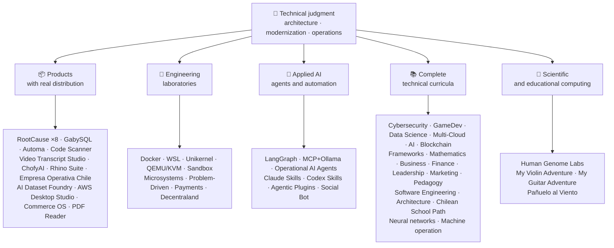

<div align="center">

# 👋ヴラディミール・アカニャ

## **ソリューションアーキテクト·シニアフルスタック·デジタル変革·経営・運営**

**コンピューターサイエンスとコンピューティング工学および経営管理の専門的訓練を受け、16年以上のビルトおよび実際の環境でソフトウェアを操作する。 業務、人、プロセス、技術を接続し、技術的な判断と運用状況を把握し、ソリューションを設計、評価、提供、および持続可能なものにします。このGitHubアカウントの検証を裏返しました。**

[](https://vladimiracunadev-create.github.io/)
[](https://www.linkedin.com/in/vladimir-acu%C3%B1a-valdebenito-11924a29/)
[](mailto:vladimir.acuna.dev@gmail.com)

[](#プロフェッショナルスコープ)
[](#実質の配分を用いるプロダクト)
[](#完全な技術的なカリキュラム)

<!-- STATS:START -->
[](https://github.com/vladimiracunadev-create?tab=repositories)
[](https://github.com/vladimiracunadev-create?tab=repositories)
[](#地球の環境システム)
[](#完全な技術的なカリキュラム)
[](https://github.com/vladimiracunadev-create?tab=repositories)
<!-- STATS:END -->

[](https://github.com/vladimiracunadev-create?tab=repositories)
[](https://github.com/vladimiracunadev-create?tab=followers)

[🌐 Portfolio (6 languages)](https://vladimiracunadev-create.github.io/) ·
[🧩 Ecosystem](#地球の環境システム) ·
[⚡ Evaluate me in 10 minutes](#自分を評価するために10分を持っている場合) ·
[✅ Professional scope](#プロフェッショナルスコープ) ·
[🧭 Non-coding management](#経営管理非コーディングのキャリア機会) ·
[📋 Role matrix](PROFESIONAL_ROLES.md) ·
[📬 Contact](#コンタクト)

**🌐 完全版:** [Español](README.md) · [English](README.en.md) · [Português](README.pt.md) · [Italiano](README.it.md) · [Français](README.fr.md) · [简体中文](README.zh.md) · [繁體中文](README.zh-TW.md) · [日本語](README.ja.md) · [한국어](README.ko.md) · [Türkçe](README.tr.md) · [Русский](README.ru.md) · [Tiếng Việt](README.vi.md) · [ไทย](README.th.md) · [Deutsch](README.de.md) · [Українська](README.uk.md) · [Polski](README.pl.md) · [العربية](README.ar.md) · [فارسی](README.fa.md) · [Bahasa Indonesia](README.id.md) · [Nederlands](README.nl.md) · [हिन्दी](README.hi.md) · [Ελληνικά](README.el.md)

**技術的な中心:**
PHP 8 · Python · Rust · Go · Node/TS · Java 21 · .NET 8 · Dart/Flutter · WASM
· AWS · Terraform · Kubernetes · Docker · n8n · LangGraph/MCP · CI/CD · FinOps · Observability

**業務技術橋:**
プロセスと要件の分析·ソリューション評価·配達コーディネート·業務・継続性·リスク管理·製品・サービス·テクニカル教育

</div>

---

> [!NOTE]
> 体験する機会をオンにしないプロファイルです。 確かな技術経験、譲渡可能なスキル、生存可能なアプリケーション、将来の開発目標は明示的に分けられます。 GitHub の証拠は実行可能か、またはドキュメンタリーです。何かが何かである**なし**終了、などと記載しております。

## 🎯あなたを見つけるためにここに

これは「1つのリポジトリ」ではありません。それは共通の基準を持つ生態系です。

- 🔁 **再発可能なデモ**— クローン、実行、検証。
- 🧰 **標準化された工具細工**— Makefiles、ハブ CLI、`doctor`と と と と 、`smoke`リポジトリごとに。
- 🛡️ **深さの防衛**— 秘密のスキャン、ポリシー、および明示的に禁止された慣行。
- 📈 **観察性** — `/health`, `/ready`, `/metrics`、ダッシュボードおよびトレーサビリティ。
- 📚 **オーディエンス・アウェアのドキュメント**— リポジトリに応じて、リクルーター、初心者、DevOps、またはセキュリティ。
- 📦 **製品の流通**— ダウンロード可能なリリース、チェックサム、および証拠のビルド。 該当する場合、商業/ストアのシグネチャは保留中のものとして宣言しました。
- 🌍 **国際的なサービス**— 6つの言語のポートフォリオ(ES)·エントリー·ツイート·インフォメーション·フリガナ·ZH)。
- 🧭 **技術的な正直者**— ラベルを貼る全てのケース`OPERATIONAL`, `DOCUMENTED/SCAFFOLD`, または`PLANNED`.

## ✅検証可能なステータス

| 表面を覆う | コンクリート証拠 |
|---|---|
| 🧪 **試験カバレッジ** | ガビーSQL**828 件のテスト**+ 上でのしゃべり**503.8M のクエリ**(0 パンク)·Empresa Operativa チリ**158 件のテスト** ·オートマチック**150 ピテスト** ·マルチOS CI |
| 🤖 **生産等級の代理店** | LangGraph リアルワールド**25/25 操作バックエンド**(ケース 01–25、100% のカバレッジ)·運用AIエージェント**13 代理店**とりあえず**39 の決定的な楕円** |
| 🔗 **Polyglotの統合** | **20件**sender→n8n→receiver — の**19 業務**, 個別にドッカーで監査· **18 + DBエンジン** · **20以上のコンテナ** ·11パターン |
| 📦 **流通販売** | **151 リリース**生態系全体**64 所有の公共リポジトリ** ·インストーラーとアーティファクト`.exe` · `.msi` · `.dmg` · `.apk`チェックサムと証拠をビルドする; 商業/ストアのシグネチャは、該当する進行中の |
| 🛡️ **サプライチェーン** | コードQL·セルムレプ·バンドイト·トリビー·グリペ·ジトルク·トラッフルホッグ·CycloneDX SBOM(サイクロンDX SBOM)·スコアカード |
| 📚 **カリキュラム** | **14,530 クラス**21プログラム全体で検証可能、カウント[a workflow](.github/workflows/stats.yml)リポジトリ構造やリポジトリで宣言された検証可能なソースから、手書きではなく、·すべてのプログラムが編集者の状態と制限を宣言します |
| 🌐 **ポートフォリオ** | インストール可能なPWA· **6 の言語** · **PDF36枚**パイプラインによって生成される·CVデータAPI·コンデンサーのアンドロイド·灯台 100 |
| 🔒 **テレメトリー** | フォレンジック製品とエンドレスバ・オペラティバ・チリのゼロテレメトリー — あらゆるビルドで検証 (Android なし)`INTERNET`許可) |
| 🌐 **公開サイト** | **56 GitHub ページサイト**—55 のランディング、製品、プログラム、またはエコシステム・ナビゲーター、およびポートフォリオごとに1つ、それぞれが独自のリポジトリから展開·全て 56 検証済み HTTP で検証済み`200` |

## 🗺️地球の環境システム



## 📦実質の配分を用いるプロダクト

ダウンロード、インストール、および使用中のソフトウェアは、クローン化されるだけでなく、

| 産品展示 | とりあえず | スタック | 配達: |
|---|---|---|---|
| [🔍 **RootCause Windows**](https://github.com/vladimiracunadev-create/rootcause-windows-inspector) | サイバーセキュリティフォレンジック: あらゆる異常リソースの歪みは、脅威の最初の兆候かもしれません。 診断 最初に、後で介入 | コース🦀 ·ETW/WPRの特長 | **...............................................................................................................................................................................................................................................................** · **16 リリース** · **5 エディション**: GUI の·ポータブル·おすすめ·パワーシェル·VSコード· [landing](https://vladimiracunadev-create.github.io/rootcause-windows-inspector/) |
| [📱 **RootCause Mobile**](https://github.com/vladimiracunadev-create/rootcause-mobile-inspector) | モバイル・シブル:各アプリを単独と比較するフォレンジックセンサー、ストークウェアのフラグ、および与えられた権限を単に要求したものから分離する | フラッタ·コルテリン·Swift の | **..0 の .** ·検証可能なAndroid APK·5 の言語· **ゼロテレメトリー** · [landing](https://vladimiracunadev-create.github.io/rootcause-mobile-inspector/) |
| [🍎 **RootCause macOS**](https://github.com/vladimiracunadev-create/rootcause-macos-inspector) | macOS edition: `launchd` persistence, Gatekeeper, SIP, FileVault, XProtect, TCC permissions, signed processes, and network neighbors — every surface checked against a known-good state | Rust 🦀 · macOS 13+ | **v0.1.0** · first published release · Apache-2.0 · [landing](https://vladimiracunadev-create.github.io/rootcause-macos-inspector/) |
| [🖥️ **RootCause Server**](https://github.com/vladimiracunadev-create/rootcause-server) | サーバのシブル:単一のログが一緒に見ていないもの、露出された表面、アクセスアテンプトバースト、同じアドレス、重要なファイル完全性、センサーのサイレンスに付与されたセッションを相関し、それを1つの実用的な文に変える | コース🦀 ·ウィンドウズ·リリース·マックオース | **.2.0 の** · **18 ルール**証拠とランブック·自らの行動を決して実行しない·ウェブ依存関係のないローカルコンソール· **公開されていないリリースはまだありません** · [landing](https://vladimiracunadev-create.github.io/rootcause-server/) |
| [🌐 **RootCause Web**](https://github.com/vladimiracunadev-create/rootcause-web-inspector) | ブラウザのフォレンジックセンサー:クッキー、メールセッション、拡張機能、ダウンロード、パーミッション、および実際のウィンドウを模倣するページ | コンテンツ·MV3 拡張子 | **.2.0 の** ·公開されていないリリースはまだありません·パネル`127.0.0.1` ·ゼロ依存関係·CIで検証されたゼロテレメトリー· [landing](https://vladimiracunadev-create.github.io/rootcause-web-inspector/) |
| [₿ **RootCause Bitcoin Defense**](https://github.com/vladimiracunadev-create/rootcause-bitcoin-defense) | ビットコインの保管のための時計だけ防衛:各キーの起源を発明し、公開された警告でそれをクロスチェックし、証拠と根本的な原因を説明します | コンテンツ·Windowsアプリ·ローカル パネル | **.3.0 の** · **2 リリース** ·ゼロ依存関係·種子を要求しない·CIで検証· [landing](https://vladimiracunadev-create.github.io/rootcause-bitcoin-defense/) |
| [⛓️ **RootCause Blockchain Security**](https://github.com/vladimiracunadev-create/rootcause-blockchain-security) | マルチチェーンの監視のみコンソール: 在庫契約、プロキシ、オラクル、ブリッジ、ガバナンス、および依存関係、ルート・ヒューズのランブックを生成し、 | コンテンツ·Windowsアプリ·ローカル パネル | **.3.0 の**リポジトリに·公開リリース:`v0.1.0` ·ゼロ依存関係·プライベートキーを要求しない·CIで検証· [landing](https://vladimiracunadev-create.github.io/rootcause-blockchain-security/) |
| [📷 **RootCause QR Inspector**](https://github.com/vladimiracunadev-create/rootcause-qr-inspector) | 行動する前にQRコードを検査するためのローカルAndroidアプリ:26信号を説明し、偽物から事実を分離し、赤字の証拠をエクスポートします | フラッタ·ダーツ | **..4 .** · **5 リリース** · **107テスト** ·公開されたAndroid APK·検証可能なSHA-256·技術的なAPKパッケージ署名; 進行中の商業/ストア署名·ゼロテレメトリー· [landing](https://vladimiracunadev-create.github.io/rootcause-qr-inspector/) |
| [🏢 **Empresa Operativa Chile**](https://github.com/vladimiracunadev-create/empresa-operativa-chile) | 毎月のクローズに組み込まれる前に、SPA をガイド: 証拠、VAT の持ち方、F29 ドラフト、不変なクローズ、および監査ログと組み込む。 正規のソースにすべての規則がポイント | コンテンツ·コース·プワワ | **.5.0 の v1.5.0** ·アンドロイド·ウィンドウズ·ブラウザ· **158 件のテスト** · **0 生産の依存性** ·ゼロテレメトリー· [landing](https://vladimiracunadev-create.github.io/empresa-operativa-chile/) |
| [🔍 **Universal Code Scanner**](https://github.com/vladimiracunadev-create/universal-code-scanner) | QR とバーコードリーダー**演技前の解釈**: 16 ローカル URL の危険信号と明示的な確認 | フラッタ·ダーツ | **.1.0 の v1.1.0 の** ·アンドロイド·スマートフォン·マックオース·プワワ·暗号化された履歴**AES-256-GCM(オプション)** · [landing](https://vladimiracunadev-create.github.io/universal-code-scanner/) |
| [🗄️ **GabySQL**](https://github.com/vladimiracunadev-create/gabysql) | 組み込みデータベース: シングル`.db`ファイル名、WAL、コストベース最適化、HTTP/JSON API | コース🦀 | ウィンドウズ·マックオース·リリース· [landing](https://vladimiracunadev-create.github.io/gabysql/) |
| [🤖 **Automa PC**](https://github.com/vladimiracunadev-create/automa-pc) | ローカルオーケストレーター:JSON は、実際のウィンドウを開き、DOM とやり取りし、証拠を残している | フィードバック·プレイライト·pywebview の使い方 | **.3.0 の** · **27 流れ** ·公開および検証可能なインストーラ· [landing](https://vladimiracunadev-create.github.io/automa-pc/) |
| [🏭 **AI Dataset Foundry**](https://github.com/vladimiracunadev-create/ai-dataset-foundry) | PDF、Word、Web、Git、JSON、CSVを事前トレーニング、微調整、RAG、評価のための監査可能なデータセットに変換するローカルファースト工場 | フィードバック | **.2.0 の** ·Windows + オフライン Android·初公開リリース· [landing](https://vladimiracunadev-create.github.io/ai-dataset-foundry/) |
| [☁️ **AWS Desktop Studio**](https://github.com/vladimiracunadev-create/aws-desktop-studio) | ローカルファーストアプリで15 AWSインベントリの統合、20 のチュートリアル、CLI/SSO、および読み取り専用デフォルト; 進捗の実装、ユニバーサルアクセスではなく | コンテンツ·ウィンドウズ | **.1. .** ·初公開リリース· [landing](https://vladimiracunadev-create.github.io/aws-desktop-studio/) |
| [🧭 **Commerce OS**](https://github.com/vladimiracunadev-create/commerce-operating-system) | 商用操作の概念のデモ:カタログ、株式、CRM、注文、モック支払い、およびトレーサビリティ | コンテンツ·コンテンツ·ウィンドウズ·アンドロイド | **.3.0 の** · **2 リリース** ·実際のお金やチリの税務当局の統合はありません· [landing](https://vladimiracunadev-create.github.io/commerce-operating-system/) |
| [📄 **PDF Reader**](https://github.com/vladimiracunadev-create/pdf-reader-windows-android) | アンドロイド初のローカル読み取り専用リーダー、無作物ズーム、再オープン可能な履歴、WhatsApp共有、および既定のリーダー選択 | コンテンツ·コンテンツ·アンドロイド·ウィンドウズ | **..3 .** ·署名されたAPK·口座、機密権限、またはテレメトリーなし· [landing](https://vladimiracunadev-create.github.io/pdf-reader-windows-android/) |
| [🎙️ **Video Transcript Studio**](https://github.com/vladimiracunadev-create/video-transcript-studio) | ワンビデオ、プレイリスト、または**YouTubeチャンネル全体**タイムスタンプでテキストに。 既存の字幕に依存しません。 ウィスパーは、オーディオを認識**お使いのマシンで**、API、アカウント、またはキーを構成しないで | フィードバック·ピシド6·速いAPI·より高速ホイスパー | **.2.0 の** ·Windowsデスクトップ+ローカルパネル`127.0.0.1`+ クライアント**同じキューを共有** ·ダイバーシティ·パンフレット·TXT(TXT)·エスアールティ·ヴィット·ジェイソン·エムピー・スリー·トピックス· **89 件のテスト** ·バンドル FFmpeg·ゼロテレメトリー· [landing](https://vladimiracunadev-create.github.io/video-transcript-studio/) |
| [🎨 **ChofyAI Studio**](https://github.com/vladimiracunadev-create/chofyai-studio) | ローカルクリエイティブAIランチャー:Qwen3-TTS、Whysper.cpp、FaceFusion、AceForge、ComfyUIをオーケスト | 田栗 2·コース·反応する | .1 の v0.5.1· **実際の推論の5/5ツール** ·macOS Apple シリコン·実験的なWindows· **公開されていないリリースはまだありません** · [site](https://vladimiracunadev-create.github.io/chofyai-studio/) |
| [🦏 **Rhino Suite**](https://github.com/vladimiracunadev-create/rhino-suite) | 文書ルールは DOM に依存しない - HTML は単なる投影である | ラースト/WASM·おすすめ·反応 19 | フェーズによる進化単球· [landing](https://vladimiracunadev-create.github.io/rhino-suite/) |
| [🎻 **My Violin Adventure**](https://github.com/vladimiracunadev-create/violin-adventure) | 子供のための教育アプリ: クロマチックチューナー、オーディオクロック-正確メトロノーム、本物のバイオリンと曲 | 田栗 2·反応する·ツイート | **.3.0 の v1.3.0** ·ウィンドウズ·アンドロイド·リリース·マックオース·プワワ· [landing](https://vladimiracunadev-create.github.io/violin-adventure/) |
| [🎸 **My Guitar Adventure**](https://github.com/vladimiracunadev-create/guitarra-adventure) | plucked-string の兄弟: 6 の世界の 24 のレッスン、6 弦のチューナー、漂流なしのメトロノーム、および 11 実質のギターのノート | 田栗 2·反応する·ツイート | **.0.0 の** ·ウィンドウズ·アンドロイド·リリース·マックオース·スマートフォン·プワワ·口座、広告、またはオンラインの依存関係なし· [landing](https://vladimiracunadev-create.github.io/guitarra-adventure/) |
| [🧣 **Pañuelo al Viento**](https://github.com/vladimiracunadev-create/panuelo-al-viento-cueca-app) | 10歳からCueca: 8レベル、24クラス、72アクティビティ、6パルスラボ(3 + 3、2 + 2 + 2)、およびアクセス可能なフロア図。 それを述べる**補完、置換しない**, 教師と文化のベアラー | フラッタ·ダーツ | **.2.0 の** ·アンドロイド 7+·ウィンドウズ 10/11·ツイート·エクスクルーシブ·エムシー·ポータブル· **29 個のテスト + 2 個のバリデータ** ·カメラ、マイク、アカウント、広告、インターネットなし· [landing](https://vladimiracunadev-create.github.io/panuelo-al-viento-cueca-app/) |

## 🧪エンジニアリング研究所

| リポジトリ | 何が実証するか |
|---|---|
| [🐳 **Problem-Driven Systems Lab**](https://github.com/vladimiracunadev-create/problem-driven-systems-lab) | **20 実際の問題**(負荷、N+1、再試行嵐、漏れ、モノリス、キャッシュスタンプ、バックプレッシャー、ゼロダウンタイム移行、DLQを忘れた)、高忠実度注入障害で解決**7 スタック**: PHP 8 の·フィードバック·Node.js の使い方·Java 21 の·.NET 8 の特長· **ゴー 1.23** · **ラースト 1.83** · [landing](https://vladimiracunadev-create.github.io/problem-driven-systems-lab/) |
| [📆 **Social Bot Scheduler**](https://github.com/vladimiracunadev-create/social-bot-scheduler) | **...............................................................................................................................................................................................................................................................** · **20件**source→n8n→receiver オーバーオーバー**18 + DBエンジン** —**19 業務**, 個別にドッカーで監査**8層**監査、出没ガードレール、遮断器、DLQ· [landing](https://vladimiracunadev-create.github.io/social-bot-scheduler/) |
| [🧰 **Microsistemas**](https://github.com/vladimiracunadev-create/microsistemas) | **12 の診断および近代化の microapps**PHP の·ローカル読み取り専用MCPサーバー·3相硬化症· [landing](https://vladimiracunadev-create.github.io/microsistemas/) |
| [🧪 **Docker Labs**](https://github.com/vladimiracunadev-create/docker-labs) | **13 の実験室**4つのサービスプラットフォーム+自動化`.exe`インストーラーとランチャー· [landing](https://vladimiracunadev-create.github.io/docker-labs/) |
| [🐳 **WSL Labs**](https://github.com/vladimiracunadev-create/wsl-labs) | **12 件**にほんご`wslc`、 ネイティブWSLコンテナエンジン —**Dockerデスクトップなし** · [landing](https://vladimiracunadev-create.github.io/wsl-labs/) |
| [⚡ **Unikernel Labs**](https://github.com/vladimiracunadev-create/unikernel-labs) | 「ドッカーデスクトップユニカネル」: WindowsはWSL2のバックエンドが付いているUnikraft上の制御を、`kraft`電子メール: qEMU· [landing](https://vladimiracunadev-create.github.io/unikernel-labs/) |
| [🧰 **QEMU/KVM Labs**](https://github.com/vladimiracunadev-create/qemu-kvm-labs) | **12 の実験室**QEMU、KVM、libvirt、クラウド・インシット、および`vm-manager`Linux と WSL2 の· [landing](https://vladimiracunadev-create.github.io/qemu-kvm-labs/) |
| [🛡️ **Sandbox Labs**](https://github.com/vladimiracunadev-create/sandbox-labs) | Linux の分離: 宣言されたポリシーの下でサードパーティのコード、ファイル、およびビジネス モデルを実行します。**署名された証拠を発し、実際に適用された制御をします** · **36 件**2つの家族で —15 の技術と 21 の資本市場 —·実験的・教育的宣言、*セキュリティ製品ではない*· [landing](https://vladimiracunadev-create.github.io/sandbox-labs/) |
| [💳 **Universal Payments Engineering Lab**](https://github.com/vladimiracunadev-create/universal-payments-engineering-lab) | **28 支払家族**ローカルの自己表現のデモ: 状態、レジャー、調整、セキュリティ、および実装ガイド· [landing](https://vladimiracunadev-create.github.io/universal-payments-engineering-lab/) |
| [🕹️ **Decentraland Social Arcade**](https://github.com/vladimiracunadev-create/decentraland-social-arcade) | ネイティブ・デカルトランド・ソーシャル3D体験: 1つのMVPとSDK7、ECS、TypeScriptのマルチゲームアーキテクチャ·スペイン語のドキュメント·支払いやテレメトリーなし |
| [☁️ **AWS Projects**](https://github.com/vladimiracunadev-create/proyectos-aws) | Progressive cases where each one adds one AWS service **and** a new GitHub Actions capability · SAA-C03 · DVA-C02 · SOA-C02 coverage |

## 🤖応用AI

| リポジトリ | 何が実証するか |
|---|---|
| [🤖 **LangGraph RealWorld**](https://github.com/vladimiracunadev-create/langgraph-realworld) | **25/25 操作バックエンド**— 型の状態、条件付きルート、NDJSON ストリーミング、DEMO/LIVE モード、8 セキュリティーレイヤー、SHA-256 チェーンのクラスト |
| [🧭 **Operational AI Agents**](https://github.com/vladimiracunadev-create/operational-ai-agents) | **13 業務委託業者**クロードコードと互換性のあるランタイム:それぞれが完全なミッションを受け取ります。リポジトリの進化、レガシーモダナイゼーション、カリキュラム設計、ポートフォリオの公開、セキュリティの修正、インシデント分析、宣言された契約、人門、および検証可能な証拠· **39 の決定的な楕円** ·34 件のテスト·ゼロ・デプス(stdlibのみ)·リリース·マックオース·ウィンドウズ· [site](https://vladimiracunadev-create.github.io/operational-ai-agents/) |
| [🧠 **MCP + Ollama Local**](https://github.com/vladimiracunadev-create/mcp-ollama-local) | ローカルファーストAIとMCPツールをサンドボックスに· `127.0.0.1`ビーコン·多層信頼のプロフィール·限界について正直に |
| [🧩 **Agentic Plugins Toolkit**](https://github.com/vladimiracunadev-create/agentic-plugins-toolkit) | **6 の有剤のプラグイン**ロードコード、OpenAI/Codex、Copilot、Gemini、MCP に 1 つのソースからインストール可能:`repository-engineering`, `legacy-modernization`, `learning-program-studio`, `product-evolution`, `portfolio-governance`と と と と 、`rootcause-response` · **69 ドリフトなしの生成されたビュー**—各ランタイムは、同じ契約からその形式を受け取ります。·ゼロデプス·リリース·マックオース·ウィンドウズ· [site](https://vladimiracunadev-create.github.io/agentic-plugins-toolkit/) |
| [🧰 **Claude Skills Toolkit**](https://github.com/vladimiracunadev-create/claude-skills-toolkit) | **15 代理スキル**クラウデコード· **セキュリティー**: 12層`security-audit`ログアウト·ケベック·EPSS(エプス)·ツイート·コンテナ·秘密)14段`bitcoin-custody-audit` · **リポジトリゲート**: `pre-commit-guard`, `pre-push-guard`, `yaml-control`, `md-lint-fix`, `python-lint-guard` · **カンファレンス**: `repo-coherence-audit`, `version-bump`, `python-version-control`, `python-deps-pinning` · **ドッカー**: `docker-cleanup`, `docker-compose-doctor` · **ドキュメント**: `md-to-doc` ·ゼロデプス·クロスプラットフォーム |
| [🧰 **Codex Skills Toolkit**](https://github.com/vladimiracunadev-create/codex-skills-toolkit) | **19 代理スキル**Codex: セキュリティとサプライチェーン、プレッライト、機能フロー、レジリエンス、状態、リリースの証拠、Python/YAML/Markdownゲート、バージョン管理、依存関係、ドッカー、ドキュメント·Python 優先· `pnpm` ·リリース·マックオース·ウィンドウズ· [site](https://vladimiracunadev-create.github.io/codex-skills-toolkit/) |

## 📚完全な技術的なカリキュラム

スペイン語のシーケンシャルプログラム、各リポジトリで宣言されたステータスとスコープ。 21プログラムが最大で追加**14,530 クラス**, カウント[a workflow](.github/workflows/stats.yml)リポジトリ構造やリポジトリで宣言された検証可能なソースから、バッジは週1回更新され、手元では書かれていません。

🧭 [**Lifelong Learning Ecosystem**](https://github.com/vladimiracunadev-create/lifelong-learning-ecosystem)ビジュアルマップと6つの領域を横断して30の実パスを接続するフェデレーションコンパスです。[accessible offline portal](https://vladimiracunadev-create.github.io/lifelong-learning-ecosystem/); 追加プログラムとしてカウントされません。

| 参加プログラム | レッスン | スコープ |
|---|---:|---|
| [🔢 **Computational Mathematics**](https://github.com/vladimiracunadev-create/computational-mathematics-program) | 360 | 指のカウントから紙を再現· **360 の決定的なデモは CI で検証しました** ·1,080 ノート·489 用語集· [site](https://vladimiracunadev-create.github.io/computational-mathematics-program/) |
| [🏦 **Finance and Banking**](https://github.com/vladimiracunadev-create/finance-and-banking-evolution-program) | 356 | 日 時: 534 分·金融数学とIFRS → クレジット、リスク、バーゼルIII、オープンファイナンス、DLT、安定コイン、およびMICA· **27 件** · **298 試験** · [site](https://vladimiracunadev-create.github.io/finance-and-banking-evolution-program/) |
| [🎮 **GameDev**](https://github.com/vladimiracunadev-create/modern-gamedev-program) | 352 | 数学とC#/C++/GDScript →シェーダー、AI、マルチプレイ、VR/AR·ゴルゴット·ユニバース·ユレアル· **CIで検証された10のGodotラボ**(301件のチェック)· [site](https://vladimiracunadev-create.github.io/modern-gamedev-program/) |
| [🛡️ **Cybersecurity**](https://github.com/vladimiracunadev-create/modern-cybersecurity-program) | 360 | **.3.0 の v1.3.0** ·20 部·基盤 → レッドチーム、DFIR、クラウドセキュリティ、開発、CTF、ゲームセキュリティ·地図を**7 認証** ·オフライン Android/web アプリ·PDFマニュアル·CI、セキュリティ、およびページ検証· [site](https://vladimiracunadev-create.github.io/modern-cybersecurity-program/) |
| [📈 **Marketing, Sales, and Growth**](https://github.com/vladimiracunadev-create/marketing-sales-growth-evolution-program) | 336 | 運用定義、測定シート、検証可能なバイブリグラフィー、チリ規制のコンテキストを持つ24部品· **..6.0 の v1.6.0** ·1.29M の言葉·17 のロールベースのパス· [site](https://vladimiracunadev-create.github.io/marketing-sales-growth-evolution-program/) |
| [🏢 **Business Creation**](https://github.com/vladimiracunadev-create/modern-business-creation-program) | 336 | チリの会社を創出し、運営する: 設立、税務当局、運用、危機、出退社を考え、·360 の図·1,251 用語集·1,548ページマニュアル· [site](https://vladimiracunadev-create.github.io/modern-business-creation-program/) |
| [🏛️ **Architecture and Built Environment**](https://github.com/vladimiracunadev-create/architecture-built-environment-learning-program) | 830 | 83 パーツ·60の統合セッション·34 パス·トレーサブルなソース·マークダウン、オフラインリーダー、GitHubページ· [site](https://vladimiracunadev-create.github.io/architecture-built-environment-learning-program/) |
| [🇨🇱 **Chilean School Learning Path**](https://github.com/vladimiracunadev-create/chilean-school-learning-path) | 8,841 | グレード 1～12· **4,156 統合されたクロスカリキュラムの経験** · **2,823 学習目的** ·MINEDUC ソース·未完成の提案や専門的ヒューマンレビューはまだ終わらない· [site](https://vladimiracunadev-create.github.io/chilean-school-learning-path/) |
| [🧭 **Modern Software Engineering**](https://github.com/vladimiracunadev-create/modern-software-engineering-program) | 480 | 40 部・8 段·基礎 → 製品・アーキテクチャ・セキュリティ・デベロッパー・SRE・SPEC・AI・マルチエージェント・システム·リポジトリによって宣言される編集状態· [site](https://vladimiracunadev-create.github.io/modern-software-engineering-program/) |
| [🎓 **Pedagogy and Learning Sciences**](https://github.com/vladimiracunadev-create/education-pedagogy-learning-sciences-program) | 300 | 教師が訓練される方法を学ぶ人から·25 部· **各クラスは、証拠状態と限界を宣言します。** ·初期のリテラシー、比較方法、特定の教育ニーズ、共存性、文化的多様性、および国際的証拠·1,097 用語集、325 図、60 アクティビティの教室銀行·役割による14のキャリアパス·LMS エクスポート可能· **.1.0 の** · [site](https://vladimiracunadev-create.github.io/education-pedagogy-learning-sciences-program/) |
| [☁️ **Multi-Cloud**](https://github.com/vladimiracunadev-create/multi-cloud-engineering-program) | 288 | AWS の·リファレンス·ギガシー·クーベルネ·テラフォーム·プレステージ·フィンオプス· **1,288時間** ·JSON 証拠による 288 件のラボ·1,032 個のトレースされたソース·2,884ページ PDFマニュアル· [site](https://vladimiracunadev-create.github.io/multi-cloud-engineering-program/) |
| [🎖️ **Executive Leadership**](https://github.com/vladimiracunadev-create/executive-leadership-founder-program) | 288 | 貴社の第一次成果を保有し、自社をリードし、チーム、KPI/OKR、ファイナンス、製品、リスク、ボード、M&A·24 ケース、96 ラボ、39 テンプレート· [site](https://vladimiracunadev-create.github.io/executive-leadership-founder-program/) |
| [🐍 **Python Data Science**](https://github.com/vladimiracunadev-create/python-data-science-program) | 232 | 極度、ML+Optuna/SHAP、PyTorch/LLMs/LoRA、MLOps·ネイティブWindowsアプリ + Android APK· [site](https://vladimiracunadev-create.github.io/python-data-science-program/) |
| [🧠 **AI Evolution**](https://github.com/vladimiracunadev-create/artificial-intelligence-evolution-program) | 184 | Symbolic → probabilistic → deep learning → LLMs, RAG, agents, safety, and frontier · **v0.17.0** · **708 notebooks** · **148 foundational papers** · offline Windows, Android, and PWA apps · [site](https://vladimiracunadev-create.github.io/artificial-intelligence-evolution-program/) |
| [🌐 **Comparative Programming**](https://github.com/vladimiracunadev-create/polyglot-programming-labs) | 176 | ひとつのコンセプト**10 の言語**CIで検証 —**1,360 の実装**プラス**1,632 のプログラム**静止言語(COBOL、Fortran、Ada、RPG、MUMPS...)、アトラス**15人の家族で60枚のカード** ·.1.0 の v1.1.0 の· [site](https://vladimiracunadev-create.github.io/polyglot-programming-labs/) |
| [🧩 **Frameworks Compared**](https://github.com/vladimiracunadev-create/framework-ecosystems-labs) | 149 | アダプターなしで、Express、FastAPI、Spring Boot、ASP.NET、Django、Rails、Laravel、React、Vue、Svelte、その他多くの機能が搭載されている、一つの実行可能契約·12 部· **70組クラス** · **CIで検証された397件** · **210 ISBN/DOI ソース** · [site](https://vladimiracunadev-create.github.io/framework-ecosystems-labs/) |
| [🗄️ **Databases**](https://github.com/vladimiracunadev-create/database-systems-labs) | 74 | **.0.0 の** ·15 部のデータベースエンジニアリング·お電話でのお問い合わせ· **すべてのクレームの検証可能なソース**: ISBN、DOI、または標準の120ソース·27エンジンで解決する同じ場合·306 用語集·150 ピテスト· [site](https://vladimiracunadev-create.github.io/database-systems-labs/) |
| [📐 **Psychometrics and Assessment**](https://github.com/vladimiracunadev-create/psychometrics-and-assessment-program) | 40 | 測定器が構築、評価、検証、監査される方法·8 部·実行可能なエンジンと**5 楽器と344 アイテム、276 パブリックドメイン** |
| [⛓️ **Blockchain**](https://github.com/vladimiracunadev-create/blockchain-learning-path) | 66 | **v0.14.0** · from zero to programmable financial infrastructure and on-chain analytics · **91 practices** and **363 tests** · contracts with Foundry (fuzzing and invariants) and Slither static analysis in CI · offline apps verified by opening the binary and counting its contents · [site](https://vladimiracunadev-create.github.io/blockchain-learning-path/) |
| [🧠 **Neural Network Training Labs**](https://github.com/vladimiracunadev-create/neural-network-training-labs) | 31 | 7 モジュール·≈214時間· **93 ノートブック**—31クラス、31の学生バージョン、31のソリューション·実際のパブリックデータに関する質問、ビジュアルマップ、慣行、評価·ピートーチ· [study site](https://vladimiracunadev-create.github.io/neural-network-training-labs/) |
| [🕹️ **Machine Operator**](https://github.com/vladimiracunadev-create/machine-operator-program) | 451 | **41 トレーニングモジュール**、機械ごとの1· **502 h 15 分** ·システムの制御、物理、安全、およびクラスごとのソースとのシミュレーション設計·※実行可能シミュレータは未だ、その方法が宣言されていない* |

## 🔬科学コンピューティング

| リポジトリ | 何が実証するか |
|---|---|
| [🧬 **Human Genome Labs**](https://github.com/vladimiracunadev-create/human-genome-labs) | 再現性ゲノムプラットフォーム:タイプ`ScientificResult<T>`契約、FASTA/GFF3/VCF、モジュールと**明示的な成熟度と証拠**. 放射性正直: *それは臨床診断を実行しません*· [site](https://vladimiracunadev-create.github.io/human-genome-labs/) |

## ⚡自分を評価するために10分を持っている場合

アイデアはコードを見るだけでなく、: それは参照することです**考え方**、どのようにドキュメントをするか、そして、どのようにして実行可能かを全て作ります。

**ルートA — 実質の観察とオーケストラ***(お気に入り)*

```bash
git clone https://github.com/vladimiracunadev-create/social-bot-scheduler.git
```

19例と18以上のDBエンジンのワークフロー、メトリック、ダッシュボード、ガードレールなどがご覧いただけます。

**B号線 — 数分で再発可能なインフラ**

```bash
git clone https://github.com/vladimiracunadev-create/docker-labs.git
```

**ルートC — 型付き状態のエージェント**

```bash
git clone https://github.com/vladimiracunadev-create/langgraph-realworld.git
```

**ルートD — 錆びない製品、クローニングなし**

インストーラーまたはCLIバイナリーをダウンロード[RootCause releases](https://github.com/vladimiracunadev-create/rootcause-windows-inspector/releases)確認・確認`SHA256SUMS`.

## 🧠リポジトリ全体で適用する標準

- **DX 初の**— 実行が容易でないと、デモやチームベースとしては役に立ちません。
- **1日目の観察性**— メトリックとトレーサビリティ、後続ではなく。
- **パイプラインとしてのセキュリティ**— 秘密のスキャン、リリースごとのSBOM、明示的に禁止された慣行。
- **実質の弾性**— 出土、遮断器および制御された劣化。
- **デザインによるポリグロット**— 決してファッションでではなく、使用例によって選ばれた言語とエンジン。
- **ステータスに関する正直**— 1つのリポジトリの名前を変更しました()`Multisimulador` → `machine-operator-program`) 未だに存在しない有望なソフトウェアを避けるため。
- **バッジは、証拠ではなく、信号です**— 各リポジトリも宣言します**何をしない**.
- **型式 出力**— ドメインは最初に設計され、インターフェイスは投影です。
- **外部の作業は外部の作業として宣言されます**— 口座の70の公正なリポジトリのうち、64は自分の作品です。 ほかの6[`agentic-qe`](https://github.com/vladimiracunadev-create/agentic-qe), [`Anthropic-Cybersecurity-Skills`](https://github.com/vladimiracunadev-create/Anthropic-Cybersecurity-Skills), [`erpnext`](https://github.com/vladimiracunadev-create/erpnext), [`OpenExecutive`](https://github.com/vladimiracunadev-create/OpenExecutive), [`raptor`](https://github.com/vladimiracunadev-create/raptor)と と と と 、[`security-audit-skill`](https://github.com/vladimiracunadev-create/security-audit-skill)— フォークは、自分の仕事のためにすべての数字から除外されます。

## ✅プロフェッショナルスコープ

私のデュアル背景 —**コンピュータサイエンスとコンピューティング工学+経営管理**— 業務の遂行、製品、顧客、およびリーダーシップの明確な選択肢に、ビジネスの目標を技術的な決定と技術的な制約に翻訳するのに役立ちます。

### 🎯コア・アイデンティティ

| 役割・役割 | バックリング |
|---|---|
| **ソリューションアーキテクト** | モジュラー、拡張可能なシステム設計、進化的な判断 |
| **レガシー・モダナイゼーション・アーキテクト** | 実質の遺産の進化(PHP 5.x→8.xの中断のない増分再ファクタリング) |
| **シニアフルスタック/テックリード** | 実際のプラットフォームに関するアーキテクチャ、実行、および基準(+16年) |
| **AIオートメーション設計** | LangGraph/MCP および n8n の流れが付いている無機系システムガードレール |

### ↗ 自然な展開

**AI のオーケストレーション エンジニア** · **システム/錆エンジニア** · **モバイルエンジニア(Flutter)** · **ソリューションエンジニア** · **技術的なプロダクト ビルダー** · **テクニカルトレーナー** · **デジタル変革コンサルタント** · **事業・機能アナリスト** · **技術的なプロダクト操作**

### ⚙️補完スコープ

プラットフォームエンジニア/ IDP·CI-CD のデベロッパー·クラウド/AWSエンジニア·アプリケーション SRE·オートメーションエンジニア·テクニカルコンサルタンスコンサルタント

## 🧭経営・管理・非コーディングのキャリア機会

どのタイトルが保持されているかは、このスコープは主張しません。 コンピューティング、経営管理、パブリック・証拠の組み合わせがコア・デューティであることをコーディングすることなく価値を創造できる職場を優先します。

| 専門家族 | 認識された役割 | 正直な分類 | コーディング | 証拠と条件 |
|---|---|---|---|---|
| **テクノロジーのリーダーシップ** | ITの責任者·ITオペレーションマネージャー·デジタルトランスフォーメーションマネージャー·キュオ | **応用の可能性/将来の目標** | なし/時系列 | 強力な技術基盤; 人、予算、ベンダー、および執行の責任は別に証明されなければなりません |
| **プロジェクト管理** | ITプロジェクトコーディネーター/マネージャー·プロモーション·スクラムマスター·アジャイル配送 | **転送可能/アプリケーションの可能性** | なし/時系列 | 証拠の配信とリリース; 正式なチーム、予算、およびスポンサーの責任はギャップを残します |
| **経営管理** | 業務管理者·管理・運営管理責任者·契約管理者 | **応用の可能性** | なし | 経営学と運用アーティファクト。リソース、人、サプライヤーの検証済み所有権が必要です |
| **戦略・変更** | 戦略コンサルタント·変更マネージャ·経営企画·イノベーション/変革 | **転送可能/アプリケーションの可能性** | なし | 法定近代化とソリューションの評価;組織的導入結果は実証されなければならない |
| **業務分析** | 経営アナリスト·機能・要求アナリスト·日 時 分·継続的な改善 | **転送可能/アプリケーションの可能性** | なし/時系列 | ドメインモデリングと要件の証拠; 外部のステークホルダーのケースは、主張を強化する |
| **製品・サービス** | 取扱商品/販売店·製品オペレーション·サービスデリバリー·顧客成功 | **転送可能/アプリケーションの可能性** | なし/時系列 | ロードマップ、ライフサイクル、リリース、および運用; P&L、顧客ポートフォリオ、SLA 証拠はロールによって異なる |
| **サイバーセキュリティ管理** | グラッシ·IT は監査人を制御します·テクノロジーリスク·情報セキュリティ・継続性 | **応用の可能性** | なし/時系列 | 制御とルートパスの証拠; 組織の監査と関連する資格情報は保留中 |
| **商用・販売** | 技術の事前販売·ソリューションコンサルタント·テクニカルカム·B2B事業開発 | **転送可能/アプリケーションの可能性** | なし | 強力なソリューション/値翻訳; クォータ、アカウントポートフォリオ、契約交渉は主張されていません |
| **財務・管理管理** | 予算/コストアナリスト·プロジェクト評価·FP&A の特長·管理制御 | **応用の可能性** | なし | 財務/FinOps のアーティファクト; 実際の予算、財務諸表、および企業KPIが必要です |
| **品質保証** | プロセス/品質アナリスト·プロセス監査·継続的な改善 | **転送可能/アプリケーションの可能性** | なし/時系列 | ゲート、テスト、メトリック、再現性; 正式な品質システム所有権はギャップを残します |
| **Education** | Technical Trainer · Facilitator · Academic Coordinator · EdTech / Instructional Designer | **Transferable / application potential** | None/occasional | 21 programs and 14,530 classes; formal teaching and learner outcomes must be evidenced separately |
| **物流・サプライヤー** | 調達・調達·供給/オペレーションコーディネーター·ベンダー/コントラクトマネージャー | **応用の可能性** | なし | プロセスと管理基盤; 実際の調達、在庫、およびサプライヤーのパフォーマンスが必要です |
| **データとAIのガバナンス** | データスチュワード·データガバナンス·AI導入・ガバナンス | **転送可能/アプリケーションの可能性** | なし/時系列 | 監査可能なデータセットおよび人的関連エージェント;組織方針および委員会はギャップを残します |
| **公共部門** | 機関の近代化·ICTコーディネーター·デジタルプロジェクト·公共企画 | **応用の可能性** | なし | チリのコンテキストシステムとトレーサビリティ; 公的な調達とセクターの経験は主張されていません |

とりあえず[full Spanish role matrix](PROFESIONAL_ROLES.md)目的、責任、市場経験、補完的な知識、証拠、互換性、および14家族全員のギャップ。

## 🤖AI-Assisted Development Flow(AI-Assisted Development Flow) 開発実績

| ツール | 主な用途 |
|---|---|
| **クラウデコード** | 建築レビュー、実装、および技術文書 |
| **ChatGPT Plus とチャット** | 分析・アーキテクチャ・反復(2023)年以降 |
| **コードx** | コード生成と再ファクタリング |
| **アンチグラビティ** | 開発・自動化の流れの加速 |
| **VSコード/OpenCode** | 統合AI支援による環境 |

> 独自の技術判断、人的検証、建築的方向を組み合わせる。 AIは能力、スピード、リーチを増幅します。経験を交換しません。

## 📌利用条件

**以下に開きます:**シニアフルスタック·建築設計·脚本の近代化·プラットフォーム/IDP·アプリケーション SRE·ドラッグ&ドロップ·オートメーション·AIオートメーション·業務・機能分析·ITプロジェクトコーディネート·製品オペレーション·デジタルトランスフォーメーション·ソリューションコンサルティング/プリセールス·テクニカル教育·品質・継続的な改善·AIの採用とガバナンス

**各ロールのスコープに応じて評価される:**製品所有者/技術的なプロダクト マネージャー·サービスデリバリー·ITオペレーション·GRC/技術リスク·管理・運営·管理制御·公共セクターの近代化。 エグゼクティブと一般経営のタイトルは、将来の開発目標であり、要求された経験ではありません。

**変異性:**プロジェクトの依存に応じて、リモートまたはハイブリッド。

## 📬コンタクト

[](https://vladimiracunadev-create.github.io/)
[](https://www.linkedin.com/in/vladimir-acu%C3%B1a-valdebenito-11924a29/)
[](https://gitlab.com/vladimir.acuna.dev-group/vladimir.acuna.dev-group)
[](mailto:vladimir.acuna.dev@gmail.com)

---

<div align="center">

[🤝 Contribute](CONTRIBUTING.en.md) ·
[🛡️ Security](SECURITY.en.md) ·
[⚖️ Code of Conduct](CODE_OF_CONDUCT.en.md)

<sub>README は、パブリックリポジトリの検証可能な状態と同期しました。API で読み込まれるコンポーネントと変更 -·最終確認: 2026年10月12日</sub>

</div>
