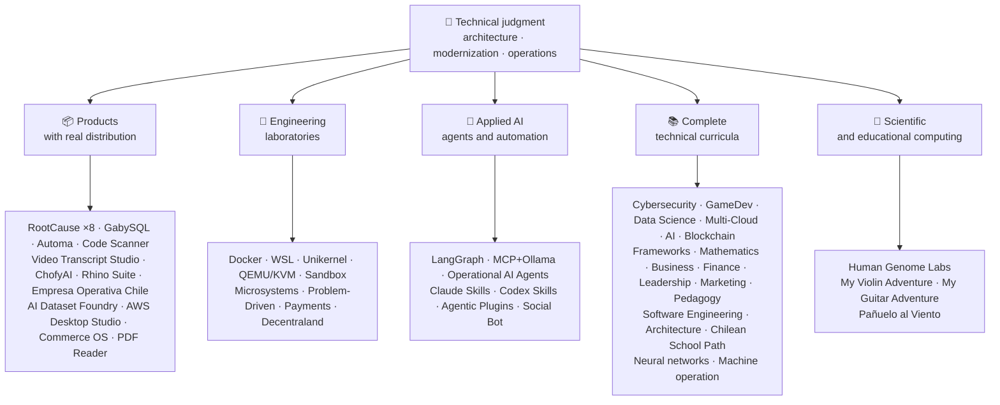

<div align="center">

# 👋Vladimir Acuña

## **Oplossingsarchitect·Senior Full-Stack·Digitale transformatie·Beheer en operaties**

**Professioneel opgeleid in Computer Science en Computing Engineering en Business Administration, met 16+ jaar bouw- en besturingssoftware in echte omgevingen. Ik sluit zaken, mensen, processen en technologie aan op het ontwerpen, evalueren, leveren en ondersteunen van oplossingen met technisch oordeel en een operationele visie .. ondersteund door verifieerbaar bewijs in deze GitHub account.**

[](https://vladimiracunadev-create.github.io/)
[](https://www.linkedin.com/in/vladimir-acu%C3%B1a-valdebenito-11924a29/)
[](mailto:vladimir.acuna.dev@gmail.com)

[](#beroepsterrein)
[](#producten-met-echte-distributie)
[](#complete-technische-curricula)

<!-- STATS:START -->
[](https://github.com/vladimiracunadev-create?tab=repositories)
[](https://github.com/vladimiracunadev-create?tab=repositories)
[](#ecosysteem-bij-een-glance)
[](#complete-technische-curricula)
[](https://github.com/vladimiracunadev-create?tab=repositories)
<!-- STATS:END -->

[](https://github.com/vladimiracunadev-create?tab=repositories)
[](https://github.com/vladimiracunadev-create?tab=followers)

[🌐 Portfolio (6 languages)](https://vladimiracunadev-create.github.io/) ·
[🧩 Ecosystem](#ecosysteem-bij-een-glance) ·
[⚡ Evaluate me in 10 minutes](#als-je-10-minuten-hebt-om-mij-te-evalueren) ·
[✅ Professional scope](#beroepsterrein) ·
[🧭 Non-coding management](#management-administratie-en-niet-coding-carrièremogelijkheden) ·
[📋 Role matrix](PROFESIONAL_ROLES.md) ·
[📬 Contact](#contactpersoon)

**🌐 Volledige versies:** [Español](README.md) · [English](README.en.md) · [Português](README.pt.md) · [Italiano](README.it.md) · [Français](README.fr.md) · [简体中文](README.zh.md) · [繁體中文](README.zh-TW.md) · [日本語](README.ja.md) · [한국어](README.ko.md) · [Türkçe](README.tr.md) · [Русский](README.ru.md) · [Tiếng Việt](README.vi.md) · [ไทย](README.th.md) · [Deutsch](README.de.md) · [Українська](README.uk.md) · [Polski](README.pl.md) · [العربية](README.ar.md) · [فارسی](README.fa.md) · [Bahasa Indonesia](README.id.md) · [Nederlands](README.nl.md) · [हिन्दी](README.hi.md) · [Ελληνικά](README.el.md)

**Technische kern:**
PHP 8 · Python · Rust · Go · Node/TS · Java 21 · .NET 8 · Dart/Flutter · WASM
· AWS · Terraform · Kubernetes · Docker · n8n · LangGraph/MCP · CI/CD · FinOps · Observability

**Brug over bedrijfstechnologie:**
proces- en vereistenanalyse·evaluatie van de oplossing·coördinatie van de levering·concrete acties en continuïteit·risicobeheer·product en dienst·technisch onderwijs

</div>

---

> [!NOTE]
> Dit profiel maakt van kansen geen ervaring. Bewezen technische ervaring, overdraagbare vaardigheden, levensvatbare toepassingen en toekomstige ontwikkelingsdoelstellingen zijn expliciet gescheiden. Gelinkt GitHub bewijs is uitvoerbaar of documentaire; waar iets is**niet**Het is als zodanig afgewerkt.

## 🎯Wat je hier zult vinden

Dit is geen repo: het is een ecosysteem met gedeelde standaarden.

- 🔁 **Demo's die herproduceerbaar zijn**Kloon, rennen, valideren.
- 🧰 **Gestandaardiseerde gereedschappen**`doctor`, en`smoke`per repository.
- 🛡️ **Defense in de diepte**. . geheime scanning, beleid, en expliciet verboden praktijken.
- 📈 **Waarneming** — `/health`, `/ready`, `/metrics`, dashboards, en traceerbaarheid.
- 📚 **Documentatie van het publiek**
- 📦 **Productdistributie**
- 🌍 **Internationalisering**. Portfolio in 6 talen (ES·NL·PT·IT·FR·ZH).
- 🧭 **Technische eerlijkheid**`OPERATIONAL`, `DOCUMENTED/SCAFFOLD`, of`PLANNED`.

## ✅Verifieerbare status

| Oppervlakte | Concrete bewijzen |
|---|---|
| 🧪 **Testdekking** | GabySQL**828 tests**+ fuzzing over**503.8M queries**(0 paniek)·Empresa Operativa Chili**158 tests** ·Automatisch**150 pytest** ·multi-OS CI |
| 🤖 **Productie-kwaliteitsagenten** | LangGraph RealWorld**25/25 operationele backends**(gevallen 01·Operationele AI-agenten**13 agentia**met**39 deterministische evaluaties** |
| 🔗 **Integratie van polygloten** | **20 zaken**afzender→n8n→ ontvanger **19 operationeel**, individueel gecontroleerd met Docker· **18+ DB motoren** · **20+ containers** ·11 patronen |
| 📦 **Distributie** | **151 releases**over een ecosysteem van**64 openbare registers in eigendom** ·installateurs en artefacten`.exe` · `.msi` · `.dmg` · `.apk`met controlesom en bouwbewijs; commerciële/store-handtekeningen, indien van toepassing |
| 🛡️ **Leveringsketen** | CodeQL·Semgrep·Bandiet·Trivy·GrypeCity in New Jersey USA·Gitleaks·Truffelhog·CycloneDX SBOM·Scorecard |
| 📚 **Curricula** | **14,530 klassen**controleerbare in 21 programma's, geteld door[a workflow](.github/workflows/stats.yml)van een echte repositorystructuur of een verifieerbare bron die in het repository is opgegeven .·elk programma verklaart zijn redactionele status en beperkingen |
| 🌐 **Portefeuille** | Installeerbare PWA· **6 talen** · **36 PDF's**door pijpleiding gegenereerd·CV Data API·Android-condensator·Vuurtoren 100 |
| 🔒 **Telemetrie** | Zero telemetrie in forensische producten en Empresa Operativa Chili `INTERNET`toestemming) |
| 🌐 **Gepubliceerde sites** | **56 GitHub Pagina's sites**·alle 56 geverifieerd met HTTP`200` |

## 🗺️Ecosysteem bij een glance



## 📦Producten met echte distributie

Software die wordt gedownload, geïnstalleerd en gebruikt ..niet alleen gekloond.

| Product | Wat het is. | Stack | Levering |
|---|---|---|---|
| [🔍 **RootCause Windows**](https://github.com/vladimiracunadev-create/rootcause-windows-inspector) | Cybersecurity forensics: elke abnormale resource vervorming kan het eerste teken van een bedreiging zijn. Diagnose eerst, later ingrijpen | Roest🦀 ·ETW/WPR | **v0,19,0** · **16 releases** · **5 edities**: GUI·Draagbaar·CLI·PowerShell·VS-code· [landing](https://vladimiracunadev-create.github.io/rootcause-windows-inspector/) |
| [📱 **RootCause Mobile**](https://github.com/vladimiracunadev-create/rootcause-mobile-inspector) | De mobiele broer en zus: een forensische sensor die elke app met zichzelf vergelijkt, vlaggen stalkerware, en onderscheidt verleend toestemmingen van slechts gevraagde | Flutter·Kotlin·Snel | **v0,8.0** ·verifieerbare Android APK·5 talen· **nul telemetrie** · [landing](https://vladimiracunadev-create.github.io/rootcause-mobile-inspector/) |
| [🍎 **RootCause macOS**](https://github.com/vladimiracunadev-create/rootcause-macos-inspector) | macOS-editie:`launchd`persistentie, Gatekeeper, SIP, FileVault, XProtect, TCC machtigingen, ondertekende processen, en netwerk buren .. elk oppervlak gecontroleerd tegen een bekende-goede staat | Roest🦀 ·macOS 13+ | **v0,1.0** ·eerste uitgave·Apache-2.0· [landing](https://vladimiracunadev-create.github.io/rootcause-macos-inspector/) |
| [🖥️ **RootCause Server**](https://github.com/vladimiracunadev-create/rootcause-server) | De server broers: correleert wat geen enkel log ziet samen .. blootgesteld oppervlak, toegang-verlichte barsten, een sessie toegekend aan datzelfde adres, kritieke bestand integriteit, en sensor stilte .. en verandert het in een actieerbare zin | Roest🦀 ·Vensters·Linux·macOS | **v0.2.0** · **18 regels**met bewijs en runbook·voert nooit acties uit op zichzelf·lokale console zonder web afhankelijkheden· **nog geen publicatie** · [landing](https://vladimiracunadev-create.github.io/rootcause-server/) |
| [🌐 **RootCause Web**](https://github.com/vladimiracunadev-create/rootcause-web-inspector) | Forensische sensor van de browser: cookies, e-mailsessies, extensies, downloads, machtigingen en pagina's die een echt venster imiteren | JavaScript·MV3-uitbreiding | **v0.2.0** ·nog geen publicatie·paneel aan`127.0.0.1` ·nul afhankelijkheden·nul telemetrie geverifieerd in CI· [landing](https://vladimiracunadev-create.github.io/rootcause-web-inspector/) |
| [₿ **RootCause Bitcoin Defense**](https://github.com/vladimiracunadev-create/rootcause-bitcoin-defense) | Watch-only verdediging voor Bitcoin bewaring: inventariseert de oorsprong van elke sleutel, kruis-checkt het met gepubliceerde waarschuwingen, en verklaart worteloorzaak met bewijs | JavaScript·Windows-app·lokaal paneel | **v0.3.0** · **2 releases** ·nul afhankelijkheden·nooit om zaden vraagt·geverifieerd in CI· [landing](https://vladimiracunadev-create.github.io/rootcause-bitcoin-defense/) |
| [⛓️ **RootCause Blockchain Security**](https://github.com/vladimiracunadev-create/rootcause-blockchain-security) | Multi-keten horloge-alleen console: inventarissen contracten, proxies, orakels, bruggen, governance, en afhankelijkheden, en genereert root-cause runbooks | JavaScript·Windows-app·lokaal paneel | **v0.3.0**in het archief·Uitgegeven:`v0.1.0` ·nul afhankelijkheden·vraagt nooit om privésleutels·geverifieerd in CI· [landing](https://vladimiracunadev-create.github.io/rootcause-blockchain-security/) |
| [📷 **RootCause QR Inspector**](https://github.com/vladimiracunadev-create/rootcause-qr-inspector) | Lokale Android-app voor het inspecteren van QR codes voordat u gaat handelen: legt 26 signalen uit, scheidt feiten van hypothesen, en exporteert geredigeerd bewijsmateriaal | Flutter·Dart | **v0.1.4** · **5 releases** · **107 tests** ·gepubliceerd Android APK·Verifieerbare SHA-256·technische handtekening van het APK-pakket; commerciële/store-ondertekeningen in uitvoering·nul telemetrie· [landing](https://vladimiracunadev-create.github.io/rootcause-qr-inspector/) |
| [🏢 **Empresa Operativa Chile**](https://github.com/vladimiracunadev-create/empresa-operativa-chile) | Geeft een SpA van vóór de oprichting aan elke maandelijkse sluiting: verwerking met bewijsmateriaal, BTW-overschrijving, F29-ontwerp, onveranderlijk sluiten en auditlogboek. Elke regel wijst naar de officiële bron | JavaScript·Roest·PWA | **v1.5.0** ·Android·Vensters·browser· **158 tests** · **0 productieafhankelijkheden** ·nul telemetrie· [landing](https://vladimiracunadev-create.github.io/empresa-operativa-chile/) |
| [🔍 **Universal Code Scanner**](https://github.com/vladimiracunadev-create/universal-code-scanner) | QR en barcode lezer dat**interpreteert voordat u handelt**: 16 lokale URL-risicosignalen en expliciete bevestiging | Flutter·Dart | **v11,0** ·Android·iOS·macOS·PWA·versleutelde geschiedenis**AES-256-GCM** · [landing](https://vladimiracunadev-create.github.io/universal-code-scanner/) |
| [🗄️ **GabySQL**](https://github.com/vladimiracunadev-create/gabysql) | Ingebedde database: single`.db`bestand, WAL, kostengebaseerde optimalisatie, HTTP/JSON API | Roest🦀 | Vensters·macOS·Linux· [landing](https://vladimiracunadev-create.github.io/gabysql/) |
| [🤖 **Automa PC**](https://github.com/vladimiracunadev-create/automa-pc) | Lokale orkestmeester: JSON stroomt door echte ramen, interageert met de DOM en laat bewijs achter | Python·Playwright·pywebview | **v0.3.0** · **27 stromen** ·gepubliceerd en controleerbare installateur· [landing](https://vladimiracunadev-create.github.io/automa-pc/) |
| [🏭 **AI Dataset Foundry**](https://github.com/vladimiracunadev-create/ai-dataset-foundry) | Lokale-eerste fabriek die PDF, Word, web, Git, JSON en CSV verandert in auditeerbare datasets voor vooropleiding, fine-tuning, RAG en evaluatie | Python | **v0.2.0** ·Windows + offline Android·eerste uitgave· [landing](https://vladimiracunadev-create.github.io/ai-dataset-foundry/) |
| [☁️ **AWS Desktop Studio**](https://github.com/vladimiracunadev-create/aws-desktop-studio) | Lokale-eerste app met 15 AWS inventaris integraties, 20 tutorials, CLI/SSO, en alleen-lezen standaards; implementatie in uitvoering, niet universele toegang | JavaScript·Vensters | **v0.1.1** ·eerste uitgave· [landing](https://vladimiracunadev-create.github.io/aws-desktop-studio/) |
| [🧭 **Commerce OS**](https://github.com/vladimiracunadev-create/commerce-operating-system) | Begeleid conceptuele demo van commerciële operaties: catalogus, voorraad, CRM, bestellingen, spotbetalingen en traceerbaarheid | JavaScript·Web·Vensters·Android | **v0.3.0** · **2 releases** ·geen echt geld of Chileense belastingautoriteit integratie· [landing](https://vladimiracunadev-create.github.io/commerce-operating-system/) |
| [📄 **PDF Reader**](https://github.com/vladimiracunadev-create/pdf-reader-windows-android) | Android-eerste lokale alleen-lezen lezer, met no-crop zoom, heropenbare geschiedenis, WhatsApp delen, en standaard-lezer selectie | HTML·Web·Android·Vensters | **v0.3.3** ·ondertekend APK·geen rekeningen, gevoelige machtigingen of telemetrie· [landing](https://vladimiracunadev-create.github.io/pdf-reader-windows-android/) |
| [🎙️ **Video Transcript Studio**](https://github.com/vladimiracunadev-create/video-transcript-studio) | Eén video, afspeellijst, of**gehele YouTube-kanaal**tekst met tijdstempels. Het is niet afhankelijk van bestaande ondertitels: Whisper herkent audio**op uw machine**, zonder API, account of sleutel om te configureren | Python·PySide6·FastAPI·sneller fluisteren | **v0.2.0** ·Windows-bureaublad + lokaal paneel op`127.0.0.1`+ CLI,**dezelfde wachtrij delen** ·MD·PDF·TXT·SRT·VTT·JSON·MP3·OGG· **89 tests** ·gebundelde FFmpeg·nul telemetrie· [landing](https://vladimiracunadev-create.github.io/video-transcript-studio/) |
| [🎨 **ChofyAI Studio**](https://github.com/vladimiracunadev-create/chofyai-studio) | Lokale creatieve AI-lanceerder: orkesten Qwen3-TTS, whisper.cpp, FaceFusion, AceForge en ComfyUI | Tauri 2·Roest·Reageren | v05.1· **5/5 gereedschappen met echte gevolgtrekkingen** ·macOS Apple Silicium·experimentele vensters· **nog geen publicatie** · [site](https://vladimiracunadev-create.github.io/chofyai-studio/) |
| [🦏 **Rhino Suite**](https://github.com/vladimiracunadev-create/rhino-suite) | Kantooruite vanaf nul: documentregels hangen niet af van de DOM . HTML is slechts een projectie | Rust/WASM·Ga.·Reageer 19 | Evolutionaire monorepo naar fasen· [landing](https://vladimiracunadev-create.github.io/rhino-suite/) |
| [🎻 **My Violin Adventure**](https://github.com/vladimiracunadev-create/violin-adventure) | Educatieve app voor kinderen: chromatische tuner, audio-klok-accurate metronoom, liedjes met echte viool | Tauri 2·Reageren·TS | **v1.3.0** ·Vensters·Android·Linux·macOS·PWA· [landing](https://vladimiracunadev-create.github.io/violin-adventure/) |
| [🎸 **My Guitar Adventure**](https://github.com/vladimiracunadev-create/guitarra-adventure) | De geplukte snaar broers en zussen: 24 lessen in 6 werelden, 6-snarige tuner, drift-free metronoom, en 11 echte gitaarnoten | Tauri 2·Reageren·TS | **v1.0.0** ·Vensters·Android·Linux·macOS·iOS·PWA·geen accounts, advertenties of online afhankelijkheid· [landing](https://vladimiracunadev-create.github.io/guitarra-adventure/) |
| [🧣 **Pañuelo al Viento**](https://github.com/vladimiracunadev-create/panuelo-al-viento-cueca-app) | Cueca vanaf 10 jaar: 24 klassen in 8 niveaus, 72 activiteiten, zes-puls lab (3+3 en 2+2+2), en toegankelijke vloerdiagrammen. Het stelt dat het**aanvullingen, niet vervangen**, leerkrachten en cultuurdragers | Flutter·Dart | **v0.2.0** ·Android 7+·Windows 10/11·APK·EXE·MSI·draagbaar· **29 tests + 2 validatoren** ·geen camera, microfoon, account, advertenties of internet· [landing](https://vladimiracunadev-create.github.io/panuelo-al-viento-cueca-app/) |

## 🧪Technische laboratoria

| Repo | Wat het laat zien |
|---|---|
| [🐳 **Problem-Driven Systems Lab**](https://github.com/vladimiracunadev-create/problem-driven-systems-lab) | **20 echte problemen**(laatteloosheid onder belasting, N+1, retry stormen, lekken, monolieten, cache stormloop, tegendruk, nul-downtime migratie, vergeten DLQ) met hoge betrouwbaarheid geïnjecteerde storingen, opgelost in**7 stapels**: PHP 8·Python·Node.js·Java 21·.NET 8· **Ga 1,23** · **Rust 1.83** · [landing](https://vladimiracunadev-create.github.io/problem-driven-systems-lab/) |
| [📆 **Social Bot Scheduler**](https://github.com/vladimiracunadev-create/social-bot-scheduler) | **v4.10.0** · **20 zaken**bron→n8n→ontvanger over**18+ DB motoren** —**19 operationeel**, individueel gecontroleerd met Docker**8-laag**audit, idempotency vangrails, circuit breker, en DLQ· [landing](https://vladimiracunadev-create.github.io/social-bot-scheduler/) |
| [🧰 **Microsistemas**](https://github.com/vladimiracunadev-create/microsistemas) | **12 diagnostische en modernisering microapps**voor PHP·lokale alleen-lezen MCP-server·verharding in 3 fasen· [landing](https://vladimiracunadev-create.github.io/microsistemas/) |
| [🧪 **Docker Labs**](https://github.com/vladimiracunadev-create/docker-labs) | **13 labs**op een 4-serviceplatform + geautomatiseerd`.exe`installatie met lanceerinstallatie· [landing](https://vladimiracunadev-create.github.io/docker-labs/) |
| [🐳 **WSL Labs**](https://github.com/vladimiracunadev-create/wsl-labs) | **12 zaken**op`wslc`, de oorspronkelijke WSL container motor . .**zonder Docker-bureaublad** · [landing](https://vladimiracunadev-create.github.io/wsl-labs/) |
| [⚡ **Unikernel Labs**](https://github.com/vladimiracunadev-create/unikernel-labs) | Windows control over Unikraft met WSL2 backend,`kraft`+ QEMU/KVM· [landing](https://vladimiracunadev-create.github.io/unikernel-labs/) |
| [🧰 **QEMU/KVM Labs**](https://github.com/vladimiracunadev-create/qemu-kvm-labs) | **12 labs**van echte virtualisatie met QEMU, KVM, libvirt, cloud-init, en`vm-manager`op Linux en WSL2· [landing](https://vladimiracunadev-create.github.io/qemu-kvm-labs/) |
| [🛡️ **Sandbox Labs**](https://github.com/vladimiracunadev-create/sandbox-labs) | Linux isolatie: draait code van derden, bestanden en bedrijfsmodellen onder aangegeven beleid en**zendt ondertekende bewijzen uit waarvan de controles daadwerkelijk zijn toegepast** · **36 zaken**in twee families ·experimenteel en educatief verklaard, *geen beveiligingsproduct*· [landing](https://vladimiracunadev-create.github.io/sandbox-labs/) |
| [💳 **Universal Payments Engineering Lab**](https://github.com/vladimiracunadev-create/universal-payments-engineering-lab) | **28 betalingsgezinnen**in een lokale zelf-uitleg demo: staten, grootboek, verzoening, veiligheid en implementatie gidsen· [landing](https://vladimiracunadev-create.github.io/universal-payments-engineering-lab/) |
| [🕹️ **Decentraland Social Arcade**](https://github.com/vladimiracunadev-create/decentraland-social-arcade) | Inheemse Decentrale en sociale 3D-ervaring: één MVP en een multi-game architectuur met SDK7, ECS en TypeScript·Spaanse documentatie·geen betalingen of telemetrie |
| [☁️ **AWS Projects**](https://github.com/vladimiracunadev-create/proyectos-aws) | Progressieve gevallen waarin elk een AWS-dienst toevoegt**en**een nieuwe GitHub-actiesmogelijkheid·SAO-C03·DVA-C02·SOA-C02 dekking |

## 🤖Toegepaste AI

| Repo | Wat het laat zien |
|---|---|
| [🤖 **LangGraph RealWorld**](https://github.com/vladimiracunadev-create/langgraph-realworld) | **25/25 operationele backends** |
| [🧭 **Operational AI Agents**](https://github.com/vladimiracunadev-create/operational-ai-agents) | **13 operationele functionarissen**voor Claude Code en compatibele looptijden: elk ontvangt een volledige missie . .repository evolutie, legacy modernisering, curriculum ontwerp, portfolio publiceren, security resupport, incident analyse . . . onder een aangegeven contract, menselijke poorten, en verifieerbare bewijs· **39 deterministische evaluaties** ·34 tests·nul-deps (alleen stdlib)·Linux·macOS·Vensters· [site](https://vladimiracunadev-create.github.io/operational-ai-agents/) |
| [🧠 **MCP + Ollama Local**](https://github.com/vladimiracunadev-create/mcp-ollama-local) | Lokale eerste AI met MCP gereedschap in een zandbak· `127.0.0.1`binden·multilayer vertrouwensprofiel·eerlijk over de grenzen ervan |
| [🧩 **Agentic Plugins Toolkit**](https://github.com/vladimiracunadev-create/agentic-plugins-toolkit) | **6 agentic plugins**te installeren in Claude Code, OpenAI/Codex, Copilot, Gemini en MCP uit één bron:`repository-engineering`, `legacy-modernization`, `learning-program-studio`, `product-evolution`, `portfolio-governance`, en`rootcause-response` · **69 gegenereerde weergaven zonder drift**·nuldiepten·Linux·macOS·Vensters· [site](https://vladimiracunadev-create.github.io/agentic-plugins-toolkit/) |
| [🧰 **Claude Skills Toolkit**](https://github.com/vladimiracunadev-create/claude-skills-toolkit) | **15 technische vaardigheden**voor Claude Code· **beveiliging**: 12-layer`security-audit`(OSV·KEV·EPSS·SAST·container·geheimen) en 14-traps`bitcoin-custody-audit` · **repo-poorten**: `pre-commit-guard`, `pre-push-guard`, `yaml-control`, `md-lint-fix`, `python-lint-guard` · **samenhang**: `repo-coherence-audit`, `version-bump`, `python-version-control`, `python-deps-pinning` · **Docker**: `docker-cleanup`, `docker-compose-doctor` · **docs**: `md-to-doc` ·nuldiepten·dwarsplatform |
| [🧰 **Codex Skills Toolkit**](https://github.com/vladimiracunadev-create/codex-skills-toolkit) | **19 bekwame middelen**voor Codex: veiligheids- en toeleveringsketen, preflight, functionele stromen, veerkracht en staat, vrijgegeven bewijs, Python/YAML/Markdown poorten, versiering, afhankelijkheden, Docker, en documenten·Python-first· `pnpm` ·Linux·macOS·Vensters· [site](https://vladimiracunadev-create.github.io/codex-skills-toolkit/) |

## 📚Complete technische Curricula

Sequentiële programma's in het Spaans, met status en toepassingsgebied die door elke repository worden opgegeven. De 21 programma's tellen samen tot**14,530 klassen**, geteld door[a workflow](.github/workflows/stats.yml)van een echte repository structuur of een verifieerbare bron die in de repository is opgegeven; de badge ververst wekelijks en wordt niet met de hand geschreven.

🧭 [**Lifelong Learning Ecosystem**](https://github.com/vladimiracunadev-create/lifelong-learning-ecosystem)is een gefedereerd kompas dat 30 echte paden over 6 gebieden verbindt via visuele kaarten en een[accessible offline portal](https://vladimiracunadev-create.github.io/lifelong-learning-ecosystem/); het wordt niet als een aanvullend programma gerekend.

| Programma | Klassen | Toepassingsgebied |
|---|---:|---|
| [🔢 **Computational Mathematics**](https://github.com/vladimiracunadev-create/computational-mathematics-program) | 360 | Van het tellen op vingers tot het reproduceren van een papier· **360 deterministische demonstraties geverifieerd in CI** ·1.080 notebooks·489-term glossarium· [site](https://vladimiracunadev-create.github.io/computational-mathematics-program/) |
| [🏦 **Finance and Banking**](https://github.com/vladimiracunadev-create/finance-and-banking-evolution-program) | 356 | 534 uur·financiële wiskunde en IFRS → krediet, risico, Basel III, open finance, DLT, stallcoins en MiCA· **27 zaken** · **298 tests** · [site](https://vladimiracunadev-create.github.io/finance-and-banking-evolution-program/) |
| [🎮 **GameDev**](https://github.com/vladimiracunadev-create/modern-gamedev-program) | 352 | Wiskunde en C#/C++/GDScript → shaders, AI, multiplayer, VR/AR·Godot·Eenheid·Onwerkelijk· **10 Godot labs geverifieerd in CI**(301)· [site](https://vladimiracunadev-create.github.io/modern-gamedev-program/) |
| [🛡️ **Cybersecurity**](https://github.com/vladimiracunadev-create/modern-cybersecurity-program) | 360 | **v1.3.0** ·20 delen·foundations → Rood team, DFIR, cloud security, exploit dev, CTF, en spelbeveiliging·in kaart gebracht**7 certificeringen** ·offline Android/web-app·PDF handleiding·CI, Security en Pagina's geverifieerd· [site](https://vladimiracunadev-create.github.io/modern-cybersecurity-program/) |
| [📈 **Marketing, Sales, and Growth**](https://github.com/vladimiracunadev-create/marketing-sales-growth-evolution-program) | 336 | 24 delen met operationele definities, meetbladen, controleerbare bibliografie en Chileense regelgeving· **v1.6.0** ·1.29M woorden·17 op rollen gebaseerde paden· [site](https://vladimiracunadev-create.github.io/marketing-sales-growth-evolution-program/) |
| [🏢 **Business Creation**](https://github.com/vladimiracunadev-create/modern-business-creation-program) | 336 | Een echt bedrijf in Chili oprichten en exploiteren: van idee tot integratie, belastingautoriteit, operaties, crisis en exit·360 diagrammen·1.251-term glossarium·1 548 pagina's handleiding· [site](https://vladimiracunadev-create.github.io/modern-business-creation-program/) |
| [🏛️ **Architecture and Built Environment**](https://github.com/vladimiracunadev-create/architecture-built-environment-learning-program) | 830 | 83 delen·60 integratieve sessies·34 paden·traceerbare bronnen·Markdown, offline lezer, en GitHub pagina's· [site](https://vladimiracunadev-create.github.io/architecture-built-environment-learning-program/) |
| [🇨🇱 **Chilean School Learning Path**](https://github.com/vladimiracunadev-create/chilean-school-learning-path) | 8,841 | Graad 1· **4.156 geïntegreerde cross-curriculaire ervaringen** · **2 823 leerdoelstellingen** ·MINEDUC-bronnen·geen hangende voorstellen en gespecialiseerde menselijke evaluatie nog in behandeling· [site](https://vladimiracunadev-create.github.io/chilean-school-learning-path/) |
| [🧭 **Modern Software Engineering**](https://github.com/vladimiracunadev-create/modern-software-engineering-program) | 480 | 40 delen en 8 fasen·foundations → product, architectuur, beveiliging, DevOps, SRE, SPEC, AI en multi-agent systemen·redactionele status opgegeven door het archief· [site](https://vladimiracunadev-create.github.io/modern-software-engineering-program/) |
| [🎓 **Pedagogy and Learning Sciences**](https://github.com/vladimiracunadev-create/education-pedagogy-learning-sciences-program) | 300 | Van hoe iemand leert hoe leraren worden opgeleid·25 delen· **elke klasse verklaart zijn bewijsstaat en -limieten** ·vroege alfabetisering, vergelijkende methoden, specifieke onderwijsbehoeften, coëxistentie, culturele diversiteit en internationale bewijzen·1 097-term glossarium, 325 diagrammen en een 60-activiteitsklaslokaalbank·14 loopbaantrajecten naar rol·LMS-exporteerbaar· **v21,0** · [site](https://vladimiracunadev-create.github.io/education-pedagogy-learning-sciences-program/) |
| [☁️ **Multi-Cloud**](https://github.com/vladimiracunadev-create/multi-cloud-engineering-program) | 288 | AWS·Azure·GCP·Kubernetten·Terraform·SRE·FinOps· **1,288 uur** ·288 labs met JSON bewijs·1.032 getraceerde bronnen·2,884-pagina PDF handleiding· [site](https://vladimiracunadev-create.github.io/multi-cloud-engineering-program/) |
| [🎖️ **Executive Leadership**](https://github.com/vladimiracunadev-create/executive-leadership-founder-program) | 288 | Van het bezitten van uw eerste resultaat tot het leiden van een bedrijf en het oprichten van uw eigen: teams, KPI/OKR, financiën, product, risico, bestuur, en M&A·24 gevallen, 96 labs en 39 templates· [site](https://vladimiracunadev-create.github.io/executive-leadership-founder-program/) |
| [🐍 **Python Data Science**](https://github.com/vladimiracunadev-create/python-data-science-program) | 232 | Polars, ML+Optuna/SHAP, PyTorch/LLMs/LoRA, MLOps·native Windows-app + Android APK· [site](https://vladimiracunadev-create.github.io/python-data-science-program/) |
| [🧠 **AI Evolution**](https://github.com/vladimiracunadev-create/artificial-intelligence-evolution-program) | 184 | Symbolic → probabilistische → diep leren → LLM's, RAG, agenten, veiligheid en grens· **v0,17,0** · **708 notebooks** · **148 basisdocumenten** ·offline Windows, Android en PWA-apps· [site](https://vladimiracunadev-create.github.io/artificial-intelligence-evolution-program/) |
| [🌐 **Comparative Programming**](https://github.com/vladimiracunadev-create/polyglot-programming-labs) | 176 | Eén concept,**10 talen**geverifieerd in CI **1.360 implementaties****1.632 programma's**in nog levende talen (COBOL, Fortran, Ada, RPG, MUMPS...) en een atlas van**60 kaarten in 15 families** ·v11,0· [site](https://vladimiracunadev-create.github.io/polyglot-programming-labs/) |
| [🧩 **Frameworks Compared**](https://github.com/vladimiracunadev-create/framework-ecosystems-labs) | 149 | Een uitvoerbaar contract, zonder adapters, tegen Express, FastAPI, Spring Boot, ASP.NET, Django, Rails, Laravel, React, Vue, Svelte, en meer·12 delen· **70 gebouwde klassen** · **397 gevallen gecontroleerd in CI** · **210 ISBN/DOI bronnen** · [site](https://vladimiracunadev-create.github.io/framework-ecosystems-labs/) |
| [🗄️ **Databases**](https://github.com/vladimiracunadev-create/database-systems-labs) | 74 | **v3.0.0** ·database engineering in 15 delen·230 uur· **de verifieerbare bron voor elke claim**: 120 bronnen met ISBN, DOI, of standaard·hetzelfde geval opgelost in 27 motoren·306-term glossarium·150 pytest· [site](https://vladimiracunadev-create.github.io/database-systems-labs/) |
| [📐 **Psychometrics and Assessment**](https://github.com/vladimiracunadev-create/psychometrics-and-assessment-program) | 40 | Hoe een meetinstrument wordt gebouwd, gescoord, gevalideerd en gecontroleerd·8 delen·uitvoerbare motor met**5 instrumenten en 344 posten, 276 openbare domein** |
| [⛓️ **Blockchain**](https://github.com/vladimiracunadev-create/blockchain-learning-path) | 66 | **v0.14,0** ·van nul naar programmeerbare financiële infrastructuur en on-chain analytics· **91 praktijken**en**363 tests** ·contracten met Foundry (fuzzing en invarianten) en Slither statische analyse in CI·Offline apps geverifieerd door het openen van de binaire en het tellen van de inhoud· [site](https://vladimiracunadev-create.github.io/blockchain-learning-path/) |
| [🧠 **Neural Network Training Labs**](https://github.com/vladimiracunadev-create/neural-network-training-labs) | 31 | 7 modules·≈214 uur· **93 notebooks**·vragen, visuele kaarten, praktijken en evaluatie met echte publieke gegevens·PyTorch· [study site](https://vladimiracunadev-create.github.io/neural-network-training-labs/) |
| [🕹️ **Machine Operator**](https://github.com/vladimiracunadev-create/machine-operator-program) | 451 | **41 opleidingsmodules**, één per machine· **502 uur 15 min.** ·systemen, besturingen, natuurkunde, veiligheid en simulatieontwerp met bronnen per klasse·*nog geen uitvoerbare simulator, en het wordt die manier verklaard* |

## 🔬Wetenschappelijke berekeningen

| Repo | Wat het laat zien |
|---|---|
| [🧬 **Human Genome Labs**](https://github.com/vladimiracunadev-create/human-genome-labs) | Herroepbaar genomics platform: getypt`ScientificResult<T>`contracten, FASTA/GFF3/VCF, modules met**expliciete rijpheid en bewijs**. Radicale eerlijkheid: *het voert geen klinische diagnose uit*· [site](https://vladimiracunadev-create.github.io/human-genome-labs/) |

## ⚡Als je 10 minuten hebt om mij te evalueren

Het idee is niet alleen om naar code te kijken: het is om te zien**hoe ik denk**, hoe ik documenteer, en hoe ik alles uitvoerbaar maak.

**Route A ***(my favorite) *

```bash
git clone https://github.com/vladimiracunadev-create/social-bot-scheduler.git
```

U ziet workflows, metrics, dashboards en vangrails in 19 gevallen en 18+ DB motoren.

**Route B . . . Reproduceerbare infrastructuur in minuten**

```bash
git clone https://github.com/vladimiracunadev-create/docker-labs.git
```

**Route C **

```bash
git clone https://github.com/vladimiracunadev-create/langgraph-realworld.git
```

**Route D **

Download de installatie of CLI binair van[RootCause releases](https://github.com/vladimiracunadev-create/rootcause-windows-inspector/releases)en controleren`SHA256SUMS`.

## 🧠Standaarden die ik toepaste in alle repositories

- **DX eerst**
- **Waarneming vanaf dag 1**..meters en traceerbaarheid, geen nadacht.
- **Veiligheid als pijpleiding**
- **Echte veerkracht**• Idempotentie, circuitbreker en gecontroleerde afbraak.
- **Polyglot naar ontwerp**. Taal en motor gekozen door use case, nooit door mode.
- **Eerlijkheid over status**`Multisimulador` → `machine-operator-program`) om veelbelovende software die nog niet bestaat te vermijden.
- **Badges zijn signalen, geen bewijs.****wat het NIET doet**.
- **Model naar buiten**. . het domein is eerst ontworpen; de interface is een projectie.
- **Extern werk wordt als extern aangegeven**. . . van de rekening . 70 openbare repositories , 64 zijn mijn eigen werk . De andere zes .[`agentic-qe`](https://github.com/vladimiracunadev-create/agentic-qe), [`Anthropic-Cybersecurity-Skills`](https://github.com/vladimiracunadev-create/Anthropic-Cybersecurity-Skills), [`erpnext`](https://github.com/vladimiracunadev-create/erpnext), [`OpenExecutive`](https://github.com/vladimiracunadev-create/OpenExecutive), [`raptor`](https://github.com/vladimiracunadev-create/raptor), en[`security-audit-skill`](https://github.com/vladimiracunadev-create/security-audit-skill)

## ✅Beroepsterrein

Mijn dubbele achtergrond .**Computerwetenschappen en computersystemen en bedrijfsadministratie**

### 🎯Kernidentiteit

| Rol | Ondersteuning |
|---|---|
| **Oplossingsarchitect** | Modulaire, schaalbare systeemontwerp met evolutionaire beoordeling |
| **Legacy Modernization Architect** | Echte legacy evolutie (PHP 5.x→8.x, incrementele refactoring zonder onderbreking van de operaties) |
| **Senior Full-Stack / Tech Lead** | Architectuur, uitvoering en normen op echte platforms (+16 jaar) |
| **AI-automatiseringsarchitect** | Agentische systemen met LangGraph/MCP en n8n stromen met vangrails |

### ↗ Natuurlijke uitbreiding

**AI Orchestration Engineer** · **Systemen / Rust ingenieur** · **Mobiele ingenieur (Flutter)** · **Oplossingen ingenieur** · **Technische productbouwer** · **Technische trainer** · **Digitale Transformatie Consultant** · **Bedrijfs-/functionele analist** · **Technische productbewerkingen**

### ⚙️Aanvullende werkingssfeer

Platform ingenieur / IDP·DevOps / CI-CD·Cloud / AWS Engineer·Toepassing SRE·Automatiseringsingenieur·Technisch-commerciële adviseur

## 🧭Management, administratie en niet-coding carrièremogelijkheden

Deze reikwijdte stelt niet dat elke titel is gehouden. Het prioriteiten werk waar de combinatie van computer, bedrijfsadministratie en openbare bewijs kan waarde creëren zonder codering is de kerntaak.

| Beroepsfamilie | Herkende rollen | Eerlijke classificatie | Codering | Bewijs en voorwaarde |
|---|---|---|---|---|
| **Technologieleiderschap** | Hoofd IT·IT-operations Manager·Digitale transformatiebeheer·CIO | **Toepassingspotentieel / toekomstige doelstelling** | Geen/soms | Sterke technische basis; mensen, budget, verkoper en uitvoerende verantwoordingsplicht moeten afzonderlijk worden aangetoond |
| **Projectbeheer** | IT-projectcoördinator/manager·PMO·Scrum Master·Beweeglijke levering | **Overdraagbaar / toepassingspotentieel** | Geen/soms | Levering en vrijgave bewijs; formeel team, budget en sponsor verantwoordelijkheid blijft een kloof |
| **Bedrijfsadministratie** | Bedrijfsbeheerder·Administratie/Bedieningsbeheer·Contractbeheerder | **Toepassingspotentieel** | Geen | Bedrijfsdiploma en operationele artefacten; moet geverifieerd eigendom van middelen, mensen en leveranciers |
| **Strategie en verandering** | Strategieadviseur·Beheer wijzigen·Bedrijfsplanning·Innovatie / Transformatie | **Overdraagbaar / toepassingspotentieel** | Geen | De resultaten van de organisatorische adoptie moeten worden aangetoond. |
| **Bedrijfsanalyse** | Bedrijfsanalist·Functioneel/Requirements Analyst·BPM·Continue verbetering | **Overdraagbaar / toepassingspotentieel** | Geen/soms | Domeinmodellering en vereisten-bewijs; externe belanghebbendenzaken zouden de claim versterken |
| **Product en dienst** | Producteigenaar/manager·Productbewerkingen·Dienstverlening·Succes van de klant | **Overdraagbaar / toepassingspotentieel** | Geen/soms | Roadmaps, levenscyclus, releases en operaties; P&L, klantenportfolio en SLA-bewijs varieert per rol |
| **Cybersecurity-beheer** | GRC·IT-controle-auditor·Technologierisico·Informatiebeveiliging / Continuïteit | **Toepassingspotentieel** | Geen/soms | Controles en RootCause bewijs; organisatie audits en relevante referenties zijn in behandeling |
| **Handel en verkoop** | Technologie voorverkoop·Oplossingen Consultant·Technische KAM·B2B Business Development | **Overdraagbaar / toepassingspotentieel** | Geen | Sterke oplossing/waarde vertaling; quota, rekeningportefeuille en contractonderhandelingen worden niet aangevraagd |
| **Financiën en beheerscontrole** | Budget/Kostenanalyse·Projectevaluatie·FP&A·Beheerscontrole | **Toepassingspotentieel** | Geen | Financiën/FinOps artefacten; reële budgetten, financiële overzichten en bedrijfs KPI's zijn nodig |
| **Kwaliteit** | Proces/kwaliteitsanalyse·Procesauditor·Continue verbetering | **Overdraagbaar / toepassingspotentieel** | Geen/soms | Gates, tests, metrics en reproduceerbaarheid; formeel eigendom van kwaliteitssystemen blijft een kloof |
| **Onderwijs** | Technische trainer·Facilitator·Academische coördinator·EdTech / Instructional Designer | **Overdraagbaar / toepassingspotentieel** | Geen/soms | 21 programma's en 14,530 lessen; de formele leerresultaten en de resultaten van de leerlingen moeten afzonderlijk worden aangetoond |
| **Logistiek en leveranciers** | Aanbesteding·Coördinator leveringen/diensten·Verkoper/contractbeheerder | **Toepassingspotentieel** | Geen | Proces- en administratiebasis; echte inkoop, inventaris en prestaties van leveranciers zijn nodig |
| **Gegevens en AI-governance** | Data Steward·Gegevensbeheer·AI-adoptie / governance | **Overdraagbaar / toepassingspotentieel** | Geen/soms | Auditable datasets en human-gated agents; organisatiebeleid en commissies blijven een kloof |
| **Openbare sector** | Institutionele modernisering·ICT-coördinator·Digitale projecten·Openbare planning | **Toepassingspotentieel** | Geen | Chilianse contextsystemen en traceerbaarheid; er wordt geen ervaring opgedaan met overheidsopdrachten en sectoriële activiteiten |

De[full Spanish role matrix](PROFESIONAL_ROLES.md)Details van doelstellingen, verantwoordelijkheden, marktervaring, aanvullende kennis, bewijs, compatibiliteit en lacunes in alle 14 families.

## 🤖AI-geassisteerde ontwikkelingsstroom

| Hulpmiddel | Voornaamste gebruik |
|---|---|
| **Claude Code** | Architectenonderzoek, uitvoering en technische documentatie |
| **ChatGPT Plus** | Analyse, architectuur en iteratie (sinds 2023) |
| **Codex** | Codegeneratie en refactoring |
| **Antizwaartekracht** | Versnelling van de ontwikkeling en automatiseringsstromen |
| **VS Code / OpenCode** | Milieu met geïntegreerde AI-bijstand |

> Ik combineer mijn eigen technische beoordeling, menselijke validatie en architectuur richting. AI versterkt capaciteit, snelheid en bereik .. het vervangt geen ervaring.

## 📌Beschikbaarheid

**Openen voor:**Senior Full-Stack·Architectuur·Modernisering van de legacy·Platform/IDP·Toepassing SRE·pragmatische DevOps·Automatisering·Automatisering van AI·bedrijfs/functionele analyse·Coördinatie van IT-projecten·Productbewerkingen·digitale transformatie·Oplossingen advies/voorverkoop·technisch onderwijs·kwaliteit en continue verbetering·AI-adoptie en -bestuur

**Geevalueerd naar gelang van de rolomvang:**Product Eigenaar / technische Product Manager·Dienstverlening·IT-operaties·GRC / technologierisico·Administratie en operaties·beheerscontrole·modernisering van de openbare sector. Executive en algemeen beheer titels zijn toekomstige ontwikkelingsdoelstellingen, niet geclaimde ervaring.

**Modaliteit:**remote of hybride, afhankelijk van het project.

## 📬Contactpersoon

[](https://vladimiracunadev-create.github.io/)
[](https://www.linkedin.com/in/vladimir-acu%C3%B1a-valdebenito-11924a29/)
[](https://gitlab.com/vladimir.acuna.dev-group/vladimir.acuna.dev-group)
[](mailto:vladimir.acuna.dev@gmail.com)

---

<div align="center">

[🤝 Contribute](CONTRIBUTING.en.md) ·
[🛡️ Security](SECURITY.en.md) ·
[⚖️ Code of Conduct](CODE_OF_CONDUCT.en.md)

<sub>README gesynchroniseerd met de controleerbare staat van de openbare repositories .figuren en wijzigingen gelezen door de API·laatste verificatie: 12 oktober 2026.</sub>

</div>
