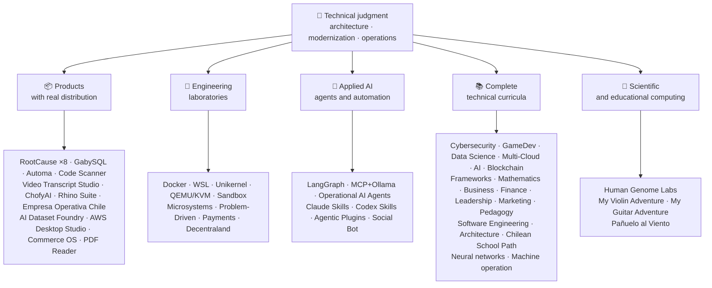

<div align="center">

# 👋Vladimir Acuña

## **Architekt rozwiązania·Senior Full- Stack·Transformacja cyfrowa·Zarządzanie i operacje**

**Profesjonalnie przeszkolony w informatyce i komputerach Inżynierii i Administracji Biznesu, z 16 + lat budowy i oprogramowania operacyjnego w rzeczywistych środowiskach. Łączę biznes, ludzi, procesy i technologię z projektowaniem, oceną, dostarczaniem i podtrzymywaniem rozwiązań z oceną techniczną i widokiem operacyjnym - poparte sprawdzalnymi dowodami na tym koncie GitHub.**

[](https://vladimiracunadev-create.github.io/)
[](https://www.linkedin.com/in/vladimir-acu%C3%B1a-valdebenito-11924a29/)
[](mailto:vladimir.acuna.dev@gmail.com)

[](#zakres-działalności)
[](#produkty-z-dystrybucją-rzeczywistą)
[](#kompletne-programy-nauczania-technicznego)

<!-- STATS:START -->
[](https://github.com/vladimiracunadev-create?tab=repositories)
[](https://github.com/vladimiracunadev-create?tab=repositories)
[](#ekosystem-w-odblasku)
[](#kompletne-programy-nauczania-technicznego)
[](https://github.com/vladimiracunadev-create?tab=repositories)
<!-- STATS:END -->

[](https://github.com/vladimiracunadev-create?tab=repositories)
[](https://github.com/vladimiracunadev-create?tab=followers)

[🌐 Portfolio (6 languages)](https://vladimiracunadev-create.github.io/) ·
[🧩 Ecosystem](#ekosystem-w-odblasku) ·
[⚡ Evaluate me in 10 minutes](#jeśli-masz-10-minut-na-ocenę-mnie) ·
[✅ Professional scope](#zakres-działalności) ·
[🧭 Non-coding management](#zarządzanie-administracja-i-niekodujące-szanse-na-karierę) ·
[📋 Role matrix](PROFESIONAL_ROLES.md) ·
[📬 Contact](#kontakt)

**🌐 Pełne wersje:** [Español](README.md) · [English](README.en.md) · [Português](README.pt.md) · [Italiano](README.it.md) · [Français](README.fr.md) · [简体中文](README.zh.md) · [繁體中文](README.zh-TW.md) · [日本語](README.ja.md) · [한국어](README.ko.md) · [Türkçe](README.tr.md) · [Русский](README.ru.md) · [Tiếng Việt](README.vi.md) · [ไทย](README.th.md) · [Deutsch](README.de.md) · [Українська](README.uk.md) · [Polski](README.pl.md) · [العربية](README.ar.md) · [فارسی](README.fa.md) · [Bahasa Indonesia](README.id.md) · [Nederlands](README.nl.md) · [हिन्दी](README.hi.md) · [Ελληνικά](README.el.md)

**Rdzeń techniczny:**
PHP 8 · Python · Rust · Go · Node/TS · Java 21 · .NET 8 · Dart/Flutter · WASM
· AWS · Terraform · Kubernetes · Docker · n8n · LangGraph/MCP · CI/CD · FinOps · Observability

**Most biznesowo-technologiczny:**
analiza procesu i wymogów·Ocena roztworu·koordynacja realizacji·operacje i ciągłość·zarządzanie ryzykiem·produkt i usługa·kształcenie techniczne

</div>

---

> [!NOTE]
> Profil ten nie zmienia możliwości w doświadczenie. Dowodzone doświadczenie techniczne, umiejętności do przenoszenia, wykonalne zastosowania oraz przyszłe cele rozwojowe są wyraźnie oddzielone. Powiązane dowody GitHub są wykonalne lub dokumentalne; gdzie coś jest**nie**wykończone, jest to określone jako takie.

## 🎯Co znajdziesz tutaj

Nie jest to "jeden repo": jest to ekosystem o wspólnych standardach.

- 🔁 **Odtwarzalne demo**- Klon, uciekaj, potwierdzaj.
- 🧰 **Znormalizowane oprzyrządowanie**- Makefiles, Hub CLI,`doctor`, oraz`smoke`w każdym repozytorium.
- 🛡️ **Obrona w głębi**- tajne skanowanie, polityka i wyraźnie zabronione praktyki.
- 📈 **Obserwacja** — `/health`, `/ready`, `/metrics`, deski rozdzielcze i identyfikowalność.
- 📚 **Dokumentacja dotycząca wiedzy o użytkownikach**- rekruter, początkujący, DevOps lub bezpieczeństwo, w zależności od repozytorium.
- 📦 **Dystrybucja produktów**- możliwość pobrania, sumy kontrolne i tworzenia dowodów; podpisy handlowe / sklepowe zadeklarowane jako oczekujące, w stosownych przypadkach.
- 🌍 **Internacjonalizacja**- portfolio w 6 językach (ES)·PL·PT·IT·FR·ZH).
- 🧭 **Szczerość techniczna**- każda sprawa oznaczona`OPERATIONAL`, `DOCUMENTED/SCAFFOLD`lub`PLANNED`.

## ✅Stan weryfikowalny

| Powierzchnia | Betonowe dowody |
|---|---|
| 🧪 **Zakres badania** | GabySQL**828 badań**+ rozmycie**503,8M zapytania**(0 paniki)·Empresa Operativa Chile**158 badań** ·Automa**150 pikseli** ·wieloOS CI |
| 🤖 **Czynniki klasy produkcyjnej** | LangGraph RealWorld**25 / 25 operacyjnych oparć**(sprawy 01- 25, 100%)·Operacyjne środki do zwalczania ptasiej grypy**13**z**39 determinalistycznych wymienników** |
| 🔗 **Integracja poliglotów** | **20 spraw**nadawca → n8n → odbiornik -**19 operacyjne**, indywidualnie skontrolowane z Docker -· **Silniki o mocy 18 + DB** · **20 + pojemniki** ·11 wzorów |
| 📦 **Dystrybucja** | **151 wydaleń**w całym ekosystemie**64 będące własnością repozytoriów publicznych** ·instalatorzy i artefakty`.exe` · `.msi` · `.dmg` · `.apk`z sumami kontrolnymi i dowodami na budowę; w stosownych przypadkach w toku podpisów handlowych / sklepowych |
| 🛡️ **Łańcuch dostaw** | CodeQL·Semgrep·Bandyta·Trivy·Typ·Gitleaks·TruffleHog Przewodniczący·CycloneDX SBOM·Wyniki |
| 📚 **Programy nauczania** | **14 530 klas**weryfikowalne w 21 programach, policzone przez[a workflow](.github/workflows/stats.yml)ze struktury repozytorium rzeczywistego lub źródła weryfikowalnego zadeklarowanego w repozytorium - nie napisane ręcznie -·Każdy program deklaruje swój status redakcyjny i ograniczenia |
| 🌐 **Portfolio** | Instalowalne PWA· **6 języków** · **36 PDF**generowane przez rurociąg·API danych CV·Capacitor Android·Latarnia morska 100 |
| 🔒 **Telemetria** | Zero telemetrii w wyrobach kryminalistycznych i Empresa Operativa Chile - zweryfikowane w każdej budowie (nie Android`INTERNET`(pozwolenie) |
| 🌐 **Published sites** | **56 GitHub Pages sites** —55 landings, one per product, program, or ecosystem navigator, plus the portfolio— each deployed from its own repository · all 56 verified with HTTP `200` |

## 🗺️Ekosystem w odblasku



## 📦Produkty z dystrybucją rzeczywistą

Oprogramowanie, które jest pobierane, instalowane i używane - nie tylko sklonowane.

| Produkt | Co to jest? | Stack | Dostawa |
|---|---|---|---|
| [🔍 **RootCause Windows**](https://github.com/vladimiracunadev-create/rootcause-windows-inspector) | Cyberbezpieczeństwa: każde anomalia może być pierwszym znakiem zagrożenia. Diagnos najpierw, interweniować później | Rdza🦀 ·ETW / WPR | **v0.19.0** · **16 uwolnień** · **5 edycji**: GUI·Przenośne·CLI·PowerShell·Kod VS· [landing](https://vladimiracunadev-create.github.io/rootcause-windows-inspector/) |
| [📱 **RootCause Mobile**](https://github.com/vladimiracunadev-create/rootcause-mobile-inspector) | Mobilne rodzeństwo: czujnik sądowy, który porównuje każdą aplikację do siebie, flagi stalkerware i oddziela przyznane uprawnienia od tylko tych, o które się zwrócono | Tłok·KotlinaCity in New Jersey USA·Swift | **v0.8.0** ·weryfikowalny Android APK·5 języków· **zero telemetrii** · [landing](https://vladimiracunadev-create.github.io/rootcause-mobile-inspector/) |
| [🍎 **RootCause macOS**](https://github.com/vladimiracunadev-create/rootcause-macos-inspector) | wydanie makos:`launchd`trwałość, Gatekeeper, SIP, FileVault, XProtect, TCC uprawnienia, podpisane procesy i sąsiedzi sieci - każda powierzchnia sprawdzona w stanie wiedzy | Rdza🦀 ·macOS 13 + | **v0.1.0** ·pierwsze opublikowane wydanie·Apache- 2, 0· [landing](https://vladimiracunadev-create.github.io/rootcause-macos-inspector/) |
| [🖥️ **RootCause Server**](https://github.com/vladimiracunadev-create/rootcause-server) | Sygnatura serwera: koreluje to, co żaden pojedynczy dziennik nie widzi razem - odsłonięta powierzchnia, pękanie prób dostępu, sesja przyznana temu samemu adresowi, krytyczna integralność plików i cisza czujnika - i zmienia ją w jedno zdalne zdanie | Rdza🦀 ·Okna·Linux·makos | **v0.2.0** · **18 zasad**z dowodami i księgą biegacza·nigdy nie wykonuje działań samodzielnie·konsola lokalna bez zależności od sieci· **nie opublikowano jeszcze wydania** · [landing](https://vladimiracunadev-create.github.io/rootcause-server/) |
| [🌐 **RootCause Web**](https://github.com/vladimiracunadev-create/rootcause-web-inspector) | Przeglądarka czujników: pliki cookie, sesje e-mail, rozszerzenia, pobieranie, uprawnienia i strony, które naśladują prawdziwe okno | JavaScript·Rozszerzenie MV3 | **v0.2.0** ·nie opublikowano jeszcze wydania·panel na`127.0.0.1` ·0 zależności·zero telemetrii zweryfikowane w CI· [landing](https://vladimiracunadev-create.github.io/rootcause-web-inspector/) |
| [₿ **RootCause Bitcoin Defense**](https://github.com/vladimiracunadev-create/rootcause-bitcoin-defense) | Tylko Watch obrony Bitcoin przechowywania: inwentaryzuje pochodzenie każdego klucza, krzyżuje go z opublikowanych ostrzeżeń i wyjaśnia przyczyny z dowodami | JavaScript·Aplikacja Windows·panel lokalny | **v0.3.0** · **2 wydania** ·0 zależności·nigdy nie prosi o nasiona·zweryfikowane w CI· [landing](https://vladimiracunadev-create.github.io/rootcause-bitcoin-defense/) |
| [⛓️ **RootCause Blockchain Security**](https://github.com/vladimiracunadev-create/rootcause-blockchain-security) | Konsola wielołańcuchowa - tylko: umowy na zapasy, proxy, wyrocznie, mosty, zarządzanie i zależności, i generuje książki startowe z przyczyn root- | JavaScript·Aplikacja Windows·panel lokalny | **v0.3.0**w repozytorium·opublikowane wydanie:`v0.1.0` ·0 zależności·nigdy nie prosi o prywatne klucze·zweryfikowane w CI· [landing](https://vladimiracunadev-create.github.io/rootcause-blockchain-security/) |
| [📷 **RootCause QR Inspector**](https://github.com/vladimiracunadev-create/rootcause-qr-inspector) | Lokalna aplikacja Android do sprawdzania kodów QR przed działaniem: wyjaśnia 26 sygnałów, oddziela fakty od hipotez, i eksport zredagowane dowody | Tłok·Dart | **v0.1.4** · **5 uwolnień** · **107 testów** ·opublikowany Android APK·weryfikowalny SHA- 256·podpisy techniczne pakietu APK; podpisów handlowych / sklepowych w toku·zero telemetrii· [landing](https://vladimiracunadev-create.github.io/rootcause-qr-inspector/) |
| [🏢 **Empresa Operativa Chile**](https://github.com/vladimiracunadev-create/empresa-operativa-chile) | Przewodnik SpA przed włączeniem do każdego miesięcznego zamknięcia: włączenie z dowodami, VAT carryforward, F29 projekt, niezmienne zamknięcia, i dziennik audytu. Każda zasada wskazuje na oficjalne źródło | JavaScript·Rdza·PWA | **v1.5.0** ·Android·Okna·przeglądarka· **158 badań** · **0 zależności produkcji** ·zero telemetrii· [landing](https://vladimiracunadev-create.github.io/empresa-operativa-chile/) |
| [🔍 **Universal Code Scanner**](https://github.com/vladimiracunadev-create/universal-code-scanner) | Czytnik QR i kodów kreskowych, że**interpretuje przed podjęciem działania**: 16 lokalnych sygnałów ryzyka URL i potwierdzenie | Tłok·Dart | **v1.1.0** ·Android·iOS·makos·PWA·Zaszyfrowana historia**AES- 256- GCM** · [landing](https://vladimiracunadev-create.github.io/universal-code-scanner/) |
| [🗄️ **GabySQL**](https://github.com/vladimiracunadev-create/gabysql) | Baza danych wbudowanych: pojedyncza`.db`plik, ENENCJA, optymalizator oparty na kosztach, HTTP / JSON API | Rdza🦀 | Okna·makos·Linux· [landing](https://vladimiracunadev-create.github.io/gabysql/) |
| [🤖 **Automa PC**](https://github.com/vladimiracunadev-create/automa-pc) | Lokalny orchestrator: JSON przepływa, które otwierają prawdziwe okna, interakcji z DOM, i zostawić dowody | Python·Playwright·pywebview | **v0.3.0** · **27 przepływów** ·publikowany i weryfikowalny instalator· [landing](https://vladimiracunadev-create.github.io/automa-pc/) |
| [🏭 **AI Dataset Foundry**](https://github.com/vladimiracunadev-create/ai-dataset-foundry) | Lokalna fabryka, która przekształca PDF, Word, web, Git, JSON i CSV w weryfikowalne zbiory danych do wstępnego szkolenia, dostrajania, RAG i oceny | Python | **v0.2.0** ·Windows + offline Android·pierwsze opublikowane wydanie· [landing](https://vladimiracunadev-create.github.io/ai-dataset-foundry/) |
| [☁️ **AWS Desktop Studio**](https://github.com/vladimiracunadev-create/aws-desktop-studio) | Local- first app z 15 AWS invent integrations, 20 tutorials, CLI / SSO, i tylko read- defaults; implementacja w toku, nie uniwersalny dostęp | JavaScript·Okna | **v0.1.1** ·pierwsze opublikowane wydanie· [landing](https://vladimiracunadev-create.github.io/aws-desktop-studio/) |
| [🧭 **Commerce OS**](https://github.com/vladimiracunadev-create/commerce-operating-system) | Demo koncepcyjne z przewodnikiem operacji handlowych: katalog, magazyn, CRM, zamówienia, makiety płatności i identyfikowalność | JavaScript·Web·Okna·Android | **v0.3.0** · **2 wydania** ·brak realnych pieniędzy lub chilijski organ podatkowy integracji· [landing](https://vladimiracunadev-create.github.io/commerce-operating-system/) |
| [📄 **PDF Reader**](https://github.com/vladimiracunadev-create/pdf-reader-windows-android) | Android- pierwszy lokalny czytnik tylko do odczytu, z nie- powiększeniem ziarna, ponownie włączyć historię, Udostępnianie WhatsApp i wybór default- readera | HTML·Web·Android·Okna | **v0.3.3** ·Podpisane APK·Brak kont, wrażliwe uprawnienia lub telemetria· [landing](https://vladimiracunadev-create.github.io/pdf-reader-windows-android/) |
| [🎙️ **Video Transcript Studio**](https://github.com/vladimiracunadev-create/video-transcript-studio) | Jeden film, lista odtwarzania, lub**cały kanał YouTube**do wysyłania wiadomości z znacznikami czasu. Nie polega na istniejących napisach: Whisper rozpoznaje dźwięk**na twojej maszynie**, bez API, konta lub klucza do konfiguracji | Python·PySide6·FastaPI·szept | **v0.2.0** ·Desktop systemu Windows + panel lokalny na`127.0.0.1`+ CLI,**dzielenie się tą samą kolejką** ·MD·PDF·TXT·SRT·VTT·JSON·MP3·OGG· **89 badań** ·w połączeniu z FFmpeg·zero telemetrii· [landing](https://vladimiracunadev-create.github.io/video-transcript-studio/) |
| [🎨 **ChofyAI Studio**](https://github.com/vladimiracunadev-create/chofyai-studio) | Lokalny twórczy wyrzutnia AI: organizuje Qwen3-TTS, whisper.cpp, FaceFusion, AceForge i ComfyUI | Tauri 2·Rdza·Reakcja | v0.5.1· **5 / 5 narzędzi z prawdziwym wnioskiem** ·Krzemionka do Apple·eksperymentalne okna· **nie opublikowano jeszcze wydania** · [site](https://vladimiracunadev-create.github.io/chofyai-studio/) |
| [🦏 **Rhino Suite**](https://github.com/vladimiracunadev-create/rhino-suite) | Apartament biurowy od podstaw: zasady dokumentu nie zależą od DOM - HTML jest tylko projekcją | Rdza / WASM·Idź.·Reakcja 19 | Monorepo ewolucyjne według faz· [landing](https://vladimiracunadev-create.github.io/rhino-suite/) |
| [🎻 **My Violin Adventure**](https://github.com/vladimiracunadev-create/violin-adventure) | Aplikacja edukacyjna dla dzieci: tuner chromatyczny, metronom precyzyjny audio- zegara, piosenki z prawdziwymi skrzypcami | Tauri 2·Reakcja·TS | **v1.3.0** ·Okna·Android·Linux·makos·PWA· [landing](https://vladimiracunadev-create.github.io/violin-adventure/) |
| [🎸 **My Guitar Adventure**](https://github.com/vladimiracunadev-create/guitarra-adventure) | Sygnatura strun plucked-: 24 lekcje w 6 światach, 6- tuner strun, bezdryfujący metronom i 11 prawdziwych nut gitarowych | Tauri 2·Reakcja·TS | **v1.0.0** ·Okna·Android·Linux·makos·iOS·PWA·brak kont, reklam lub zależności online· [landing](https://vladimiracunadev-create.github.io/guitarra-adventure/) |
| [🧣 **Pañuelo al Viento**](https://github.com/vladimiracunadev-create/panuelo-al-viento-cueca-app) | Cueca od 10 roku życia: 24 klasy w 8 poziomach, 72 aktywności, laboratorium 6-pulsacyjne (3 + 3 i 2 + 2 + 2), i dostępne schematy podłogi. Pisze, że**uzupełnia, nie zastępuje**, nauczycieli i nosicieli kultury | Tłok·Dart | **v0.2.0** ·Android 7 +·Windows 10 / 11·APK·EXE·MSI·przenośne· **29 testów + 2 walidatory** ·brak kamery, mikrofonu, konta, reklam lub internetu· [landing](https://vladimiracunadev-create.github.io/panuelo-al-viento-cueca-app/) |

## 🧪Laboratoria inżynieryjne

| Repo | To, co pokazuje |
|---|---|
| [🐳 **Problem-Driven Systems Lab**](https://github.com/vladimiracunadev-create/problem-driven-systems-lab) | **20 prawdziwych problemów**(opóźnienie pod obciążeniem, N + 1, powtórne burze, przecieki, monolity, stampede cache, ciśnienie wsteczne, migracja zerowa w czasie przestoju, zapomniane DLQ) z highfidelity wstrzyknięte niepowodzenia, rozwiązane w**7 stosów**: PHP 8·Python·Node.js·Java 21·.NET 8· **1, 23** · **Rdza 1,83** · [landing](https://vladimiracunadev-create.github.io/problem-driven-systems-lab/) |
| [📆 **Social Bot Scheduler**](https://github.com/vladimiracunadev-create/social-bot-scheduler) | **v4.10.0** · **20 spraw**źródło → n8n → odbiornik over**Silniki o mocy 18 + DB** —**19 operacyjne**, indywidualnie skontrolowane z Docker -**8-warstwa**audyt, poręcze idempotencji, wyłącznik obwodu i DLQ· [landing](https://vladimiracunadev-create.github.io/social-bot-scheduler/) |
| [🧰 **Microsistemas**](https://github.com/vladimiracunadev-create/microsistemas) | **12 mikroaplikacji diagnostycznych i modernizacyjnych**dla PHP·lokalny serwer MCP·twardzenie w 3 fazach· [landing](https://vladimiracunadev-create.github.io/microsistemas/) |
| [🧪 **Docker Labs**](https://github.com/vladimiracunadev-create/docker-labs) | **13 laboratoriów**na platformie 4-usługowej + zautomatyzowane`.exe`instalator z wyrzutnią· [landing](https://vladimiracunadev-create.github.io/docker-labs/) |
| [🐳 **WSL Labs**](https://github.com/vladimiracunadev-create/wsl-labs) | **12 spraw**dnia`wslc`, natywny silnik kontenerowy WSL -**bez pulpitu dokującego** · [landing](https://vladimiracunadev-create.github.io/wsl-labs/) |
| [⚡ **Unikernel Labs**](https://github.com/vladimiracunadev-create/unikernel-labs) | "Docker Desktop for unikernels": Sterowanie systemem Windows nad Unikraft z wtyczką WSL2,`kraft`+ QUGW / KVM· [landing](https://vladimiracunadev-create.github.io/unikernel-labs/) |
| [🧰 **QEMU/KVM Labs**](https://github.com/vladimiracunadev-create/qemu-kvm-labs) | **12 laboratoriów**prawdziwej wirtualizacji z QEMU, KVM, libvirt, cloud- init, i`vm-manager`na Linuksie i WSL2· [landing](https://vladimiracunadev-create.github.io/qemu-kvm-labs/) |
| [🛡️ **Sandbox Labs**](https://github.com/vladimiracunadev-create/sandbox-labs) | Izolacja Linuksa: działa kod trzeciej partii, pliki i modele biznesowe w ramach zadeklarowanych zasad i**emituje podpisane dowody, których kontrole faktycznie miały zastosowanie** · **36 spraw**w dwóch rodzinach - 15 rynków technicznych i 21 rynków kapitałowych -·deklarowane eksperymentalne i edukacyjne, * nie produkt bezpieczeństwa *· [landing](https://vladimiracunadev-create.github.io/sandbox-labs/) |
| [💳 **Universal Payments Engineering Lab**](https://github.com/vladimiracunadev-create/universal-payments-engineering-lab) | **28 rodzin płatniczych**w lokalnym demo samowyjaśniającym: stany, rejestr, pojednanie, bezpieczeństwo i wytyczne wdrażania· [landing](https://vladimiracunadev-create.github.io/universal-payments-engineering-lab/) |
| [🕹️ **Decentraland Social Arcade**](https://github.com/vladimiracunadev-create/decentraland-social-arcade) | Native Decentraland Social 3D doświadczenie: jeden MVP i architektura multigame z SDK7, ECS i TypeScript·Dokumentacja hiszpańska·brak płatności lub telemetrii |
| [☁️ **AWS Projects**](https://github.com/vladimiracunadev-create/proyectos-aws) | Postępowe przypadki, w których każdy z nich dodaje jedną usługę AWS**oraz**nowa zdolność GitHub Actions·SAA-C03·DVA- C02·W przypadku gdy w odniesieniu do danego środka pomocy nie ma zastosowania art. 107 ust. 1 TFUE, Komisja może podjąć decyzję o przyznaniu pomocy na rzecz państwa członkowskiego, w którym pomoc jest przyznawana. |

## 🤖Stosowana AI

| Repo | To, co pokazuje |
|---|---|
| [🤖 **LangGraph RealWorld**](https://github.com/vladimiracunadev-create/langgraph-realworld) | **25 / 25 operacyjnych oparć**- stan wpisany, warunkowe trasy, strumieniowanie NDJSON, tryb DEMO / LIVE, 8 warstw bezpieczeństwa, łańcuch nadzoru SHA- 256 |
| [🧭 **Operational AI Agents**](https://github.com/vladimiracunadev-create/operational-ai-agents) | **13 agentów operacyjnych**dla Claude Code i kompatybilnych runtimes: każda z nich otrzymuje pełną misję - ewolucję repozytorium, modernizację, projekt programu nauczania, publikację portfolio, rekultywację bezpieczeństwa, analizę incydentów - w ramach zadeklarowanej umowy, bram ludzkich i weryfikowalnych dowodów· **39 determinalistycznych wymienników** ·34 badania·zero- deps (tylko stdlib)·Linux·makos·Okna· [site](https://vladimiracunadev-create.github.io/operational-ai-agents/) |
| [🧠 **MCP + Ollama Local**](https://github.com/vladimiracunadev-create/mcp-ollama-local) | Lokalne AI z narzędziami MCP w piaskownicy· `127.0.0.1`bind·wielowarstwowy profil zaufania·uczciwie o jego granicach |
| [🧩 **Agentic Plugins Toolkit**](https://github.com/vladimiracunadev-create/agentic-plugins-toolkit) | **6 agonalnych wtyczek**instalowalny w Claude Code, OpenAI / Codex, Copilot, Gemini i MCP z jednego źródła:`repository-engineering`, `legacy-modernization`, `learning-program-studio`, `product-evolution`, `portfolio-governance`, oraz`rootcause-response` · **69 generowanych widoków bez dryfowania**- każdy czas trwania otrzymuje swój format z tej samej umowy -·zero- deps·Linux·makos·Okna· [site](https://vladimiracunadev-create.github.io/agentic-plugins-toolkit/) |
| [🧰 **Claude Skills Toolkit**](https://github.com/vladimiracunadev-create/claude-skills-toolkit) | **15 umiejętności agenicznych**dla kodu Claude 'a· **bezpieczeństwo**: 12- warstwa`security-audit`(OSV·KEV·EPSS·SAST·pojemnik·tajemnica) i 14- etap`bitcoin-custody-audit` · **bramki repo**: `pre-commit-guard`, `pre-push-guard`, `yaml-control`, `md-lint-fix`, `python-lint-guard` · **spójność**: `repo-coherence-audit`, `version-bump`, `python-version-control`, `python-deps-pinning` · **Docker**: `docker-cleanup`, `docker-compose-doctor` · **doki**: `md-to-doc` ·zero- deps·platforma krzyżowa |
| [🧰 **Codex Skills Toolkit**](https://github.com/vladimiracunadev-create/codex-skills-toolkit) | **19 umiejętności agetalnych**dla Kodeksu: łańcuch bezpieczeństwa i dostaw, przeloty, przepływy funkcjonalne, odporność i stan, dowody wydania, bramy Python / YAML / Markdown, wersje, zależności, Docker i dokumenty·Python- first· `pnpm` ·Linux·makos·Okna· [site](https://vladimiracunadev-create.github.io/codex-skills-toolkit/) |

## 📚Kompletne programy nauczania technicznego

Sekwencyjne programy w języku hiszpańskim, ze statusem i zakresem deklarowanym przez każde repozytorium. 21 programów dodaje się do**14 530 klas**, policzone[a workflow](.github/workflows/stats.yml)z rzeczywistej struktury repozytorium lub źródła weryfikowalnego zadeklarowanego w repozytorium; odznaka odświeża raz w tygodniu i nie jest zapisywana ręcznie.

🧭 [**Lifelong Learning Ecosystem**](https://github.com/vladimiracunadev-create/lifelong-learning-ecosystem)jest federacyjnym kompasem łączącym 30 prawdziwych ścieżek przez 6 obszarów poprzez mapy wizualne i[accessible offline portal](https://vladimiracunadev-create.github.io/lifelong-learning-ecosystem/); nie jest on liczony jako dodatkowy program.

| Program | Klasy | Zakres |
|---|---:|---|
| [🔢 **Computational Mathematics**](https://github.com/vladimiracunadev-create/computational-mathematics-program) | 360 | Od liczenia na palcach do reprodukcji papieru· **360 demonstracje deterministyczne zweryfikowane w CI** ·1,080 notesów·489- termin glosariusz· [site](https://vladimiracunadev-create.github.io/computational-mathematics-program/) |
| [🏦 **Finance and Banking**](https://github.com/vladimiracunadev-create/finance-and-banking-evolution-program) | 356 | 534 h·matematyka finansowa i MSSF → kredyty, ryzyko, Bazylea III, otwarte finanse, DLT, stablecoins, i MiCA· **27 spraw** · **298 testów** · [site](https://vladimiracunadev-create.github.io/finance-and-banking-evolution-program/) |
| [🎮 **GameDev**](https://github.com/vladimiracunadev-create/modern-gamedev-program) | 352 | Matematyka i C # / C + + / GDSscript → cieniarki, AI, multiplayer, VR / AR·GodotCity in Ontario Canada·Jedność·Nierealne· **10 laboratoriów Godota zweryfikowanych w CI**(301 kontroli)· [site](https://vladimiracunadev-create.github.io/modern-gamedev-program/) |
| [🛡️ **Cybersecurity**](https://github.com/vladimiracunadev-create/modern-cybersecurity-program) | 360 | **v1.3.0** ·20 części·fundacje → Red Team, DFIR, bezpieczeństwo w chmurze, wykorzystać dev, CTF, i bezpieczeństwa gry·mapined to**7 certyfikatów** ·offline Android / aplikacja web·Podręcznik PDF·CI, Bezpieczeństwo i Strony zweryfikowane· [site](https://vladimiracunadev-create.github.io/modern-cybersecurity-program/) |
| [📈 **Marketing, Sales, and Growth**](https://github.com/vladimiracunadev-create/marketing-sales-growth-evolution-program) | 336 | 24 części z definicjami operacyjnymi, arkuszami pomiarowymi, weryfikowalną bibliografią oraz chilijskim kontekstem regulacyjnym· **v1.6.0** ·1. 29M słowa·17 ścieżek role-· [site](https://vladimiracunadev-create.github.io/marketing-sales-growth-evolution-program/) |
| [🏢 **Business Creation**](https://github.com/vladimiracunadev-create/modern-business-creation-program) | 336 | Tworzenie i prowadzenie prawdziwej firmy w Chile: od idei do włączenia, organu podatkowego, operacji, kryzysu i wyjścia·360 schematów·Glosariusz o terminie 1,251@@·Podręcznik na stronie 1,548- stronicaName· [site](https://vladimiracunadev-create.github.io/modern-business-creation-program/) |
| [🏛️ **Architecture and Built Environment**](https://github.com/vladimiracunadev-create/architecture-built-environment-learning-program) | 830 | 83 części·60 sesji integracyjnych·34 ścieżki·źródła identyfikowalne·Markdown, czytnik offline i strony GitHub· [site](https://vladimiracunadev-create.github.io/architecture-built-environment-learning-program/) |
| [🇨🇱 **Chilean School Learning Path**](https://github.com/vladimiracunadev-create/chilean-school-learning-path) | 8,841 | Stopnie 1- 12· **4.156 zintegrowane doświadczenia międzyprogramowe** · **2,823 Cele edukacyjne** ·Źródła MINEDUC·brak oczekujących propozycji i specjalistyczny przegląd człowieka nadal w toku· [site](https://vladimiracunadev-create.github.io/chilean-school-learning-path/) |
| [🧭 **Modern Software Engineering**](https://github.com/vladimiracunadev-create/modern-software-engineering-program) | 480 | 40 części i 8 etapów·fundacje → produkty, architektura, bezpieczeństwo, DevOps, SRE, SPEC, AI i systemy wieloagencyjne·status redakcyjny zadeklarowany przez repozytorium· [site](https://vladimiracunadev-create.github.io/modern-software-engineering-program/) |
| [🎓 **Pedagogy and Learning Sciences**](https://github.com/vladimiracunadev-create/education-pedagogy-learning-sciences-program) | 300 | Od tego, jak człowiek uczy się, jak nauczyciele są szkoleni·25 części· **każda klasa deklaruje stan i granice dowodów** ·wczesna umiejętność czytania i pisania, metody porównawcze, szczególne potrzeby edukacyjne, współistnienie, różnorodność kulturowa i dowody międzynarodowe·Słownik 1097- term, 325 diagramów i 60-aktywny bank klasy·14 ścieżek kariery według ról·LMS- exportable· **v2.1.0** · [site](https://vladimiracunadev-create.github.io/education-pedagogy-learning-sciences-program/) |
| [☁️ **Multi-Cloud**](https://github.com/vladimiracunadev-create/multi-cloud-engineering-program) | 288 | AWS·Azure·GCP·Kubernety·Terraform·SRE·Finansowe· **1 288 godzin** ·288 laboratoriów z dowodami JSON·1,032 źródła śledzone·2,884- strona PDF instrukcja· [site](https://vladimiracunadev-create.github.io/multi-cloud-engineering-program/) |
| [🎖️ **Executive Leadership**](https://github.com/vladimiracunadev-create/executive-leadership-founder-program) | 288 | Od posiadania pierwszego wyniku do prowadzenia firmy i zakładania własnych: zespołów, KPI / OKR, finansów, produktów, ryzyka, zarządu i M & A·24 przypadki, 96 laboratoriów i 39 szablonów· [site](https://vladimiracunadev-create.github.io/executive-leadership-founder-program/) |
| [🐍 **Python Data Science**](https://github.com/vladimiracunadev-create/python-data-science-program) | 232 | Polary, ML + Optuna / SHAP, PyTorch / LLMs / LRA, MLOps·natywna aplikacja Windows + Android APK· [site](https://vladimiracunadev-create.github.io/python-data-science-program/) |
| [🧠 **AI Evolution**](https://github.com/vladimiracunadev-create/artificial-intelligence-evolution-program) | 184 | Symboliczne → probabilistic → głębokie uczenie → LLM, RAG, agentów, bezpieczeństwa i granic· **v0.17.0** · **708 notebooków** · **148 dokumentów założycielskich** ·offline aplikacje Windows, Android i PWA· [site](https://vladimiracunadev-create.github.io/artificial-intelligence-evolution-program/) |
| [🌐 **Comparative Programming**](https://github.com/vladimiracunadev-create/polyglot-programming-labs) | 176 | Jedna koncepcja,**10 języków**zweryfikowane w CI -**1,360 implementacje**- plus**1,632 programów**w językach żyjący w stanie spoczynku (COBOL, Fortran, Ada, RPG, MUMPS...) i atlas**60 kart w 15 rodzinach** ·v1.1.0· [site](https://vladimiracunadev-create.github.io/polyglot-programming-labs/) |
| [🧩 **Frameworks Compared**](https://github.com/vladimiracunadev-create/framework-ecosystems-labs) | 149 | Jeden kontrakt wykonywalny, bez adapterów, przeciwko Express, FastaPI, Spring Boot, ASP.NET, Django, Rails, Laravel, React, Vue, Svelte i więcej·12 części· **70 klas zbudowanych** · **397 spraw zweryfikowanych w CI** · **210 ISBN / DOI sources** · [site](https://vladimiracunadev-create.github.io/framework-ecosystems-labs/) |
| [🗄️ **Databases**](https://github.com/vladimiracunadev-create/database-systems-labs) | 74 | **v3.0.0** ·inżynieria bazy danych w 15 częściach·230 godzin· **weryfikowalne źródło dla każdego roszczenia**: 120 źródeł z ISBN, DOI, lub standard·ta sama sprawa rozwiązana w 27 silnikach·Słownik 306- termin·150 pikseli· [site](https://vladimiracunadev-create.github.io/database-systems-labs/) |
| [📐 **Psychometrics and Assessment**](https://github.com/vladimiracunadev-create/psychometrics-and-assessment-program) | 40 | W jaki sposób instrument pomiarowy jest budowany, oceniany, zatwierdzany i poddawany audytowi·8 części·z silnikiem wykonywalnym**5 instrumentów i 344 pozycji, 276 domen publicznych** |
| [⛓️ **Blockchain**](https://github.com/vladimiracunadev-create/blockchain-learning-path) | 66 | **v0.14.0** ·od 0 do programowalnej infrastruktury finansowej i analizy na łańcuchu· **91 praktyk**oraz**363 badania** ·kontrakty z Foundry (fuzing i niezmienni) i Slither static analysis in CI·aplikacje offline zweryfikowane przez otwarcie binarnego i liczenie jego zawartości· [site](https://vladimiracunadev-create.github.io/blockchain-learning-path/) |
| [🧠 **Neural Network Training Labs**](https://github.com/vladimiracunadev-create/neural-network-training-labs) | 31 | 7 modułów·214 godzin· **93 notebooki**- 31 klas, 31 wersji studenckich i 31 rozwiązań -·pytania, mapy wizualne, praktyki i ocena z prawdziwymi danymi publicznymi·PyTorchCity in Germany· [study site](https://vladimiracunadev-create.github.io/neural-network-training-labs/) |
| [🕹️ **Machine Operator**](https://github.com/vladimiracunadev-create/machine-operator-program) | 451 | **41 modułów szkoleniowych**, jeden na maszynę· **502 h 15 min** ·systemy, sterowanie, fizyka, bezpieczeństwo i projektowanie symulacji ze źródłami na klasę·* nie ma jeszcze symulatora wykonywalnego, i jest to zadeklarowane w ten sposób * |

## 🔬Konstrukcja naukowa

| Repo | To, co pokazuje |
|---|---|
| [🧬 **Human Genome Labs**](https://github.com/vladimiracunadev-create/human-genome-labs) | Platforma genomiki powtarzalnej: wpisywana`ScientificResult<T>`kontrakty, FASTA / GFF3 / VCF, moduły**jednoznaczny termin zapadalności i dowody**. Radykalna uczciwość: * nie wykonuje diagnozy klinicznej *· [site](https://vladimiracunadev-create.github.io/human-genome-labs/) |

## ⚡Jeśli masz 10 minut na ocenę mnie

Idea nie polega tylko na patrzeniu na kod: to jest zobaczyć**Jak myślę**Jak dokumentuję i jak wszystko wykonywalne.

**Trasa A - Realna obserwacja i orchestracja*** (my favorite) *

```bash
git clone https://github.com/vladimiracunadev-create/social-bot-scheduler.git
```

Zobaczysz przepływ pracy, pomiary, deski rozdzielcze i poręcze w 19 przypadkach i 18 + silniki DB.

**Trasa B - Infrastruktura powtarzalna w minutach**

```bash
git clone https://github.com/vladimiracunadev-create/docker-labs.git
```

**Trasa C - Agenci z wpisanym stanem**

```bash
git clone https://github.com/vladimiracunadev-create/langgraph-realworld.git
```

**Trasa D - Produkt sądowy z rdzy, bez klonowania**

Pobierz instalator lub CLI binarne z[RootCause releases](https://github.com/vladimiracunadev-create/rootcause-windows-inspector/releases)i zweryfikować`SHA256SUMS`.

## 🧠Normy I stosowane w różnych repozytoriach

- **DX pierwszy**- jeśli nie jest to łatwe do uruchomienia, nie jest to przydatne jako demo lub jako baza zespołowa.
- **Obserwacja od pierwszego dnia**- dane pomiarowe i identyfikowalność, nie są to informacje po przemyśleniu.
- **Bezpieczeństwo rurociągu**- tajne skanowanie, SBOM za zwolnienie, wyraźnie zabronione praktyki.
- **Realna odporność**- idempotencja, przerywacz obwodów i kontrolowana degradacja.
- **Poliglot według projektu**- język i silnik wybrany przez przypadek użycia, nigdy przez modę.
- **Szczerość o statusie**- zmieniono nazwę jednego repo (`Multisimulador` → `machine-operator-program`) aby uniknąć obiecującego oprogramowania, które jeszcze nie istnieje.
- **Odznaki to sygnały, nie dowody.**- każdy repo deklaruje również**co nie robi NIE robi**.
- **Wzór na zewnątrz**- domenę zaprojektowano najpierw; interfejs jest projekcją.
- **Praca zewnętrzna jest deklarowana jako zewnętrzna**- 70 publicznych repozytoriów, 64 to moja praca. Pozostałe sześć...[`agentic-qe`](https://github.com/vladimiracunadev-create/agentic-qe), [`Anthropic-Cybersecurity-Skills`](https://github.com/vladimiracunadev-create/Anthropic-Cybersecurity-Skills), [`erpnext`](https://github.com/vladimiracunadev-create/erpnext), [`OpenExecutive`](https://github.com/vladimiracunadev-create/OpenExecutive), [`raptor`](https://github.com/vladimiracunadev-create/raptor), oraz[`security-audit-skill`](https://github.com/vladimiracunadev-create/security-audit-skill)- są widelcami i są wykluczone ze wszystkich liczb dla mojej pracy.

## ✅Zakres działalności

Moje podwójne tło...**Informatyka i informatyka + Administracja Biznesu**- pomaga mi przełożyć cele biznesowe na decyzje techniczne i ograniczenia techniczne na jasne opcje dla operacji, produktów, klientów i przywództwa.

### 🎯Tożsamość podstawowa

| Rola | Backing |
|---|---|
| **Architekt rozwiązania** | Modułowa, skalowalna konstrukcja systemu z oceną ewolucyjną |
| **Architekt modernizacji dziedzictwa** | Prawdziwa ewolucja spuścizny (PHP 5.x → 8.x, przyrostowe przeróbki bez przerywania operacji) |
| **Senior Full- Stack / Tech Lead** | Architektura, wykonanie i standardy na platformach rzeczywistych (+ 16 lat) |
| **Architekt automatyzacji AI** | Systemy agentalne z LangGraph / MCP i n8n przepływają z poręczami |

### ↗ Naturalne rozszerzenie

**Inżynier orkiestracji AI** · **Systemy / Inżynier Rust** · **Inżynier mobilny (Flutter)** · **Inżynier rozwiązań** · **Techniczny budowniczy produktów** · **Trener techniczny** · **Cyfrowy konsultant transformacji** · **Business / Functional Analyst** · **Operacje techniczne dotyczące produktu**

### ⚙️Zakres uzupełniający

Inżynier platformy / IDP·Devops / CI- CD·Inżynier chmur / AWS·Program SRE·Inżynier automatyki·Konsultant handlowy

## 🧭Zarządzanie, Administracja i niekodujące szanse na karierę

Zakres ten nie stanowi, że każdy tytuł został zachowany. Priorytetem jest praca, w której połączenie komputerów, administracji przedsiębiorstw i dowodów publicznych może tworzyć wartość bez kodowania jako podstawowego obowiązku.

| Rodzina zawodowa | Uznane role | Uczciwa klasyfikacja | Kodowanie | Dowody i stan |
|---|---|---|---|---|
| **Liderem technologicznym** | Szef IT·Kierownik ds. operacji IT·Kierownik transformacji cyfrowej·CIO | **Potencjał zastosowania / cel na przyszłość** | Brak / sporadycznie | Silne podstawy techniczne; ludzie, budżet, sprzedawca i odpowiedzialność wykonawczą muszą być udowodnione oddzielnie |
| **Zarządzanie projektami** | Koordynator projektu IT / menedżer·PMO·Mistrz Scrum·Dostawa zwinnych | **Potencjał nadający się do przenoszenia / zastosowania** | Brak / sporadycznie | Dowody dostawy i wydania; formalny zespół, budżet i odpowiedzialność sponsora pozostaje luką |
| **Administracja biznesowa** | Administrator biznesu·Administracja / Kierownik Operacyjny·Administrator umowy | **Potencjalny potencjał zastosowania** | Brak | Stopień działalności i artefakty operacyjne; wymaga zweryfikowanej własności zasobów, ludzi i dostawców |
| **Strategia i zmiany** | Konsultant Strategii·Zmień menedżera·Planowanie korporacyjne·Innowacje / transformacja | **Potencjał nadający się do przenoszenia / zastosowania** | Brak | Modernizacja i ocena rozwiązań w zakresie legacji; należy wykazać wyniki organizacyjne adopcji |
| **Analiza biznesowa** | Analityk biznesu·Analityk funkcjonalny / wymagania·BPM·Ciągłe doskonalenie | **Potencjał nadający się do przenoszenia / zastosowania** | Brak / sporadycznie | Modeling domeny i wymogi dowody; zewnętrzne sprawy zainteresowanych stron wzmocniłyby wniosek |
| **Produkt i usługi** | Właściciel produktu / menedżer·Operacje produktu·Dostawa usług·Sukces klienta | **Potencjał nadający się do przenoszenia / zastosowania** | Brak / sporadycznie | Mapy drogowe, cykl życia, wydania i operacje; P & L, portfolio klientów i dowody SLA różnią się w zależności od roli |
| **Zarządzanie bezpieczeństwem cybernetycznym** | GRC·Audytor kontroli IT·Ryzyko technologiczne·Bezpieczeństwo informacji / Ciągłość | **Potencjalny potencjał zastosowania** | Brak / sporadycznie | Kontrole i dowody RootCause; audyty organizacyjne i odpowiednie kwalifikacje są w toku |
| **Sprzedaż i sprzedaż** | Pregales Technology·Konsultant ds. rozwiązań·KAM techniczny·B2B Rozwój działalności gospodarczej | **Potencjał nadający się do przenoszenia / zastosowania** | Brak | Silny sposób przetłumaczenia / wartość; kwoty, portfolio rachunków i negocjacje umowne nie są zgłaszane |
| **Kontrola finansów i zarządzania** | Budżet / Analityk kosztów·Ocena projektu·FP & A·Kontrola zarządzania | **Potencjalny potencjał zastosowania** | Brak | Artefakty finansowe / finansowe; potrzebne są prawdziwe budżety, sprawozdania finansowe i korporacyjne KPI |
| **Jakość** | Proces / Analizator jakości·Audytor procesu·Ciągłe doskonalenie | **Potencjał nadający się do przenoszenia / zastosowania** | Brak / sporadycznie | Bramy, testy, wskaźniki i odtwarzalność; posiadanie formalnego systemu jakości pozostaje luką |
| **Edukacja** | Trener techniczny·Ułatwiacz·Koordynator akademicki·EdTech / Projektant Instrukcji | **Potencjał nadający się do przenoszenia / zastosowania** | Brak / sporadycznie | 21 programów i 14,530 klas; oficjalne wyniki nauczania i uczenia się muszą być udokumentowane oddzielnie |
| **Logistyka i dostawcy** | Zamówienia publiczne·Koordynator ds. dostaw / operacji·Kierownik / zleceniodawca | **Potencjalny potencjał zastosowania** | Brak | Podstawy procesu i administracji; potrzebne są rzeczywiste zamówienia, inwentaryzacja i wydajność dostawcy |
| **Zarządzanie danymi i ptasimi zwierzętami i ptasimi zwierzętami** | Data Steward·Zarządzanie danymi·Przyjęcie / zarządzanie PWI | **Potencjał nadający się do przenoszenia / zastosowania** | Brak / sporadycznie | Zestawy danych audytowych i agenci zajmujący się ochroną przed ludźmi; polityka organizacyjna i komitety nadal pozostają luką |
| **Sektor publiczny** | Modernizacja instytucjonalna·Koordynator TIK·Projekty cyfrowe·Planowanie publiczne | **Potencjalny potencjał zastosowania** | Brak | Systemy kontekstowe i identyfikowalność; nie wnioskuje się o zamówienia publiczne i doświadczenie sektorowe |

W[full Spanish role matrix](PROFESIONAL_ROLES.md)szczegółowe cele, obowiązki, doświadczenie rynkowe, uzupełniająca wiedza, dowody, zgodność i luki we wszystkich 14 rodzinach.

## 🤖Proces rozwoju wspomagany przez AI

| Narzędzie | Główne zastosowanie |
|---|---|
| **Kod Claude 'a** | Przegląd architektoniczny, wdrożenie i dokumentacja techniczna |
| **ChatGPT Plus** | analiza, architektura i iteracja (od 2023) |
| **Kodeks** | Wytwarzanie i refakturowanie kodów |
| **Przeciwgrawitacyjne** | Przyspieszenie rozwoju i automatyzacji przepływu |
| **Kod VS / OpenCode** | Środowisko ze zintegrowaną pomocą w zakresie ptasiej grypy |

> Łączę mój własny osąd techniczny, ludzkie potwierdzenie i kierunek architektoniczny. AI wzmacnia pojemność, szybkość i zasięg - nie zastępuje doświadczenia.

## 📌Dostępność

**Otwórz na:**Senior Full- Stack·Architektura·Modernizacja dziedzictwa·Platforma / IDP·Program SRE·devops pragmatic·Automatyzacja·Automatyzacja AI·analiza biznesowa / funkcjonalna·Koordynacja projektów informatycznych·Operacje produktu·transformacja cyfrowa·rozwiązania konsultingowe / presales·kształcenie techniczne·jakość i ciągłe doskonalenie·Przyjęcie i zarządzanie ptasią grypą

**Oceniany w zależności od zakresu każdej roli:**Właściciel produktu / techniczny menedżer produktu·Dostawa usług·Operacje informatyczne·Ryzyko związane z technologią·administracja i operacje·kontrola zarządzania·modernizacja sektora publicznego. Tytuły wykonawcze i ogólne zarządzania są przyszłymi celami rozwoju, a nie deklarowane doświadczenie.

**Moduł:**zdalne lub hybrydowe, w zależności od projektu.

## 📬Kontakt

[](https://vladimiracunadev-create.github.io/)
[](https://www.linkedin.com/in/vladimir-acu%C3%B1a-valdebenito-11924a29/)
[](https://gitlab.com/vladimir.acuna.dev-group/vladimir.acuna.dev-group)
[](mailto:vladimir.acuna.dev@gmail.com)

---

<div align="center">

[🤝 Contribute](CONTRIBUTING.en.md) ·
[🛡️ Security](SECURITY.en.md) ·
[⚖️ Code of Conduct](CODE_OF_CONDUCT.en.md)

<sub>README zsynchronizowany z weryfikowalnym stanem repozytoriów publicznych - dane liczbowe i zmiany odczytywane za pośrednictwem API -·ostatnia weryfikacja: 12 października 2026 r.</sub>

</div>
