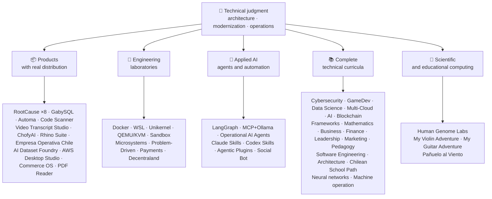

<div align="center">

# 👋Владимир Акунья

## **Архитектор решений·Старший Full-Stack·Цифровая трансформация·Управление и операции**

**Профессионально обучен в области компьютерных наук и вычислительной техники и делового администрирования, с 16+ лет создания и эксплуатации программного обеспечения в реальных средах. Я связываю бизнес, людей, процессы и технологии для разработки, оценки, предоставления и поддержки решений с техническим суждением и оперативным взглядом, подкрепленным проверяемыми доказательствами в этой учетной записи GitHub.**

[](https://vladimiracunadev-create.github.io/)
[](https://www.linkedin.com/in/vladimir-acu%C3%B1a-valdebenito-11924a29/)
[](mailto:vladimir.acuna.dev@gmail.com)

[](#профессиональный-уровень)
[](#продукты-с-реальным-распределением)
[](#полная-техническая-программа)

<!-- STATS:START -->
[](https://github.com/vladimiracunadev-create?tab=repositories)
[](https://github.com/vladimiracunadev-create?tab=repositories)
[](#экосистема-с-первого-взгляда)
[](#полная-техническая-программа)
[](https://github.com/vladimiracunadev-create?tab=repositories)
<!-- STATS:END -->

[](https://github.com/vladimiracunadev-create?tab=repositories)
[](https://github.com/vladimiracunadev-create?tab=followers)

[🌐 Portfolio (6 languages)](https://vladimiracunadev-create.github.io/) ·
[🧩 Ecosystem](#экосистема-с-первого-взгляда) ·
[⚡ Evaluate me in 10 minutes](#если-у-вас-есть-10-минут-чтобы-оценить-меня) ·
[✅ Professional scope](#профессиональный-уровень) ·
[🧭 Non-coding management](#управление-администрирование-и-некодирование-карьерных-возможностей) ·
[📋 Role matrix](PROFESIONAL_ROLES.md) ·
[📬 Contact](#контакт)

**🌐 Полные версии:** [Español](README.md) · [English](README.en.md) · [Português](README.pt.md) · [Italiano](README.it.md) · [Français](README.fr.md) · [简体中文](README.zh.md) · [繁體中文](README.zh-TW.md) · [日本語](README.ja.md) · [한국어](README.ko.md) · [Türkçe](README.tr.md) · [Русский](README.ru.md) · [Tiếng Việt](README.vi.md) · [ไทย](README.th.md) · [Deutsch](README.de.md) · [Українська](README.uk.md) · [Polski](README.pl.md) · [العربية](README.ar.md) · [فارسی](README.fa.md) · [Bahasa Indonesia](README.id.md) · [Nederlands](README.nl.md) · [हिन्दी](README.hi.md) · [Ελληνικά](README.el.md)

**Техническое ядро:**
PHP 8 · Python · Rust · Go · Node/TS · Java 21 · .NET 8 · Dart/Flutter · WASM
· AWS · Terraform · Kubernetes · Docker · n8n · LangGraph/MCP · CI/CD · FinOps · Observability

**Мост бизнес-технологий:**
Процесс и анализ требований·Оценка решений·координация поставок·операций и преемственности·Управление рисками·продукт и услуга·техническое образование

</div>

---

> [!NOTE]
> Этот профиль не превращает возможности в опыт. Доказанный технический опыт, передаваемые навыки, жизнеспособные приложения и будущие цели развития четко разделены. Связанные доказательства GitHub являются исполняемыми или документальными; где что-то может быть использовано.**не**закончено, говорится как таковое.

## 🎯Что вы найдете здесь

Это не «одно РЕПО»: это экосистема с общими стандартами.

- 🔁 **Воспроизводимые демо**- клонировать, бегать, проверять.
- 🧰 **Стандартизированный инструментарий**- Макефилы, Хаб КЛИ,`doctor`и`smoke`на репозиторий.
- 🛡️ **Оборона в глубину**- секретное сканирование, политика и явно запрещенные практики.
- 📈 **наблюдаемость** — `/health`, `/ready`, `/metrics`, приборные панели и прослеживаемость.
- 📚 **Документация, учитывающая аудиторию**— рекрутер, новичок, DevOps или безопасность, в зависимости от хранилища.
- 📦 **Распределение продукции**- загружаемые релизы, контрольные суммы и сбор доказательств; коммерческие / магазинные подписи объявлены незавершенными, когда это применимо.
- 🌍 **Интернационализация**Портфолио на 6 языках (ES)·EN·ПТ·Это·FR·ЗХ).
- 🧭 **Техническая честность**Каждый случай помечен`OPERATIONAL`, `DOCUMENTED/SCAFFOLD`или`PLANNED`.

## ✅Проверяемый статус

| поверхность | Конкретные доказательства |
|---|---|
| 🧪 **Покрытие за счет испытаний** | ГабискВиЛ**828 тестов**+ Поверх**503.8M запросы**(0 паников)·Empresa Operativa Чили**158 тестов** ·автоматика**150 пиастров** ·Multi-OS CI |
| 🤖 **Агенты производственного класса** | Обсуждение RealWorld**25/25 операционные бэкэнды**(случаи 01-25, 100% охват)·Операционные агенты AI**13 Агенты**с**39 детерминированных эвалов** |
| 🔗 **Интеграция Polyglot** | **20 случаев**Для отправителя →n8n → получателя —**19 Операционная**Проверка с помощью Docker —· **18+ ДБ мотор** · **20+ контейнеров** ·11 шаблонов |
| 📦 **Распределение** | **151 выпуск**В рамках экосистемы**64 публичных хранилища** ·установщики и артефакты`.exe` · `.msi` · `.dmg` · `.apk`с контрольными суммами и сбором доказательств; коммерческие / магазинные подписи в процессе, где это применимо |
| 🛡️ **Сеть поставок** | Код QL·Семгреп·бандит·Тривиус·Грип·Гитлак·Трюффлехог·CycloneDX SBOM·Счет |
| 📚 **Учебные планы** | **14 530 классов**Проверяется по 21 программе, подсчитанной[a workflow](.github/workflows/stats.yml)от реальной структуры хранилища или проверяемого источника, объявленного в хранилище, не написанного от руки,·Каждая программа заявляет о своем редакционном статусе и ограничениях. |
| 🌐 **Портфолио** | Установка PWA· **6 языков** · **36 PDF-файлов**Создан трубопроводом·API данных CV·Конденсатор Android·Маяк 100 |
| 🔒 **телеметрия** | Нулевая телеметрия в судебных продуктах и Empresa Operativa Chile — проверена на каждой сборке (без Android)`INTERNET`разрешение |
| 🌐 **Опубликованные сайты** | **56 страниц GitHub**55 посадок, по одной на продукт, программу или навигатор экосистемы, плюс портфель — каждая развернута из собственного хранилища·Все 56 проверены HTTP`200` |

## 🗺️Экосистема с первого взгляда



## 📦Продукты с реальным распределением

Программное обеспечение, которое загружается, устанавливается и используется, не только клонируется.

| Продукт | Что это такое | стек | Доставка |
|---|---|---|---|
| [🔍 **RootCause Windows**](https://github.com/vladimiracunadev-create/rootcause-windows-inspector) | Кибер-криминалистика: каждое аномальное искажение ресурсов может быть первым признаком угрозы. Сначала диагностировать, потом вмешаться. | Ржавчина🦀 ·ETW/WPR | **v0.19.0** · **16 выпусков** · **5 изданий**: ГУИ·портативный·КЛИ·PowerShell·VS код· [landing](https://vladimiracunadev-create.github.io/rootcause-windows-inspector/) |
| [📱 **RootCause Mobile**](https://github.com/vladimiracunadev-create/rootcause-mobile-inspector) | Мобильный брат: судебный датчик, который сравнивает каждое приложение с самим собой, флаги stalkerware и отделяет предоставленные разрешения от просто запрошенных. | флаттер·Котлин·Свифт | **v0.8.0** ·Проверяемый Android APK·5 языков· **нулевая телеметрия** · [landing](https://vladimiracunadev-create.github.io/rootcause-mobile-inspector/) |
| [🍎 **RootCause macOS**](https://github.com/vladimiracunadev-create/rootcause-macos-inspector) | Издание macOS:`launchd`настойчивость, Gatekeeper, SIP, FileVault, XProtect, разрешения TCC, подписанные процессы и соседи по сети — каждая поверхность проверена на соответствие известному хорошему состоянию | Ржавчина🦀 ·macOS 13+ | **v0.1.0** ·Первый опубликованный выпуск·Apache-2.0· [landing](https://vladimiracunadev-create.github.io/rootcause-macos-inspector/) |
| [🖥️ **RootCause Server**](https://github.com/vladimiracunadev-create/rootcause-server) | Серверный брат: соотносит то, что не видит ни один журнал, — открытую поверхность, всплески попытки доступа, сеанс, предоставленный тому же адресу, критическую целостность файла и тишину датчика — и превращает его в одно действующее предложение | Ржавчина🦀 ·Windows·Linux·Мако | **v0.2.0** · **18 Правила**С доказательствами и руничной книгой·Никогда не совершайте действий самостоятельно·локальная консоль без веб-зависимостей· **Пока не опубликовано ни одного** · [landing](https://vladimiracunadev-create.github.io/rootcause-server/) |
| [🌐 **RootCause Web**](https://github.com/vladimiracunadev-create/rootcause-web-inspector) | Браузерный криминалистический датчик: файлы cookie, сеансы электронной почты, расширения, загрузки, разрешения и страницы, имитирующие реальное окно | JavaScript·Расширение MV3 | **v0.2.0** ·Пока не опубликовано ни одного·панель`127.0.0.1` ·нулевая зависимость·нулевая телеметрия, проверенная в CI· [landing](https://vladimiracunadev-create.github.io/rootcause-web-inspector/) |
| [₿ **RootCause Bitcoin Defense**](https://github.com/vladimiracunadev-create/rootcause-bitcoin-defense) | Защита только от наблюдения за хранением биткойнов: инвентаризация происхождения каждого ключа, перекрестная проверка с опубликованными предупреждениями и объяснение первопричины с доказательствами | JavaScript·Приложение Windows·Местная панель | **v0.3.0** · **2 релиза** ·нулевая зависимость·Никогда не просите семена·Проверено в CI· [landing](https://vladimiracunadev-create.github.io/rootcause-bitcoin-defense/) |
| [⛓️ **RootCause Blockchain Security**](https://github.com/vladimiracunadev-create/rootcause-blockchain-security) | Многоцепочечная консоль только для часов: контракты на запасы, прокси, оракулы, мосты, управление и зависимости и генерирует рутинные книги | JavaScript·Приложение Windows·Местная панель | **v0.3.0**в репозитории·опубликованный релиз:`v0.1.0` ·нулевая зависимость·Никогда не просите приватные ключи·Проверено в CI· [landing](https://vladimiracunadev-create.github.io/rootcause-blockchain-security/) |
| [📷 **RootCause QR Inspector**](https://github.com/vladimiracunadev-create/rootcause-qr-inspector) | Местное приложение для Android для проверки QR-кодов перед действием: объясняет 26 сигналов, отделяет факты от гипотез и экспортирует отредактированные доказательства | флаттер·Дарт | **v0.1.4** · **5 выпусков** · **107 тестов** ·Издательство: Android APK·Проверяемый SHA-256·техническая подпись пакета APK; коммерческие / магазинные подписи в процессе·нулевая телеметрия· [landing](https://vladimiracunadev-create.github.io/rootcause-qr-inspector/) |
| [🏢 **Empresa Operativa Chile**](https://github.com/vladimiracunadev-create/empresa-operativa-chile) | Руководство СПА от до регистрации до каждого ежемесячного закрытия: включение с доказательствами, перенос НДС вперед, проект F29, неизменное закрытие и журнал аудита. Каждое правило указывает на свой официальный источник. | JavaScript·Ржавчина·ПВА | **v1.5.0** ·Android·Windows·браузер· **158 тестов** · **0 производственных зависимостей** ·нулевая телеметрия· [landing](https://vladimiracunadev-create.github.io/empresa-operativa-chile/) |
| [🔍 **Universal Code Scanner**](https://github.com/vladimiracunadev-create/universal-code-scanner) | QR и считыватель штрих-кода, который**толковать перед тем, как действовать**16 локальных сигналов риска URL и явное подтверждение | флаттер·Дарт | **v1.1.0** ·Android·iOS·Мако·ПВА·Зашифрованная история**AES-256-GCM** · [landing](https://vladimiracunadev-create.github.io/universal-code-scanner/) |
| [🗄️ **GabySQL**](https://github.com/vladimiracunadev-create/gabysql) | Встроенная база данных: одиночная`.db`Файл, WAL, оптимизатор на основе затрат, HTTP/JSON API | Ржавчина🦀 | Windows·Мако·Linux· [landing](https://vladimiracunadev-create.github.io/gabysql/) |
| [🤖 **Automa PC**](https://github.com/vladimiracunadev-create/automa-pc) | Местный оркестратор: потоки JSON, которые открывают реальные окна, взаимодействуют с DOM и оставляют доказательства | Python·драматург·pywebview | **v0.3.0** · **27 Поток** ·опубликованный и проверяемый установщик· [landing](https://vladimiracunadev-create.github.io/automa-pc/) |
| [🏭 **AI Dataset Foundry**](https://github.com/vladimiracunadev-create/ai-dataset-foundry) | Завод, который превращает PDF, Word, Web, Git, JSON и CSV в проверяемые наборы данных для предварительной подготовки, тонкой настройки, RAG и оценки | Python | **v0.2.0** ·Windows + оффлайн Android·Первый опубликованный выпуск· [landing](https://vladimiracunadev-create.github.io/ai-dataset-foundry/) |
| [☁️ **AWS Desktop Studio**](https://github.com/vladimiracunadev-create/aws-desktop-studio) | Приложение Local-first с 15 интеграцией инвентаря AWS, 20 учебными пособиями, CLI/SSO и по умолчанию только для чтения; реализация продолжается, а не универсальный доступ | JavaScript·Windows | **v0.1.1** ·Первый опубликованный выпуск· [landing](https://vladimiracunadev-create.github.io/aws-desktop-studio/) |
| [🧭 **Commerce OS**](https://github.com/vladimiracunadev-create/commerce-operating-system) | Руководящая концептуальная демонстрация коммерческих операций: каталог, акции, CRM, заказы, макеты платежей и прослеживаемость | JavaScript·Веб-сайт·Windows·Android | **v0.3.0** · **2 релиза** ·Отсутствие реальных денег или интеграция с налоговыми органами Чили· [landing](https://vladimiracunadev-create.github.io/commerce-operating-system/) |
| [📄 **PDF Reader**](https://github.com/vladimiracunadev-create/pdf-reader-windows-android) | Android-первый локальный читатель только для чтения, с безрезультатным зумом, повторно открываемой историей, обменом WhatsApp и выбором чтения по умолчанию | HTML·Веб-сайт·Android·Windows | **v0.3.3** ·подписанный APK·отсутствие аккаунтов, конфиденциальных разрешений или телеметрии;· [landing](https://vladimiracunadev-create.github.io/pdf-reader-windows-android/) |
| [🎙️ **Video Transcript Studio**](https://github.com/vladimiracunadev-create/video-transcript-studio) | Одно видео, плейлист или**Весь YouTube канал**Текст с метками времени. Не стоит полагаться на существующие субтитры: Whisper распознает звук**На твоей машине**без API, учетной записи или ключа для настройки | Python·PySide6·Быстрый·быстрый шепот | **v0.2.0** ·Windows desktop + локальная панель`127.0.0.1`+ CLI,**разделять одну и ту же очередь** ·MD·PDF·TXT·СТО·ВТТ·Джон·MP3·ОГГ· **89 испытаний** ·FFmpeg в комплекте·нулевая телеметрия· [landing](https://vladimiracunadev-create.github.io/video-transcript-studio/) |
| [🎨 **ChofyAI Studio**](https://github.com/vladimiracunadev-create/chofyai-studio) | Локальная творческая пусковая установка ИИ: оркеструет Qwen3-TTS, whisper.cpp, FaceFusion, AceForge и ComfyUI | Таури 2·Ржавчина·реагировать | v0.5.1· **5/5 инструменты с реальным выводом** ·MacOS Apple Silicon·Экспериментальная Windows· **Пока не опубликовано ни одного** · [site](https://vladimiracunadev-create.github.io/chofyai-studio/) |
| [🦏 **Rhino Suite**](https://github.com/vladimiracunadev-create/rhino-suite) | Office Suite с нуля: правила документов не зависят от DOM — HTML — это только проекция | Ржавчина/WASM·Иди.·Реакция 19 | Эволюционная монорепо по фазам· [landing](https://vladimiracunadev-create.github.io/rhino-suite/) |
| [🎻 **My Violin Adventure**](https://github.com/vladimiracunadev-create/violin-adventure) | Образовательное приложение для детей: хроматический тюнер, аудио-часы-точный метроном, песни с настоящей скрипкой | Таури 2·реагировать·ТС | **v1.3.0** ·Windows·Android·Linux·Мако·ПВА· [landing](https://vladimiracunadev-create.github.io/violin-adventure/) |
| [🎸 **My Guitar Adventure**](https://github.com/vladimiracunadev-create/guitarra-adventure) | Собрат с выщипанной струной: 24 урока в 6 мирах, 6-струнный тюнер, бездрифтовый метроном и 11 настоящих гитарных нот | Таури 2·реагировать·ТС | **v1.0.0** ·Windows·Android·Linux·Мако·iOS·ПВА·Нет аккаунтов, рекламы или онлайн-зависимости· [landing](https://vladimiracunadev-create.github.io/guitarra-adventure/) |
| [🧣 **Pañuelo al Viento**](https://github.com/vladimiracunadev-create/panuelo-al-viento-cueca-app) | Квека с 10 лет: 24 класса на 8 уровнях, 72 занятия, шестиимпульсная лаборатория (3+3 и 2+2+2) и доступные напольные диаграммы. Он утверждает, что**дополняет, а не заменяет**Учителя и носители культуры | флаттер·Дарт | **v0.2.0** ·Android 7+·Windows 10/11·АПХ·EXE·МГИ·портативный· **29 тестов + 2 валидатора** ·Нет камеры, микрофона, аккаунта, рекламы или Интернета· [landing](https://vladimiracunadev-create.github.io/panuelo-al-viento-cueca-app/) |

## 🧪Инженерные лаборатории

| Репо | Что это демонстрирует |
|---|---|
| [🐳 **Problem-Driven Systems Lab**](https://github.com/vladimiracunadev-create/problem-driven-systems-lab) | **20 реальных проблем**(задержка под нагрузкой, N+1, повторные штормы, утечки, монолиты, давка кэша, обратное давление, миграция с нулевым временем простоя, забытый DLQ) с высокоточными инъекционными сбоями, решенными в**7 стеков**PHP 8·Python·Node.js·Java 21·.NET 8· **Иди 1,23** · **Ржавчина 1.83** · [landing](https://vladimiracunadev-create.github.io/problem-driven-systems-lab/) |
| [📆 **Social Bot Scheduler**](https://github.com/vladimiracunadev-create/social-bot-scheduler) | **v4.10.0** · **20 случаев**Источник: ^n8n > приемник**18+ ДБ мотор** —**19 Операционная**Проверка с помощью Docker —**8-слойный**аудит, защитные ограждения от импотенции, выключатель и DLQ· [landing](https://vladimiracunadev-create.github.io/social-bot-scheduler/) |
| [🧰 **Microsistemas**](https://github.com/vladimiracunadev-create/microsistemas) | **12 диагностических и модернизационных микроприложений**для PHP·Локальный MCP-сервер только для чтения·Уплотнение в 3 фазы· [landing](https://vladimiracunadev-create.github.io/microsistemas/) |
| [🧪 **Docker Labs**](https://github.com/vladimiracunadev-create/docker-labs) | **13 Лаборатории**на 4-сервисной платформе + автоматизированный`.exe`установщик с пусковой установкой· [landing](https://vladimiracunadev-create.github.io/docker-labs/) |
| [🐳 **WSL Labs**](https://github.com/vladimiracunadev-create/wsl-labs) | **12 случаев**на`wslc`, родной контейнерный двигатель WSL -**Без Docker Desktop** · [landing](https://vladimiracunadev-create.github.io/wsl-labs/) |
| [⚡ **Unikernel Labs**](https://github.com/vladimiracunadev-create/unikernel-labs) | «Docker Desktop для юникернелей»: Контроль Windows над Unikraft с помощью WSL2 backend`kraft`+ QEMU/KVM· [landing](https://vladimiracunadev-create.github.io/unikernel-labs/) |
| [🧰 **QEMU/KVM Labs**](https://github.com/vladimiracunadev-create/qemu-kvm-labs) | **12 Лаборатории**Реальная виртуализация с QEMU, KVM, libvirt, cloud-init и`vm-manager`Linux и WSL2· [landing](https://vladimiracunadev-create.github.io/qemu-kvm-labs/) |
| [🛡️ **Sandbox Labs**](https://github.com/vladimiracunadev-create/sandbox-labs) | Изоляция Linux: запускает сторонний код, файлы и бизнес-модели в соответствии с объявленными политиками и правилами.**- эмитирует подписанные доказательства того, какие средства контроля фактически применяются** · **36 случаев**в двух семьях — 15 технических и 21 рынок капитала —·объявленный экспериментальным и образовательным, *не продукт безопасности*· [landing](https://vladimiracunadev-create.github.io/sandbox-labs/) |
| [💳 **Universal Payments Engineering Lab**](https://github.com/vladimiracunadev-create/universal-payments-engineering-lab) | **28 платных семей**в демо-версии с местным самоопределением: государства, реестр, примирение, безопасность и руководства по реализации· [landing](https://vladimiracunadev-create.github.io/universal-payments-engineering-lab/) |
| [🕹️ **Decentraland Social Arcade**](https://github.com/vladimiracunadev-create/decentraland-social-arcade) | Native Decentraland Social 3D: один MVP и многопользовательская архитектура с SDK7, ECS и TypeScript·Испанская документация·Никаких платежей или телеметрии |
| [☁️ **AWS Projects**](https://github.com/vladimiracunadev-create/proyectos-aws) | Прогрессивные случаи, когда каждый добавляет один сервис AWS**и**Новая функция GitHub Actions·САА-С03·DVA-C02·Покрытие SOA-C02 |

## 🤖Прикладной ИИ

| Репо | Что это демонстрирует |
|---|---|
| [🤖 **LangGraph RealWorld**](https://github.com/vladimiracunadev-create/langgraph-realworld) | **25/25 операционные бэкэнды**— типизированное состояние, условные маршруты, потоковая передача NDJSON, режим DEMO/LIVE, 8 уровней безопасности, цепочка хранения SHA-256 |
| [🧭 **Operational AI Agents**](https://github.com/vladimiracunadev-create/operational-ai-agents) | **13 оперативных агентов**для Claude Code и совместимых с ним сред выполнения: каждый получает полную миссию — эволюцию хранилища, модернизацию наследия, разработку учебных программ, публикацию портфолио, восстановление безопасности, анализ инцидентов — по задекларированным контрактам, человеческие ворота и поддающиеся проверке доказательства· **39 детерминированных эвалов** ·34 испытания·ноль-депс (только Stdlib)·Linux·Мако·Windows· [site](https://vladimiracunadev-create.github.io/operational-ai-agents/) |
| [🧠 **MCP + Ollama Local**](https://github.com/vladimiracunadev-create/mcp-ollama-local) | Локальный ИИ с инструментами MCP в песочнице· `127.0.0.1`связывание·Многослойный профиль доверия·Честность о своих границах |
| [🧩 **Agentic Plugins Toolkit**](https://github.com/vladimiracunadev-create/agentic-plugins-toolkit) | **6 агентурных плагинов**Установка в Claude Code, OpenAI/Codex, Copilot, Gemini и MCP из одного источника:`repository-engineering`, `legacy-modernization`, `learning-program-studio`, `product-evolution`, `portfolio-governance`и`rootcause-response` · **69 генерируемых просмотров без дрейфа**- каждая среда выполнения получает свой формат из одного и того же контракта -·нулевые глубины·Linux·Мако·Windows· [site](https://vladimiracunadev-create.github.io/agentic-plugins-toolkit/) |
| [🧰 **Claude Skills Toolkit**](https://github.com/vladimiracunadev-create/claude-skills-toolkit) | **15 агентских навыков**Клод Код (Claude Code)· **безопасность**12-слойный`security-audit`ОСВ·КЭВ·EPSS·САНТ·контейнер·Секреты) и 14-ступенчатый`bitcoin-custody-audit` · **ворот репо**: `pre-commit-guard`, `pre-push-guard`, `yaml-control`, `md-lint-fix`, `python-lint-guard` · **согласованность**: `repo-coherence-audit`, `version-bump`, `python-version-control`, `python-deps-pinning` · **Докер**: `docker-cleanup`, `docker-compose-doctor` · **документы**: `md-to-doc` ·нулевые глубины·кроссплатформенный |
| [🧰 **Codex Skills Toolkit**](https://github.com/vladimiracunadev-create/codex-skills-toolkit) | **19 агентурных навыков**для Codex: безопасность и цепочка поставок, префайт, функциональные потоки, устойчивость и состояние, доказательства выпуска, ворота Python / YAML / Markdown, версии, зависимости, Docker и документы·Python-первый· `pnpm` ·Linux·Мако·Windows· [site](https://vladimiracunadev-create.github.io/codex-skills-toolkit/) |

## 📚Полная техническая программа

Последовательные программы на испанском языке, с статусом и объемом, объявленным каждым репозиторием. 21 программа, которая включает в себя**14 530 классов**Подсчитано по[a workflow](.github/workflows/stats.yml)от реальной структуры хранилища или проверяемого источника, объявленного в хранилище; значок обновляется еженедельно и не пишется от руки.

🧭 [**Lifelong Learning Ecosystem**](https://github.com/vladimiracunadev-create/lifelong-learning-ecosystem)Это федеративный компас, соединяющий 30 реальных путей через 6 областей через визуальные карты и компьютерные карты.[accessible offline portal](https://vladimiracunadev-create.github.io/lifelong-learning-ecosystem/)Не считается дополнительной программой.

| Программа | Классы | Сфера охвата |
|---|---:|---|
| [🔢 **Computational Mathematics**](https://github.com/vladimiracunadev-create/computational-mathematics-program) | 360 | От подсчета пальцев до воспроизведения бумаги· **360 детерминированных демонстраций, проверенных в CI** ·1080 ноутбуков·489-срочный глоссарий· [site](https://vladimiracunadev-create.github.io/computational-mathematics-program/) |
| [🏦 **Finance and Banking**](https://github.com/vladimiracunadev-create/finance-and-banking-evolution-program) | 356 | 534 ч.·Финансовая математика и МСФО → кредит, риск, Базель III, открытые финансы, DLT, стейблкоины и MiCA· **27 случаев** · **298 тестов** · [site](https://vladimiracunadev-create.github.io/finance-and-banking-evolution-program/) |
| [🎮 **GameDev**](https://github.com/vladimiracunadev-create/modern-gamedev-program) | 352 | Математика и C#/C++/GDScript → шейдеры, AI, мультиплеер, VR/AR·Годо·единство·нереальный· **10 лабораторий Годо, проверенных в CI**(301 проверка)· [site](https://vladimiracunadev-create.github.io/modern-gamedev-program/) |
| [🛡️ **Cybersecurity**](https://github.com/vladimiracunadev-create/modern-cybersecurity-program) | 360 | **v1.3.0** ·20 частей·Red Team, DFIR, облачная безопасность, эксплойт-разработчик, CTF и безопасность игр·на карте**7 Сертификаты** ·Offline Android/web приложение·PDF руководство·CI, безопасность и страницы проверены· [site](https://vladimiracunadev-create.github.io/modern-cybersecurity-program/) |
| [📈 **Marketing, Sales, and Growth**](https://github.com/vladimiracunadev-create/marketing-sales-growth-evolution-program) | 336 | 24 части с рабочими определениями, таблицами измерений, проверяемой библиографией и чилийским нормативным контекстом· **v1.6.0** ·1.29 млн слов·17 ролевых путей· [site](https://vladimiracunadev-create.github.io/marketing-sales-growth-evolution-program/) |
| [🏢 **Business Creation**](https://github.com/vladimiracunadev-create/modern-business-creation-program) | 336 | Создание и управление реальной компанией в Чили: от идеи до регистрации, налогового органа, операций, кризиса и выхода из ЕС.·360 диаграмм·1251-срочный глоссарий·1548-страничное руководство· [site](https://vladimiracunadev-create.github.io/modern-business-creation-program/) |
| [🏛️ **Architecture and Built Environment**](https://github.com/vladimiracunadev-create/architecture-built-environment-learning-program) | 830 | 83 части·60 интегративных сессий·34 пути·отслеживаемые источники·Markdown, офлайн-читатель и страницы GitHub· [site](https://vladimiracunadev-create.github.io/architecture-built-environment-learning-program/) |
| [🇨🇱 **Chilean School Learning Path**](https://github.com/vladimiracunadev-create/chilean-school-learning-path) | 8,841 | 1-12 классы· **4 156 интегрированных кросс-курсов** · **2823 учебных целей** ·Источники MINEDUC·не выдвигаются предложения и не проводится специализированный обзор положения в области людских ресурсов· [site](https://vladimiracunadev-create.github.io/chilean-school-learning-path/) |
| [🧭 **Modern Software Engineering**](https://github.com/vladimiracunadev-create/modern-software-engineering-program) | 480 | 40 частей и 8 этапов·Основы → продукт, архитектура, безопасность, DevOps, SRE, SPEC, AI и мультиагентные системы·редакционный статус, объявленный репозиторием· [site](https://vladimiracunadev-create.github.io/modern-software-engineering-program/) |
| [🎓 **Pedagogy and Learning Sciences**](https://github.com/vladimiracunadev-create/education-pedagogy-learning-sciences-program) | 300 | От того, как человек учится, к тому, как обучаются учителя·25 частей· **Каждый класс заявляет о своем состоянии доказательств и ограничениях.** ·ранняя грамотность, сравнительные методы, конкретные образовательные потребности, сосуществование, культурное разнообразие и международные доказательства·1097-срочный глоссарий, 325 диаграмм и 60-ти развлекательный банк·14 карьерных путей по ролям·LMS-экспортируемый· **v2.1.0** · [site](https://vladimiracunadev-create.github.io/education-pedagogy-learning-sciences-program/) |
| [☁️ **Multi-Cloud**](https://github.com/vladimiracunadev-create/multi-cloud-engineering-program) | 288 | AWS·Азур·ГКП·Куберне·терраформ·Срэ·Финапс· **1288 часов** ·288 лабораторий с доказательствами JSON·1032 источника·2 884-страничное руководство по PDF· [site](https://vladimiracunadev-create.github.io/multi-cloud-engineering-program/) |
| [🎖️ **Executive Leadership**](https://github.com/vladimiracunadev-create/executive-leadership-founder-program) | 288 | От владения первым результатом до руководства компанией и создания собственного: команды, KPI / OKR, финансы, продукт, риск, совет директоров и слияния и поглощения·24 случая, 96 лабораторий и 39 шаблонов· [site](https://vladimiracunadev-create.github.io/executive-leadership-founder-program/) |
| [🐍 **Python Data Science**](https://github.com/vladimiracunadev-create/python-data-science-program) | 232 | Polars, ML+Optuna/SHAP, PyTorch/LLMs/LoRA, MLOps·Нативное приложение Windows + Android APK· [site](https://vladimiracunadev-create.github.io/python-data-science-program/) |
| [🧠 **AI Evolution**](https://github.com/vladimiracunadev-create/artificial-intelligence-evolution-program) | 184 | Символично → вероятностно → глубокое обучение → LLM, RAG, агенты, безопасность и границы· **v0.17-0** · **708 ноутбуков** · **148 основополагающих документов** ·автономные приложения Windows, Android и PWA· [site](https://vladimiracunadev-create.github.io/artificial-intelligence-evolution-program/) |
| [🌐 **Comparative Programming**](https://github.com/vladimiracunadev-create/polyglot-programming-labs) | 176 | Одна концепция,**10 языков**Проверено в CI -**1360 реализаций**- плюс**1632 программы**на еще живых языках (COBOL, Fortran, Ada, RPG, MUMPS...) и атлас**60 карт в 15 семьях** ·v1.1.0· [site](https://vladimiracunadev-create.github.io/polyglot-programming-labs/) |
| [🧩 **Frameworks Compared**](https://github.com/vladimiracunadev-create/framework-ecosystems-labs) | 149 | Один исполняемый контракт без адаптеров против Express, FastAPI, Spring Boot, ASP.NET, Django, Rails, Laravel, React, Vue, Svelte и других.·12 частей· **70 построенных классов** · **397 случаев подтверждено в КИ** · **210 ISBN/DOI источники** · [site](https://vladimiracunadev-create.github.io/framework-ecosystems-labs/) |
| [🗄️ **Databases**](https://github.com/vladimiracunadev-create/database-systems-labs) | 74 | **v3.0.0** ·Инжиниринг баз данных в 15 частях·230 часов· **Проверяемый источник для каждого утверждения**120 источников с ISBN, DOI или стандартом·В том же случае решено 27 двигателей·306-летний глоссарий·150 пиастров· [site](https://vladimiracunadev-create.github.io/database-systems-labs/) |
| [📐 **Psychometrics and Assessment**](https://github.com/vladimiracunadev-create/psychometrics-and-assessment-program) | 40 | Как измерительный инструмент построен, оценен, проверен и проверен·8 частей·Двигатель с исполняемым**5 инструментов и 344 предмета, 276 общественных домен** |
| [⛓️ **Blockchain**](https://github.com/vladimiracunadev-create/blockchain-learning-path) | 66 | **v0.14-0** ·от нуля до программируемой финансовой инфраструктуры и аналитики на цепочке· **91 практика**и**363 испытания** ·контракты с Foundry (нечеткие и инварианты) и Slither статичный анализ в CI·оффлайн приложения, проверенные путем открытия двоичного файла и подсчета его содержимого· [site](https://vladimiracunadev-create.github.io/blockchain-learning-path/) |
| [🧠 **Neural Network Training Labs**](https://github.com/vladimiracunadev-create/neural-network-training-labs) | 31 | 7 модулей·214 часов· **93 ноутбука**31 класс, 31 версия для студентов и 31 решение·вопросы, визуальные карты, методы и оценка с реальными общедоступными данными;·Питорч· [study site](https://vladimiracunadev-create.github.io/neural-network-training-labs/) |
| [🕹️ **Machine Operator**](https://github.com/vladimiracunadev-create/machine-operator-program) | 451 | **41 учебный модуль**Один на машину· **502 ч 15 мин** ·системы, элементы управления, физика, безопасность и дизайн моделирования с источниками на класс·* пока нет исполняемого симулятора, и он объявлен таким образом* |

## 🔬Научные вычисления

| Репо | Что это демонстрирует |
|---|---|
| [🧬 **Human Genome Labs**](https://github.com/vladimiracunadev-create/human-genome-labs) | Воспроизводимая платформа геномики: типизированная`ScientificResult<T>`контракты, FASTA/GFF3/VCF, модули с**явная зрелость и доказательства**Радикальная честность: *не выполняет клинического диагноза*· [site](https://vladimiracunadev-create.github.io/human-genome-labs/) |

## ⚡Если у вас есть 10 минут, чтобы оценить меня

Идея не просто посмотреть на код: это увидеть.**Как я думаю**Как я документирую и как делаю все исполняемым.

**Маршрут А — Реальная наблюдательность и оркестровка***(Мой любимый)*

```bash
git clone https://github.com/vladimiracunadev-create/social-bot-scheduler.git
```

Вы увидите рабочие процессы, метрики, панели приборов и ограждения в 19 корпусах и 18 двигателях DB.

**Маршрут B: Воспроизводимая инфраструктура за считанные минуты**

```bash
git clone https://github.com/vladimiracunadev-create/docker-labs.git
```

**Маршрут C — Агенты с типизированным состоянием**

```bash
git clone https://github.com/vladimiracunadev-create/langgraph-realworld.git
```

**Маршрут D — судебный продукт Rust без клонирования**

Скачать инсталлятор или CLI бинарный от[RootCause releases](https://github.com/vladimiracunadev-create/rootcause-windows-inspector/releases)и проверить`SHA256SUMS`.

## 🧠Стандарты, которые я применяю в репозиториях

- **DX первый**Если это не легко запустить, это не полезно в качестве демо или в качестве базы команды.
- **Наблюдение с 1-го дня**— метрики и прослеживаемость, а не запоздалая мысль.
- **Безопасность как трубопровод**— секретное сканирование, СБОМ на релиз, явно запрещенные практики.
- **Реальная устойчивость**— идемпотенция, выключатель и контролируемая деградация.
- **Polyglot по дизайну**- язык и двигатель, выбранные в зависимости от случая использования, а не моды.
- **Честность в отношении статуса**- одно репо было переименовано (`Multisimulador` → `machine-operator-program`) избегать перспективного программного обеспечения, которое еще не существует.
- **Значки - это сигналы, а не доказательства.**Каждый репо также заявляет**Что не делает**.
- **Модель наружу**— домен проектируется первым, интерфейс — проекцией.
- **Внешняя работа объявляется внешней**Из 70 публичных хранилищ аккаунта 64 — это моя собственная работа. Остальные шесть —[`agentic-qe`](https://github.com/vladimiracunadev-create/agentic-qe), [`Anthropic-Cybersecurity-Skills`](https://github.com/vladimiracunadev-create/Anthropic-Cybersecurity-Skills), [`erpnext`](https://github.com/vladimiracunadev-create/erpnext), [`OpenExecutive`](https://github.com/vladimiracunadev-create/OpenExecutive), [`raptor`](https://github.com/vladimiracunadev-create/raptor)и[`security-audit-skill`](https://github.com/vladimiracunadev-create/security-audit-skill)— являются вилками и исключаются из всех фигур для собственной работы.

## ✅Профессиональный уровень

Мой двойной фон —**Компьютерные науки и вычислительная техника + бизнес-администрирование**- помогает мне преобразовывать бизнес-цели в технические решения и технические ограничения в четкие варианты операций, продукта, клиентов и лидерства.

### 🎯Основная идентичность

| Роль | Обратная связь |
|---|---|
| **Архитектор решений** | Модульный, масштабируемый дизайн системы с эволюционным суждением |
| **Архитектор модернизации наследия** | Реальная эволюция наследия (PHP 5.x → 8.x, инкрементная рефакторинг без прерывания операций) |
| **Старший Full-Stack / Tech Lead** | Архитектура, исполнение и стандарты на реальных платформах (+16 лет) |
| **Архитектор автоматизации AI** | Агентные системы с LangGraph/MCP и n8n потоками с ограждением |

### ↗ Естественное расширение

**Инженер оркестровки AI** · **Системы / Rust Engineer** · **Мобильный инженер (Flutter)** · **Инженер решений** · **Технический конструктор продукта** · **Технический тренер** · **Консультант по цифровой трансформации** · **Бизнес / Функциональный аналитик** · **Технические операции с продуктом**

### ⚙️Дополнительный охват

Инженер платформы / IDP·DevOps / CI-CD·Облако / Инженер AWS·Приложение SRE·Инженер по автоматизации·Технический коммерческий консультант

## 🧭Управление, администрирование и некодирование карьерных возможностей

В этой области не утверждается, что каждый титул был присвоен. Он отдает приоритет работе, где сочетание вычислений, делового администрирования и публичных доказательств может создать ценность без кодирования.

| Профессиональная семья | Признанные роли | Честная классификация | кодирование | Доказательства и состояние |
|---|---|---|---|---|
| **Технологическое лидерство** | Руководитель IT·IT Operations Manager·Диспетчер цифровой трансформации·ИТ-директор | **Потенциал приложения / будущая цель** | Нет/случайно | Сильная техническая база; люди, бюджет, поставщик и исполнительная отчетность должны быть доказаны отдельно. |
| **Управление проектами** | Координатор проекта / менеджер·ПМЖ·Мастер скремма·Agile доставка | **Трансферный/прикладной потенциал** | Нет/случайно | Доставка и публикация доказательств; формальная команда, бюджет и ответственность спонсора остаются пробелом. |
| **Управление бизнесом** | Бизнес-администратор·Менеджер по управлению/операциям·Администратор контрактов | **Потенциал применения** | Ни одного | Степень бизнеса и эксплуатационные артефакты; нуждается в подтвержденной собственности на ресурсы, людей и поставщиков |
| **Стратегия и изменения** | Стратегический консультант·Менеджер по смене·Корпоративное планирование·Инновации / Трансформация | **Трансферный/прикладной потенциал** | Ни одного | Модернизация наследия и оценка решений; результаты организационного принятия должны быть продемонстрированы |
| **Бизнес-анализ** | Бизнес-аналитик·Функциональный/обязательный аналитик·БМП·Постоянное улучшение | **Трансферный/прикладной потенциал** | Нет/случайно | Моделирование домена и доказательства требований; внешние дела заинтересованных сторон укрепят иск |
| **Продукт и услуга** | Владелец продукта / менеджер·Операции с продуктами·Доставка услуг·Успех клиента | **Трансферный/прикладной потенциал** | Нет/случайно | Дорожные карты, жизненный цикл, выпуски и операции; P&L, портфель клиентов и доказательства SLA варьируются в зависимости от роли. |
| **Управление кибербезопасностью** | ГКЧ·IT контролирует аудитора·Технологический риск·Информационная безопасность / Непрерывность | **Потенциал применения** | Нет/случайно | Контроль и доказательства причинно-следственных связей; организационные аудиты и соответствующие полномочия находятся на рассмотрении |
| **Коммерческие и сбытовые** | Технологии предпродаж·Консультант по решениям·Технический КАМ·B2B Бизнес-развитие | **Трансферный/прикладной потенциал** | Ни одного | Сильный перевод решения/стоимости; квота, портфель счетов и переговоры по контракту не требуются |
| **Финансовый и управленческий контроль** | Бюджет/Стоимость аналитика·Оценка проекта·FP&A·Контроль управления | **Потенциал применения** | Ни одного | Финансовые / FinOps артефакты; реальные бюджеты, финансовая отчетность и корпоративные KPI необходимы |
| **Качество** | Анализ качества / Quality Analyst·Аудитор процесса·Постоянное улучшение | **Трансферный/прикладной потенциал** | Нет/случайно | Врата, тесты, метрики и воспроизводимость; формальное владение системой качества остается пробелом |
| **Образование** | Технический тренер·Посредник·Академический координатор·EdTech / Инструкционный дизайнер | **Трансферный/прикладной потенциал** | Нет/случайно | 21 программа и 14 530 классов; формальные результаты обучения и обучения должны быть подтверждены отдельно. |
| **Логистика и поставщики** | Закупки·Координатор по поставкам/операциям·Продавец/контрактный менеджер | **Потенциал применения** | Ни одного | Процессная и административная база; необходимы реальные закупки, инвентаризация и производительность поставщиков |
| **Управление данными и ИИ** | Управляющий данными·Управление данными·Усыновление/управление | **Трансферный/прикладной потенциал** | Нет/случайно | Регулируемые наборы данных и агенты, связанные с людьми; организационная политика и комитеты остаются пробелами |
| **Государственный сектор** | Институциональная модернизация·Координатор ИКТ·Цифровые проекты·Государственное планирование | **Потенциал применения** | Ни одного | Чилийские контекстные системы и прослеживаемость; государственные закупки и опыт сектора не заявлены |

The[full Spanish role matrix](PROFESIONAL_ROLES.md)- детализировать цели, обязанности, опыт работы на рынке, дополнительные знания, доказательства, совместимость и пробелы во всех 14 семьях.

## 🤖Поток развития с помощью ИИ

| Инструмент | Главное использование |
|---|---|
| **Клод Код** | Архитектурный обзор, внедрение и техническая документация |
| **Чат-ПТП Плюс** | Анализ, архитектура и итерация (с 2023 года) |
| **Кодекс** | Генерация и рефакторинг кода |
| **антигравитация** | Ускорение потоков разработки и автоматизации |
| **VS Code / OpenCode** | Окружающая среда с интегрированной помощью ИИ |

> Я сочетаю свои собственные технические суждения, человеческую оценку и архитектурное направление. ИИ увеличивает емкость, скорость и охват — он не заменяет опыт.

## 📌Доступность

**Открыт для:**Старший Full-Stack·Архитектура·Модернизация наследия·Платформа/IDP·Приложение SRE·прагматичный DevOps·автоматизация·Автоматизация AI·Бизнес/функциональный анализ·Координация проектов·Операции с продуктами·Цифровая трансформация·Консультирование/предпродажи решений·техническое образование·качество и постоянное совершенствование·Принятие ИИ и управление

**Оценка в соответствии с масштабом каждой роли:**Владелец продукта / технический менеджер продукта·Доставка услуг·ИТ-операции·GRC/технологический риск·административное управление и операции·контроль за управлением·Модернизация государственного сектора. Названия руководителей и руководителей общего звена являются будущими целями развития, а не заявленным опытом.

**Модальность:**Удаленный или гибридный, в зависимости от проекта.

## 📬Контакт

[](https://vladimiracunadev-create.github.io/)
[](https://www.linkedin.com/in/vladimir-acu%C3%B1a-valdebenito-11924a29/)
[](https://gitlab.com/vladimir.acuna.dev-group/vladimir.acuna.dev-group)
[](mailto:vladimir.acuna.dev@gmail.com)

---

<div align="center">

[🤝 Contribute](CONTRIBUTING.en.md) ·
[🛡️ Security](SECURITY.en.md) ·
[⚖️ Code of Conduct](CODE_OF_CONDUCT.en.md)

<sub>README синхронизирован с проверяемым состоянием публичных репозиториев — считываемые через API цифры и изменения —·Последняя проверка: 12 октября 2026 года.</sub>

</div>
