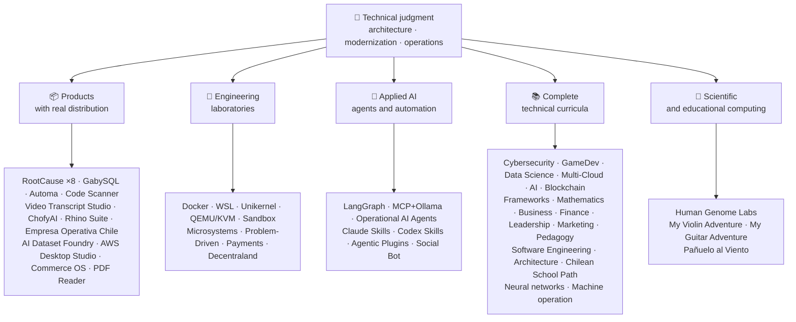

<div align="center">

# 👋ว ลาดิ อุส อา คูญา

## **สถาปัตยกรรม ทาง แก้·แพ็ครุ่นน้อง·การแปลงภาพดิจิทัล·ปฏิบัติการการจัดการ**

**ผู้เชี่ยวชาญได้รับการอบรมในสาขาวิทยาศาสตร์คอมพิวเตอร์ และวิศวกรรมและการบริหารธุรกิจ โดยมีอาคาร 16+ ปีและซอฟต์แวร์ปฏิบัติการในสภาพแวดล้อมจริง ผม เชื่อม โยง ธุรกิจ, ผู้ คน, กระบวนการ, และ เทคโนโลยี เข้า กับ การ ออก แบบ, การ ประเมิน, การ ส่ง, และ การ ค้ําจุน ทาง แก้ ด้วย การ ตัดสิน โดย ทาง เทคนิค และ ทัศนะ ที่ ดําเนิน งาน — โดย หลัก ฐาน ที่ ยืน ยัน ได้ ใน บัญชี กิตติฮับ นี้.**

[](https://vladimiracunadev-create.github.io/)
[](https://www.linkedin.com/in/vladimir-acu%C3%B1a-valdebenito-11924a29/)
[](mailto:vladimir.acuna.dev@gmail.com)

[](#ขอบเขตงาน)
[](#ผลตภณฑทมการเผยแพรจรง)
[](#หลกสตรเทคนคฉบบสมบรณ)

<!-- STATS:START -->
[](https://github.com/vladimiracunadev-create?tab=repositories)
[](https://github.com/vladimiracunadev-create?tab=repositories)
[](#ภาพรวมระบบนเวศ)
[](#หลกสตรเทคนคฉบบสมบรณ)
[](https://github.com/vladimiracunadev-create?tab=repositories)
<!-- STATS:END -->

[](https://github.com/vladimiracunadev-create?tab=repositories)
[](https://github.com/vladimiracunadev-create?tab=followers)

[🌐 Portfolio (6 languages)](https://vladimiracunadev-create.github.io/) ·
[🧩 Ecosystem](#ภาพรวมระบบนเวศ) ·
[⚡ Evaluate me in 10 minutes](#หากคณมเวลา-10-นาทเพอประเมนผม) ·
[✅ Professional scope](#ขอบเขตงาน) ·
[🧭 Non-coding management](#การจดการ-การบรหาร-และโอกาสงานทไมประสบความสาเรจ) ·
[📋 Role matrix](PROFESIONAL_ROLES.md) ·
[📬 Contact](#ตดตอ)

**🌐 ฉบับเต็ม:** [Español](README.md) · [English](README.en.md) · [Português](README.pt.md) · [Italiano](README.it.md) · [Français](README.fr.md) · [简体中文](README.zh.md) · [繁體中文](README.zh-TW.md) · [日本語](README.ja.md) · [한국어](README.ko.md) · [Türkçe](README.tr.md) · [Русский](README.ru.md) · [Tiếng Việt](README.vi.md) · [ไทย](README.th.md) · [Deutsch](README.de.md) · [Українська](README.uk.md) · [Polski](README.pl.md) · [العربية](README.ar.md) · [فارسی](README.fa.md) · [Bahasa Indonesia](README.id.md) · [Nederlands](README.nl.md) · [हिन्दी](README.hi.md) · [Ελληνικά](README.el.md)

**แกนเทคนิค:**
PHP 8 · Python · Rust · Go · Node/TS · Java 21 · .NET 8 · Dart/Flutter · WASM
· AWS · Terraform · Kubernetes · Docker · n8n · LangGraph/MCP · CI/CD · FinOps · Observability

**สะพาน สาขา ธุรกิจ – เทคโนโลยี:**
ประมวลผลและวิเคราะห์ความต้องการ·การประมาณคําตอบ·การจัดวาง·การปฏิบัติการและต่อเนื่อง·การจัดการความเสี่ยง·ผลิตภัณฑ์และบริการ·การศึกษาทางเทคนิค

</div>

---

> [!NOTE]
> โปรไฟล์นี้ไม่ได้เปลี่ยนโอกาสให้กลายเป็นประสบการณ์ ประสบการณ์ ทาง เทคนิค ที่ พิสูจน์ ว่า มี ความ สามารถ ที่ จะ ย้าย ได้ การ ใช้ ประโยชน์ ได้ และ เป้า หมาย ใน การ พัฒนา อนาคต ก็ แยก กัน อย่าง ชัดเจน. เชื่อมโยงหลักฐาน Githoub มีกระบวนการประมวลผลหรือสารคดี; ที่บางสิ่งบางอย่าง**ไม่**เสร็จ สิ้น การ ประชุม นี้ ได้ รับ การ กล่าว ถึง ว่า เป็น เช่น นั้น.

## 🎯สิ่งที่คุณจะพบที่นี่

นี่ ไม่ ใช่ “การ กลับ มา ใหม่ อย่าง เดียว กัน ”: เป็น ระบบ นิเวศ ที่ มี มาตรฐาน การ ใช้ ร่วม กัน.

- 🔁 **โม เด็ค ที่ สามารถ ทํา งาน ได้**-โคลน วิ่ง มั่นใจ
- 🧰 **ตัวเล่นมาตรฐาน**-เมคเฟช, ฮับ ซีแอลไอ`doctor`และ`smoke`ต่อคลังเก็บของ
- 🛡️ **การป้องกันในความลึก**-การสแกนลับ นโยบาย และกิจกรรมต้องห้าม
- 📈 **ความไวแสง** — `/health`, `/ready`, `/metrics`หนวดและรอยขีดข่วน
- 📚 **เอกสารที่ปรากฏแก่ผู้ชม**-คนรับสมัคร มือใหม่ เดวอป หรือ รปภ. ขึ้นอยู่กับคลังสินค้า
- 📦 **การกระจายตัวของโปรดักต์**— เปิดตัวแบบดาวน์โหลดได้, Checksums, และสร้างหลักฐาน; ลายเซ็นการค้า/สโตร์ ที่ประกาศว่าใช้ได้ชั่วคราว
- 🌍 **การแบ่งเขตการปกครอง**— ประวัติ ย่อ ใน 6 ภาษา (ส.·เอ็น·ขนาด PT·มัน·ฟิล์ม FR·ZH).
- 🧭 **ความซื่อสัตย์เชิงเทคนิค**-ทุกคดีที่ถูกติดป้าย`OPERATIONAL`, `DOCUMENTED/SCAFFOLD`หรือ`PLANNED`.

## ✅สถานะที่ใช้ได้

| พื้นผิว | หลักฐานที่สรุปได้ |
|---|---|
| 🧪 **นําเสนอผลการตรวจสอบ** | แกบบีเอสQL**828 ทดสอบ**# พ่นน้ําออกมา**สี่เหลี่ยม**(0 ความตื่นตระหนก)·ชิลี**158 ทดสอบ** ·อัตโนมัติ**ไพย์ 150** ·CI หลายแบบ |
| 🤖 **ตัวแสดงเกรดของการผลิต** | ลังกราฟเรียลเวิลด์**25/ 25 โปรแกรมเบื้องหลังการทํางาน**(เคสที่ 01–25, 100% ออกอากาศ)·ปฏิบัติการเอไอเอเจ้นท์**13 เจ้าหน้าที่**ด้วย**39 การ ประเมิน โดย ไม่ มี เงื่อนไข** |
| 🔗 **การรวมพาราเมทริก** | **20 คดี**ผู้ ส่ง ส่ง (Transs Itter) —**19 ปฏิบัติการ**แต่ละคนตรวจสอบกับโดเกอร์· **18+ เครื่องยนต์ DB** · **ภาชนะบรรจุ 20+** ·11 รูปแบบ |
| 📦 **การกระจายตัว** | **151 เผยแพร่**ไปทั่วระบบนิเวศของ**การประชุมมหาชน 64 แห่ง** ·ตัวติดตั้งและวัตถุ`.exe` · `.msi` · `.dmg` · `.apk`ด้วย checksums และการสร้างหลักฐาน; ลายเซ็นพาณิชย์/ storition ในความคืบหน้าที่นําไปใช้ |
| 🛡️ **ห่วงโซ่อุปทาน** | รหัสQL·เซ ม รี ป·แบนดิต·ไตรวี่·กราฟแสดงความถี่·กิตติม จิ·สับปะรด·CyloonDX SBOM·ไพ่คะแนน |
| 📚 **เคอร์ริคูลา** | **14,530 คลาสเรียน พ.ศ.**ตรวจสอบได้ทั้ง 21 โปรแกรม นับด้วย[a workflow](.github/workflows/stats.yml)จากโครงสร้างของคลังสินค้า หรือแหล่งที่รับรองได้ ที่ถูกประกาศไว้ในคลังสินค้า·ทุกโปรแกรมประกาศสถานะและข้อจํากัดของรายการ |
| 🌐 **พอร์ตโฟลิโอ้** | โปรแกรม PWA ที่ติดตั้งได้· **6 ภาษา** · **36 PDF**สร้างโดยท่อส่งแก๊ส·API ข้อมูล CV·แคปซิเตอร์ แอนดรอยด์·ไลท์เฮาส์ 100 |
| 🔒 **เส้นพริ้วไหว** | ซีโร่โทรเมชันในผลิตภัณฑ์นิติเวช และเอ็มพริซา โอเปราตีวา ชิลี — ได้รับการยืนยันในทุกอาคาร (โน อันดรอยด์)`INTERNET`อนุญาต |
| 🌐 **เผยแพร่เว็บไซต์** | **56 เว็บไซต์ GitHub Pages**-55 เครื่องลงจอด 1 เครื่อง ต่อผลิตภัณฑ์ โปรแกรม หรือระบบนําทางระบบนิเวศ รวมกับชุดผลงาน แต่ละอันใช้จากคลังเก็บ·ทั้ง 56 คนตรวจสอบกับ HTTP`200` |

## 🗺️ภาพรวมระบบนิเวศ



## 📦ผลิตภัณฑ์ที่มีการเผยแพร่จริง

ซอฟต์แวร์ ที่ ถูก ดาวน์โหลด, ติดตั้ง, และ ใช้ — ไม่ เพียง แต่ โคลน เท่า นั้น.

| โพรดุก | ว่ามันคืออะไร | สแต็ก | บริการส่ง |
|---|---|---|---|
| [🔍 **RootCause Windows**](https://github.com/vladimiracunadev-create/rootcause-windows-inspector) | นิติเวชไซเบอร์ การบิดเบือนของทรัพยากร ผิดปกติทุกรูปแบบ อาจเป็นสัญญาณแรกของภัยคุกคาม วินิจฉัยก่อน, แทรกแซงภายหลัง | แปรงทาสี🦀 ·ESW/ WPR | **v0.19. 0** · **16 ออกจําหน่าย** · **5 ฉบับ**ส่วนติดต่อผู้ใช้·ย้ายได้·CLI·เชลล์พลังงาน·รหัส VS· [landing](https://vladimiracunadev-create.github.io/rootcause-windows-inspector/) |
| [📱 **RootCause Mobile**](https://github.com/vladimiracunadev-create/rootcause-mobile-inspector) | พี่น้องมือถือ: เซ็นเซอร์นิติเวชที่เปรียบเทียบโปรแกรมแต่ละกับตัวเอง, เว็บแท็กแวร์ธง, และแยกสิทธิ์ที่ได้รับจากเพียงหนึ่งที่ต้องการ | แปรงทาสี·ค็อตลิน·ไว | **v0. 0** ·แอนดรอยด์ APK ที่สามารถตรวจสอบได้·5 ภาษา· **ศูนย์โทรศัพท์** · [landing](https://vladimiracunadev-create.github.io/rootcause-mobile-inspector/) |
| [🍎 **RootCause macOS**](https://github.com/vladimiracunadev-create/rootcause-macos-inspector) | พิมพ์ MacOS:`launchd`ความพยายาม, ผู้รักษาประตู, SIP, fileVlod, XCL, สิทธิ์ในการใช้ TCC, โพรเซสที่ลงนาม, และเพื่อนบ้านของเครือข่าย — ทุกพื้นผิวตรวจสอบกับรัฐที่ดีที่รู้จักกัน | แปรงทาสี🦀 ·MacOS 13+ | **v0. 0** ·ออกครั้งแรก·Apache-2.0· [landing](https://vladimiracunadev-create.github.io/rootcause-macos-inspector/) |
| [🖥️ **RootCause Server**](https://github.com/vladimiracunadev-create/rootcause-server) | พี่เซิฟเวอร์: เชื่อมสัมพันธ์กันในสิ่งที่ไม่มีบันทึกเดียวเห็นด้วยกัน — ผิวที่เปิดเผย, การระเบิดของเครื่องช่วยหายใจ, การแบ่งเวลาให้ที่อยู่เดิม, ความสมบูรณ์ของไฟล์ที่สําคัญ, และความเงียบของเซ็นเซอร์ — และเปลี่ยนให้เป็นประโยคเดียวที่สามารถทํางานได้ | แปรงทาสี🦀 ·หน้าต่าง·ลินุกซ์·มากอส | **v0.0.** · **18 กฎ**ด้วยหลักฐานและสมุด·ไม่ประมวลผลการกระทําด้วยตัวมันเอง·คอนโซลภายในโดยไม่ขึ้นต่อกันบนเว็บ· **ยังไม่มีการเผยแพร่** · [landing](https://vladimiracunadev-create.github.io/rootcause-server/) |
| [🌐 **RootCause Web**](https://github.com/vladimiracunadev-create/rootcause-web-inspector) | เซ็นเซอร์พิสูจน์หลักฐานของเบราว์เซอร์: คุกกี้, วาระงานอีเมล, ส่วนขยาย, ดาวน์โหลด, สิทธิ์การใช้งาน, และหน้าที่เลียนแบบหน้าต่างจริง | จาวาสคริปต์·ส่วนขยาย MV3 | **v0.0.** ·ยังไม่มีการเผยแพร่·แผงควบคุม`127.0.0.1` ·ไม่ขึ้นกับสิ่งใด·ตรวจความถูกต้องของโทรศัพท์เป็นศูนย์ใน CI· [landing](https://vladimiracunadev-create.github.io/rootcause-web-inspector/) |
| [₿ **RootCause Bitcoin Defense**](https://github.com/vladimiracunadev-create/rootcause-bitcoin-defense) | การป้องกันเฉพาะสําหรับบิตคอยควบคุม: ประดิษฐ์ที่มาของแต่ละคีย์, cross-ตรวจสอบด้วย แจ้งเตือนที่ตีพิมพ์และอธิบายสาเหตุรากกับหลักฐาน | จาวาสคริปต์·แอพพลิเคชันของวินโดวส์·แถบพาเนลภายใน | **v0.3. 0** · **2 เผยแพร่** ·ไม่ขึ้นกับสิ่งใด·ไม่เคยขอเมล็ด·ยืนยันใน CI· [landing](https://vladimiracunadev-create.github.io/rootcause-bitcoin-defense/) |
| [⛓️ **RootCause Blockchain Security**](https://github.com/vladimiracunadev-create/rootcause-blockchain-security) | คอนโซลหลายสายเท่านั้น: สัญญานักประดิษฐ์, พระราชทาน, คํา ทํานาย, สะพาน, การควบคุม, และความขึ้นต่อกัน, และสร้าง roots root-rofile scootbooks | จาวาสคริปต์·แอพพลิเคชันของวินโดวส์·แถบพาเนลภายใน | **v0.3. 0**ในคลังเก็บ·เผยแพร่เผยแพร่:`v0.1.0` ·ไม่ขึ้นกับสิ่งใด·ไม่เคยขอกุญแจส่วนตัว·ยืนยันใน CI· [landing](https://vladimiracunadev-create.github.io/rootcause-blockchain-security/) |
| [📷 **RootCause QR Inspector**](https://github.com/vladimiracunadev-create/rootcause-qr-inspector) | International Android App for Incode QR ก่อนการดําเนินงาน: อธิบายสัญญาณ 26 อัน แยกข้อเท็จจริงจากสมมุติฐาน และส่งออกหลักฐานที่แก้ไข | แปรงทาสี·สีแดง | **v0. 4** · **5 เผยแพร่** · **ทดสอบ 107** ·จัด พิมพ์ แอนดรอยด์ เอพีเค·เปรียบเทียบ SHA-256 ได้·ลายเซ็นแพกเกจ April ของ APK; ลายเซ็น พาณิชย์/ slotation อยู่ระหว่างดําเนินการ·ศูนย์โทรศัพท์· [landing](https://vladimiracunadev-create.github.io/rootcause-qr-inspector/) |
| [🏢 **Empresa Operativa Chile**](https://github.com/vladimiracunadev-create/empresa-operativa-chile) | กํากับ SSA จากก่อนที่จะมีการรวมกิจการ ใกล้เคียงกับแต่ละเดือน การรวมเข้ากับหลักฐาน, VAT ดําเนินการไปข้างหน้า, ฟอร์โมชั่น F29, การย้ายถิ่น, การติดตาม และการตรวจสอบบันทึก กฎเกณฑ์ทุกข้อชี้ไปยังแหล่งอย่างเป็นทางการ | จาวาสคริปต์·แปรงทาสี·ขนาด PWA | **v1.5. 0** ·แอนดรอยด์·หน้าต่าง·เบราว์เซอร์Comment· **158 ทดสอบ** · **การขึ้นต่อกันระหว่างการผลิต 0** ·ศูนย์โทรศัพท์· [landing](https://vladimiracunadev-create.github.io/empresa-operativa-chile/) |
| [🔍 **Universal Code Scanner**](https://github.com/vladimiracunadev-create/universal-code-scanner) | โปรแกรมอ่าน barcode ที่ QR และตัวอ่าน**แปลความหมายก่อนแสดง**สืบค้นเมื่อ: | แปรงทาสี·สีแดง | **v1. 0** ·แอนดรอยด์·ISO·มากอส·ขนาด PWA·ประวัติการเข้ารหัส**AES-256-GCM** · [landing](https://vladimiracunadev-create.github.io/universal-code-scanner/) |
| [🗄️ **GabySQL**](https://github.com/vladimiracunadev-create/gabysql) | ฐานข้อมูลที่ฝังแนบมาด้วย:ซิงเกิล`.db`แฟ้ม, WAL, การปรับแต่งค่าใช้จ่าย, HTTP/Json API | แปรงทาสี🦀 | หน้าต่าง·มากอส·ลินุกซ์· [landing](https://vladimiracunadev-create.github.io/gabysql/) |
| [🤖 **Automa PC**](https://github.com/vladimiracunadev-create/automa-pc) | วงออร์เคสตราท้องถิ่น: Json ไหลเวียนที่เปิดหน้าต่างจริง โต้ตอบกับ DOM และทิ้งหลักฐาน | Python·รายการเล่น·กราฟิกแบบไพวี | **v0.3. 0** · **27 ระดับความโปร่งแสง** ·ตัวติดตั้งแบบพิมพ์และตรวจสอบได้· [landing](https://vladimiracunadev-create.github.io/automa-pc/) |
| [🏭 **AI Dataset Foundry**](https://github.com/vladimiracunadev-create/ai-dataset-foundry) | โรงงานท้องถิ่นที่เปลี่ยน PDF, Word, web, web, Git, Json, และ CSV เป็นชุดข้อมูลการตรวจสอบสําหรับผลิต, ปรับละเอียด RAG และการประเมิน | Python | **v0.0.** ·วินโดวส์ + แอนดรอยด์ออฟไลน์·ออกครั้งแรก· [landing](https://vladimiracunadev-create.github.io/ai-dataset-foundry/) |
| [☁️ **AWS Desktop Studio**](https://github.com/vladimiracunadev-create/aws-desktop-studio) | apps ภายในระบบแรกที่มี 15 AWS การรวมรายการ, 20 ทิศทาง, CLI/SO และอ่านได้อย่างเดียว; การจัดทําในความคืบหน้าไม่ได้เข้าถึงสากล | จาวาสคริปต์·หน้าต่าง | **v0.1** ·ออกครั้งแรก· [landing](https://vladimiracunadev-create.github.io/aws-desktop-studio/) |
| [🧭 **Commerce OS**](https://github.com/vladimiracunadev-create/commerce-operating-system) | ตัวอย่างแนวคิดกํากับของการดําเนินการเชิงพาณิชย์: แคตตาล็อก, หุ้น, CRM, คําสั่งเยาะเย้ยการจ่ายเงินและสามารถติดตาม | จาวาสคริปต์·เว็บ·หน้าต่าง·แอนดรอยด์ | **v0.3. 0** · **2 เผยแพร่** ·ไม่มีส่วนร่วมของ อํานาจภาษีแบบจริงหรือชิลี· [landing](https://vladimiracunadev-create.github.io/commerce-operating-system/) |
| [📄 **PDF Reader**](https://github.com/vladimiracunadev-create/pdf-reader-windows-android) | โปรแกรมอ่านแบบแอนดรอยด์แบบอ่านได้แบบท้องถิ่น (Android-round) รุ่นแรก โดยไม่มีขนาดย่อแบบย่อ, เปิดอ่านได้, แบ่งปันข้อมูล, และเลือกอ่านโดยปริยาย | HTML·เว็บ·แอนดรอยด์·หน้าต่าง | **v.3.** ·เซ็นชื่อ APK·ไม่มีส่วนบัญชีผู้ใช้, สิทธิ์ที่ละเอียดอ่อน, หรือตัวโทรคมนาคม· [landing](https://vladimiracunadev-create.github.io/pdf-reader-windows-android/) |
| [🎙️ **Video Transcript Studio**](https://github.com/vladimiracunadev-create/video-transcript-studio) | วีดีโอ, รายการเล่น, หรือ**ช่องสัญญาณทั้งหมดบน YouTube**ส่งข้อความด้วยเวลา ไม่ต้องใช้คําบรรยายที่มีอยู่: กระซิบจดจําเสียง**ในเครื่องของคุณ**สืบค้นเมื่อไม่มี API, บัญชี หรือกุญแจที่จะปรับแต่ง | Python·ไพย์·OCKI·หนวดเร็ว | **v0.0.** ·หน้าต่างหน้าจอของวินโดวส์ + แผงระบบบน`127.0.0.1`+ CLI**ใช้คิวเดียวกัน** ·MD·PDF·TXT·ขนาด SRT·วีทีที·เจ สัน·MP3·Oggy· **89 ทดสอบ** ·แพ็ค FPPeg·ศูนย์โทรศัพท์· [landing](https://vladimiracunadev-create.github.io/video-transcript-studio/) |
| [🎨 **ChofyAI Studio**](https://github.com/vladimiracunadev-create/chofyai-studio) | AI ในท้องถิ่น: Partwards Qwen3-TTS, กระซิบ.cpp, Facefation, AceForge, และ ComfiUI | ทาอุรี 2·แปรงทาสี·ย้อนกลับ | v0.5. 1· **เครื่องมือ 5/5 ที่มีการอนุมานจริง** ·ภาพไอคอนแอปเปิล MacOS·การทดลองวินโดวส์· **ยังไม่มีการเผยแพร่** · [site](https://vladimiracunadev-create.github.io/chofyai-studio/) |
| [🦏 **Rhino Suite**](https://github.com/vladimiracunadev-create/rhino-suite) | ห้อง ชุด สํานักงาน จาก ที่ ขีดข่วน: กฎ เอกสาร ไม่ ได้ ขึ้น อยู่ กับ DOM — HTML เป็น เพียง การ อนุมาน | Rust/ WASSM·ไป·ย้อนกลับ 19 | วิวัฒนาการ โมโนเรโป โดย เฟส· [landing](https://vladimiracunadev-create.github.io/rhino-suite/) |
| [🎻 **My Violin Adventure**](https://github.com/vladimiracunadev-create/violin-adventure) | แอพเพื่อการศึกษาสําหรับเด็ก: เครื่องบันทึกเสียงโครมาติก, เครื่องเสียง-เวลาที่เหมาะสม, เพลงที่มีไวโอลินจริง | ทาอุรี 2·ย้อนกลับ·ขนาด TS | **v1.3.0** ·หน้าต่าง·แอนดรอยด์·ลินุกซ์·มากอส·ขนาด PWA· [landing](https://vladimiracunadev-create.github.io/violin-adventure/) |
| [🎸 **My Guitar Adventure**](https://github.com/vladimiracunadev-create/guitarra-adventure) | พี่น้องเชือกตัด : 24 บทเรียนใน 6 โลก, เครื่องจูน 6 สาย, เมโทรนอมฟรี, และ 11 กีตาร์จริง | ทาอุรี 2·ย้อนกลับ·ขนาด TS | **v1. 0** ·หน้าต่าง·แอนดรอยด์·ลินุกซ์·มากอส·ISO·ขนาด PWA·ไม่ มี บัญชี, โฆษณา, หรือ การ ติด ต่อ สื่อสาร ทาง อินเทอร์เน็ต· [landing](https://vladimiracunadev-create.github.io/guitarra-adventure/) |
| [🧣 **Pañuelo al Viento**](https://github.com/vladimiracunadev-create/panuelo-al-viento-cueca-app) | Cueca ตั้งแต่อายุ 10: 24 ห้องเรียนใน 8 ระดับ กิจกรรม 72 อย่าง ห้องปฏิบัติการ 6 เพลา (3+3 และ 2+2+2) และแผนภาพพื้นที่เข้าถึงได้ มันกล่าวว่ามัน**คอมพลีเมนต์ ไม่แทนที่**ครูและผู้ถือวัฒนธรรม | แปรงทาสี·สีแดง | **v0.0.** ·แอนดรอยด์ 7+·วินโดวส์ 10/11·APK·ExE·MSI·เลือกแบบพกพา· **29 ทดสอบ + 2 ตัวตรวจความถูกต้อง** ·ไม่มีกล้อง ไมโครโฟน บัญชีธนาคาร โฆษณา หรืออินเตอร์เน็ต· [landing](https://vladimiracunadev-create.github.io/panuelo-al-viento-cueca-app/) |

## 🧪ห้องปฏิบัติการวิศวกรรม

| รีโป | สิ่งที่มันแสดงให้เห็น |
|---|---|
| [🐳 **Problem-Driven Systems Lab**](https://github.com/vladimiracunadev-create/problem-driven-systems-lab) | **20 ปัญหาจริง**(สายภายใต้การโหลด, N+1 พายุ retricing, รั่วไหล, ก้อนหิน, แคช ประทับ, หด, การย้ายที่ศูนย์เวลา, ลืม DLQ) กับความล้มเหลวใน การฉีดวัคซีนระดับสูง, แก้ปัญหาได้**สแต็ก 7 สแต็ก**PHP 8·Python·โหนด. js·ชวา 21·.NET 8· **ไป 1.23** · **Russt 1.83** · [landing](https://vladimiracunadev-create.github.io/problem-driven-systems-lab/) |
| [📆 **Social Bot Scheduler**](https://github.com/vladimiracunadev-create/social-bot-scheduler) | **v4. 10. 0** · **20 คดี**แหล่งที่มา 82000 – กว่า**18+ เครื่องยนต์ DB** —**19 ปฏิบัติการ**แต่ละคนตรวจสอบกับโดเกอร์**8 เลเยอร์**ตรวจ, ป้องกัน ตัว เอง, เบรกเกอร์, และ DLQ· [landing](https://vladimiracunadev-create.github.io/social-bot-scheduler/) |
| [🧰 **Microsistemas**](https://github.com/vladimiracunadev-create/microsistemas) | **12 การ วินิจฉัย และ การ ปรับ ปรุง ไมโคร แอ ป**สําหรับ PHP·เซิร์ฟเวอร์ MCP ภายในระบบแบบอ่านอย่างเดียว·แข็ง ตัว ใน สาม ช่วง· [landing](https://vladimiracunadev-create.github.io/microsistemas/) |
| [🧪 **Docker Labs**](https://github.com/vladimiracunadev-create/docker-labs) | **13 ห้อง แล็บ**บนแพลตฟอร์ม 4 บริการ + อัตโนมัติ`.exe`ตัวติดตั้งพร้อมตัวยิง· [landing](https://vladimiracunadev-create.github.io/docker-labs/) |
| [🐳 **WSL Labs**](https://github.com/vladimiracunadev-create/wsl-labs) | **12 กรณี**บน`wslc`เครื่องบรรจุของ WSL พื้นเมือง**ไม่มีพื้นที่ทํางานของโดกเกอร์** · [landing](https://vladimiracunadev-create.github.io/wsl-labs/) |
| [⚡ **Unikernel Labs**](https://github.com/vladimiracunadev-create/unikernel-labs) | "Dopker December for Unkernes": โปรแกรมควบคุมวินโดวส์เหนือยูนิเคียฟด้วยโปรแกรมเบื้องหลัง WSL2`kraft`+ QEMU/ KVM· [landing](https://vladimiracunadev-create.github.io/unikernel-labs/) |
| [🧰 **QEMU/KVM Labs**](https://github.com/vladimiracunadev-create/qemu-kvm-labs) | **12 แลป**ของจริงการจําลองด้วย QEMU, KVM, libvert, เมฆ-idit, และ`vm-manager`บนลินุกซ์และ WSL2· [landing](https://vladimiracunadev-create.github.io/qemu-kvm-labs/) |
| [🛡️ **Sandbox Labs**](https://github.com/vladimiracunadev-create/sandbox-labs) | การแยกลินุกซ์: ทํางานรหัสภาคที่สาม ไฟล์ และโมเดลธุรกิจภายใต้นโยบายประกาศและ**ส่งหลักฐานที่ลงนามว่าตัวควบคุมนั้นใช้จริง** · **36 กรณี**ในสองครอบครัว มีเทคนิค 15 อย่าง และตลาดทุน 21 แห่ง·ประกาศการทดลองและการศึกษา ไม่ใช่ผลิตภัณฑ์รักษาความปลอดภัย· [landing](https://vladimiracunadev-create.github.io/sandbox-labs/) |
| [💳 **Universal Payments Engineering Lab**](https://github.com/vladimiracunadev-create/universal-payments-engineering-lab) | **28 ครอบครัวที่จ่ายเงิน**ในตัวอย่างการอธิบายตัวเองในท้องถิ่น: รัฐ, บัญชี, ประนีประนอม, ความ ปลอดภัย, และคู่มือการทํางาน· [landing](https://vladimiracunadev-create.github.io/universal-payments-engineering-lab/) |
| [🕹️ **Decentraland Social Arcade**](https://github.com/vladimiracunadev-create/decentraland-social-arcade) | สืบค้นเมื่อ 3 มิติ จากประเทศไทย สถาปัตยกรรมของชาติไทยและชาติไทย โดยมี SDK7, ESC และประเภท Script·เอกสารภาษาสเปน·ไม่มีการชําระเงินหรือค่าโทรศัพท์ |
| [☁️ **AWS Projects**](https://github.com/vladimiracunadev-create/proyectos-aws) | เหตุการณ์ที่คืบหน้า ซึ่งแต่ละรายเพิ่มบริการ AWS**และ**ความสามารถในการประมวลผลกลุ่มผู้ใช้แบบ GitHub ใหม่·SAA- C03·DVA- C02·SOA-C02 ออกอากาศ |

## 🤖ปรับใช้ AI

| รีโป | สิ่งที่มันแสดงให้เห็น |
|---|---|
| [🤖 **LangGraph RealWorld**](https://github.com/vladimiracunadev-create/langgraph-realworld) | **25/ 25 โปรแกรมเบื้องหลังการทํางาน**- ชนิดของรัฐ เส้นทางสภาพ NDJson สตรีม, DEMO/LFFF ชั้นรักษาความปลอดภัย 8 ชั้น, cha256 สายของการดูแล |
| [🧭 **Operational AI Agents**](https://github.com/vladimiracunadev-create/operational-ai-agents) | **13 เจ้าหน้าที่ปฏิบัติการ**สําหรับรหัสและเวลาที่เหมาะสมกับน้ําน้ําดี แต่ละคนจะได้รับภารกิจที่สมบูรณ์ — วิวัฒนาการแบบปรับปรุงใหม่, การรับมรดก การออกแบบหลักสูตร, ผลงานพิมพ์ชุดวงจรการรักษาความปลอดภัย วิเคราะห์เหตุการณ์ -- ภายใต้สัญญาประกาศประตูของมนุษย์และหลักฐานที่เชื่อถือได้· **39 การ ประเมิน โดย ไม่ มี เงื่อนไข** ·34 ทดสอบ·ไม่ใช้เอฟเฟ็คต์·ลินุกซ์·มากอส·หน้าต่าง· [site](https://vladimiracunadev-create.github.io/operational-ai-agents/) |
| [🧠 **MCP + Ollama Local**](https://github.com/vladimiracunadev-create/mcp-ollama-local) | AI ภายในระบบแรกพร้อมเครื่องมือ MCP ในกล่องทราย· `127.0.0.1`แนบ·โพรไฟล์หลายชนิด·ความซื่อสัตย์เกี่ยวกับข้อจํากัดของมัน |
| [🧩 **Agentic Plugins Toolkit**](https://github.com/vladimiracunadev-create/agentic-plugins-toolkit) | **6 ส่วนเสริมตัวแทน**ติดตั้งได้ในรหัส Claude, OpenAI/Codex, Codex, Comor, Gemini, และ MCP จากแหล่งเดียว:`repository-engineering`, `legacy-modernization`, `learning-program-studio`, `product-evolution`, `portfolio-governance`และ`rootcause-response` · **69 มุมมองที่สร้างโดยไม่ลอย**- เวลาทํางานแต่ละรายการได้รับรูปแบบจากสัญญาเดียวกัน -·เฟรม% 1·ลินุกซ์·มากอส·หน้าต่าง· [site](https://vladimiracunadev-create.github.io/agentic-plugins-toolkit/) |
| [🧰 **Claude Skills Toolkit**](https://github.com/vladimiracunadev-create/claude-skills-toolkit) | **15 ทักษะการเป็นตัวแทน**สําหรับรหัสคล้าด· **ความปลอดภัย**12  ภูมิลําเนา`security-audit`(โอเอสวี)·เว็บ·ESMS·สคริปต์ SPN·กล่อง·2555) และ 14 ฤดูกาล พ.ศ.`bitcoin-custody-audit` · **เกตแบบรีโป**: `pre-commit-guard`, `pre-push-guard`, `yaml-control`, `md-lint-fix`, `python-lint-guard` · **ความสอดคล้อง**: `repo-coherence-audit`, `version-bump`, `python-version-control`, `python-deps-pinning` · **ด็อกเกอร์**: `docker-cleanup`, `docker-compose-doctor` · **ด็อก**: `md-to-doc` ·เฟรม% 1·แบบตัดภาพ |
| [🧰 **Codex Skills Toolkit**](https://github.com/vladimiracunadev-create/codex-skills-toolkit) | **19 ทักษะการเป็นตัวแทน**สําหรับโคเด็กซ์: ห่วงโซ่ความปลอดภัยและอุปทาน, การไหล, การยืดหยุ่นและรัฐ, ปล่อยหลักฐาน, Python/YAML/GMLLLLFunkown เกต, การปรับโครงสร้าง, การขึ้นต่อกัน, Doker, และเอกสาร·Python- คนแรก· `pnpm` ·ลินุกซ์·มากอส·หน้าต่าง· [site](https://vladimiracunadev-create.github.io/codex-skills-toolkit/) |

## 📚หลักสูตรเทคนิคฉบับสมบูรณ์

รายการ ที่ มี การ จัด ใน ภาษา สเปน ซึ่ง มี สถานะ และ ขอบ เขต ที่ แต่ ละ ห้อง เก็บ ของ ได้ ประกาศ. 21 โครงการรวมกันเป็น**14,530 คลาสเรียน พ.ศ.**นับจํานวน[a workflow](.github/workflows/stats.yml)จากโครงสร้างคลังสินค้าที่แท้จริง หรือแหล่งที่ตรวจสอบได้ เปิดใช้งานในคลังสินค้า; ตรารีเฟรชรายสัปดาห์และไม่ได้เขียนด้วยมือ

🧭 [**Lifelong Learning Ecosystem**](https://github.com/vladimiracunadev-create/lifelong-learning-ecosystem)เป็นเข็มทิศที่ดูดซึม เชื่อมต่อ 30 เส้นทางจริงผ่านพื้นที่ 6 ผ่านแผนที่และ[accessible offline portal](https://vladimiracunadev-create.github.io/lifelong-learning-ecosystem/);; ไม่ ได้ ถือ ว่า เป็น รายการ อื่น ๆ.

| โปรแกรม | คลาส | ขอบเขต |
|---|---:|---|
| [🔢 **Computational Mathematics**](https://github.com/vladimiracunadev-create/computational-mathematics-program) | 360 | จากการนับนิ้วเพื่อสร้างกระดาษ· **360 การสาธิตแบบระบุตัวตน ยืนยันใน CI** ·สมุด บันทึก 1,080 เล่ม·เคลือบด้วยน้ํามัน 489 ภาค· [site](https://vladimiracunadev-create.github.io/computational-mathematics-program/) |
| [🏦 **Finance and Banking**](https://github.com/vladimiracunadev-create/finance-and-banking-evolution-program) | 356 | 534 h·สืบค้นเมื่อ 3 ปีก่อน สืบค้นเมื่อ 3 มิถุนายน พ.ศ.· **27 กรณี** · **298 ทดสอบ** · [site](https://vladimiracunadev-create.github.io/finance-and-banking-evolution-program/) |
| [🎮 **GameDev**](https://github.com/vladimiracunadev-create/modern-gamedev-program) | 352 | คณิตศาสตร์และ C#/C+/GDScript paraders, AI, multipleplayer, VR/AR·พระเจ้า·เอกภาพ·ไม่ใช้เอฟเฟ็คต์· **10 ห้อง ปฏิบัติ การ ของ โก โดต ที่ ตรวจ สอบ ใน ซี ไอ**(301 เช็ค)· [site](https://vladimiracunadev-create.github.io/modern-gamedev-program/) |
| [🛡️ **Cybersecurity**](https://github.com/vladimiracunadev-create/modern-cybersecurity-program) | 360 | **v1.3.0** ·20 ส่วน·→ ทีมแดง, DFIR, ความปลอดภัยเมฆ, ใช้ประโยชน์จากเดวอน, CTF และความปลอดภัยในเกม·ผังแป้นพิมพ์**7 การ รับรอง** ·แอพพลิเคชันของแอนดรอยด์/ web ออฟไลน์·คู่มือ PDF·CI, รักษาความปลอดภัย และเพจตรวจสอบ· [site](https://vladimiracunadev-create.github.io/modern-cybersecurity-program/) |
| [📈 **Marketing, Sales, and Growth**](https://github.com/vladimiracunadev-create/marketing-sales-growth-evolution-program) | 336 | 24 ส่วนที่มีนิยามการทํางาน, แผ่นวัด, ชีวประวัติแบบวัดได้, และบริบทควบคุมชิลี· **v1.6. 0** ·1. 29M คํา·เส้นทางบนบทบาท 17· [site](https://vladimiracunadev-create.github.io/marketing-sales-growth-evolution-program/) |
| [🏢 **Business Creation**](https://github.com/vladimiracunadev-create/modern-business-creation-program) | 336 | สร้างและดําเนินกิจการจริงในชิลี : จากความคิดไปในทางการเข้าครอบครอง, อํานาจภาษี, การดําเนินงาน, วิกฤตการณ์และออก·แผนภูมิ 360·อภิธานศัพท์ 1,2111 ระยะเวลา·คู่มือ 1,548 หน้า· [site](https://vladimiracunadev-create.github.io/modern-business-creation-program/) |
| [🏛️ **Architecture and Built Environment**](https://github.com/vladimiracunadev-create/architecture-built-environment-learning-program) | 830 | 83 ส่วน·วาระงานของส่วนท้าย 60·34 เส้นทาง·แหล่งข้อมูลที่แกะรอยได้·พิมพ์แบบ Countดาวน์, โปรแกรมอ่านแบบออฟไลน์, และหน้าแบบ GitHub· [site](https://vladimiracunadev-create.github.io/architecture-built-environment-learning-program/) |
| [🇨🇱 **Chilean School Learning Path**](https://github.com/vladimiracunadev-create/chilean-school-learning-path) | 8,841 | คะแนน 1–12· **4,156 ผนวกประสบการณ์การข้ามห้อง** · **2,823 วัตถุประสงค์การเรียนรู้** ·แหล่ง ที่ มา ของ ความ สําเร็จ·ไม่มีการเสนองานและวิจารณ์มนุษย์เป็นพิเศษ ที่ยังคงอยู่· [site](https://vladimiracunadev-create.github.io/chilean-school-learning-path/) |
| [🧭 **Modern Software Engineering**](https://github.com/vladimiracunadev-create/modern-software-engineering-program) | 480 | 40 ส่วน และ 8 ขั้น ตอน·ฐานราก → ผลิตภัณฑ์ สถาปัตยกรรม ความปลอดภัย เดวิสส์ เอสรี เอสพีซี ไอ และระบบหลาย ๆ หน่วยงาน·สถานะส่วนแก้ไขข้อความประกาศโดยคลังเก็บ· [site](https://vladimiracunadev-create.github.io/modern-software-engineering-program/) |
| [🎓 **Pedagogy and Learning Sciences**](https://github.com/vladimiracunadev-create/education-pedagogy-learning-sciences-program) | 300 | จากวิธีที่คนเรียนรู้ ถึงวิธีสอนครู·25 ส่วน· **แต่ ละ ชั้น ประกาศ สภาพ และ ขีด จํากัด ของ หลัก ฐาน** ·การ อ่าน หนังสือ, วิธี การ ที่ ไม่ มี การ ควบคุม ใน ตอน แรก, ความ ต้องการ ทาง การ ศึกษา เฉพาะ อย่าง, การ อยู่ ร่วม กัน, ความ หลาก หลาย ทาง วัฒนธรรม, และ หลัก ฐาน จาก นานา ชาติ·1,097 แว่นขยาย 325 แผนภาพ และธนาคารห้องเรียน 60 มาตรา·14 เส้นทางอาชีพตามบทบาท·นําเข้าได้โดย LMM· **v2.1.0** · [site](https://vladimiracunadev-create.github.io/education-pedagogy-learning-sciences-program/) |
| [☁️ **Multi-Cloud**](https://github.com/vladimiracunadev-create/multi-cloud-engineering-program) | 288 | ขนาด AWS·เสน่ห์·เข้ารหัสแบบ GCP·คูแบร์เน็ตส์·เทอร์ราฟอร์ม·ครี·ฟอสเฟต· **1,288 ชั่วโมง** ·288 ห้องแล็ปพร้อมหลักฐาน Json·1,032 แกะรอยแหล่ง·ขนาด 2,884 หน้าคู่มือ PDF· [site](https://vladimiracunadev-create.github.io/multi-cloud-engineering-program/) |
| [🎖️ **Executive Leadership**](https://github.com/vladimiracunadev-create/executive-leadership-founder-program) | 288 | จากการเป็นเจ้าของผลลัพธ์แรกของคุณ เพื่อเป็นผู้นําบริษัท และก่อตั้งบริษัทของคุณเอง: ทีม, PDF/OKR, การเงิน, ผลิตภัณฑ์, ความเสี่ยง, คณะกรรมการและ M&A·24 คดี, 96 ห้องปฏิบัติการ และเอกสาร 39 ฉบับ· [site](https://vladimiracunadev-create.github.io/executive-leadership-founder-program/) |
| [🐍 **Python Data Science**](https://github.com/vladimiracunadev-create/python-data-science-program) | 232 | โพลาส, ML+Optuna/SHAP, Py Torch/LLM/LORA, MLLps·แอพพลิเคชันของวินโดวส์ + แอนดรอยด์ APK· [site](https://vladimiracunadev-create.github.io/python-data-science-program/) |
| [🧠 **AI Evolution**](https://github.com/vladimiracunadev-create/artificial-intelligence-evolution-program) | 184 | Symbolic → probabilistic → deep learning → LLMs, RAG, agents, safety, and frontier · **v0.17.0** · **708 notebooks** · **148 foundational papers** · offline Windows, Android, and PWA apps · [site](https://vladimiracunadev-create.github.io/artificial-intelligence-evolution-program/) |
| [🌐 **Comparative Programming**](https://github.com/vladimiracunadev-create/polyglot-programming-labs) | 176 | หนึ่งแนวคิด**10 ภาษา**การ ตรวจ สอบ ใน ซี ไอ —**1,360 อุปกรณ์**-บวก**1,62 โปรแกรม**ในภาษายังคงมีชีวิตอยู่ (Cobol, Fortran, Ada, RGB, MAMMMS...) และ atlas of**60 ใบใน 15 ครอบครัว** ·v1. 0· [site](https://vladimiracunadev-create.github.io/polyglot-programming-labs/) |
| [🧩 **Frameworks Compared**](https://github.com/vladimiracunadev-create/framework-ecosystems-labs) | 149 | หนึ่งสัญญาประมวลผลโดยไม่ต้องปรับกับ Express, SportAPI, Spring Boot, AP.NET, Jangle, Rail, Laravel, React, Vue, Sevelte, และอื่น ๆ·12 ส่วน· **70 คลาสที่สร้าง** · **397 คดีตรวจสอบใน CI** · **210 ISBN/ DOI แหล่งที่มา** · [site](https://vladimiracunadev-create.github.io/framework-ecosystems-labs/) |
| [🗄️ **Databases**](https://github.com/vladimiracunadev-create/database-systems-labs) | 74 | **v3. 0** ·วิศวกรรมฐานข้อมูลใน 15 ส่วน·230 ชั่วโมง· **แหล่งที่มาที่เชื่อถือได้สําหรับทุกคําอ้าง**120 แหล่งที่มาจาก ISBN, ดอยดี หรือมาตรฐาน·ตัวพิมพ์เดียวกันได้ในเครื่องยนต์ 27 ตัว·เคลือบด้วยน้ํามัน 306 ภาค·ไพย์ 150· [site](https://vladimiracunadev-create.github.io/database-systems-labs/) |
| [📐 **Psychometrics and Assessment**](https://github.com/vladimiracunadev-create/psychometrics-and-assessment-program) | 40 | วิธี ที่ เครื่อง วัด ถูก สร้าง ขึ้น, ได้ คะแนน, ได้ รับ การ ตรวจ สอบ, และ ตรวจ สอบ·8 ส่วน·กลไกประมวลผลด้วย**5 เครื่องดนตรี 344 ชิ้น 276 ชิ้นสาธารณะ-มหาชน พ.ศ.** |
| [⛓️ **Blockchain**](https://github.com/vladimiracunadev-create/blockchain-learning-path) | 66 | **v0.14. 0** ·จากศูนย์ถึงโปรแกรมโครงสร้างพื้นฐานการเงินและบนเครื่องมือวิเคราะห์· **91 กิจ.**และ**ทดสอบ 363** ·สัญญากับผู้ก่อตั้ง (การพ้องและ diversants) และการวิเคราะห์ความต่อเนื่องของสลิเธอร์ใน CI·แอพพลิเคชันที่ทํางานอยู่สําหรับตรวจสอบอัตโนมัติ โดยจะเปิดส่วนย่อยของข้อมูล (bign) และทําการนับเนื้อหา· [site](https://vladimiracunadev-create.github.io/blockchain-learning-path/) |
| [🧠 **Neural Network Training Labs**](https://github.com/vladimiracunadev-create/neural-network-training-labs) | 31 | 7 มอดูล·≈214 ชั่วโมง· **สมุดบันทึก 93 เล่ม**-31 ห้องเรียน รุ่นนักเรียน 31 และทางออก 31 ฉบับ -·คํา ถาม, แผนที่ ภาพ, การ ปฏิบัติ, และ การ ประเมิน ด้วย ข้อมูล ของ ประชาชน จริง ๆ·พ.ศ.· [study site](https://vladimiracunadev-create.github.io/neural-network-training-labs/) |
| [🕹️ **Machine Operator**](https://github.com/vladimiracunadev-create/machine-operator-program) | 451 | **มอดูลฝึก 41**หนึ่งเครื่อง· **502 h 15 นาที** ·ระบบ, การควบคุม, ฟิสิกส์, ความปลอดภัย, และแบบจําลองออกแบบกับแหล่งข้อมูลต่อชั้นเรียน·♪ยังไม่มีโปรแกรมจําลองการประมวลผลยังและมันก็ประกาศวิธีการที่♪ |

## 🔬การประมวลผลเชิงวิทยาศาสตร์

| รีโป | สิ่งที่มันแสดงให้เห็น |
|---|---|
| [🧬 **Human Genome Labs**](https://github.com/vladimiracunadev-create/human-genome-labs) | เวที genomics resroaducics residented: planguage`ScientificResult<T>`สัญญา, หน้าเว็บ, หน้าเว็บ, และบริการ FSA/ GFF3/ VCF, โมดูลร่วมกับ**ความ อาวุโส และ หลัก ฐาน ที่ ชัดเจน**ความซื่อสัตย์สุดโต่ง : * มันไม่ดําเนินการวินิจฉัยโรค*· [site](https://vladimiracunadev-create.github.io/human-genome-labs/) |

## ⚡หากคุณมีเวลา 10 นาทีเพื่อประเมินผม

แนวคิดไม่ใช่แค่ดูรหัสเท่านั้น คือต้องมอง**ที่ฉันคิด**ผมบันทึกเอกสารอย่างไร และทําทุกสิ่งให้สําเร็จได้อย่างไร

**เส้น ทาง เอ — ความ ทุกข์ จริง ๆ และ การ ร้อง เพลง บรรเลง ออร์ เคส ตรา**♪ (โปรดของฉัน) ♪

```bash
git clone https://github.com/vladimiracunadev-create/social-bot-scheduler.git
```

คุณจะเห็นการไหลของแรงงาน เมตริก แผงหน้าปัด และรางรถข้าม 19 กรณี และเครื่องยนต์ DB 18+

**เส้น ทาง บี — โครง สร้าง แบบ โครงสร้าง ที่ สามารถ ทดแทน ได้ ใน เวลา ไม่ กี่ นาที**

```bash
git clone https://github.com/vladimiracunadev-create/docker-labs.git
```

**เส้น ทาง C — เจ้า หน้าที่ ที่ มี ขนาด พิมพ์**

```bash
git clone https://github.com/vladimiracunadev-create/langgraph-realworld.git
```

**เส้น ทาง ดี — สินค้า ทาง การ แพทย์ ที่ แยบยล ปราศจาก การ ปลอม แปลง**

ดาวน์โหลดตัวติดตั้งหรือเลขฐานสองของ CLI จาก[RootCause releases](https://github.com/vladimiracunadev-create/rootcause-windows-inspector/releases)และตรวจสอบ`SHA256SUMS`.

## 🧠มาตรฐานที่ผมใช้ในทุกคลัง

- **DX ก่อน**-ถ้าไม่ง่ายในการวิ่ง มันก็ไม่มีประโยชน์ที่จะเข้ารับบทเป็นเดโม หรือเป็นฐานทีม
- **ความ สามารถ ใน การ เลือก ตั้ง ตั้ง แต่ วัน ที่ 1**-วัดและติดตามไม่ได้
- **ความปลอดภัยเป็นท่อส่ง**-การสแกนลับ เอสบีเอ็มต่อปลดปล่อย การปฏิบัติต้องห้ามอย่างชัดเจน
- **ความยืดหยุ่นจริง**-ไร้สมรรถภาพ วงจรไฟฟ้า และควบคุมความเสื่อมโทรม
- **โพ ลิ กลอท โดย การ ออก แบบ**-ภาษาและเครื่องยนต์ที่ถูกเลือกโดยคดีที่ไม่เคยถูกเลือกโดยแฟชั่น
- **ความซื่อสัตย์เกี่ยวกับสถานะ**— อีก หนึ่ง เรโป ถูก เปลี่ยน ชื่อ (ค.ศ.`Multisimulador` → `machine-operator-program`เพื่อหลีกเลี่ยงซอฟท์แวร์ที่ยังไม่มีอยู่
- **แบดเจอร์เป็นสัญญาณ ไม่ใช่หลักฐาน**-การยึดทรัพย์สินของแต่ละฝ่ายยังประกาศ**สิ่งที่มันไม่ทํา**.
- **โมเดลภายนอก**— โดเมน ถูก ออก แบบ มา ก่อน ส่วน ต่อ นี้ เป็น การ ฉาย ภาพ.
- **งานภายนอกถูกประกาศเป็นภายนอก**— จาก การ จัด เตรียม ต่อ สาธารณชน 70 แห่ง 64 แห่ง ของ เรื่อง นี้ เป็น งาน ของ ผม เอง. อีก หก คน —[`agentic-qe`](https://github.com/vladimiracunadev-create/agentic-qe), [`Anthropic-Cybersecurity-Skills`](https://github.com/vladimiracunadev-create/Anthropic-Cybersecurity-Skills), [`erpnext`](https://github.com/vladimiracunadev-create/erpnext), [`OpenExecutive`](https://github.com/vladimiracunadev-create/OpenExecutive), [`raptor`](https://github.com/vladimiracunadev-create/raptor)และ[`security-audit-skill`](https://github.com/vladimiracunadev-create/security-audit-skill)-เป็นส้อมและถูกกีดกันจากตัวเลขทั้งหมด สําหรับงานของตัวเอง

## ✅ขอบเขตงาน

ภูมิ หลัง ของ ผม ทั้ง สอง —**วิทยาศาสตร์คอมพิวเตอร์และวิศวกรรมคอมพิวเตอร์ + สํานักงานบริหารธุรกิจ**ช่วยผมให้แปลเป้าหมายทางธุรกิจ เป็นการตัดสินใจทางเทคนิคและข้อจํากัดทางเทคนิค ให้เป็นทางเลือกที่ชัดเจนสําหรับการดําเนินการ ผลิตภัณฑ์ ลูกค้า และผู้นํา

### 🎯การแสดงตัวของแกนหลัก

| บทบาท | การสํารองข้อมูล |
|---|---|
| **สถาปัตยกรรม ทาง แก้** | ระบบออกแบบแบบเคลื่อนไหวได้ ด้วยการตัดสินวิวัฒนาการ |
| **สถาปัตยกรรม สมัย ใหม่** | วิวัฒนาการที่แท้จริง (PHP 5.x/8.x, การเพิ่มการเพิ่มการ อนุมานโดยไม่รบกวนดําเนินการ) |
| **จ่าฝูง/ เทคโนโลยีอาวุโส** | สถาปัตยกรรม, การ ประหาร ชีวิต, และ มาตรฐาน บน เวที จริง (+16 ปี) |
| **สถาปัตยกรรม AI อัตโนมัติ** | ระบบเอเจนท์ที่มี แลงกราฟ/เอ็มซีพี และ n8n flow ด้วยรางป้องกัน |

### ↗ การขยายตามธรรมชาติ

**วิศวกรการเพิ่มเสียง AI** · **ระบบ / กลไกการหมุน** · **เครื่องกลโมบายล์ (เสียงฟลัช)** · **ตัวช่วยแก้ปัญหา** · **ผู้สร้างโปรดักต์เชิงเทคนิค** · **ผู้ ฝึก อบรม ด้าน เทคนิค** · **ที่ปรึกษาการแปลงภาพดิจิทัล** · **การ วิเคราะห์ ธุรกิจ / การ ทํา งาน** · **ปฏิบัติการ Production ทางเทคนิค**

### ⚙️ขอบเขตเสริม

ตัวช่วยสร้างแพลตฟอร์ม / IDP·เด โวป / ซีซีดี·เมฆ / เครื่อง ยนต์ เอ ดับเบิล ยู เอส·โปรแกรม SER·ตัวสร้างอัตโนมัติ·ที่ปรึกษาด้านเทคนิค

## 🧭การจัดการ, การบริหาร, และโอกาสงานที่ไม่ประสบความสําเร็จ

ขอบเขตนี้มิได้อ้างว่า ทุกชื่อมีชื่อดังกล่าวถูกจัดขึ้น การ ทํา เช่น นี้ มี ความ สําคัญ อย่าง ยิ่ง ต่อ งาน ที่ มี การ รวม กัน ของ การ คํานวณ, การ บริหาร ธุรกิจ, และ หลัก ฐาน ของ สาธารณชน สามารถ ก่อ ให้ เกิด คุณค่า โดย ไม่ ต้อง มี การ จํา รหัส เป็น หน้า ที่ หลัก.

| ตระกูลมืออาชีพ | บทบาทที่จดจํา | จําแนกประเภทได้ซื่อสัตย์ | การจับ | หลัก ฐาน และ สภาพ การณ์ |
|---|---|---|---|---|
| **ผู้นําเทคโนโลยี** | หัว เรื่อง·ตัวจัดการปฏิบัติการของ IT·ตัวจัดการการแปลงดิจิทัล·ไอโอ | **เป้าหมายของโปรแกรม / อนาคต** | ไม่มี/ เลือก | ฐาน ทาง เทคนิค ที่ เข้ม แข็ง; ผู้ คน, งบ ประมาณ, ผู้ ขาย, และ ผู้ บริหาร ต้อง ได้ รับ การ พิสูจน์ ว่า ต้อง แยก กัน อยู่ |
| **การจัดการโครงการ** | โปรเจกต์ Cortignator/Manager·แบบ PMO·อาจารย์สแครตซ์·การ ช่วย ให้ รอด แบบ อัก เงิล | **มีศักยภาพที่จะถ่ายโอน / แอพพลิเคชัน** | ไม่มี/ เลือก | การ ส่ง และ ปล่อย หลัก ฐาน; ทีม งาน ทางการ, งบ ประมาณ, และ ผู้ สนับสนุน ยัง คง เป็น ช่อง ว่าง |
| **การ บริหาร ธุรกิจ** | ผู้บริหารธุรกิจ·ตัวจัดการระบบ/ OCPERSE (institute)·ผู้ดูแลระบบ | **มีศักยภาพในการโปรแกรม** | ไม่มี | ปริญญาธุรกิจและวัตถุที่ประกอบงาน ต้องการการรับรองการเป็นเจ้าของทรัพยากร, ประชาชน, และผู้ผลิต |
| **วางแผนและเปลี่ยนแปลง** | ที่ปรึกษาด้านยุทธศาสตร์·เปลี่ยนตัวจัดการ·วางแผนจัดการขององค์กร·การ สร้าง สรรค์ และ การ เปลี่ยน แปลง | **มีศักยภาพที่จะถ่ายโอน / แอพพลิเคชัน** | ไม่มี | มรดก การ ทํา ให้ ทัน สมัย และ การ ประเมิน ทาง แก้ ต้อง มี การ แสดง ให้ เห็น ผล แห่ง การ รับ เป็น บุตร ของ องค์การ |
| **วิเคราะห์ธุรกิจ** | วิเคราะห์ธุรกิจ·การวิเคราะห์/ การถามซ้ํา·ขนาด BPM·ปรับ ปรุง อย่าง ต่อ เนื่อง | **มีศักยภาพที่จะถ่ายโอน / แอพพลิเคชัน** | ไม่มี/ เลือก | การ จําลอง และ ข้อ เรียก ร้อง ของ โดเมน เป็น หลัก ฐาน; ผู้ ที่ เป็น ผู้ ถือ หลัก ฐาน ต่าง ประเทศ จะ ทํา ให้ ข้อ อ้าง นี้ เข้ม แข็ง ขึ้น |
| **โปรดักต์และบริการ** | ผู้จัดจําหน่าย/ ผู้จัดจําหน่าย·ปฏิบัติการโปรดักต์·บริการ·สําเร็จเป็นเลิศของลูกค้า | **มีศักยภาพที่จะถ่ายโอน / แอพพลิเคชัน** | ไม่มี/ เลือก | โรดแมป, รถ ชูชีพ, ปล่อย, และ ปฏิบัติ การ; พีแอนด์แอล, ชุด ของ ลูกค้า, และ หลัก ฐาน ของ เอส แอล แตก ต่าง กัน ไป ใน เรื่อง บทบาท |
| **การจัดการความปลอดภัยทางไซเบอร์** | กราฟแสดงความถี่·หนังสือ นี้ ควบคุม ผู้ ดู แล·ความเสี่ยงทางเทคโนโลยี·ความปลอดภัยข้อมูล / ความต่อเนื่อง | **มีศักยภาพในการโปรแกรม** | ไม่มี/ เลือก | การ ควบคุม และ ราก เหง้า เป็น หลัก ฐาน; การ ตรวจ สอบ องค์การ และ หลัก ฐาน ที่ เกี่ยว ข้อง กัน นั้น ยัง คง อยู่ |
| **การ ค้า และ การ ขาย** | พรีเซลเทคโนโลยี·วิธี แก้ ปัญหา·เทคนิก KAM·บี2B การพัฒนาธุรกิจ | **มีศักยภาพที่จะถ่ายโอน / แอพพลิเคชัน** | ไม่มี | การ แปล แบบ แก้ไข และ ค่า นิยม ที่ เข้ม แข็ง; โควตา, ประมวล กฎหมาย บัญชี, และ สัญญา เจรจา ไม่ ได้ อ้าง ว่า เป็น การ เจรจา |
| **การเงินและการจัดการควบคุม** | งบประมาณ/ การวิเคราะห์ความจุ·การแทนที่โครงการ·FP&A·การควบคุมการจัดการ | **มีศักยภาพในการโปรแกรม** | ไม่มี | สิ่งประดิษฐ์การเงิน/ phinos; งบประมาณจริง, บัญชีการเงิน, และบริษัท KPIs |
| **คุณภาพ** | การวิเคราะห์โพรเซส/  Quecture·ตัวแบ่งส่วนโพรเซส·ปรับ ปรุง อย่าง ต่อ เนื่อง | **มีศักยภาพที่จะถ่ายโอน / แอพพลิเคชัน** | ไม่มี/ เลือก | ประตู, การทดสอบ, เมตริก, และ ตอบโต้ได้; คุณภาพของระบบอย่างเป็นทางการยังคงช่องว่าง |
| **การศึกษา** | ผู้ ฝึก อบรม ด้าน เทคนิค·ตัวนําทาง·ตัวผสมเสียงแบบอะคาเดมี·เอดเทค / ผู้ ออก แบบ ที่ มี ความ รู้ | **มีศักยภาพที่จะถ่ายโอน / แอพพลิเคชัน** | ไม่มี/ เลือก | 21 โครงการ และ 14,530 คลาส การสอนอย่างเป็นทางการและผลการเรียนต้องปรากฏเป็นหลัก |
| **ผู้ จัด จําหน่าย และ ผู้ ผลิต ไม้ ซุง** | การเกิดขึ้นอีก·ตัวคอมโพเนนท์/ ดําเนินการจัดการแพกเกจ·ตัวจัดการผู้จําหน่าย/ คอนแทรค | **มีศักยภาพในการโปรแกรม** | ไม่มี | กรรมวิธี และ ฐาน การ บริหาร; การ จัด หา ของ จริง, การ เก็บ ของ, และ การ จัด หา ของ ผู้ ซื้อ เป็น สิ่ง จําเป็น |
| **ข้อมูล และ การ ควบคุม AI** | ประมวลผลข้อมูล·การ ปกครอง แบบ ราช อาณาจักร·การ รับ เป็น บุตร บุญธรรม / การ ปกครอง | **มีศักยภาพที่จะถ่ายโอน / แอพพลิเคชัน** | ไม่มี/ เลือก | ข้อมูลที่อ่านได้และตัวแทนที่มนุษย์เปิดรับ นโยบายองค์กรและคณะกรรมการยังคงช่องว่าง |
| **ภาคต่อ** | การ ปรับ ปรุง ใหม่·ตัวจัดการระบบ ICT·โปรเจกต์ดิจิทัล·วางแผนสาธารณะ | **มีศักยภาพในการโปรแกรม** | ไม่มี | Offonan-context ระบบและติดตาม; ประชาธิปัตย์และประสบการณ์ส่วน |

เดอะ[full Spanish role matrix](PROFESIONAL_ROLES.md)ราย ละเอียด ที่ มี เป้า หมาย หน้า ที่ รับ ผิด ชอบ ประสบการณ์ ทาง การ ตลาด ความ รู้ เสริม สร้าง หลัก ฐาน ความ เข้า กัน ได้ และ ช่อง ว่าง ตลอด 14 ครอบครัว.

## 🤖กระบวนการพัฒนาที่มี AI ช่วย

| เครื่องมือ | ใช้หลัก |
|---|---|
| **รหัสของน้ํามือ** | การ ทบทวน ด้าน สถาปัตยกรรม, การ จัด ระเบียบ, และ เอกสาร ทาง เทคนิค |
| **chartGPT Plute** | การ วิเคราะห์, สถาปัตยกรรม, และ การ ทํา ศัลยกรรม (ตั้งแต่ ปี 2023) |
| **โค เดก ซ์** | รุ่นโค้ดและการจําลอง |
| **ความไม่ต่อเนื่อง** | การเร่งพัฒนาและระบบการไหล |
| **รหัส VS /  OpenCode** | สภาพแวดล้อมที่ประกอบด้วยความช่วยเหลือ AI |

> ผมรวมการตัดสินใจทางเทคนิคของผม ความถูกต้องของมนุษย์ และทิศทางสถาปัตยกรรมของผมเข้าด้วยกัน การ ทํา เช่น นี้ ช่วย ให้ ความ สามารถ, ความ เร็ว, และ ความ สามารถ ของ คุณ มี มาก ขึ้น.

## 📌ความสามารถ

**เปิดไปยัง:**แพ็ครุ่นน้อง·สถาปัตยกรรม·การ ทํา ให้ เป็น แบบ สมัย ใหม่·แพลตฟอร์ม/ หมายเลขไอพี·โปรแกรม SER·ปฏิรูป·อัตโนมัติ·การอัตโนมัติ AI·การวิเคราะห์ธุรกิจ/ ขอบเขตงาน·โครงการนี้ร่วมมือกัน·ปฏิบัติการโปรดักต์·การแปลงภาพดิจิทัล·ที่ปรึกษา/ พรีเซล·การศึกษาทางเทคนิค·คุณภาพและการปรับปรุงอย่างต่อเนื่อง·การ รับ เป็น บุตร บุญธรรม และ การ ปกครอง ของ AI

**การ แบ่ง แยก ตาม ขอบ เขต แต่ ละ อย่าง:**Production Hist / เทคนิกโปรดักต์·บริการ·ปฏิบัติ การ ของ IT·ความเสี่ยงของ GRC / เทคโนโลยี·การ บริหาร และ การ ดําเนิน งาน·การควบคุมการจัดการ·นักแสดงยุคปัจจุบัน ตําแหน่งผู้บริหารและผู้จัดการทั่วไป คือเป้าหมายการพัฒนาในอนาคต ไม่ใช่การอ้างประสบการณ์

**ความสมบูรณ์:**ห่างไกลหรือลูกผสม ขึ้นอยู่กับโครงการ

## 📬ติดต่อ

[](https://vladimiracunadev-create.github.io/)
[](https://www.linkedin.com/in/vladimir-acu%C3%B1a-valdebenito-11924a29/)
[](https://gitlab.com/vladimir.acuna.dev-group/vladimir.acuna.dev-group)
[](mailto:vladimir.acuna.dev@gmail.com)

---

<div align="center">

[🤝 Contribute](CONTRIBUTING.en.md) ·
[🛡️ Security](SECURITY.en.md) ·
[⚖️ Code of Conduct](CODE_OF_CONDUCT.en.md)

<sub>RecodeME ตรงกับสภาพที่ตรวจสอบได้ของสถานสงเคราะห์สาธารณะ การแปลงและเปลี่ยนแปลงการอ่านผ่านเครื่องเอไอ --·2560. สืบค้นครั้งสุดท้าย: 12 ตุลาคม 2026.</sub>

</div>
