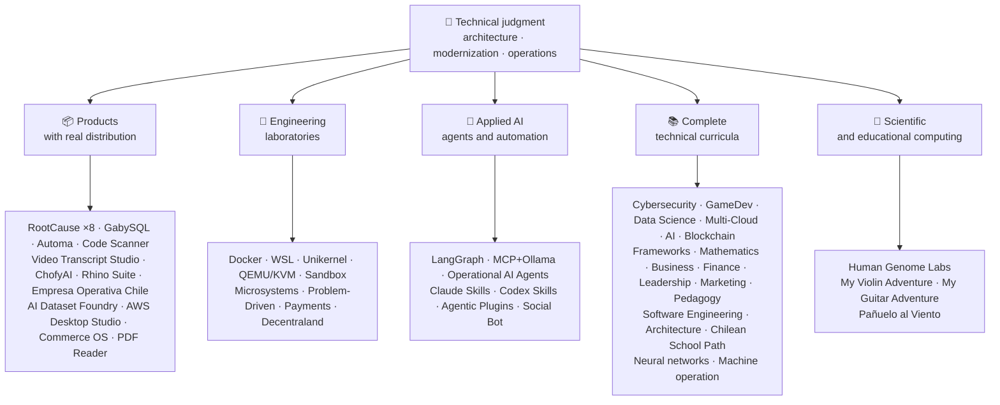

<div align="center">

# 👋Vladimir Acuña

## **Çözüm Mimarı·Senior Full-Stack·Dijital Dönüşüm·Yönetim ve Operasyonlar**

**Bilgisayar Bilimi ve Bilişim Mühendisliği ve İşletmesinde profesyonel olarak eğitilmiş, 16+ yıl bina ve gerçek ortamlarda işletim yazılımı ile. İşi, insanları, süreçleri ve teknolojiyi tasarım, değerlendirme, teslim etmek ve teknik yargı ve operasyonel bir görüşle çözümler sürdürmek için birleştiriyorum - bu GitHub hesabında doğrulanabilir kanıtlarla desteklendi.**

[](https://vladimiracunadev-create.github.io/)
[](https://www.linkedin.com/in/vladimir-acu%C3%B1a-valdebenito-11924a29/)
[](mailto:vladimir.acuna.dev@gmail.com)

[](#profesyonel-kapsam)
[](#gerçek-dağıtım-ile-ürünler)
[](#eksiksiz-teknik-müfredatlar)

<!-- STATS:START -->
[](https://github.com/vladimiracunadev-create?tab=repositories)
[](https://github.com/vladimiracunadev-create?tab=repositories)
[](#bir-bakışta-ekosistem)
[](#eksiksiz-teknik-müfredatlar)
[](https://github.com/vladimiracunadev-create?tab=repositories)
<!-- STATS:END -->

[](https://github.com/vladimiracunadev-create?tab=repositories)
[](https://github.com/vladimiracunadev-create?tab=followers)

[🌐 Portfolio (6 languages)](https://vladimiracunadev-create.github.io/) ·
[🧩 Ecosystem](#bir-bakışta-ekosistem) ·
[⚡ Evaluate me in 10 minutes](#beni-değerlendirmek-için-10-dakikanız-varsa) ·
[✅ Professional scope](#profesyonel-kapsam) ·
[🧭 Non-coding management](#yönetim-yönetim-ve-kariyer-fırsatları) ·
[📋 Role matrix](PROFESIONAL_ROLES.md) ·
[📬 Contact](#iletişim)

**🌐 Tam sürümler:** [Español](README.md) · [English](README.en.md) · [Português](README.pt.md) · [Italiano](README.it.md) · [Français](README.fr.md) · [简体中文](README.zh.md) · [繁體中文](README.zh-TW.md) · [日本語](README.ja.md) · [한국어](README.ko.md) · [Türkçe](README.tr.md) · [Русский](README.ru.md) · [Tiếng Việt](README.vi.md) · [ไทย](README.th.md) · [Deutsch](README.de.md) · [Українська](README.uk.md) · [Polski](README.pl.md) · [العربية](README.ar.md) · [فارسی](README.fa.md) · [Bahasa Indonesia](README.id.md) · [Nederlands](README.nl.md) · [हिन्दी](README.hi.md) · [Ελληνικά](README.el.md)

**Teknik temel:**
PHP 8 · Python · Rust · Go · Node/TS · Java 21 · .NET 8 · Dart/Flutter · WASM
· AWS · Terraform · Kubernetes · Docker · n8n · LangGraph/MCP · CI/CD · FinOps · Observability

**Business-teknoloji köprüsü:**
process and requirements analysis · solution evaluation · delivery coordination · operations and continuity · risk management · product and service · technical education

</div>

---

> [!NOTE]
> This profile does not turn opportunities into experience. Proven technical experience, transferable skills, viable applications, and future development goals are explicitly separated. Linked GitHub evidence is executable or documentary; where something is **not** finished, it is stated as such.

## 🎯Burada neler bulacaksınız

Bu “bir repo” değil: paylaşılan standartlarla bir ekosistemdir.

- 🔁 **Reproducible demos**- klon, koşmak, doğrulama.
- 🧰 **Standartlaştırılmış araç**- Makefiles, Hub CLI,`doctor`Ve`smoke`per repository.
- 🛡️ **Savunma derinlikte**- gizli tarama, politikalar ve açıkça yasak uygulamalar.
- 📈 **Observability** — `/health`, `/ready`, `/metrics`, panolar ve izlenebilirlik.
- 📚 **İzleyici-aware belgeleri**- işe alımcı, başlangıçta DevOps veya güvenlik, depolara bağlı olarak.
- 📦 **Ürün dağıtım**- indirilebilir sürümler, çekler ve kanıtlar inşa; ticari / mağaza imzaları geçerli olduğunda beklemeye karar verdi.
- 🌍 **Internationalization** — portfolio in 6 languages (ES · EN · PT · IT · FR · ZH).
- 🧭 **Teknik dürüstlük**- Her vaka etiketli`OPERATIONAL`, `DOCUMENTED/SCAFFOLD`, ya da`PLANNED`.

## ✅Doğrulanabilir durum

| Surface | Concrete evidence |
|---|---|
| 🧪 **Test kapsamı** | GabySQL**828 test testleri**+ söndürücü**503.8M sorguları**(0 Panik)·Empresa Operativa Chile**158 Test testleri** ·Automa**150 pytest** ·multi-OS CI |
| 🤖 **Production-grade agents** | LangGraph RealWorld **25/25 operational backends** (cases 01–25, 100% coverage) · Operational AI Agents **13 agents** with **39 deterministic evals** |
| 🔗 **Polyglot integration** | **20 cases** sender→n8n→receiver —**19 operational**, individually audited with Docker— · **18+ DB engines** · **20+ containers** · 11 patterns |
| 📦 **Distribution** | **151 releases** across an ecosystem of **64 owned public repositories** · installers and artifacts `.exe` · `.msi` · `.dmg` · `.apk` with checksums and build evidence; commercial/store signatures in progress where applicable |
| 🛡️ **Tedarik zinciri** | KodQL·Semgrep·Bandit·Trivy·Grype·Gitleaks·TruffleHog·CycloneDX SBOM·Scorecard |
| 📚 **Curricula** | **14,530 classes** verifiable across 21 programs, counted by [a workflow](.github/workflows/stats.yml) from real repository structure or a verifiable source declared in the repository —not written by hand— · every program declares its editorial status and limitations |
| 🌐 **Portföy Portföyü** | Yükleme edilebilir PWA· **6 dil dili** · **36 PDFs**Boru hattı tarafından üretilen·CV Data API·Capacitor Android·Lighthouse 100 |
| 🔒 **Telemetri** | Adli ürünler ve Empresa Operativa Chile'de Sıfır telemetri - her binada doğrulandı (no Android`INTERNET`İzin) |
| 🌐 **Yayınlanmış siteleri** | **56 GitHub Pages siteleri**-55 iniş, bir ürün, program veya ekosistem navigator, artı portföy - her biri kendi depolarından dağıtıldı·56 kişi HTTP ile doğrulandı`200` |

## 🗺️Bir bakışta ekosistem



## 📦Gerçek Dağıtım ile Ürünler

İndirilen yazılımlar, yüklü ve kullanılır - sadece klonlanmış değil.

| Product | What it is | Stack | Delivery |
|---|---|---|---|
| [🔍 **RootCause Windows**](https://github.com/vladimiracunadev-create/rootcause-windows-inspector) | Siber güvenlik adlileri: Her anormal kaynak bozulması bir tehditin ilk işareti olabilir. İlk önce Diagnose müdahale etti, daha sonra müdahale et | Rust🦀 ·ETW /WPR | **v0.19.0** · **16 sürüm** · **5 baskı**: GUI·Portatif·(Sla)·PowerShell·VS Kod· [landing](https://vladimiracunadev-create.github.io/rootcause-windows-inspector/) |
| [📱 **RootCause Mobile**](https://github.com/vladimiracunadev-create/rootcause-mobile-inspector) | The mobile sibling: a forensic sensor that compares each app against itself, flags stalkerware, and separates granted permissions from merely requested ones | Flutter · Kotlin · Swift | **v0.8.0** · verifiable Android APK · 5 languages · **zero telemetry** · [landing](https://vladimiracunadev-create.github.io/rootcause-mobile-inspector/) |
| [🍎 **RootCause macOS**](https://github.com/vladimiracunadev-create/rootcause-macos-inspector) | Macon baskı:`launchd`Süreklilik, kapıcı, SIP, FileVault, X Koruma, TCC izinleri, imzalanmış süreçler ve ağ komşuları - bilinen iyi bir devlet aleyhine kontrol edilen her yüzey | Rust🦀 ·Macon 13+ | **v0.1.0** ·İlk yayınlanan salım serbest salıveren ilk·Apache-2.0· [landing](https://vladimiracunadev-create.github.io/rootcause-macos-inspector/) |
| [🖥️ **RootCause Server**](https://github.com/vladimiracunadev-create/rootcause-server) | The server sibling: correlates what no single log sees together — exposed surface, access-attempt bursts, a session granted to that same address, critical file integrity, and sensor silence — and turns it into one actionable sentence | Rust 🦀 · Windows · Linux · macOS | **v0.2.0** · **18 rules** with evidence and runbook · never executes actions on its own · local console without web dependencies · **no published release yet** · [landing](https://vladimiracunadev-create.github.io/rootcause-server/) |
| [🌐 **RootCause Web**](https://github.com/vladimiracunadev-create/rootcause-web-inspector) | Browser forensic sensor: cookies, email sessions, extensions, downloads, permissions, and pages that imitate a real window | JavaScript · MV3 extension | **v0.2.0** · no published release yet · panel on `127.0.0.1` · zero dependencies · zero telemetry verified in CI · [landing](https://vladimiracunadev-create.github.io/rootcause-web-inspector/) |
| [₿ **RootCause Bitcoin Defense**](https://github.com/vladimiracunadev-create/rootcause-bitcoin-defense) | Watch-only defense for Bitcoin custody: inventories the origin of each key, cross-checks it with published warnings, and explains root cause with evidence | JavaScript · Windows app · local panel | **v0.3.0** · **2 releases** · zero dependencies · never asks for seeds · verified in CI · [landing](https://vladimiracunadev-create.github.io/rootcause-bitcoin-defense/) |
| [⛓️ **RootCause Blockchain Security**](https://github.com/vladimiracunadev-create/rootcause-blockchain-security) | Multi-chain watch-only console: inventories contracts, proxies, oracles, bridges, governance, and dependencies, and generates root-cause runbooks | JavaScript · Windows app · local panel | **v0.3.0** in the repository · published release: `v0.1.0` · zero dependencies · never asks for private keys · verified in CI · [landing](https://vladimiracunadev-create.github.io/rootcause-blockchain-security/) |
| [📷 **RootCause QR Inspector**](https://github.com/vladimiracunadev-create/rootcause-qr-inspector) | Aktif etmeden önce QR kodları incelemek için yerel Android uygulaması: 26 sinyalleri açıklıyor, hipotezlerden ayrı gerçekler ve kırmızıacted kanıtları ihraç ediyor | Flutter·Dart | **v0.1.4** · **5 sürüm** · **107 test** ·Android Plus·Doğrulanabilir SHA-256·Teknik Pul paketi imzası; ilerlemedeki ticari / mağaza imzaları·sıfır telemetri· [landing](https://vladimiracunadev-create.github.io/rootcause-qr-inspector/) |
| [🏢 **Empresa Operativa Chile**](https://github.com/vladimiracunadev-create/empresa-operativa-chile) | Guides a SpA from before incorporation to each monthly close: incorporation with evidence, VAT carry-forward, F29 draft, immutable close, and audit log. Every rule points to its official source | JavaScript · Rust · PWA | **v1.5.0** · Android · Windows · browser · **158 tests** · **0 production dependencies** · zero telemetry · [landing](https://vladimiracunadev-create.github.io/empresa-operativa-chile/) |
| [🔍 **Universal Code Scanner**](https://github.com/vladimiracunadev-create/universal-code-scanner) | QR and barcode reader that **interprets before acting**: 16 local URL risk signals and explicit confirmation | Flutter · Dart | **v1.1.0** · Android · iOS · macOS · PWA · encrypted history **AES-256-GCM** · [landing](https://vladimiracunadev-create.github.io/universal-code-scanner/) |
| [🗄️ **GabySQL**](https://github.com/vladimiracunadev-create/gabysql) | Embedded database: single `.db` file, WAL, cost-based optimizer, HTTP/JSON API | Rust 🦀 | Windows · macOS · Linux · [landing](https://vladimiracunadev-create.github.io/gabysql/) |
| [🤖 **Automa PC**](https://github.com/vladimiracunadev-create/automa-pc) | Local orchestrator: JSON flows that open real windows, interact with the DOM, and leave evidence | Python · Playwright · pywebview | **v0.3.0** · **27 flows** · published and verifiable installer · [landing](https://vladimiracunadev-create.github.io/automa-pc/) |
| [🏭 **AI Dataset Foundry**](https://github.com/vladimiracunadev-create/ai-dataset-foundry) | Local-first factory that turns PDF, Word, web, Git, JSON, and CSV into auditable datasets for pretraining, fine-tuning, RAG, and evaluation | Python | **v0.2.0** · Windows + offline Android · first published release · [landing](https://vladimiracunadev-create.github.io/ai-dataset-foundry/) |
| [☁️ **AWS Desktop Studio**](https://github.com/vladimiracunadev-create/aws-desktop-studio) | Local-first app with 15 AWS inventory integrations, 20 tutorials, CLI/SSO, and read-only defaults; implementation in progress, not universal access | JavaScript · Windows | **v0.1.1** · first published release · [landing](https://vladimiracunadev-create.github.io/aws-desktop-studio/) |
| [🧭 **Commerce OS**](https://github.com/vladimiracunadev-create/commerce-operating-system) | Guided conceptual demo of commercial operations: catalog, stock, CRM, orders, mock payments, and traceability | JavaScript · Web · Windows · Android | **v0.3.0** · **2 releases** · no real money or Chilean tax authority integration · [landing](https://vladimiracunadev-create.github.io/commerce-operating-system/) |
| [📄 **PDF Reader**](https://github.com/vladimiracunadev-create/pdf-reader-windows-android) | Android-first local read-only reader, with no-crop zoom, reopenable history, WhatsApp sharing, and default-reader selection | HTML · Web · Android · Windows | **v0.3.3** · signed APK · no accounts, sensitive permissions, or telemetry · [landing](https://vladimiracunadev-create.github.io/pdf-reader-windows-android/) |
| [🎙️ **Video Transcript Studio**](https://github.com/vladimiracunadev-create/video-transcript-studio) | One video, playlist, or **entire YouTube channel** to text with timestamps. It does not rely on existing subtitles: Whisper recognizes audio **on your machine**, with no API, account, or key to configure | Python · PySide6 · FastAPI · faster-whisper | **v0.2.0** · Windows desktop + local panel on `127.0.0.1` + CLI, **sharing the same queue** · MD · PDF · TXT · SRT · VTT · JSON · MP3 · OGG · **89 tests** · bundled FFmpeg · zero telemetry · [landing](https://vladimiracunadev-create.github.io/video-transcript-studio/) |
| [🎨 **ChofyAI Studio**](https://github.com/vladimiracunadev-create/chofyai-studio) | Local creative AI launcher: orchestrates Qwen3-TTS, whisper.cpp, FaceFusion, AceForge, and ComfyUI | Tauri 2 · Rust · React | v0.5.1 · **5/5 tools with real inference** · macOS Apple Silicon · experimental Windows · **no published release yet** · [site](https://vladimiracunadev-create.github.io/chofyai-studio/) |
| [🦏 **Rhino Suite**](https://github.com/vladimiracunadev-create/rhino-suite) | Office suite from scratch: document rules do not depend on the DOM — HTML is only a projection | Rust/WASM · Go · React 19 | Evolutionary monorepo by phases · [landing](https://vladimiracunadev-create.github.io/rhino-suite/) |
| [🎻 **My Violin Adventure**](https://github.com/vladimiracunadev-create/violin-adventure) | Educational app for children: chromatic tuner, audio-clock-accurate metronome, songs with real violin | Tauri 2 · React · TS | **v1.3.0** · Windows · Android · Linux · macOS · PWA · [landing](https://vladimiracunadev-create.github.io/violin-adventure/) |
| [🎸 **My Guitar Adventure**](https://github.com/vladimiracunadev-create/guitarra-adventure) | The plucked-string sibling: 24 lessons in 6 worlds, 6-string tuner, drift-free metronome, and 11 real guitar notes | Tauri 2 · React · TS | **v1.0.0** · Windows · Android · Linux · macOS · iOS · PWA · no accounts, ads, or online dependency · [landing](https://vladimiracunadev-create.github.io/guitarra-adventure/) |
| [🧣 **Pañuelo al Viento**](https://github.com/vladimiracunadev-create/panuelo-al-viento-cueca-app) | 10 yaşından itibaren Cueca: 8 seviyede 24 sınıf, 72 aktivite, altı-pulse laboratuvarı (3+3 ve 2+2) ve erişilebilir zemin diyagramları. Bu, bunun onun olduğunu belirtmektedir**Tamamlar, değiştirmiyor**Öğretmenler ve kültür ayıcılar | Flutter·Dart | **v0.2.0** ·Android 7++·Windows 10/11·APK·EXE·MSI·taşınabilir portatif taşınabilir portatif· **29 test + 2 geçerli yazıcı** ·Kamera, mikrofon, hesap, reklamlar veya internet· [landing](https://vladimiracunadev-create.github.io/panuelo-al-viento-cueca-app/) |

## 🧪Mühendislik Laboratuvarları

| Repo | Ne gösterir |
|---|---|
| [🐳 **Problem-Driven Systems Lab**](https://github.com/vladimiracunadev-create/problem-driven-systems-lab) | **20 real problems** (latency under load, N+1, retry storms, leaks, monoliths, cache stampede, backpressure, zero-downtime migration, forgotten DLQ) with high-fidelity injected failures, solved in **7 stacks**: PHP 8 · Python · Node.js · Java 21 · .NET 8 · **Go 1.23** · **Rust 1.83** · [landing](https://vladimiracunadev-create.github.io/problem-driven-systems-lab/) |
| [📆 **Social Bot Scheduler**](https://github.com/vladimiracunadev-create/social-bot-scheduler) | **v4.10.0** · **20 cases** source→n8n→receiver over **18+ DB engines** —**19 operational**, individually audited with Docker— **8-layer** audit, idempotency guardrails, circuit breaker, and DLQ · [landing](https://vladimiracunadev-create.github.io/social-bot-scheduler/) |
| [🧰 **Microsistemas**](https://github.com/vladimiracunadev-create/microsistemas) | **12 tanı ve modernizasyon mikroapps**PHP için·Yerel okuma-sadece MCP sunucusu·3 aşamada sertleşme· [landing](https://vladimiracunadev-create.github.io/microsistemas/) |
| [🧪 **Docker Labs**](https://github.com/vladimiracunadev-create/docker-labs) | **13 laboratuvar**4 hizmet platformunda + otomatik`.exe`installer with starter· [landing](https://vladimiracunadev-create.github.io/docker-labs/) |
| [🐳 **WSL Labs**](https://github.com/vladimiracunadev-create/wsl-labs) | **12 vaka**Onda`wslc`, yerli WSL konteyner motoru -**Docker Masaüstü olmadan** · [landing](https://vladimiracunadev-create.github.io/wsl-labs/) |
| [⚡ **Unikernel Labs**](https://github.com/vladimiracunadev-create/unikernel-labs) | "Docker Desktop for unikernels": Windows kontrolü WSL2 backend ile Unikraft üzerinde,`kraft`+ QEMU /KV· [landing](https://vladimiracunadev-create.github.io/unikernel-labs/) |
| [🧰 **QEMU/KVM Labs**](https://github.com/vladimiracunadev-create/qemu-kvm-labs) | **12 laboratuvar**QEMU, KVM, libvirt, bulut-init ve`vm-manager`Linux ve WSL2· [landing](https://vladimiracunadev-create.github.io/qemu-kvm-labs/) |
| [🛡️ **Sandbox Labs**](https://github.com/vladimiracunadev-create/sandbox-labs) | Linux izolasyon: ilan edilen politikalar ve iş modelleri altında üçüncü taraf kodu, dosyaları ve iş modellerini çalıştırın**Bu kontrollerin aslında uygulanan kanıtları imzalar.** · **36 vaka**İki ailede -15 teknik ve 21 sermaye-pazarı -·Deneysel ve eğitim ilan etti, * bir güvenlik ürünü değil*· [landing](https://vladimiracunadev-create.github.io/sandbox-labs/) |
| [💳 **Universal Payments Engineering Lab**](https://github.com/vladimiracunadev-create/universal-payments-engineering-lab) | **28 ödeme ailesi**Yerel bir kendini açık bir demoda: devletler, liderlik, uzlaşma, güvenlik ve uygulama rehberleri· [landing](https://vladimiracunadev-create.github.io/universal-payments-engineering-lab/) |
| [🕹️ **Decentraland Social Arcade**](https://github.com/vladimiracunadev-create/decentraland-social-arcade) | Yerli Demerkezve sosyal 3D deneyimi: bir MVP ve SDK7, ECS ve TypeScript ile çok oyun mimarisi·İspanyolca belgeleri·Ödemeler veya telemetri yok |
| [☁️ **AWS Projects**](https://github.com/vladimiracunadev-create/proyectos-aws) | Her birinin bir AWS hizmeti verdiği progresif vakalar**ve**Yeni bir GitHub Actions yeteneği·SAA-C03·DVA-C02·SOA-C02 kapsamı |

## 🤖Uygulamalı yapay zekâ

| Repo | Ne gösterir |
|---|---|
| [🤖 **LangGraph RealWorld**](https://github.com/vladimiracunadev-create/langgraph-realworld) | **25/25 operasyonel geri dönüşler**- tip devlet, koşullu rotalar, NDJSON akış, DEMO/LIVE mod, 8 güvenlik katmanı, SHA-256 tutuklama zinciri |
| [🧭 **Operational AI Agents**](https://github.com/vladimiracunadev-create/operational-ai-agents) | **13 operational agents** for Claude Code and compatible runtimes: each receives a complete mission —repository evolution, legacy modernization, curriculum design, portfolio publishing, security remediation, incident analysis— under a declared contract, human gates, and verifiable evidence · **39 deterministic evals** · 34 tests · zero-deps (stdlib only) · Linux · macOS · Windows · [site](https://vladimiracunadev-create.github.io/operational-ai-agents/) |
| [🧠 **MCP + Ollama Local**](https://github.com/vladimiracunadev-create/mcp-ollama-local) | Bir kumbox'ta MCP araçlarıyla Yerel-ilk AI· `127.0.0.1`Bağlan Bağır Bağ·multikatliman güven profili·Sınırları hakkında dürüstçe |
| [🧩 **Agentic Plugins Toolkit**](https://github.com/vladimiracunadev-create/agentic-plugins-toolkit) | **6 agentic plugins** installable in Claude Code, OpenAI/Codex, Copilot, Gemini, and MCP from one source: `repository-engineering`, `legacy-modernization`, `learning-program-studio`, `product-evolution`, `portfolio-governance`, and `rootcause-response` · **69 generated views without drift** —each runtime receives its format from the same contract— · zero-deps · Linux · macOS · Windows · [site](https://vladimiracunadev-create.github.io/agentic-plugins-toolkit/) |
| [🧰 **Claude Skills Toolkit**](https://github.com/vladimiracunadev-create/claude-skills-toolkit) | **15 agentic skills** for Claude Code · **security**: 12-layer `security-audit` (OSV · KEV · EPSS · SAST · container · secrets) and 14-stage `bitcoin-custody-audit` · **repo gates**: `pre-commit-guard`, `pre-push-guard`, `yaml-control`, `md-lint-fix`, `python-lint-guard` · **coherence**: `repo-coherence-audit`, `version-bump`, `python-version-control`, `python-deps-pinning` · **Docker**: `docker-cleanup`, `docker-compose-doctor` · **docs**: `md-to-doc` · zero-deps · cross-platform |
| [🧰 **Codex Skills Toolkit**](https://github.com/vladimiracunadev-create/codex-skills-toolkit) | **19 agentic skills** for Codex: security and supply chain, preflight, functional flows, resilience and state, release evidence, Python/YAML/Markdown gates, versioning, dependencies, Docker, and documents · Python-first · `pnpm` · Linux · macOS · Windows · [site](https://vladimiracunadev-create.github.io/codex-skills-toolkit/) |

## 📚Eksiksiz teknik müfredatlar

Sequential programs in Spanish, with status and scope declared by each repository. The 21 programs add up to **14,530 classes**, counted by [a workflow](.github/workflows/stats.yml) from real repository structure or a verifiable source declared in the repository; the badge refreshes weekly and is not written by hand.

🧭 [**Lifelong Learning Ecosystem**](https://github.com/vladimiracunadev-create/lifelong-learning-ecosystem)6 alanda görsel haritalar ve bir akış ile 30 gerçek yol birbirine bağlayan bir pupassdir.[accessible offline portal](https://vladimiracunadev-create.github.io/lifelong-learning-ecosystem/); ek bir program olarak sayılmıyor.

| Program | Classes | Scope |
|---|---:|---|
| [🔢 **Computational Mathematics**](https://github.com/vladimiracunadev-create/computational-mathematics-program) | 360 | Bir kağıt oluşturmak için parmak saymak· **CII'de doğrulanan 360 deterministic gösteriler** ·1.080 Notlar·489-term· [site](https://vladimiracunadev-create.github.io/computational-mathematics-program/) |
| [🏦 **Finance and Banking**](https://github.com/vladimiracunadev-create/finance-and-banking-evolution-program) | 356 | 534 h·Finansal matematik ve IFRS → kredi, risk, Basel III, açık finans, DLT, stabilcoins ve MiCA· **27 vaka** · **298 test testleri** · [site](https://vladimiracunadev-create.github.io/finance-and-banking-evolution-program/) |
| [🎮 **GameDev**](https://github.com/vladimiracunadev-create/modern-gamedev-program) | 352 | Mathematics and C#/C++/GDScript → shaders, AI, multiplayer, VR/AR · Godot · Unity · Unreal · **10 Godot labs verified in CI** (301 checks) · [site](https://vladimiracunadev-create.github.io/modern-gamedev-program/) |
| [🛡️ **Cybersecurity**](https://github.com/vladimiracunadev-create/modern-cybersecurity-program) | 360 | **v1.3.0** ·20 parça·Temeller → Kızıl Takım, DFIR, bulut güvenliği, Dev, CTF ve oyun güvenliği·haritalandı**7 sertifikasyon** ·çevrimdışı Android /web uygulaması·PDF manuel·CI, Güvenlik ve Sayfalar doğrulandı· [site](https://vladimiracunadev-create.github.io/modern-cybersecurity-program/) |
| [📈 **Marketing, Sales, and Growth**](https://github.com/vladimiracunadev-create/marketing-sales-growth-evolution-program) | 336 | Operasyonel tanımlarla 24 parça, ölçüm çarşafları, doğrulanabilir bibliyografi ve Şili düzenleyici bağlam· **v1.6.0** ·1.29M kelime sözleri·17 rol tabanlı yol· [site](https://vladimiracunadev-create.github.io/marketing-sales-growth-evolution-program/) |
| [🏢 **Business Creation**](https://github.com/vladimiracunadev-create/modern-business-creation-program) | 336 | Şili'de gerçek bir şirket oluşturun: katılmak, vergi otoritesi, operasyonları, kriz ve çıkış yapmak için fikirden·360 diyagramlar·1.251-term·1.548-sayfa manuel· [site](https://vladimiracunadev-create.github.io/modern-business-creation-program/) |
| [🏛️ **Architecture and Built Environment**](https://github.com/vladimiracunadev-create/architecture-built-environment-learning-program) | 830 | 83 parts · 60 integrative sessions · 34 paths · traceable sources · Markdown, offline reader, and GitHub Pages · [site](https://vladimiracunadev-create.github.io/architecture-built-environment-learning-program/) |
| [🇨🇱 **Chilean School Learning Path**](https://github.com/vladimiracunadev-create/chilean-school-learning-path) | 8,841 | 1. Sınıflar 1-12· **4,156 bütünleşik çapraz-kullanıcı deneyimler** · **2,823 öğrenme hedefleri** ·MINEDUC kaynakları·Beklenmeyen teklifler ve uzman insan incelemesi hala beklemeye devam· [site](https://vladimiracunadev-create.github.io/chilean-school-learning-path/) |
| [🧭 **Modern Software Engineering**](https://github.com/vladimiracunadev-create/modern-software-engineering-program) | 480 | 40 parça ve 8 aşama·Temeller → ürün, mimarlık, güvenlik, DevOps, SRE, SPEC, AI ve multi-agent sistemler·Editör statüsü, havuz tarafından ilan edildi· [site](https://vladimiracunadev-create.github.io/modern-software-engineering-program/) |
| [🎓 **Pedagogy and Learning Sciences**](https://github.com/vladimiracunadev-create/education-pedagogy-learning-sciences-program) | 300 | Bir kişinin öğretmenlerin nasıl eğitildiğini nasıl öğrendiğinden·25 parça· **Her sınıf kanıt durumunu ve sınırları ilan eder** ·Erken okuryazarlık, karşılaştırmalı yöntemler, özel eğitim ihtiyaçları, karşılıklılık, kültürel çeşitlilik ve uluslararası kanıtlar·1.097-term parlak, 325 diyagramlar ve 60-aktivite sınıfı banka·rolü ile 14 kariyer yolu·LMS-exportable· **v2.1.0** · [site](https://vladimiracunadev-create.github.io/education-pedagogy-learning-sciences-program/) |
| [☁️ **Multi-Cloud**](https://github.com/vladimiracunadev-create/multi-cloud-engineering-program) | 288 | AWS · Azure · GCP · Kubernetes · Terraform · SRE · FinOps · **1,288 hours** · 288 labs with JSON evidence · 1,032 traced sources · 2,884-page PDF manual · [site](https://vladimiracunadev-create.github.io/multi-cloud-engineering-program/) |
| [🎖️ **Executive Leadership**](https://github.com/vladimiracunadev-create/executive-leadership-founder-program) | 288 | Bir şirketin lider ve kendi kurucu için ilk sonucunuzu kendi: takımlar, KPI/OKR, finans, ürün, risk, yönetim ve M&A·24 vaka, 96 laboratuvar ve 39 şablon· [site](https://vladimiracunadev-create.github.io/executive-leadership-founder-program/) |
| [🐍 **Python Data Science**](https://github.com/vladimiracunadev-create/python-data-science-program) | 232 | Polars, ML+Optuna/SHAP, PyTorch /LLMs /LoRA, MLOps·yerli Windows uygulaması + Android Plus· [site](https://vladimiracunadev-create.github.io/python-data-science-program/) |
| [🧠 **AI Evolution**](https://github.com/vladimiracunadev-create/artificial-intelligence-evolution-program) | 184 | Symbolic → probabilistic → deep learning → LLMs, RAG, agents, safety, and frontier · **v0.17.0** · **708 notebooks** · **148 foundational papers** · offline Windows, Android, and PWA apps · [site](https://vladimiracunadev-create.github.io/artificial-intelligence-evolution-program/) |
| [🌐 **Comparative Programming**](https://github.com/vladimiracunadev-create/polyglot-programming-labs) | 176 | Bir konsept,**10 dil dili**CI'de doğrulandı -**1,360 uygulamaları**- artı**1632 program programları**Hala hayatta kalan diller (COBOL, Fortran, Ada, RPG, MUMPS...) ve bir atlas of of**15 ailede 60 kart** ·v1.1.0· [site](https://vladimiracunadev-create.github.io/polyglot-programming-labs/) |
| [🧩 **Frameworks Compared**](https://github.com/vladimiracunadev-create/framework-ecosystems-labs) | 149 | One executable contract, without adapters, against Express, FastAPI, Spring Boot, ASP.NET, Django, Rails, Laravel, React, Vue, Svelte, and more · 12 parts · **70 built classes** · **397 cases verified in CI** · **210 ISBN/DOI sources** · [site](https://vladimiracunadev-create.github.io/framework-ecosystems-labs/) |
| [🗄️ **Databases**](https://github.com/vladimiracunadev-create/database-systems-labs) | 74 | **v3.0.0** · database engineering in 15 parts · 230 hours · **the verifiable source for every claim**: 120 sources with ISBN, DOI, or standard · same case solved in 27 engines · 306-term glossary · 150 pytest · [site](https://vladimiracunadev-create.github.io/database-systems-labs/) |
| [📐 **Psychometrics and Assessment**](https://github.com/vladimiracunadev-create/psychometrics-and-assessment-program) | 40 | How a measurement instrument is built, scored, validated, and audited · 8 parts · executable engine with **5 instruments and 344 items, 276 public-domain** |
| [⛓️ **Blockchain**](https://github.com/vladimiracunadev-create/blockchain-learning-path) | 66 | **v0.14.04.0** ·programlanabilir finansal altyapı ve zincir analizi· **91 uygulama pratik uygulama pratik uygulama pratik uygulama 91 uygulama**ve**363 testleri** ·Foundry (fuzzing and invariants) ve CI'de Slither statik analiz ile sözleşmeler·İkili açarak doğrulanan çevrimdışı uygulamalar ve içeriklerini sayarak doğrulandı· [site](https://vladimiracunadev-create.github.io/blockchain-learning-path/) |
| [🧠 **Neural Network Training Labs**](https://github.com/vladimiracunadev-create/neural-network-training-labs) | 31 | 7 modül·≈214 saat· **93 Notlar**- 31 sınıflar, 31 öğrenci versiyonu ve 31 çözüm -·Sorular, görsel haritalar, uygulamalar ve gerçek halk verileri ile değerlendirme·PisaTorch· [study site](https://vladimiracunadev-create.github.io/neural-network-training-labs/) |
| [🕹️ **Machine Operator**](https://github.com/vladimiracunadev-create/machine-operator-program) | 451 | **41 eğitim modülleri**Bir makine başına· **502 h 15 min** ·sistemler, kontroller, fizik, güvenlik ve simülasyon tasarımı sınıf başına kaynaklarla tasarım·* Henüz executable simülatörü yok ve bu şekilde ilan edilir* |

## 🔬Bilimsel Bilgi

| Repo | Ne gösterir |
|---|---|
| [🧬 **Human Genome Labs**](https://github.com/vladimiracunadev-create/human-genome-labs) | Reproducible genomics platform: typed `ScientificResult<T>` contracts, FASTA/GFF3/VCF, modules with **explicit maturity and evidence**. Radical honesty: *it does not perform clinical diagnosis* · [site](https://vladimiracunadev-create.github.io/human-genome-labs/) |

## ⚡Beni değerlendirmek için 10 dakikanız varsa

Fikir sadece koda bakmak değildir: görmektir**Nasıl düşündüğümü nasıl düşünüyorum**Nasıl belgeliyim ve her şeyi nasıl genişletebilirim.

**Yol A - Gerçek gözlemlenebilirlik ve orkestration***(En sevdiğim)*

```bash
git clone https://github.com/vladimiracunadev-create/social-bot-scheduler.git
```

İş akışlarını, ölçümleri, panoları ve 19 vaka ve 18+ DB motorlarında bekçileri göreceksiniz.

**B - Reproducible altyapı dakikalar içinde**

```bash
git clone https://github.com/vladimiracunadev-create/docker-labs.git
```

**Yol C - Tiplenmiş devletli Ajanlar**

```bash
git clone https://github.com/vladimiracunadev-create/langgraph-realworld.git
```

**Route D – Rust adli ürün, klonlama olmadan**

Yüklemeci veya Küçlüyü İndirin[RootCause releases](https://github.com/vladimiracunadev-create/rootcause-windows-inspector/releases)ve doğruyu doğrulayın`SHA256SUMS`.

## 🧠Tüm depolarda uyguladığım standartlar

- **DX ilk önce**- koşmak kolay değilse, bir demo veya takım üssü olarak yararlı değildir.
- **1 gün hayatta kalabilite 1**- metrikler ve izlenebilirlik, bir After Stillt değil.
- **Boru hattı olarak güvenlik**- gizli tarama, SBOM salıverme başına, açıkça yasak uygulamalar.
- **Gerçek direniş**- idempotency, devre kesici ve kontrollü bozulma.
- **Polyglot by design**- dil ve motor, hiçbir zaman moda tarafından seçilmez.
- **Dürüst statü hakkında**– bir repo yeniden adlandırılmıştı (`Multisimulador` → `machine-operator-program`Henüz mevcut olmayan umut verici yazılımlardan kaçınmak.
- **İşaretler sinyalleridir, kanıt değil**Her bir repo da aynı zamanda ilan eder**Ne yapmaz**.
- **Model outward** — the domain is designed first; the interface is a projection.
- **Dış çalışma dışsal olarak ilan edilir**- hesabın 70 kamu havuzu, 64 kendi işim. Diğer altı -[`agentic-qe`](https://github.com/vladimiracunadev-create/agentic-qe), [`Anthropic-Cybersecurity-Skills`](https://github.com/vladimiracunadev-create/Anthropic-Cybersecurity-Skills), [`erpnext`](https://github.com/vladimiracunadev-create/erpnext), [`OpenExecutive`](https://github.com/vladimiracunadev-create/OpenExecutive), [`raptor`](https://github.com/vladimiracunadev-create/raptor)Ve[`security-audit-skill`](https://github.com/vladimiracunadev-create/security-audit-skill)- çatallar ve kendi işim için tüm rakamlardan dışlanır.

## ✅Profesyonel Kapsam

Çift geçmişim –**Bilgisayar Bilimi ve Bilgisayar Mühendisliği + İşletme Yönetimi**- iş hedeflerini teknik kararlara ve teknik kısıtlamalara, operasyonlar, ürün, müşteriler ve liderlik için açık seçeneklere dönüştürmeme yardımcı olur.

### 🎯Temel kimlik

| Role | Backing |
|---|---|
| **Çözüm Mimarı** | modüler, ölçeklenebilir sistem tasarımı evrimsel yargı ile |
| **Legacy Modernization Architect** | Real legacy evolution (PHP 5.x→8.x, incremental refactoring without interrupting operations) |
| **Senior Full-Stack / Tech Lead** | Mimari, yürütme ve gerçek platformlarda standartlar (+16 yıl) |
| **AI Otomasyon Mimar** | LangGraph/MCP ile Agentic sistemler ve n8n bekçilerle akışlar |

### ↗ Doğal genişleme

**AI Oryantasyon Mühendisi** · **Systems / Rust Mühendis** · **Mobile Mühendis (Flutter)** · **Çözümleri Mühendis** · **Teknik Ürün Builder** · **Teknik Trener** · **Dijital Dönüşüm Danışmanı** · **İş / Fonksiyonel Analist** · **Teknik Ürün Operasyonları**

### ⚙️Tamamlayıcı Kapsam

Platform Mühendis / IDP·DevOps / CI-CD·Bulut / AWS Mühendisi·Uygulama SRE·Otomasyon Mühendisi·Teknik-kommercial danışman

## 🧭Yönetim, Yönetim ve Kariyer Fırsatları

Bu bağlamda her unvanın yapıldığı iddia edilmez. Bilgisayar, işletme yönetimi ve halk kanıtlarının kombinasyonu temel görev olmadan değer yaratabilir.

| Professional family | Recognized roles | Honest classification | Coding | Evidence and condition |
|---|---|---|---|---|
| **Technology leadership** | Head of IT · IT Operations Manager · Digital Transformation Manager · CIO | **Application potential / future goal** | None/occasional | Strong technical base; people, budget, vendor, and executive accountability must be proven separately |
| **Proje Yönetimi** | IT Project Koordinatörü /Manager·PMO·Scrum Master·Çevik Teslimat | **Transferable / uygulama potansiyel** | Yok /occasional | Teslimat ve yayın kanıtları; resmi ekip, bütçe ve sponsor sorumluluğu bir boşluk olarak kalır |
| **Business administration** | Business Administrator · Administration/Operations Manager · Contract Administrator | **Application potential** | None | Business degree and operational artifacts; needs verified ownership of resources, people, and suppliers |
| **Strateji ve değişim** | Strateji Danışmanı·Change Manager·Kurumsal Planlama·Yenilik / Dönüşüm / Dönüşüm / Dönüşüm | **Transferable / uygulama potansiyel** | Hiçbir şey yok | Miras modernizasyon ve çözüm değerlendirme; örgütsel kabul sonuçları gösterilmelidir |
| **Business analysis** | Business Analyst · Functional/Requirements Analyst · BPM · Continuous Improvement | **Transferable / application potential** | None/occasional | Domain modeling and requirements evidence; external stakeholder cases would strengthen the claim |
| **Ürün ve hizmet** | Ürün Sahibi / Manager·Ürün Operasyonları·Servis Teslimatı·Müşteri Başarısı | **Transferable / uygulama potansiyel** | Yok /occasional | Roadmaps, yaşam döngüsü, serbest bırak ve operasyonlar; P&L, müşteri portföy ve SLA kanıtları rolle değişir |
| **Cybersecurity management** | GRC · IT Controls Auditor · Technology Risk · Information Security / Continuity | **Application potential** | None/occasional | Controls and RootCause evidence; organizational audits and relevant credentials are pending |
| **Ticari ve satış** | Teknoloji Presat·Çözümleri Danışman·Teknik KAM·B2B Business Development | **Transferable / uygulama potansiyel** | Hiçbir şey yok | Güçlü çözüm/değer çevirisi; kota, hesap portföyü ve sözleşme müzakeresi iddia edilmez |
| **Finance and management control** | Budget/Cost Analyst · Project Evaluation · FP&A · Management Control | **Application potential** | None | Finance/FinOps artifacts; real budgets, financial statements, and corporate KPIs are needed |
| **Quality** | Process/Quality Analyst · Process Auditor · Continuous Improvement | **Transferable / application potential** | None/occasional | Gates, tests, metrics, and reproducibility; formal quality-system ownership remains a gap |
| **Education** | Technical Trainer · Facilitator · Academic Coordinator · EdTech / Instructional Designer | **Transferable / application potential** | None/occasional | 21 programs and 14,530 classes; formal teaching and learner outcomes must be evidenced separately |
| **Logistics and suppliers** | Procurement · Supply/Operations Coordinator · Vendor/Contract Manager | **Application potential** | None | Process and administration base; real procurement, inventory, and supplier performance are needed |
| **Data and AI Governance** | Data Steward·Data Governance Data Governance Data·AI Kabul / Yönetişim | **Transferable / uygulama potansiyel** | Yok /occasional | Denetimli veri kümeleri ve insan kaynaklı ajanlar; örgütsel politikalar ve komiteler bir boşluk olarak kalır |
| **Public sector** | Institutional Modernization · ICT Coordinator · Digital Projects · Public Planning | **Application potential** | None | Chilean-context systems and traceability; public procurement and sector experience are not claimed |

The [full Spanish role matrix](PROFESIONAL_ROLES.md) details objectives, responsibilities, market experience, complementary knowledge, evidence, compatibility, and gaps across all 14 families.

## 🤖Yapay zekâ destekli geliştirme akışı

| Tool | Main use |
|---|---|
| **Claude Code** | Mimari inceleme, uygulama ve teknik dokümantasyon |
| **ChatGPT Plus** | Analiz, mimarlık ve iterasyon ( 2023'ten beri) |
| **Kod** | Kod nesli ve yeniden faktörleme |
| **Antika** | Geliştirme ve otomasyon akışlarının hızlandırılması |
| **VS Code / OpenKo** | Entegre AI yardımı ile çevreler |

> Kendi teknik yargıımı, insan doğrulamasını ve mimari yönünü birleştiriyorum. AI kapasiteyi, hızı ve ulaşmak - deneyimi değiştirmiyor.

## 📌Kullanılabilirlik

**Open to:** Senior Full-Stack · Architecture · Legacy modernization · Platform/IDP · Application SRE · pragmatic DevOps · Automation · AI Automation · business/functional analysis · IT project coordination · Product Operations · digital transformation · solutions consulting/presales · technical education · quality and continuous improvement · AI adoption and governance

**Her role göre Evaluated:**Ürün Sahibi / Teknik Ürün Yöneticisi·Servis Teslimatı·IT Operations·GRC / teknoloji riski·Yönetim ve operasyonlar·yönetim kontrolü·Kamu-sector modernizasyon. Yönetici ve genel yönetim başlıkları gelecekteki gelişim hedefleridir, deneyim iddia edilmez.

**Modality:**Uzak veya hibrit, projeye bağlı olarak.

## 📬İletişim

[](https://vladimiracunadev-create.github.io/)
[](https://www.linkedin.com/in/vladimir-acu%C3%B1a-valdebenito-11924a29/)
[](https://gitlab.com/vladimir.acuna.dev-group/vladimir.acuna.dev-group)
[](mailto:vladimir.acuna.dev@gmail.com)

---

<div align="center">

[🤝 Contribute](CONTRIBUTING.en.md) ·
[🛡️ Security](SECURITY.en.md) ·
[⚖️ Code of Conduct](CODE_OF_CONDUCT.en.md)

<sub>DME, kamu depolarının gerçekleştirilebilir durumuyla senkronize edildi - API aracılığıyla okunan değişiklikler ve değişiklikler -·Son doğrulama: 12 Ekim 2026.</sub>

</div>
