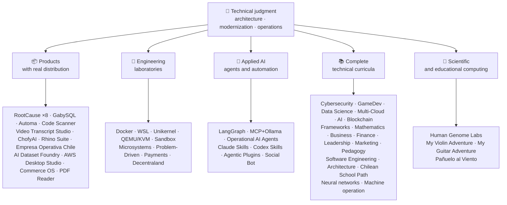

<div align="center">

# 👋Володимир Акуня

## **Архітектор рішення·Старший повний ступінь·Цифрова трансформація·Управління та операції**

**Професійна підготовка до комп’ютерних наук та комп’ютерної інженерії та бізнес-адміністрації, з 16-річним будівництвом та робочим програмним забезпеченням в реальних умовах. Я з'єдную бізнес, люди, процеси та технології проектування, оцінка, постачання та стійкі рішення з технічним судом та оперативним поданням — за рахунок верифікованих доказів у цьому обліковому записі GitHub.**

[](https://vladimiracunadev-create.github.io/)
[](https://www.linkedin.com/in/vladimir-acu%C3%B1a-valdebenito-11924a29/)
[](mailto:vladimir.acuna.dev@gmail.com)

[](#професійний-scope)
[](#продукція-з-реальним-розподілом)
[](#повний-технічний-навчальний-план)

<!-- STATS:START -->
[](https://github.com/vladimiracunadev-create?tab=repositories)
[](https://github.com/vladimiracunadev-create?tab=repositories)
[](#екосистема-на-погляді)
[](#повний-технічний-навчальний-план)
[](https://github.com/vladimiracunadev-create?tab=repositories)
<!-- STATS:END -->

[](https://github.com/vladimiracunadev-create?tab=repositories)
[](https://github.com/vladimiracunadev-create?tab=followers)

[🌐 Portfolio (6 languages)](https://vladimiracunadev-create.github.io/) ·
[🧩 Ecosystem](#екосистема-на-погляді) ·
[⚡ Evaluate me in 10 minutes](#якщо-ви-маєте-10-хвилин-щоб-оцінити-мене) ·
[✅ Professional scope](#професійний-scope) ·
[🧭 Non-coding management](#управління-адміністрування-та-незгодні-можливості-карєри) ·
[📋 Role matrix](PROFESIONAL_ROLES.md) ·
[📬 Contact](#контакти)

**🌐 Повні версії:** [Español](README.md) · [English](README.en.md) · [Português](README.pt.md) · [Italiano](README.it.md) · [Français](README.fr.md) · [简体中文](README.zh.md) · [繁體中文](README.zh-TW.md) · [日本語](README.ja.md) · [한국어](README.ko.md) · [Türkçe](README.tr.md) · [Русский](README.ru.md) · [Tiếng Việt](README.vi.md) · [ไทย](README.th.md) · [Deutsch](README.de.md) · [Українська](README.uk.md) · [Polski](README.pl.md) · [العربية](README.ar.md) · [فارسی](README.fa.md) · [Bahasa Indonesia](README.id.md) · [Nederlands](README.nl.md) · [हिन्दी](README.hi.md) · [Ελληνικά](README.el.md)

**Технічна база:**
PHP 8 · Python · Rust · Go · Node/TS · Java 21 · .NET 8 · Dart/Flutter · WASM
· AWS · Terraform · Kubernetes · Docker · n8n · LangGraph/MCP · CI/CD · FinOps · Observability

**Бізнес-технологій міст:**
аналіз процесів і вимог·оцінка розчину·координація доставки·операції та безперервність·Управління ризиками·продукт і сервіс·техніко-технічна освіта

</div>

---

> [!NOTE]
> Цей профіль не перетворює можливості для досвіду. Визначено технічний досвід, переносні навички, вімкнені програми та цілі майбутнього розвитку. Заявка на GitHub є документальним або документальним, де щось**нема**закінчився, він зазначений таким чином.

## 🎯Що ви знайдете тут

Це не “одна репо”: це екосистема з загальними стандартами.

- 🔁 **Відтворюються демо**— клон, біг, валід.
- 🧰 **Стандартний інструмент**— Макефи, Хаб КЛІ,`doctor`й`smoke`за репозиторію.
- 🛡️ **Захист глибини**— секретне сканування, політики та явно заборонені практики.
- 📈 **Відповідальність** — `/health`, `/ready`, `/metrics`, прилади, прилади,
- 📚 **Аудиторія-програма**— рекрутер, початківця, DevOps, або безпека, в залежності від репозиторій.
- 📦 **Розподіл продуктів**— завантажувальні релізи, контрольні та складові докази; підписи комерційного/магазину, заявлені у разі необхідності.
- 🌍 **Інтернаціоналізація**— портфоліо 6 мов (ES)·СЕРЕДОВИЩА·ПТ·ЦЕНА ЗА ЧАС:·ФОП·ЗХ.
- 🧭 **Технічна чесність**— кожен випадок, позначений`OPERATIONAL`, `DOCUMENTED/SCAFFOLD`або`PLANNED`.

## ✅Вигідний статус

| Промисловість | Бетонні докази |
|---|---|
| 🧪 **Тестове покриття** | ДЖИС**828 тести**+ знезадувається над**503.8M запитів**(0 каструлі)·Оператив Чилі**158 тести** ·Автоматика**150 пітест** ·мульти-OS CI |
| 🤖 **Продукція-градусний агент** | Універсальні інженерні рішення**25/25 оперативних запобіжників**(кейси 01–25, 100% покриття)·Операційні агенти AI**13 агентів**з**39 детермінативних ОВД** |
| 🔗 **Інтеграція поліглоту** | **20 випадків**Надсилання на сайті: http://n8n→receiver**19 операцій**, індивідуально аудитовані Docker-· **18+ ДБ-двигуни** · **20+ контейнерів** ·11 візерунки |
| 📦 **Розсилка** | **151 релізи**через екосистему**64 державних репозиторіїв** ·монтажники та артефакти`.exe` · `.msi` · `.dmg` · `.apk`з контрольними та будівельними доказами; комерційні / зберігати підписи в процесі, де це можливо |
| 🛡️ **Мережа поставок** | КодQL·Семгреп·бензо·Триває·Гріпе·ГІДЛІКИ·Трьох·ЦП-Р·укр |
| 📚 **Культура** | **14530 класи**в порівнянні з 21 програм, підраховані[a workflow](.github/workflows/stats.yml)з реальної репозиторійної структури або в'єтнамського джерела, заявленого в репозиторію, не письмово вручну -·Кожна програма оголошує про своє редакційне становище та обмеження |
| 🌐 **Портфоліо** | Установлений PWA· **6 мов** · **36 PDF-файлів**генерується трубопроводом·API даних CV·конденсатор Android·Маяк 100 |
| 🔒 **Телеметрія** | Телеметрія Zero в судових продуктах і Empresa Operativa Chile — перевірена в кожній збудові (без Android`INTERNET`дозвіл |
| 🌐 **Оприлюднено сайт** | **56 GitHub Веб-сайти**—55 посадок, один за продукт, програму, або екосистемний навігатор, плюс портфель — кожен розгорнутий з власної репозиторій·всі 56 перевірені з HTTP`200` |

## 🗺️Екосистема на погляді



## 📦Продукція з реальним розподілом

Програмне забезпечення, яке завантажується, встановлюється і використовується — не тільки закручена.

| Продукція | Що це таке | Стейк | Доставка |
|---|---|---|---|
| [🔍 **RootCause Windows**](https://github.com/vladimiracunadev-create/rootcause-windows-inspector) | З питань кібербезпеки: кожен аномальний ресурс спотворення може бути першим ознакою загрози. Діагностика спочатку, переплетені пізніше | РУШ🦀 ·ETW/WPR | **в0.19.0** · **16 релізів** · **5 видань**: Інтерфейс·Портфоліо·КЛІ·ЕнергоШелл·Код ВС· [landing](https://vladimiracunadev-create.github.io/rootcause-windows-inspector/) |
| [📱 **RootCause Mobile**](https://github.com/vladimiracunadev-create/rootcause-mobile-inspector) | Мобільний зв'язок: судовий датчик, який порівняє кожну програму проти себе, прапори стебел, і окремі надані дозволи від затребаних | льодяник·Котлін·Сплав | **в0.8.0** ·версифікований Android APK·5 мов· **нульова телеметрія** · [landing](https://vladimiracunadev-create.github.io/rootcause-mobile-inspector/) |
| [🍎 **RootCause macOS**](https://github.com/vladimiracunadev-create/rootcause-macos-inspector) | Видання macOS:`launchd`наполегливість, воротар, SIP, FileVault, XProtect, TCC дозволи, підписані процеси, а також мережеві сусіди — кожна поверхня, що перевіряється на відомий стан | РУШ🦀 ·ОСОБА 13+ | **v0.1.0** ·перший опублікований реліз·Ø2,0 мм· [landing](https://vladimiracunadev-create.github.io/rootcause-macos-inspector/) |
| [🖥️ **RootCause Server**](https://github.com/vladimiracunadev-create/rootcause-server) | Серверний дроб: що не відображається один з одним, не видається поверхні, доступ-привід лопається, сеанс, надана цій же адресі, критичній цілісності файлів і сенсорної тиші, і перетворює його в одну послідовну вирок | РУШ🦀 ·укр·Електронний·ОБМЕЖЕНЬ | **до 1 2 3 4 5+** · **18 правил**з доказами та книжкою·не виконує дії на власній·локальна консоль без залежностей· **немає опублікованого релізу** · [landing](https://vladimiracunadev-create.github.io/rootcause-server/) |
| [🌐 **RootCause Web**](https://github.com/vladimiracunadev-create/rootcause-web-inspector) | Браузера длясенсора: файли cookie, електронні сесії, розширення, завантаження, дозволи та сторінки, які імітують реальне вікно | Електронний документ·Розширення MV3 | **до 1 2 3 4 5+** ·немає опублікованого релізу·панель на`127.0.0.1` ·нульові залежності·нульова телеметрія перевірена на CI· [landing](https://vladimiracunadev-create.github.io/rootcause-web-inspector/) |
| [₿ **RootCause Bitcoin Defense**](https://github.com/vladimiracunadev-create/rootcause-bitcoin-defense) | Переглядайте захист для Bitcoin утримується: запас кожного ключа, перехресні його з опублікованими попередженнями, і пояснюється першопричиною з доказами | Електронний документ·Додаток для Windows·локальна панель | **v0.3.0** · **2 релізи** ·нульові залежності·ніколи не просить насіння·перевірено на CI· [landing](https://vladimiracunadev-create.github.io/rootcause-bitcoin-defense/) |
| [⛓️ **RootCause Blockchain Security**](https://github.com/vladimiracunadev-create/rootcause-blockchain-security) | Багатокамерні годинникові консольи: контракти, проксі, оркеси, місти, управління та залежності, і генерує крос-коучні книжки | Електронний документ·Додаток для Windows·локальна панель | **v0.3.0**в репозиторію·опублікований реліз:`v0.1.0` ·нульові залежності·ніколи не просить приватних ключів·перевірено на CI· [landing](https://vladimiracunadev-create.github.io/rootcause-blockchain-security/) |
| [📷 **RootCause QR Inspector**](https://github.com/vladimiracunadev-create/rootcause-qr-inspector) | Local Android app for inspecting QR codes before acting: explains 26 signals, separates facts from hypotheses, and exports redacted evidence | Flutter · Dart | **v0.1.4** · **5 releases** · **107 tests** · published Android APK · verifiable SHA-256 · technical APK package signature; commercial/store signatures in progress · zero telemetry · [landing](https://vladimiracunadev-create.github.io/rootcause-qr-inspector/) |
| [🏢 **Empresa Operativa Chile**](https://github.com/vladimiracunadev-create/empresa-operativa-chile) | Керівництва SpA від перед перерахуванням на кожен місяць близько: невірність з доказами, ПДВ, переадресація, F29 проект, незмінний закритий і журнал аудиту. Щодо правил на офіційному джерело | Електронний документ·РУШ·ПВА | **в1.5.0** ·АКЦІЇ·укр·укр· **158 тести** · **0 товарних залежностей** ·нульова телеметрія· [landing](https://vladimiracunadev-create.github.io/empresa-operativa-chile/) |
| [🔍 **Universal Code Scanner**](https://github.com/vladimiracunadev-create/universal-code-scanner) | зчитувач QR-коду**Переклади до в.**: 16 сигналів місцевого ризику URL та підтвердження явного підтвердження | льодяник·СЕРЕДОВИЩА | **до 1 2 3 4 5+** ·АКЦІЇ·ОЗЕРА·ОБМЕЖЕНЬ·ПВА·зашифрована історія**АГС-256-ГКМ** · [landing](https://vladimiracunadev-create.github.io/universal-code-scanner/) |
| [🗄️ **GabySQL**](https://github.com/vladimiracunadev-create/gabysql) | Вбудована база даних: один`.db`файл, WAL, оптимізатор на основі вартості, HTTP / JSON API | РУШ🦀 | укр·ОБМЕЖЕНЬ·Електронний· [landing](https://vladimiracunadev-create.github.io/gabysql/) |
| [🤖 **Automa PC**](https://github.com/vladimiracunadev-create/automa-pc) | У програмі: JSON, що відкриваються реальні вікна, взаємодіяти з DOM, і залишити докази | Контактори·Грати·pywebview, веб-сайт | **v0.3.0** · **27 потоків** ·опублікований і віфікований інсталятор· [landing](https://vladimiracunadev-create.github.io/automa-pc/) |
| [🏭 **AI Dataset Foundry**](https://github.com/vladimiracunadev-create/ai-dataset-foundry) | Перша фабрика, яка перетворює PDF, Word, веб, Git, JSON та CSV на аудиторські дані для претренування, тонкотуїнг, RAG та оцінювання | Контактори | **до 1 2 3 4 5+** ·Windows + автономний Android·перший опублікований реліз· [landing](https://vladimiracunadev-create.github.io/ai-dataset-foundry/) |
| [☁️ **AWS Desktop Studio**](https://github.com/vladimiracunadev-create/aws-desktop-studio) | Перший додаток з інтеграції запасних частин 15 AWS, 20 підручників, CLI/SSO та докладно прочитаних за замовчуванням; впровадження в прогрес, не універсальний доступ | Електронний документ·укр | **в0.1.1** ·перший опублікований реліз· [landing](https://vladimiracunadev-create.github.io/aws-desktop-studio/) |
| [🧭 **Commerce OS**](https://github.com/vladimiracunadev-create/commerce-operating-system) | Напрямок концептуальної демо-операції: каталог, склад, CRM, замовлення, буклети та простеження | Електронний документ·Веб-сайт·укр·АКЦІЇ | **v0.3.0** · **2 релізи** ·нема реальних грошей або чилійська податкова система· [landing](https://vladimiracunadev-create.github.io/commerce-operating-system/) |
| [📄 **PDF Reader**](https://github.com/vladimiracunadev-create/pdf-reader-windows-android) | Android-перший локальний зчитувач, без збільшування, перевідкрита історія, обмін WhatsApp та вибір за замовчуванням | укр·Веб-сайт·АКЦІЇ·укр | **в0.3.3** ·Підписано APK·немає рахунків, чутливих дозволів, або телеметрії· [landing](https://vladimiracunadev-create.github.io/pdf-reader-windows-android/) |
| [🎙️ **Video Transcript Studio**](https://github.com/vladimiracunadev-create/video-transcript-studio) | One video, playlist, or **entire YouTube channel** to text with timestamps. It does not rely on existing subtitles: Whisper recognizes audio **on your machine**, with no API, account, or key to configure | Python · PySide6 · FastAPI · faster-whisper | **v0.2.0** · Windows desktop + local panel on `127.0.0.1` + CLI, **sharing the same queue** · MD · PDF · TXT · SRT · VTT · JSON · MP3 · OGG · **89 tests** · bundled FFmpeg · zero telemetry · [landing](https://vladimiracunadev-create.github.io/video-transcript-studio/) |
| [🎨 **ChofyAI Studio**](https://github.com/vladimiracunadev-create/chofyai-studio) | Художній пусковий апарат: оркестри Qwen3-TTS, віскпер.cpp, FaceFusion, AceForge, ComfyUI | Таурі 2·РУШ·Редакція | в0.5.1· **5/5 інструменти з реальною інференцією** ·macOS Apple Кремнієв·експериментальні вікна· **немає опублікованого релізу** · [site](https://vladimiracunadev-create.github.io/chofyai-studio/) |
| [🦏 **Rhino Suite**](https://github.com/vladimiracunadev-create/rhino-suite) | Офісний люкс з нуля: правила документів не залежать від DOM — HTML – це лише проекція | РУС / ВАСМ·Зберегти·Редакція 19 | Еволюція монорепо за фазами· [landing](https://vladimiracunadev-create.github.io/rhino-suite/) |
| [🎻 **My Violin Adventure**](https://github.com/vladimiracunadev-create/violin-adventure) | Навчальний додаток для дітей: хроматичний тюнер, аудіо-розрядний гладдю, пісні з реальною скрипкою | Таурі 2·Редакція·ТСН | **в1.3.0** ·укр·АКЦІЇ·Електронний·ОБМЕЖЕНЬ·ПВА· [landing](https://vladimiracunadev-create.github.io/violin-adventure/) |
| [🎸 **My Guitar Adventure**](https://github.com/vladimiracunadev-create/guitarra-adventure) | Захоплений-string sbling: 24 уроки в 6 світах, 6-string тюнер, бездріжний метроном, і 11 реальних гітарних нот | Таурі 2·Редакція·ТСН | **до 1 2 3 4 5+** ·укр·АКЦІЇ·Електронний·ОБМЕЖЕНЬ·ОЗЕРА·ПВА·немає акаунтів, оголошень або онлайн-відповіді· [landing](https://vladimiracunadev-create.github.io/guitarra-adventure/) |
| [🧣 **Pañuelo al Viento**](https://github.com/vladimiracunadev-create/panuelo-al-viento-cueca-app) | Cueca from age 10: 24 classes in 8 levels, 72 activities, six-pulse lab (3+3 and 2+2+2), and accessible floor diagrams. It states that it **complements, not replaces**, teachers and culture bearers | Flutter · Dart | **v0.2.0** · Android 7+ · Windows 10/11 · APK · EXE · MSI · portable · **29 tests + 2 validators** · no camera, microphone, account, ads, or internet · [landing](https://vladimiracunadev-create.github.io/panuelo-al-viento-cueca-app/) |

## 🧪Інженерні лабораторії

| Репо | Що це демонструє |
|---|---|
| [🐳 **Problem-Driven Systems Lab**](https://github.com/vladimiracunadev-create/problem-driven-systems-lab) | **20 реальних проблем**(додаток на навантаження, N+1, птихи, витоки, моноліти, кеш-пам'яті, зворотній тиск, нульова зміна часу, забутий DLQ) з високою чіткістю ін'єкційних збої, вирішених в**7 стеків**Български, English, Українська...·Контактори·......·Türkçe, English, Русский, Українська...·.NET 8· **Перейти 1.23** · **Русь 1.83** · [landing](https://vladimiracunadev-create.github.io/problem-driven-systems-lab/) |
| [📆 **Social Bot Scheduler**](https://github.com/vladimiracunadev-create/social-bot-scheduler) | **4.10.0 км** · **20 випадків**Джерело→n8n→receiver над**18+ ДБ-двигуни** —**19 операцій**, індивідуально аудитовані Docker-**8-шаровий**аудит, охоронці та демппотенції, вимикачі ланцюга та DLQ· [landing](https://vladimiracunadev-create.github.io/social-bot-scheduler/) |
| [🧰 **Microsistemas**](https://github.com/vladimiracunadev-create/microsistemas) | **12 діагностичних і модернізованих мікрододатків**для PHP·локальний сервер зчитування MCP·загартування в 3 фази· [landing](https://vladimiracunadev-create.github.io/microsistemas/) |
| [🧪 **Docker Labs**](https://github.com/vladimiracunadev-create/docker-labs) | **13 лабораторій**на 4-х сервісній платформі + автоматизований`.exe`монтажник з пусковим пристроєм· [landing](https://vladimiracunadev-create.github.io/docker-labs/) |
| [🐳 **WSL Labs**](https://github.com/vladimiracunadev-create/wsl-labs) | **12 випадків**на`wslc`, рідний двигун контейнера WSL —**без Docker Desktop** · [landing](https://vladimiracunadev-create.github.io/wsl-labs/) |
| [⚡ **Unikernel Labs**](https://github.com/vladimiracunadev-create/unikernel-labs) | “Докер Desktop для unikernels”: Контроль Windows над Unikraft з підтримкою WSL2,`kraft`+ QEMU / KVM· [landing](https://vladimiracunadev-create.github.io/unikernel-labs/) |
| [🧰 **QEMU/KVM Labs**](https://github.com/vladimiracunadev-create/qemu-kvm-labs) | **12 лабораторій**віртуалізації з QEMU, KVM, libvirt, Cloud-init, і`vm-manager`на Linux і WSL2· [landing](https://vladimiracunadev-create.github.io/qemu-kvm-labs/) |
| [🛡️ **Sandbox Labs**](https://github.com/vladimiracunadev-create/sandbox-labs) | Linux ізоляції: працює сторонній код, файли та бізнес-моделі за заявленими політиками та**видає підписані докази, які контролює, фактично застосовуються** · **36 випадків**у двох сім'ях —15 техніко- 21, капітально-маркетингових магазинах —·заявлений експериментальний та навчальний процес, *не є безпечним продуктом *· [landing](https://vladimiracunadev-create.github.io/sandbox-labs/) |
| [💳 **Universal Payments Engineering Lab**](https://github.com/vladimiracunadev-create/universal-payments-engineering-lab) | **28 сімей з виплатами**в локальній самовиправній демо: стани, під керівництвом, розвідувальні роботи, безпека та здійснення інструкцій· [landing](https://vladimiracunadev-create.github.io/universal-payments-engineering-lab/) |
| [🕹️ **Decentraland Social Arcade**](https://github.com/vladimiracunadev-create/decentraland-social-arcade) | Відносний досвід децентраліта і соціального 3D: один MVP і багатогранна архітектура з SDK7, ECS і TypeScript·Іспанська документація·без платежів або телеметрії |
| [☁️ **AWS Projects**](https://github.com/vladimiracunadev-create/proyectos-aws) | Прогресивні випадки, коли кожен додає один сервіс AWS**і**новий GitHub Дія·САА-К03·ДВА-К02·SOA-C02 покриття |

## 🤖Прикладна AI

| Репо | Що це демонструє |
|---|---|
| [🤖 **LangGraph RealWorld**](https://github.com/vladimiracunadev-create/langgraph-realworld) | **25/25 оперативних запобіжників**— типований стан, умовні маршрути, NDJSON потокове відео, DEMO/LIVE режим, 8 шарів безпеки, SHA-256 мережа суваги |
| [🧭 **Operational AI Agents**](https://github.com/vladimiracunadev-create/operational-ai-agents) | **13 operational agents** for Claude Code and compatible runtimes: each receives a complete mission —repository evolution, legacy modernization, curriculum design, portfolio publishing, security remediation, incident analysis— under a declared contract, human gates, and verifiable evidence · **39 deterministic evals** · 34 tests · zero-deps (stdlib only) · Linux · macOS · Windows · [site](https://vladimiracunadev-create.github.io/operational-ai-agents/) |
| [🧠 **MCP + Ollama Local**](https://github.com/vladimiracunadev-create/mcp-ollama-local) | локально-перший AI з інструментами МПК в пісочниці· `127.0.0.1`нижня·багатошаровий профіль довіри·чесність про її межі |
| [🧩 **Agentic Plugins Toolkit**](https://github.com/vladimiracunadev-create/agentic-plugins-toolkit) | **6 агентських плагінів**встановіть код Claude, OpenAI/Codex, Copilot, Gemini та MCP з одного джерела:`repository-engineering`, `legacy-modernization`, `learning-program-studio`, `product-evolution`, `portfolio-governance`й`rootcause-response` · **69 генерованих переглядів без drift**— Вчистий робочий час отримує формат з того ж договору —·нуль-депс·Електронний·ОБМЕЖЕНЬ·укр· [site](https://vladimiracunadev-create.github.io/agentic-plugins-toolkit/) |
| [🧰 **Claude Skills Toolkit**](https://github.com/vladimiracunadev-create/claude-skills-toolkit) | **15 агентських навичок**для коду Claude· **Гарантійне забезпечення**: 12-шаровий`security-audit`(ОСВ·КЄВ·ЕПС·САП·контейнери·секрети) і 14-й стаж`bitcoin-custody-audit` · **РЕМ-БРИ**: `pre-commit-guard`, `pre-push-guard`, `yaml-control`, `md-lint-fix`, `python-lint-guard` · **дружба**: `repo-coherence-audit`, `version-bump`, `python-version-control`, `python-deps-pinning` · **Панчохи**: `docker-cleanup`, `docker-compose-doctor` · **верстка**: `md-to-doc` ·нуль-депс·транзистор |
| [🧰 **Codex Skills Toolkit**](https://github.com/vladimiracunadev-create/codex-skills-toolkit) | **19 діагностичних навичок**для Codex: мережа безпеки та постачання, префлайс, функціональні витрати, резилітенція та стан, докази виходу, py/YAML/Markdown gates, версія, залежності, Docker та документи·Python-перший· `pnpm` ·Електронний·ОБМЕЖЕНЬ·укр· [site](https://vladimiracunadev-create.github.io/codex-skills-toolkit/) |

## 📚Повний технічний навчальний план

Напрями діяльності іспанської мови, з статусом та сферою, що засвідчує кожну репозиторію. 21 програми додано**14530 класи**, підрахунок[a workflow](.github/workflows/stats.yml)з реальної структури репозиторій або в'єтнамського джерела, заявленого в репозиторію; значок освіжає щотижневий і не письмовий вручну.

🧭 [**Lifelong Learning Ecosystem**](https://github.com/vladimiracunadev-create/lifelong-learning-ecosystem)- це федований компас, що поєднує 30 реальних шляхів через 6 зон через візуальні карти та[accessible offline portal](https://vladimiracunadev-create.github.io/lifelong-learning-ecosystem/); не підраховано як додаткова програма.

| Програма | Класи | Промисловість |
|---|---:|---|
| [🔢 **Computational Mathematics**](https://github.com/vladimiracunadev-create/computational-mathematics-program) | 360 | Від підрахунку пальців на пальці, щоб відтворити папір· **360 детермінативних демонстрацій, перевірених на CI** ·1,080 ноутбуки·489-терміновий глянцевий· [site](https://vladimiracunadev-create.github.io/computational-mathematics-program/) |
| [🏦 **Finance and Banking**](https://github.com/vladimiracunadev-create/finance-and-banking-evolution-program) | 356 | 534 ч·Фінансова математика та IFRS → кредит, ризик, Базовий III, відкриті фінанси, DLT, стабільні монети та MiCA· **27 випадків** · **298 тести** · [site](https://vladimiracunadev-create.github.io/finance-and-banking-evolution-program/) |
| [🎮 **GameDev**](https://github.com/vladimiracunadev-create/modern-gamedev-program) | 352 | Математика та C#/C++/GDScript → тіні, AI, мультиплеер, VR/AR·Голос·Зручність·Нереальні· **10 Лабораторія Godot, перевірені на CI**(301 перевірок)· [site](https://vladimiracunadev-create.github.io/modern-gamedev-program/) |
| [🛡️ **Cybersecurity**](https://github.com/vladimiracunadev-create/modern-cybersecurity-program) | 360 | **в1.3.0** ·20 частин·Фундаменти → Red Team, DFIR, хмарна безпека, експлуатувати dev, CTF та безпека ігор·мапа**7 сертифікацій** ·автономний Android / веб-додаток·PDF керівництво·CI, Безпека та перевірені сторінки· [site](https://vladimiracunadev-create.github.io/modern-cybersecurity-program/) |
| [📈 **Marketing, Sales, and Growth**](https://github.com/vladimiracunadev-create/marketing-sales-growth-evolution-program) | 336 | 24 частини з оперативними визначеннями, міркуваннями, врізною бібліографії, та регулятивним контекстом Чиліан· **в1.6.0** ·1.29М слів·17 шляхів на основі ролі· [site](https://vladimiracunadev-create.github.io/marketing-sales-growth-evolution-program/) |
| [🏢 **Business Creation**](https://github.com/vladimiracunadev-create/modern-business-creation-program) | 336 | Створіть і встановіть реальну компанію в Чилі: від ідеї до некорпорації, податкового органу, операцій, кризи та виходу·360 діаграм·1,251-терміновий глянцевий·1,548-сторінок керівництво· [site](https://vladimiracunadev-create.github.io/modern-business-creation-program/) |
| [🏛️ **Architecture and Built Environment**](https://github.com/vladimiracunadev-create/architecture-built-environment-learning-program) | 830 | 83 частини·60 інтегративних сеансів·34 доріжки·простежуються джерела·Відобразити, офлайн зчитувач, і GitHub Сторінки· [site](https://vladimiracunadev-create.github.io/architecture-built-environment-learning-program/) |
| [🇨🇱 **Chilean School Learning Path**](https://github.com/vladimiracunadev-create/chilean-school-learning-path) | 8,841 | 1–12 рр.· **4,156 інтегрованих міжкурсників** · **2,823 цілі навчання** ·Джерела МІНЕДУ·не зажадає пропозицій та спеціалізованих рецензентів, які ще не завадили· [site](https://vladimiracunadev-create.github.io/chilean-school-learning-path/) |
| [🧭 **Modern Software Engineering**](https://github.com/vladimiracunadev-create/modern-software-engineering-program) | 480 | 40 частин і 8 етапів·Основи → продукт, архітектура, безпека, DevOps, SRE, SPEC, AI та багатоагентні системи·Редакційне становище, заявлене репозиторією· [site](https://vladimiracunadev-create.github.io/modern-software-engineering-program/) |
| [🎓 **Pedagogy and Learning Sciences**](https://github.com/vladimiracunadev-create/education-pedagogy-learning-sciences-program) | 300 | Як навчається людина, як навчаються викладачам·25 частин· **Кожен клас визначає стан доказів та ліміти** ·ранніх термінів, порівняльні методи, специфічні навчальні потреби, коексистенція, культурне різноманіття та міжнародні докази·1,097-терміновий глянцевий, 325 діаграми, і 60-активний класний банк·14 кар'єрних шляхів за роль·LMS-експортативний· **v2.1.0** · [site](https://vladimiracunadev-create.github.io/education-pedagogy-learning-sciences-program/) |
| [☁️ **Multi-Cloud**](https://github.com/vladimiracunadev-create/multi-cloud-engineering-program) | 288 | АВС·верстка·ГП·Кубернети·Тераса·СКЛАД·фінолепс· **1 999 час** ·288 лабораторій з доказами JSON·1,032 простежованих джерел·2,884-сторінок PDF керівництво· [site](https://vladimiracunadev-create.github.io/multi-cloud-engineering-program/) |
| [🎖️ **Executive Leadership**](https://github.com/vladimiracunadev-create/executive-leadership-founder-program) | 288 | З власного першого результату, який очолює компанію, і запроваджує власну команду: команди, KPI/OKR, фінанси, продукт, ризик, дошка та M&A·24 випадки, 96 лабораторій, 39 шаблонів· [site](https://vladimiracunadev-create.github.io/executive-leadership-founder-program/) |
| [🐍 **Python Data Science**](https://github.com/vladimiracunadev-create/python-data-science-program) | 232 | Поляри, ML+Optuna/SHAP, PyTorch/LLMs/LoRA, MLOps·English, Українська, Français...· [site](https://vladimiracunadev-create.github.io/python-data-science-program/) |
| [🧠 **AI Evolution**](https://github.com/vladimiracunadev-create/artificial-intelligence-evolution-program) | 184 | Символіка → імовірністичний → глибоке навчання → ЛМС, РАГ, агенти, безпека та передній· **в0.17.0** · **708 блокноти** · **148 Папір фундаментні** ·автономні програми Windows, Android та PWA· [site](https://vladimiracunadev-create.github.io/artificial-intelligence-evolution-program/) |
| [🌐 **Comparative Programming**](https://github.com/vladimiracunadev-create/polyglot-programming-labs) | 176 | Одна концепція,**10 мов**перевірено в CI —**1,360 впровадження**— плюс**1 632 програми**в лівих мовах (COBOL, Fortran, Ada, RPG, MUMPS...) і атлас**60 карток в 15 сім'ях** ·до 1 2 3 4 5+· [site](https://vladimiracunadev-create.github.io/polyglot-programming-labs/) |
| [🧩 **Frameworks Compared**](https://github.com/vladimiracunadev-create/framework-ecosystems-labs) | 149 | Один з найбільш прийнятних контрактів, без адаптерів, проти Експресу, FastAPI, весняного чоботи, ASP.NET, Django, Rails, Laravel, React, Vue, Svelte та багато іншого·12 частин· **70 вбудованих класів** · **397 випадків, перевірені на CI** · **210 ISBN/ДОІ джерела** · [site](https://vladimiracunadev-create.github.io/framework-ecosystems-labs/) |
| [🗄️ **Databases**](https://github.com/vladimiracunadev-create/database-systems-labs) | 74 | **v3.0.0** ·Інженерія бази даних в 15 частинах·230 годин· **джерело для кожного претензії**: 120 джерел з ISBN, DOI, стандартом·односторонній випадок, що вирішило в 27 двигунах·306-терміновий глянцевий·150 пітест· [site](https://vladimiracunadev-create.github.io/database-systems-labs/) |
| [📐 **Psychometrics and Assessment**](https://github.com/vladimiracunadev-create/psychometrics-and-assessment-program) | 40 | Як будується інструмент вимірювання, забитий, перевірений і перевірений·8 частин·керма з виконувальною двигуном**5 інструментів і 344 предметів, 276 громадсько-домен** |
| [⛓️ **Blockchain**](https://github.com/vladimiracunadev-create/blockchain-learning-path) | 66 | **в0.14.0** ·від нуля до програмованої фінансової інфраструктури та аналітики на основі хайнів· **91 практики**і**363 тести** ·контракти з ливарними та варіантами та статичним аналізом на ТПП·автономні програми, перевірені шляхом відкриття бінарних і підрахунку його вмісту· [site](https://vladimiracunadev-create.github.io/blockchain-learning-path/) |
| [🧠 **Neural Network Training Labs**](https://github.com/vladimiracunadev-create/neural-network-training-labs) | 31 | 7 modules · ≈214 hours · **93 notebooks** —31 classes, 31 student versions, and 31 solutions— · questions, visual maps, practices, and assessment with real public data · PyTorch · [study site](https://vladimiracunadev-create.github.io/neural-network-training-labs/) |
| [🕹️ **Machine Operator**](https://github.com/vladimiracunadev-create/machine-operator-program) | 451 | **41 модулів навчання**, один за машиною· **502 ч 15 хв** ·системи, контрольні системи, фізика, безпека та імітаційний дизайн з джерелами на клас·*не виконавний тренажер, але і він продекларований таким чином* |

## 🔬Науковий склад

| Репо | Що це демонструє |
|---|---|
| [🧬 **Human Genome Labs**](https://github.com/vladimiracunadev-create/human-genome-labs) | Репродуктивна платформа геноміки: типd`ScientificResult<T>`контракти, FASTA/GFF3/VCF, модулі з**чітке зрілість і докази**. Радична чесна: * Чи не виконує клінічну діагностику*· [site](https://vladimiracunadev-create.github.io/human-genome-labs/) |

## ⚡Якщо ви маєте 10 хвилин, щоб оцінити мене

Ідея не просто подивитися на код: це подивитися**Як я думаю**, як я документ, і як я зробити все прийнятним.

**Маршрут А — Реал спостережності та оркестрування***(my улюблений)*

```bash
git clone https://github.com/vladimiracunadev-create/social-bot-scheduler.git
```

Ви побачите робочі процеси, метрики, прилади, охоронці по 19 корпусах та 18+ ДБ-двигунів.

**Маршрут B — Відповідна інфраструктура за хвилину**

```bash
git clone https://github.com/vladimiracunadev-create/docker-labs.git
```

**Маршрут С — Агенти з типом**

```bash
git clone https://github.com/vladimiracunadev-create/langgraph-realworld.git
```

**Маршрут D — Rust forensic продукт, без склінінгу**

Завантажити інсталятор або CLI бінарні з[RootCause releases](https://github.com/vladimiracunadev-create/rootcause-windows-inspector/releases)і перевірка`SHA256SUMS`.

## 🧠Стандарти, які я застосовую в усіх репозиторіях

- **DX перший**— якщо це не просто, не корисно як демо, так і як командна база.
- **Спостереження за днем 1**— метрики і слідованість, не післясумка.
- **Безпека як трубопровод**— секретне сканування, SBOM за випуск, явно заборонені практики.
- **Реальна резистентність**— ідемпотенція, вимикач, контрольний деградація.
- **Поліглот за проектом**— мова та двигун, вибраний за допомогою кейсу, ніколи не модним.
- **Хонсти про статус**— одна репо була перейменована (`Multisimulador` → `machine-operator-program`) щоб уникнути перспективних програм, які ще не існує.
- **Значки сигнальні, не докази**— кожен репо також проголошує**що це не робить**.
- **Модель поза**— домен розроблений першим; інтерфейс – проекція.
- **Зовнішня робота продекларована як зовнішнім**— 70 публічних репозицій, 64 — це моя робота. Друге шість —[`agentic-qe`](https://github.com/vladimiracunadev-create/agentic-qe), [`Anthropic-Cybersecurity-Skills`](https://github.com/vladimiracunadev-create/Anthropic-Cybersecurity-Skills), [`erpnext`](https://github.com/vladimiracunadev-create/erpnext), [`OpenExecutive`](https://github.com/vladimiracunadev-create/OpenExecutive), [`raptor`](https://github.com/vladimiracunadev-create/raptor)й[`security-audit-skill`](https://github.com/vladimiracunadev-create/security-audit-skill)— вилки і виключені з усіх фігур для своєї роботи.

## ✅Професійний Scope

Мій подвійний фон —**Комп'ютерна наука та обчислювальна інженерія + бізнес-адміністрування**— допомагає перевести цілі бізнесу в технічні рішення та технічні обмеження в чіткі параметри операцій, товарів, клієнтів та керівництва.

### 🎯Назва ядра

| , , , , , , , , , , , , , , , , , , , , , , , , , , , , , , , , , , , , , , , , , , , , , , , , , , , , , , , , , , , , , , , , , , , , , , , , , , , , , , , , , , , , , , , , , , , , , , , , , , , , , , , , , , , , , , , , , , , , , , , , , , , , , , , , | Зареєструватися |
|---|---|
| **Архітектор рішення** | Модульний, масштабований дизайн системи з еволюцією |
| **Архітектор з модернізації спадщини** | Реальна еволюція спадщини (PHP 5.x→8.x, неперервне рефакторинг без перервних операцій) |
| **Старший повний набір / Tech Lead** | Архітектура, виконання та стандарти на реальних платформах (+16 років) |
| **Архітектор AI Automation** | Агентичні системи з LangGraph/MCP та n8n потоки з охороною |

### ↗ Природне розширення

**Інженер з оркестру AI** · **Системи / Інженер-рум** · **Мобільний інженер (Flutter)** · **Інженер-консультант з питань автоматизації** · **Технічний конструктор продуктів** · **Технічний тренер** · **Консультант з цифрової трансформації** · **Бізнес / Функціональний аналітик** · **Технічні продукти**

### ⚙️Додаткова сфера

Інженер-платформа / ВПО·Демопс / CI-CD·Хмар / інженер AWS·Додаток SRE·Інженер з автоматизації·Технічно-комерційний консультант

## 🧭Управління, адміністрування та незгодні можливості кар'єри

Цей обсяг не вимагає, щоб кожен заголовок був проведений. Передбачає роботу, де поєднання обчислень, управління бізнесом та публічних доказів може створювати значення без кодування, що є основним обов’язком.

| Професійне сімейне | Визначені ролі | Класифікація гонесту | магазини | Відданість і стан |
|---|---|---|---|---|
| **Керівництво по технології** | Керівник ІТ·Менеджер з ІТ-операцій·Менеджер з цифрової трансформації·БІО | **Мета програми / майбутні цілі** | Невідома | Сильна технічна база; люди, бюджет, постачальник та виконавча відповідальність повинні бути доведені окремо |
| **Управління проектами** | Координатор проекту IT/менеджер·ПМО·Скрам Мастер·Agile Доставка | **Передача / потенціал застосування** | Невідома | Відповідальність за за охорону та видачу; |
| **Управління бізнесом** | Адміністратор бізнесу·Менеджер з адміністрування/операцій·Адміністратор контракту | **Можливості застосування** | Ні | Бізнес-клас та оперативні артефакти; потреби перевірених право власності на ресурси, люди та постачальники |
| **Стратегія та зміни** | Консультант з питань стратегічного розвитку·Менеджер з питань зміни·Корпоративне планування·Інновації / Трансформація | **Передача / потенціал застосування** | Ні | Аналіз результатів організаційного прийняття слід продемонструвати |
| **Бізнес-аналіз** | Бізнес-аналітик·Функціональний/вимагає аналітика·БПМ·Безперервне поліпшення | **Передача / потенціал застосування** | Невідома | Доменне моделювання та вимоги до вимог; зовнішні випадки, що затримуються, посилить позов |
| **Продукція та сервіс** | Власник продукту / менеджер·Продукція·Доставка послуг·Успіх клієнтів | **Передача / потенціал застосування** | Невідома | Дорожні карти, життєвий цикл, релізи та операції; P&L, портфоліо клієнтів та SLA докази залежать від ролі |
| **Управління кібербезпекою** | КРОК·IT-аудитор·Технологічний ризик·Безпека інформації / безперервність | **Можливості застосування** | Невідома | Контроль та визначення кореневих даних; організаційні перевірки та відповідні критерії |
| **Продаж комерційної нерухомості** | Технології передпродажу·Консультант з питань вирішення спорів·Технічна інформація·B2B бізнес-розробник | **Передача / потенціал застосування** | Ні | Сильний переклад/значення; квоти, портфоліо рахунку та договірне переговорів не заявлені |
| **Finance and management control** | Budget/Cost Analyst · Project Evaluation · FP&A · Management Control | **Application potential** | None | Finance/FinOps artifacts; real budgets, financial statements, and corporate KPIs are needed |
| **Якість** | Аналіз процесів / якості·Процес аудитор·Безперервне поліпшення | **Передача / потенціал застосування** | Невідома | Шлюзи, тести, метрики та відтворюваність; формальна власність системи якості залишається зазором |
| **Освіта** | Технічний тренер·Фахівець·Академічний координатор·EdTech / Інструкції | **Передача / потенціал застосування** | Невідома | 21 програми та 14530 класи; формальні результати навчання та навчання повинні бути свідченими окремо |
| **Логістика та постачальники** | Закупівля·Координатор з постачання/операцій·Менеджер з продажу | **Можливості застосування** | Ні | Необхідні роботи з купівлі-продажу, інвентаризації та експлуатації постачальника |
| **Управління даними та AI** | Стюардеса даних·Управління даними·АІ-Прийняти / Впровадження | **Передача / потенціал застосування** | Невідома | Аудиторські дані та агенти з людськими гілками; організаційні політики та комітети залишаються зазорами |
| **Громадська галузь** | Інституційне модернізація·Координатор з питань КТ·цифрові проекти·Громадське планування | **Можливості застосування** | Ні | Чиліан-контекстові системи та слідованість; досвід публічних закупівель та секторів не заявлений |

Мистецтво[full Spanish role matrix](PROFESIONAL_ROLES.md)деталі, обов'язки, досвід ринку, доповнює знання, докази, сумісність і проміжки по всій сім'ї 14.

## 🤖Процес розробки за допомогою ШІ

| КОМПЛЕКС | Головна |
|---|---|
| **Код товару** | Архітектурний огляд, впровадження та технічна документація |
| **ЧаГП плюс** | Аналіз, архітектура, ітерація (з 2023) |
| **Кодx** | генерація та рефакторинг коду |
| **Антигравітність** | Прискорення процесів розробки та автоматизації |
| **Код ВС / OpenCode** | Навколишнє середовище з інтегрованою службою AI |

> Я поєдную власний технічний суд, вірування людини та архітектурний напрямок. Амплітує продуктивність, швидкість та досягне — це не замінює досвід.

## 📌Наявність

**Відкрито:**Старший повний ступінь·Мистецтво·модернізація спадщини·Платформа/IDP·Додаток SRE·регматичний DevOps·Автоматика·Автоматизація AI·бізнес-процеси·Організація проекту IT·Продукція·цифрова трансформація·консалтинг / продаж·техніко-технічна освіта·якість і безперервне вдосконалення·Імплементація та управління AI

**Оцінено за кожним напрямком ролі:**Менеджер з продажу / технічний менеджер·Доставка послуг·ІТ-операції·ГРК / технологічний ризик·адміністрування та операції·контроль управління·модернізація громадського сектору. Виконавчі та загальні заголовки є майбутніми досягненнями розвитку, не заявленими досвідом.

**Модальність:**дистанційно або гібридні, в залежності від проекту.

## 📬Контакти

[](https://vladimiracunadev-create.github.io/)
[](https://www.linkedin.com/in/vladimir-acu%C3%B1a-valdebenito-11924a29/)
[](https://gitlab.com/vladimir.acuna.dev-group/vladimir.acuna.dev-group)
[](mailto:vladimir.acuna.dev@gmail.com)

---

<div align="center">

[🤝 Contribute](CONTRIBUTING.en.md) ·
[🛡️ Security](SECURITY.en.md) ·
[⚖️ Code of Conduct](CODE_OF_CONDUCT.en.md)

<sub>синхронізований з верифікованим станом публічних репозицій — дивізії та зміни, які прочитаються за допомогою API—·Остання перевірка: 12 жовтня 2026 р.</sub>

</div>
